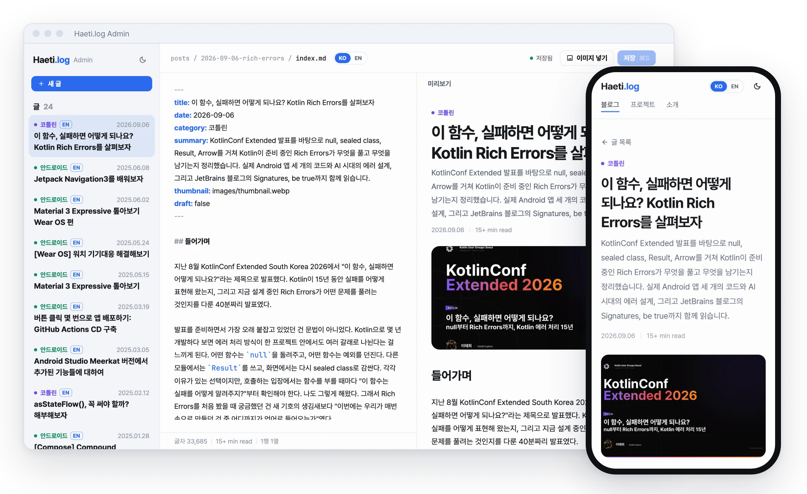
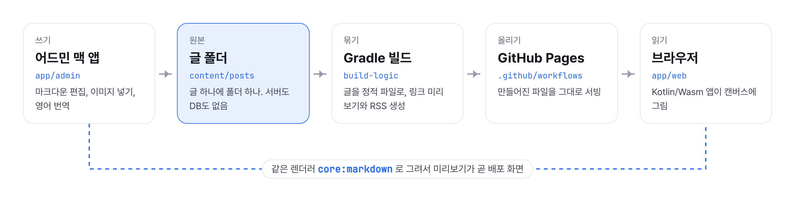
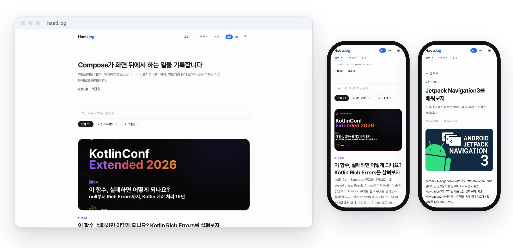
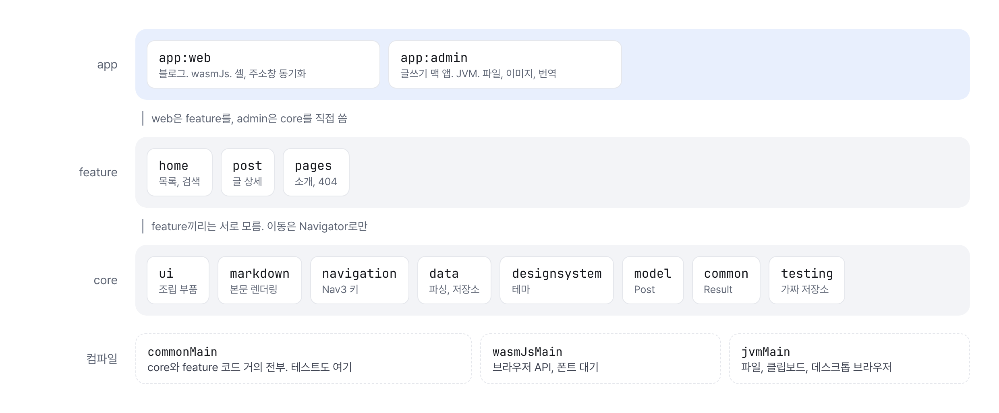
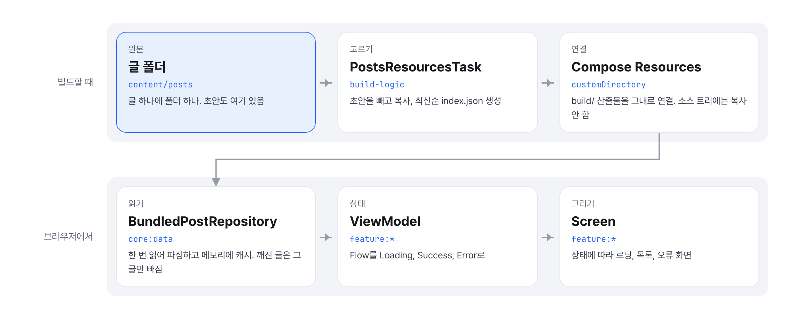

<p align="center">
  <picture>
    <source media="(prefers-color-scheme: dark)" srcset="design/icon/mark-dark.svg">
    
  </picture>
</p>

<h1 align="center">Haeti.log</h1>

<p align="center">Compose Multiplatform으로 만든 기술 블로그와 글 작성용 어드민 데스크톱 앱</p>

<p align="center">
  <!-- 배포 후 사이트 주소를 맨 앞에 둔다 -->
  <a href="docs/ARCHITECTURE.md">아키텍처</a> &nbsp;|&nbsp;
  <a href="docs/DESIGN.md">디자인 시스템</a> &nbsp;|&nbsp;
  <a href="docs/PUBLISHING.md">글 발행 가이드</a>
</p>

<picture>
  <source media="(prefers-color-scheme: dark)" srcset="docs/readme/hero-dark.webp">
  
</picture>

<br>

Compose Multiplatform으로 직접 만든 기술 블로그입니다. Android에서 쓰던 Compose로 웹과 데스크톱 앱까지 만들어 보는 것을 목표로 했습니다.

- **블로그**는 Kotlin/Wasm으로 컴파일되어 브라우저 캔버스에 렌더링됩니다.
- **어드민**은 글을 작성하는 Compose Desktop 앱(macOS)입니다. 블로그와 같은 렌더러를 쓰기 때문에 미리보기가 실제 블로그 화면과 같습니다.
- **서버와 DB가 없습니다.** 글은 저장소의 마크다운 파일로 관리하고, 빌드 결과물을 GitHub Pages에 배포합니다.

<picture>
  <source media="(prefers-color-scheme: dark)" srcset="docs/readme/flow-dark.png">
  
</picture>

## 화면

<picture>
  <source media="(prefers-color-scheme: dark)" srcset="docs/readme/screens-dark.webp">
  
</picture>

라이트/다크 모드와 데스크톱/모바일 레이아웃을 지원합니다. 글 24편 모두 영어 번역이 있고, 검색, 카테고리 필터, 이미지 확대, 유튜브 임베드, 본문 텍스트 복사, 링크 미리보기(OG), RSS를 지원합니다.

## 아키텍처

<picture>
  <source media="(prefers-color-scheme: dark)" srcset="docs/readme/modules-dark.png">
  
</picture>

app, feature, core 세 계층으로 나눴고, core와 feature는 같은 코드를 jvm과 wasmJs로 함께 컴파일합니다.

<picture>
  <source media="(prefers-color-scheme: dark)" srcset="docs/diagrams/pipeline-dark.png">
  
</picture>

글은 빌드할 때 앱 리소스로 묶이고, 브라우저에서는 저장소가 한 번 읽어 캐시한 글을 ViewModel과 화면이 그립니다.

설계 기준과 결정 배경(글 저장 방식, 어드민, 캔버스의 한계를 채운 방법, DI와 내비게이션 선택, 번역 확인, 테스트)은 [docs/ARCHITECTURE.md](docs/ARCHITECTURE.md)에 정리했습니다.

## 기술 스택

| 분류 | 사용 기술 | 선택 이유 |
|---|---|---|
| UI | Compose Multiplatform 1.12 (Wasm, Desktop) | 블로그와 어드민을 하나의 코드베이스로 개발 |
| 언어 | Kotlin 2.4 | jvm, wasmJs 멀티플랫폼 |
| DI | [Metro](https://github.com/ZacSweers/metro) 1.4 | 컴파일 타임 의존성 그래프 검증, Kotlin/Wasm 지원 |
| 내비게이션 | Navigation 3 | 백스택을 직접 관리할 수 있어 URL과 1:1로 맞추기 쉬움 |
| 상태 관리 | Lifecycle ViewModel, StateFlow | Android와 같은 패턴 유지 |
| 마크다운 | [multiplatform-markdown-renderer](https://github.com/mikepenz/multiplatform-markdown-renderer) | 문단, 이미지, 코드 블록, 콜아웃을 커스텀 컴포넌트로 교체 |
| 빌드 | build-logic 컨벤션 플러그인, 커스텀 Gradle 태스크 | 모듈 설정 통일, 글 리소스와 배포 파일 생성 |
| 테스트 | kotlin-test, Turbine | 공유 모듈은 commonTest를 JVM에서, 어드민과 빌드 로직은 JVM 테스트로 실행 |
| 배포 | GitHub Actions, GitHub Pages | 정적 파일만으로 운영 |

## 실행 방법

JDK 17 이상이 필요합니다. JDK 21은 Gradle이 자동으로 내려받습니다.

```bash
./gradlew :app:web:wasmJsBrowserDevelopmentRun   # 블로그 개발 서버 (localhost:8080)
./gradlew :app:admin:run                         # 어드민 앱 실행
./gradlew :app:admin:installAdminApp             # 어드민 앱을 ~/Applications에 설치
./gradlew jvmTest                                # 공유 모듈(core, feature) 테스트
./gradlew build                                  # 전체 빌드와 모든 테스트
```

Android Studio에서는 위 태스크를 Gradle Run Configuration으로 등록해 실행할 수 있습니다. 블로그는 Kotlin/Wasm이 WasmGC를 사용하기 때문에 Safari 18.2, Chrome 119, Firefox 120 이상에서 동작합니다.

## 문서

- [ARCHITECTURE.md](docs/ARCHITECTURE.md): 모듈 구조, DI, 내비게이션, 데이터 흐름, 결정 배경
- [DESIGN.md](docs/DESIGN.md): 컬러, 타이포그래피, 컴포넌트 규칙
- [PUBLISHING.md](docs/PUBLISHING.md): 글 작성부터 번역, 배포까지
