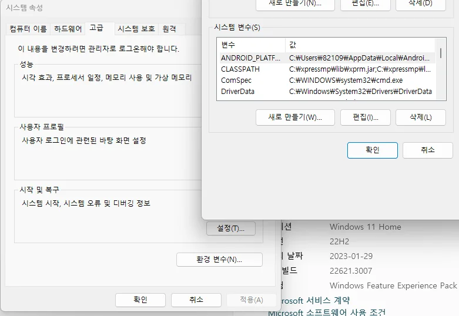
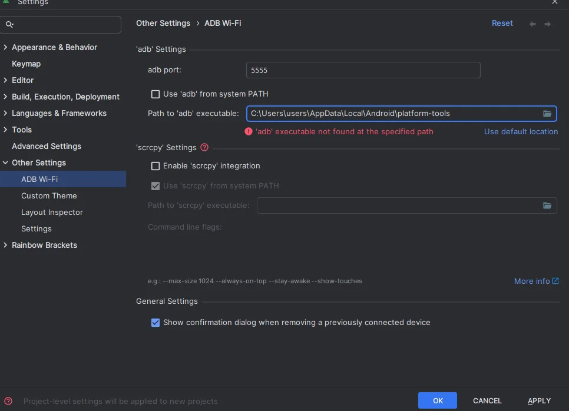
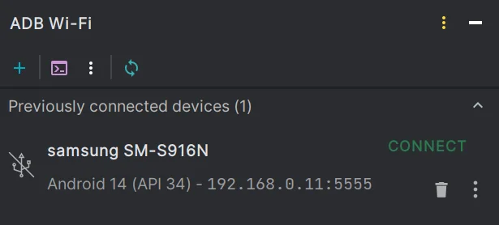

## 문제

해당 플러그인을 통해 와이파이로 무선 디버깅을 편하게 하려 했다.

[ADB Wi-Fi - IntelliJ IDEs Plugin | Marketplace](https://plugins.jetbrains.com/plugin/14969-adb-wi-fi)

> **Getting Started**

1. Connect an Android device via USB cable.
2. Open the "ADB Wi-Fi" Tool Window (in the right-bottom corner).
3. Click the "Connect" button.
4. After a successful connection, you can unplug the USB cable.

위 방법대로 진행하려 했으나, ADB Wi-Fi Tool을 Open해도 기기가 보이지 않고

```kotlin
adb executable not found at the specified path
```

라는 문구만 발생해서 열심히 구글링을 하였다.

문제를 살펴보니 아래 두 가지 원인이 있어보였다.

1. ADB가 설치되어있지 않다.
2. ADB가 환경변수 Path에 등록되어 있지 않다.
3. adb가 설치된 경로가 인식되어 있지 않다.

## 해결과정

1번의 경우 평상시 에뮬레이터를 자주 사용했으니 ADB가 설치가 안되어 있을리가 없다 판단하고 2번 방법을 서칭하여 작용해보았다.

{width=100 align=center}

환경 변수를 편집하고 재시작하고 다시 시도했으나 여전히 문제는 지속되었다.

{width=100 align=center}

알고보니 해당 플러그인의 Setting에서 Adb의 경로가 잘못 지정되어 있어서 알맞게 변경하였더니 플러그인이 잘 적용되었다.

{width=90 align=center}

이제 별도의 연결 없이도 동일한 Wi-Fi에 접속해 있다면, 편하게 무선으로 기기를 연결할 수 있게 되었다!
