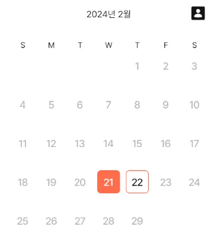

## The problem

{width=50 align=center}

Tapping a cell (DayItem) in my calendar triggers a ripple effect, and that ripple spills past the cell's border. So I set out to get rid of it.

(I gave the cell a rounded border and shape, yet tapping it still produced a square ripple. I have no idea why yet, so that's something to dig into later.)

### The original code

```
Card(
		shape = RoundedCornerShape(6.dp),
		colors = CardDefaults.cardColors(
                    containerColor = when {
                        isToday -> MaterialTheme.colorScheme.primary
                       else -> MaterialTheme.colorScheme.background
                       },
                   ),
		border = BorderStroke(
                                1.dp,
                                if (isSelected) MaterialTheme.colorScheme.primary else Color.Transparent,
                             ),
                modifier = modifier
                    .aspectRatio(1f)
                    .alpha(if (!isCurrentMonth) 0f else 1f)
                    .clickable(
                        enabled = isCurrentMonth,
                        onClick = { onDayClick(date) },
                        )
```

It's a fair amount of code, but here's all this Card does:

- It has a border and shape rounded by 6dp
- Its containerColor and border color change depending on state
- It's only clickable if the date belongs to the month you're viewing (on the February calendar, tapping a hidden January date does nothing)

## Attempt 1: adding indication = null

```kotlin
.indication(
                    interactionSource = remember { MutableInteractionSource() },
                    indication = null
                )
```

- `clickable` no longer had an `indication` parameter.
- So I added `Modifier.indication` to the `modifier` instead.
  - First, create an `interactionSource` object to track user interactions.
  - Then set `indication`, which is what draws the visual feedback, to `null`.

⇒ With the current Jetpack Compose version, setting indication to null doesn't remove the ripple.

## Attempt 2: replacing `clickable()` with `pointerInput()`

```kotlin
.pointerInput(Unit) {
            detectTapGestures { offset ->
                if (isCurrentMonth) {
                    onDayClick(date)
                }
            }
```

- I replaced the original `.clickable()` with `pointerInput()`, which detects and handles touch events.
- Then I called `detectTapGestures` to handle the gesture I wanted.

⇒ The ripple was gone, but as soon as I moved to another month, the items stopped responding to taps entirely.

## Attempt 3: applying a NoRippleTheme

```kotlin
private object NoRippleTheme : RippleTheme {
    @Composable
    override fun defaultColor() = Color.Unspecified

    @Composable
    override fun rippleAlpha() = RippleAlpha(0.0f, 0.0f, 0.0f, 0.0f)
}
```

- It's only used in this one file, so I made it a private object.
- It sets the default `Color` to `Unspecified` and every `Alpha` value to 0.0f.

```kotlin
CompositionLocalProvider(
        LocalRippleTheme provides NoRippleTheme,
    ) {
			Card ...
```

- I wrapped the code that holds the Card in a `CompositionLocalProvider` that provides `NoRippleTheme`, which removed the ripple.

=\> It worked fine on a real device, but not when I ran it on an API 33 emulator.

## The fix: a NoRippleClickable extension function

```kotlin
inline fun Modifier.noRippleClickable(


 modifier: Modifier = Modifier,


    crossinline onClick: () -> Unit,
): 
Modifier = composed {
    clickable(
        indication = null,
        interactionSource = remember { MutableInteractionSource() },
    ) {
        onClick()
    }
}
```

- I declared it as an `inline` function to cut down on call overhead. The compiler inserts an `inline` function's body directly at each call site.
- The `crossinline` keyword forbids non-local returns from the lambda.
- It applies a `clickable Modifier` that turns off the ripple and adds a `MutableInteractionSource` to track the user's interaction state.
- Finally, it runs the `onClick` lambda that was passed in.

```kotlin
modifier = modifier
                .aspectRatio(1f)
                .alpha(if (!isCurrentMonth) 0f else 1f)
                .noRippleClickable(
                    onClick = { if (isCurrentMonth) onDayClick(date) else null },
                ),
```

⇒ I swapped this extension function in where `clickable` used to be, and now it works on both real devices and the emulator.

### What I learned

If I'd been a bit more careful with my first idea, passing `indication` to the existing `clickable`, I think that alone would have fixed it. Then again, with reuse in mind, building an extension function from the start would have been the better move.

Fixing this taught me about the three kinds of Card, and about how `clickable` and `indication` work.

I still want to dig into why the ripple didn't behave the way I expected in the first place.

### Further reading

[Jetpack Compose Card - Jetpack Compose World](https://jetpackcomposeworld.com/jetpack-compose-card/)
