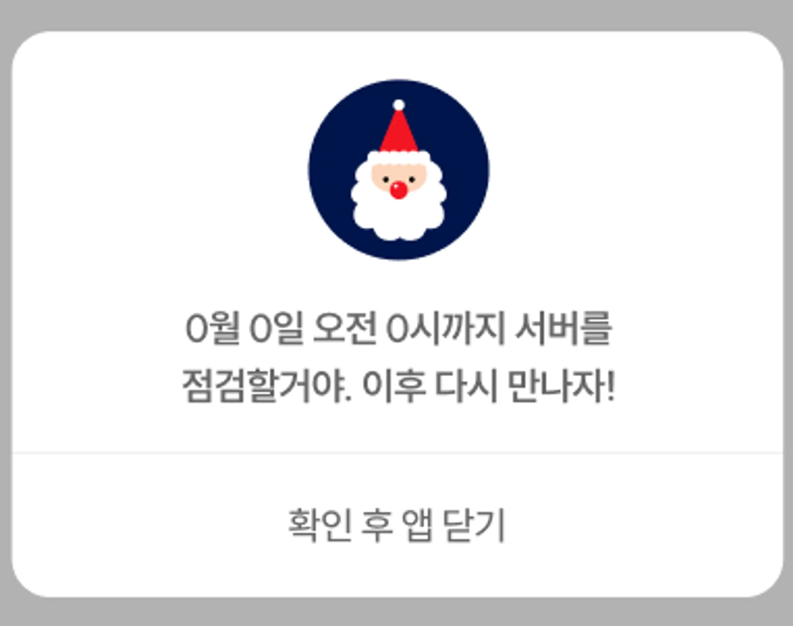
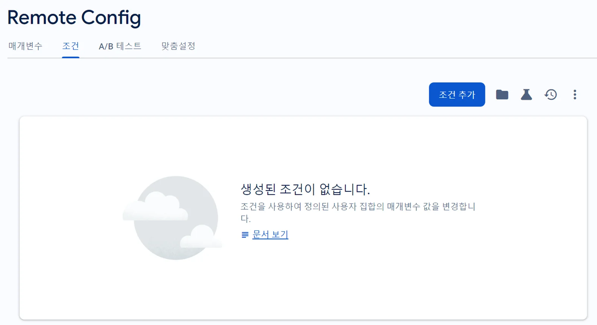
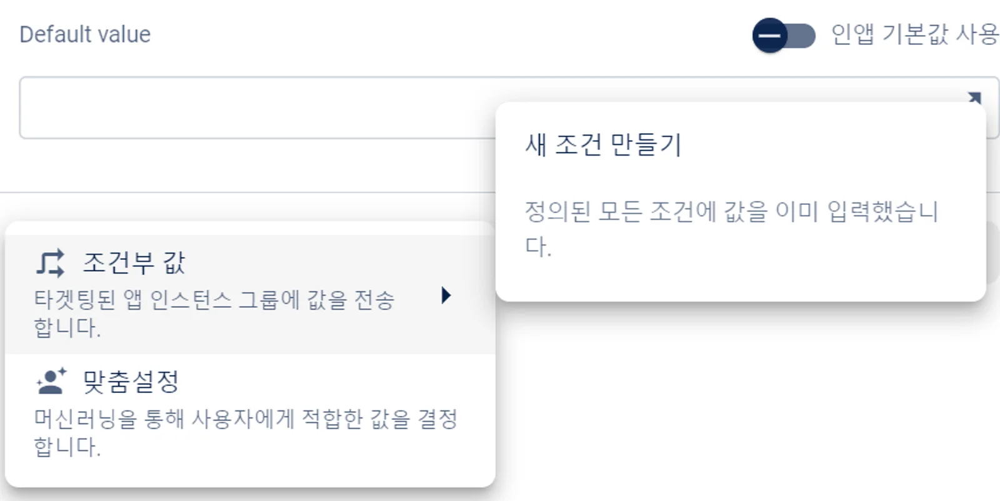
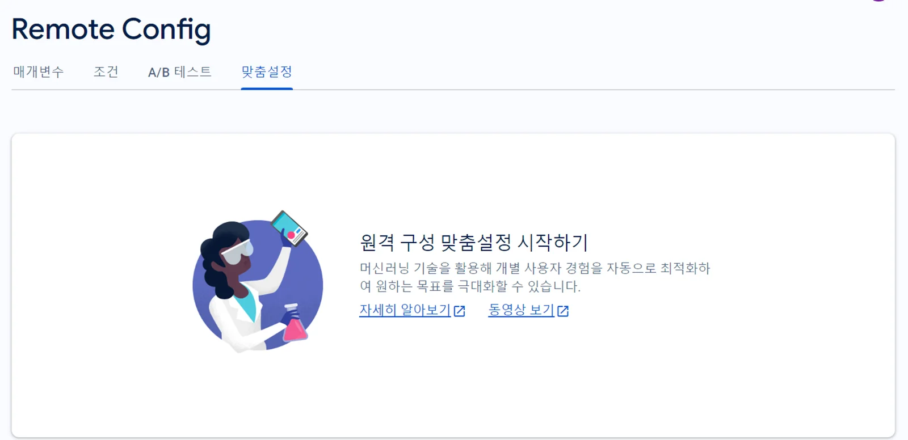
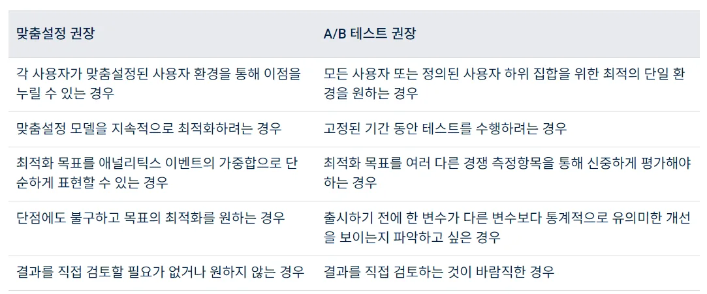
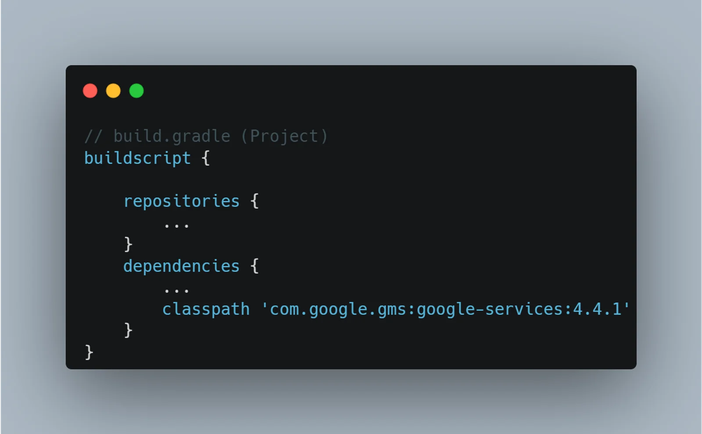
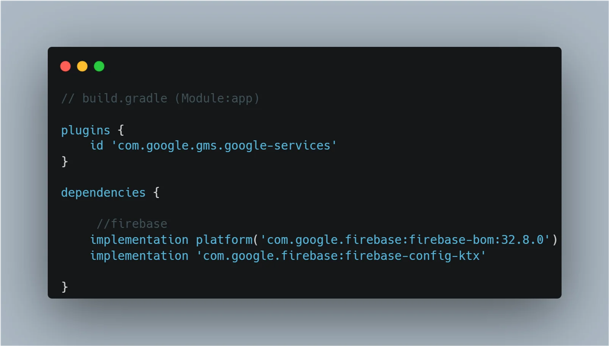
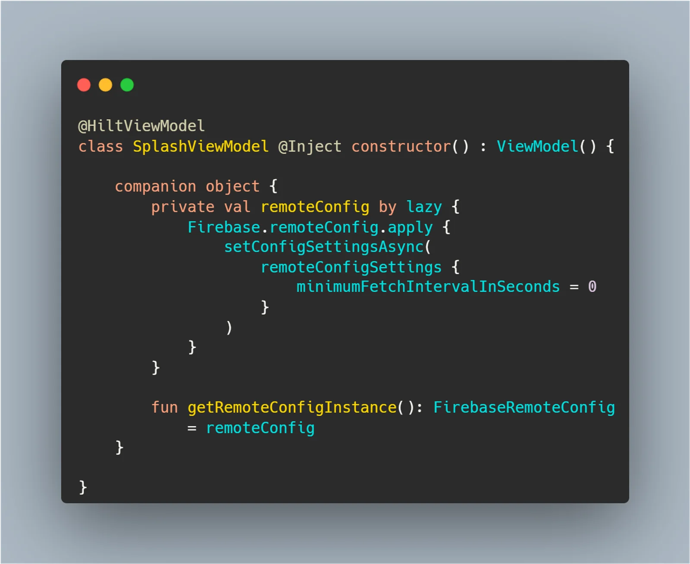
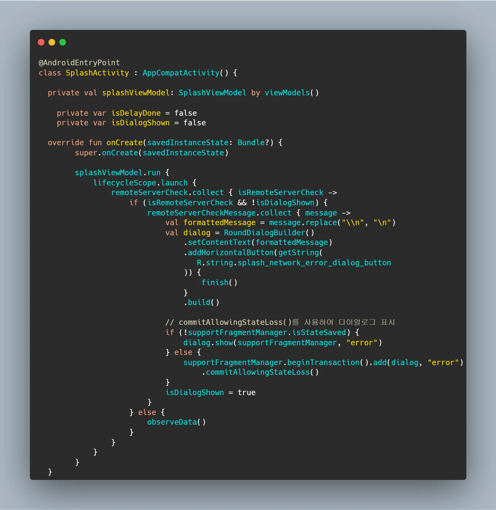

\[산타마니또\] 라는 사이드 프로젝트를 하다 서버 점검 시 팝업을 노출시키는 이슈를 할당 받았다. 여기서 말하는 팝업은 안드로이드에서 Dialog를 뜻하고, 해당 content Text는 서버 개발자에 의해서 동적으로 변경되어야 했다.

{width=100 align=center}

**기존에는 SplashActivity 진입 시 서버 점검 유무를 확인하는 API콜을 하고 response를 받아서 작업을 하는 방식을 했으나, 산타 마니또 팀에서는 Firebase remote config를 통해 서버 점검 관리를 하고 있어서 Firebase remote config에 대해 알아보았다**.

## Firebase remote config란?

> **Firebase Remote Config는 앱의 동작과 모양을 변경하도록 사용자를 대상으로 설정 값을 변경할 수 있는 클라우드 서비스입니다. 이를 통해 앱을 사용하는 사람들에게 다른 경험을 제공하거나 테스트 그룹을 설정하여 앱의 새로운 기능을 테스트할 수 있습니다. 또한, 앱의 새로운 버전을 출시하고자 할 때, Remote Config를 사용하여 이전 버전의 앱을 지원하거나 특정 기능을 비활성화 할 수 있습니다**.
>
> \- **출처** : [**https://firebase.google.com/docs/remote-config?hl=ko**](https://firebase.google.com/docs/remote-config?hl=ko)

**즉, 별도의 앱 업데이트 없이도 사용자에게 변화하는 정보를 제공할 수 있는 개념이다. 성능에 거의 영향을 주지 않고 적용되는 시점을 개발자가 쉽고 자유롭게 설정이 가능해, 개발자의 리소스가 부족한 상황에서 최적의 기능이라고 생각한다**.

**Firebase Remote Config를 통해서 아래와 같은 기능들을 사용할 수 있다**.

- **단순한 매개변수 값 변경 (레이아웃, Theme, String, JSON, Boolean**)
- **특정 세그먼트에 맞춤 설정**
- **머신러닝을 통한 맞춤 이벤트 최적화**

**위 기능들을 어떻게 사용하면 좋을지 하나씩 알아보겠다**.

### 단순한 매개변수 값 변경

**산타 마니또 사이드 프로젝트에서 맡은 이슈인, 서버 점검 시 팝업 노출을 예시로 들어 설명하겠다**.

**Firebase remote config**에서 위와 같이 문자열, 숫자, Boolean, JSON 값을 담고 있는 매개변수들을 생성할 수 있다. 이제 이 매개변수를 통해 서버 점검 유무를 나타내는 Boolean 매개 변수 하나와 서버 점검 시 어떤 텍스트를 팝업에 노출 시킬 지 결정하는 문자열 매개변수 하나를 만들 수 있다.

앱 시작 시 서버 점검 유무를 나타내는 변수를 가져와서 그 변수가 true이면 만들어둔 문자열 매개변수에서 텍스트를 가져와 팝업 콘텐츠에 담을 수 있을 것이다.

이외에도 복잡한 데이터를 JSON과 Boolean 매개 변수들을 통해 상황에 따라 사용자에게 맞춤하여 사용할 수 있을 것으로 보인다.

### 특정 세그먼트 맞춤 설정

[원격 구성 매개변수 및 조건  |  Firebase Remote Config](https://firebase.google.com/docs/remote-config/parameters?hl=ko&authuser=0&_gl=1*16e4wsr*_ga*MTE2Njg4NTEyOC4xNzExODY4OTI2*_ga_CW55HF8NVT*MTcxMzE1MTUzMi4xMS4xLjE3MTMxNTQwMDguNjAuMC4w#conditions_rules_and_conditional_values)

특정 사용자 층(세그먼트)에게만 다른 정보를 부여할 수 있다. 예를 들어 국가별로 다른 문자열을 배포한다던지, Android 사용자에게만 긴급 업데이트를 배포할 수 있다.

또한 모든 사용자 층에게 어떠한 업데이트를 배포하기 전 **A/B 테스트**를 통해 어느정도의 결과가 도출되었는지 확인할 수 있다. [**A/B 테스트**](https://firebase.google.com/docs/ab-testing/abtest-config?hl=ko&_gl=1*pfzswz*_up*MQ..*_ga*NTMwOTUwODMxLjE3MTMxNjAzNjM.*_ga_CW55HF8NVT*MTcxMzE2MDM2My4xLjAuMTcxMzE2MDM2My4wLjAuMA..)란 두 가지 이상의 변수를 비교하여 효과적인 변수를 선택하는 통계적 방법이다. 이 방법은 웹사이트 또는 앱의 사용자 경험 디자인을 테스트하고 개선하는데 널리 사용된다. 예를 들어, 웹사이트에서 사용자가 더 많이 클릭하는 버튼 색깔, 더 많은 사용자 참여를 이끌어내는 홈페이지 레이아웃 등을 결정하는 데 사용될 수 있다. 이 방법을 사용하면, 개발자들은 사용자의 행동을 추정하는 대신 실제 데이터를 기반으로 결정을 내릴 수 있게 되어 매우 유용한 테스트라고 볼 수 있다.

**Firebase remote Config**에서 조건 탭을 통해 특정 사용자 층을 정의하고, 매개변수 사용 시 조건을 부여할 수 있다.

{width=100 align=center}

{width=100 align=center}

### 머신러닝을 통한 맞춤 이벤트 최적화

{width=100 align=center}

공식 문서에 따르면 매개변수 맞춤설정은 자동으로 개별화되어 지속적으로 개선되는 영구적 A/B 테스트가 실행되는 것과 같다고 한다. 이때 Google Analytics 설정은 필수적이며, 아래와 같은 기본 제공 측정항목이 포함되어 있다고 한다.

- 사용자 참여가 발생한 시간을 기준으로 최적화되는 사용자 참여 발생 시간
- 총 광고 클릭 이벤트 수를 기준으로 최적화되는 광고 클릭 수
- 광고 노출 수를 기준으로 최적화되는 광고 노출

맞춤설정에서는 머신러닝 알고리즘을 사용해 각 사용자에게 최적화된 환경을 결정한다. 이 알고리즘은 다양한 유형의 사용자를 위한 최상의 환경을 학습하는 것과 해당 지식을 활용하여 목표 측정항목을 최대화하는 것 사이에서 효과적으로 균형을 유지한다고 한다.

#### 맞춤설정 vs A/B 테스트

성능이 가장 뛰어난 단일 사용자 환경을 찾도록 설계된 A/B 테스트와 달리 맞춤설정에서는 각 사용자를 위한 최적의 사용자 환경을 동적으로 선택하여 목표의 극대화를 시도한다. 대부분의 문제 유형에 맞춤설정을 사용하면 최상의 결과를 얻을 수 있지만 다음과 같은 사례에는 A/B 테스트를 사용하는게 좋다고 한다.

{width=100 align=center}

각 상황에 따라, 애널리틱스 결과에 따라 다른 방법을 사용하는 것이 좋아 보이며 활용할 수 있는 방법이 무궁무진한 것 같아서 앞으로 다양한 방면으로 활용을 해보려고 한다. 빠르고 간편하게 매개변수를 설정할 수 있기에 리소스가 부족한 개발자에게 정말 최고의 기능인 것 같다.

마지막으로 Android에서 Firebase Remote Config를 통해 서버 점검 시 점검 팝업을 띄우는 이슈의 구현 과정을 끝으로 글을 마무리 하겠다.

## 구현 과정

#### 의존성 추가 (build.gradle)

{width=100 align=center}

{width=100 align=center}

#### Remote Config 객체 싱글톤으로 생성

이제 Firebase remote config에서 원하는 값을 가져올 수 있게 객체를 생성해야 한다. 해당 객체는 싱글톤으로 생성해야 하므로 (앱 전역으로 일관된 값을 가져오기 위함, 성능 저하 방지) 코틀린의 companion object를 통해 객체를 생성하였다.

{width=100 align=center}

`minimumFetchIntervalInSeconds` 속성은 최소 가져오기 간격을 의미하는데, 이를 0초로 두어 remote config의 데이터의 변경 사항을 즉시 가져오게 세팅하였다. 이 짧은 간격을 너무 자주 호출하게 되면 Server에서 제재를 가하는데, 이 이슈의 경우 앱 시작 시 단 한번만 변경 사항을 가져오면 되기에 0초로 설정하였다. 또한 `setConfigSettingsAsync` 속성으로 위 세팅을 비동기로 작업하였다.

#### Remote Config에서 값을 가져와 할당하기

뷰모델에서 MutableStateFlow와 StateFlow로 읽기 전용 데이터를 분리하는 Backing Property 개념을 사용해서 액티비티에서 collect할 변수들을 생성하였다.

싱글톤으로 생성했던 remote config 객체에서 `fetchAndActivate()` 함수를 통해 서버에서 설정을 가져오고 활성화하였다. `addOnCompleteListener`를 사용해 비동기 작업이 완료되었을 때의 콜백을 추가하였다. 만약 작업이 성공적으로 완료되면, Firebase remote config에서 발행한 매개변수 값들을 앞서 생성한 MutableStateFlow 변수들에 저장한다.

#### Activity에서 값을 collect하고 Dialog 띄워주기

{width=100 align=center}

ViewModel에서 remote config의 변경 사항이 반영된 StateFlow 객체들을 Collect하고 만약 서버가 점검중이면(remoteServerCheck의 값이 true면) remote config에서 발행한 메시지를 다이얼로그 content text로 설정하고 다이얼로그를 띄워준다.

이때 observing하고 있는 다른 변수들이 dialog에 영향을 끼치지 않도록 `isDialogShown` 플래그를 추가해 분기처리 로직을 추가하였다. 또한, `commitAllowingStateLoss()`를 통해 액티비티 상태가 저장된 후에도 안전하게 다이얼로그를 표시할 수 있도록 하였다.

위 로직 덕분에 서버에서 remote config값을 변경하면, 즉 Firebase를 통해 개발자가 서버 점검을 시작하면 모든 사용자에게 점검 다이얼로그가 노출되고 앱 사용을 block할 수 있다. 반응 속도가 매우 빠르며 앞서 설명한 것처럼 Remote Config 매개변수를 세그먼트 별로 다르게 설정을 할 수 있어 매우 유용한 것 같다.
