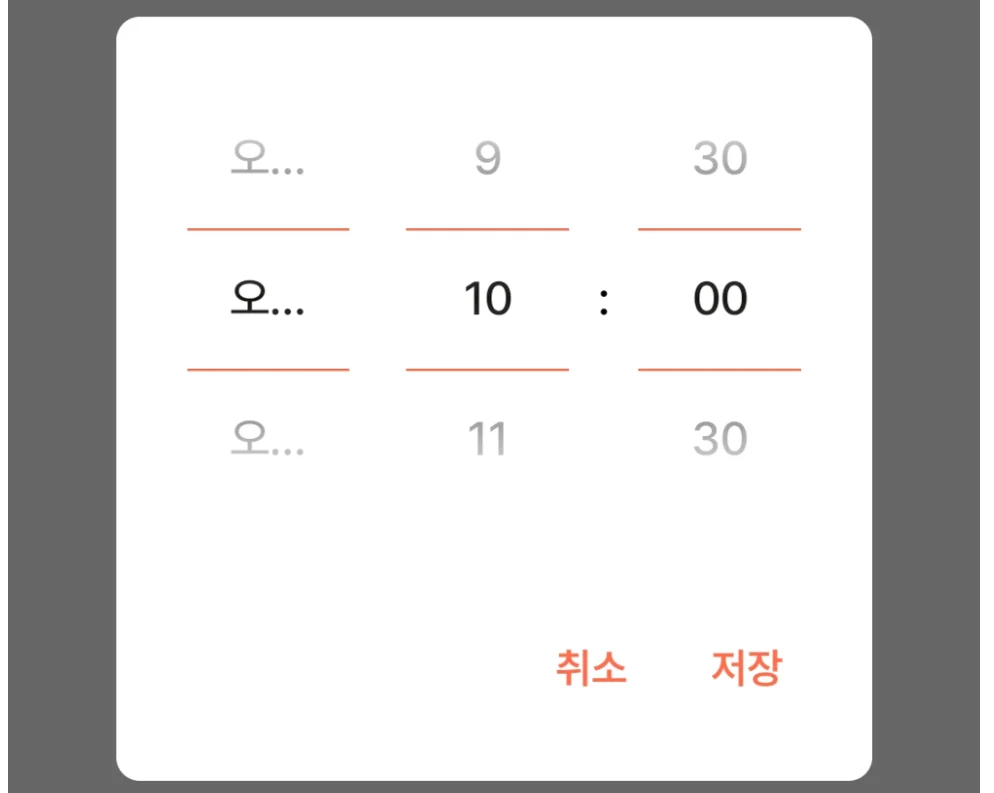
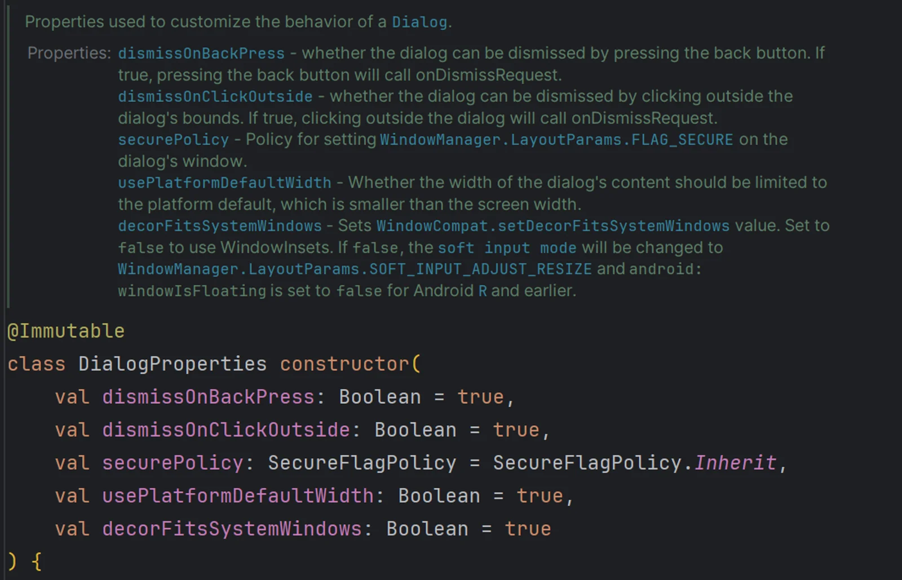
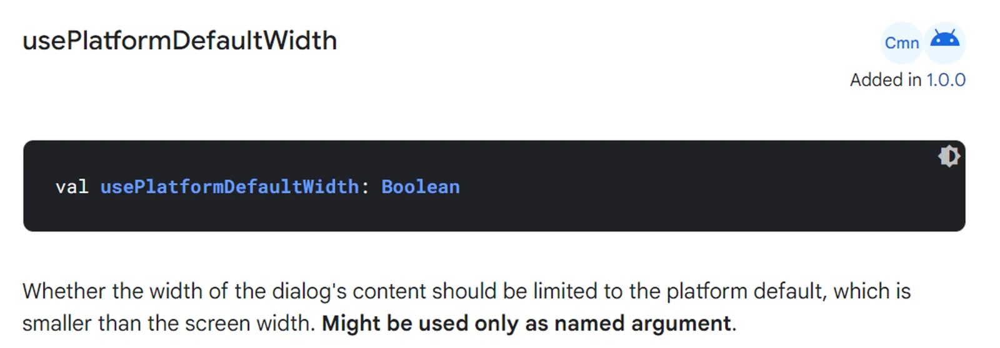
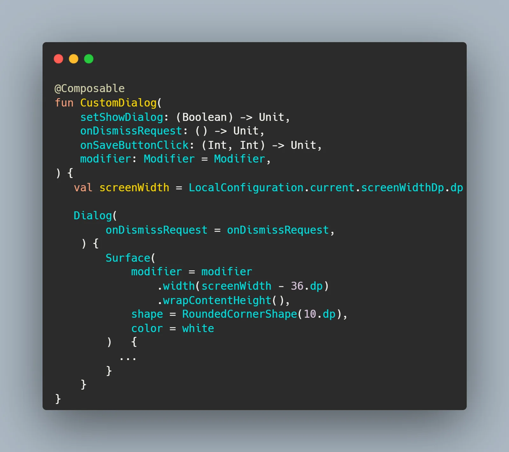
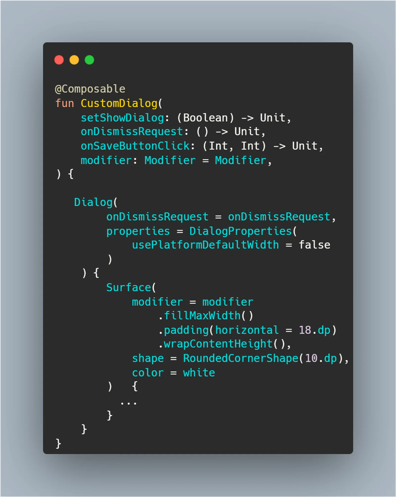

## The problem

I wanted my dialog to keep the same side padding on every device, so I read the device width and sized the dialog to device width minus 36dp.

But **on some devices** the gap ended up wider than the padding I'd set, and a `Text` with `TextOverflow.Ellipsis` **got cut off**.

{width=100 align=center}

## The fix

I was setting the dialog's width explicitly, so I went looking for why it wasn't taking effect. In Compose, you configure a `Dialog` through `DialogProperties`.

{width=100 align=center}

The docs list five properties in total, including one that keeps the dialog open when you tap outside it and one that keeps it open when you press back. The one behind my problem turned out to be `usePlatformDefaultWidth`.

{width=100 align=center}

By default, a dialog's width is constrained to whatever looks right on the platform and adapts easily to different screen sizes. With that default on, though, you can't set your own fixed width. You need to set it to `false` and then size the dialog yourself.

With that in mind, I changed the code.

### Before

{width=100 align=center}

### After

{width=100 align=center}

Instead of using `screenWidth`, I set `usePlatformDefaultWidth` to `false` and gave the dialog a `Modifier` that fills the full width with 18dp of padding on each side.

Compose components have a lot of handy properties like this one, and I want to make better use of them from now on!
