{width=100 align=center}

최근 국내 최대 규모 안드로이드 컨퍼런스인 드로이드나이츠의 앱 컨트리뷰터를 모집한다는 글이 올라왔다. 평소에 아주 관심이 많던 프로젝트이자 오픈소스 컨트리뷰터 경험을 쌓기 위해 열려 있는 이슈들을 유심히 본 뒤 가장 해보고 싶은 이슈를 골라보았다!

[https://github.com/droidknights/DroidKnightsApp/issues/299](https://github.com/droidknights/DroidKnightsApp/issues/299)

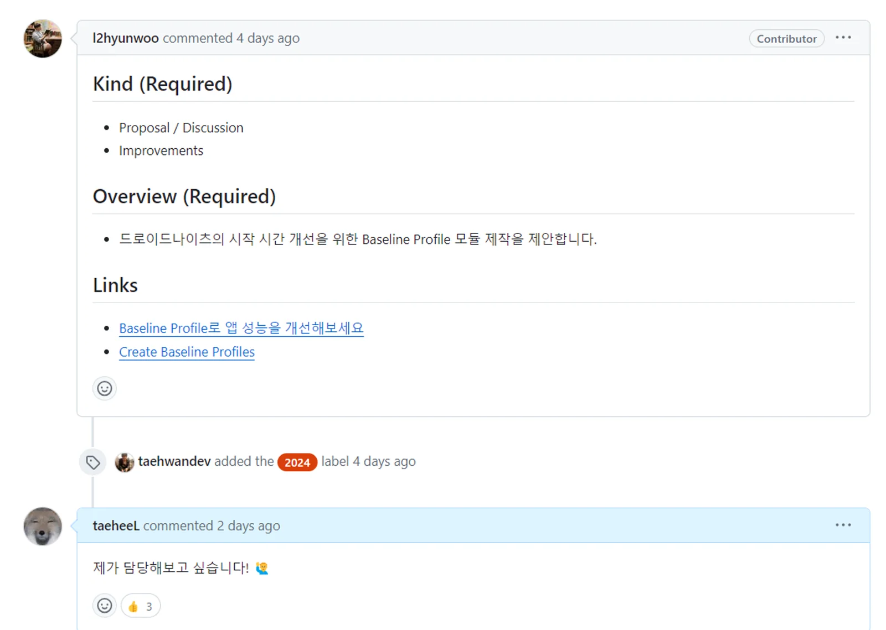{width=100 align=center}

항상 들어만 봤던 Baseline Profile의 구현과 성능이 궁금했기에 이 이슈를 담당했다. Test 코드를 한 번도 짜본 적이 없어 걱정했지만, 도전해볼만 하다는 조언이 있었기에 이슈에 도전해보았다.

## BaseLine Profile이란?

앱을 설치하거나 업데이트한 후에 처음 실행할 때 앱의 코드는 [JIT](https://source.android.com/devices/tech/dalvik/jit-compiler)될 때까지 인터프리트 모드(interpreted mode)로 실행된다. APK에서는 Java 및 Kotlin 코드가 dex 바이트 코드로 컴파일되지만, 완전히 컴파일된 앱을 저장하고 로드하는 비용 때문에 (Android 6 이후로는) 기계어 코드로 완전히 컴파일되지 않는다. 앱에서 자주 사용되는 클래스와 메서드뿐 아니라 앱 시작에 사용되는 클래스와 메서드도 프로필 파일에 기록된다. 기기가 유휴 모드(idle mode)에 들어가면 ART는 이러한 프로필을 기반으로 앱을 컴파일한다. 이에 따라 다음번에는 앱이 더 빠르게 시작된다.

앱 또는 라이브러리에 기준 프로필을 제공하면 [Android 런타임(ART)](https://source.android.com/docs/core/runtime?hl=ko)이 AOT(Ahead-Of-Time) 컴파일을 통해 지정된 코드 경로를 최적화하여 모든 신규 사용자와 앱 업데이트에 향상된 성능을 제공한다. 이 프로필 기반 최적화(PGO)는 앱이 시작을 최적화하고, 상호작용으로 인한 버벅거림을 줄이고, 첫 실행부터 사용자가 경험하는 전반적인 런타임 성능을 개선할 수 있도록 해 준다.

공식 문서의 설명을 가져와봤다. 요약하자면 BaseLine Profile을 사용하면 App의 성능을 최적화하기 위해 **중요 코드 경로에 대한 메타데이터를 제공**하여 **AOT(사전 컴파일) 컴파일을 우선적으로 처리해**, **최초 실행 코드 실행 속도를 30% 향상 시킬 수 있다**.

이 PGO(프로필 기반 최적화)를 통해 앱은 시작을 최적화하고, 상호 작용 버벅거림을 줄이고, 첫 번째 실행부터 최종 사용자의 전반적인 런타임 성능을 향상시킬 수 있다.

기준 프로필을 사용하면 앱 시작, 화면 간 탐색, 콘텐츠 스크롤과 같은 모든 사용자 상호 작용이 처음 실행될 때부터 더욱 원활해지고, 결국 앱의 속도와 응답성이 향상되면 일일 활성 사용자가 늘어나고 평균 재방문률도 높아질 수 있다.

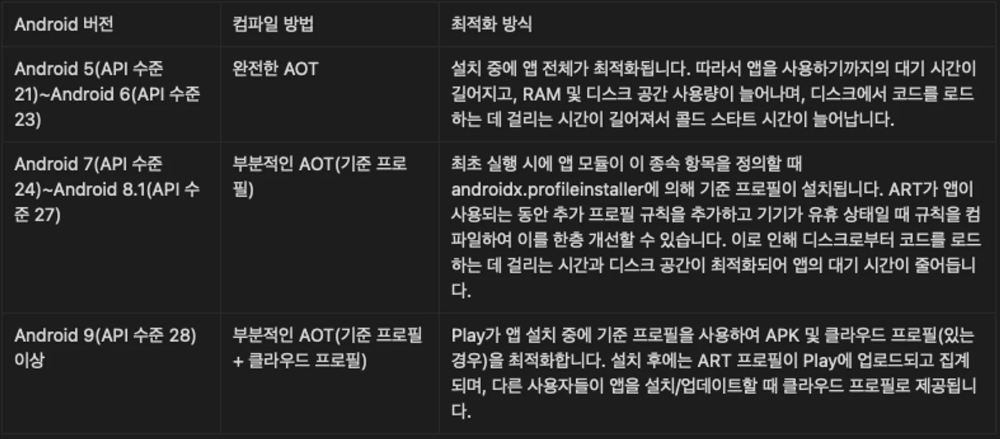{width=100 align=center}

Droid Knights 앱은 min SDK가 28이므로 맨 아래 방식을 사용한다. 배포 시점에 이미 프로필이 추가되었기 때문에 사용자들은 play store에 Cloud Profile이 존재하지 않아도 기준 프로필을 통해 기본적인 최적화를 경험할 수 있다.

### 모듈 추가 및 의존성 추가

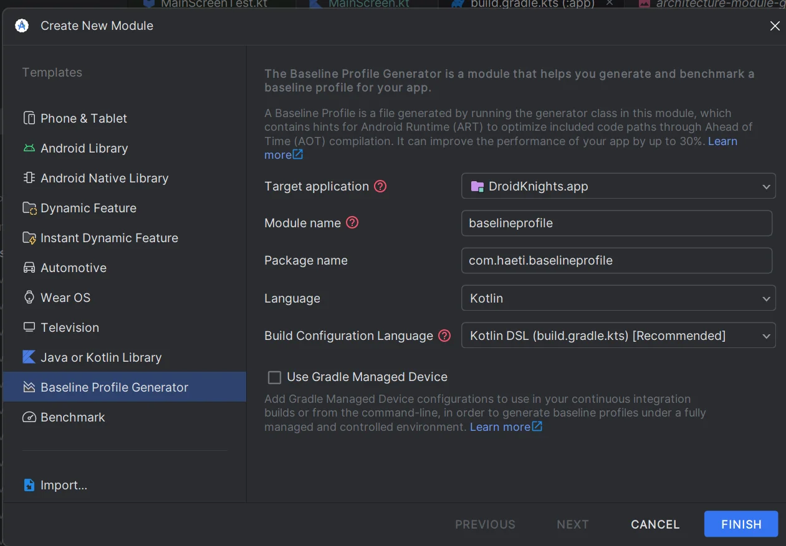{width=100 align=center}

먼저 **Baseline Profile Generator**를 통해 baselineprofile 모듈을 생성하였다. 신기하게도 Android Studio에서 app모듈과 생성된 baselineprofile 모듈의 의존성을 VersionCatalog 형식으로 추가해줌과 동시에, 기본적인 `BaselineProfileGenerator`와 `StartupBenchmarks`를 생성해준다.

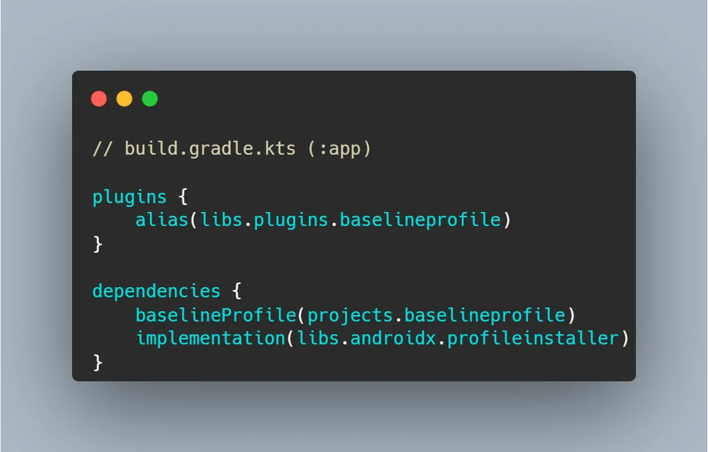{width=100 align=center}

다음으로 libs.versions.toml 파일에 기존 컨벤션대로 정리하고 app 모듈에 profileinstaller와 baselineprofile에 대한 의존성과 plugin을 추가하였다.

### Build Type 추가

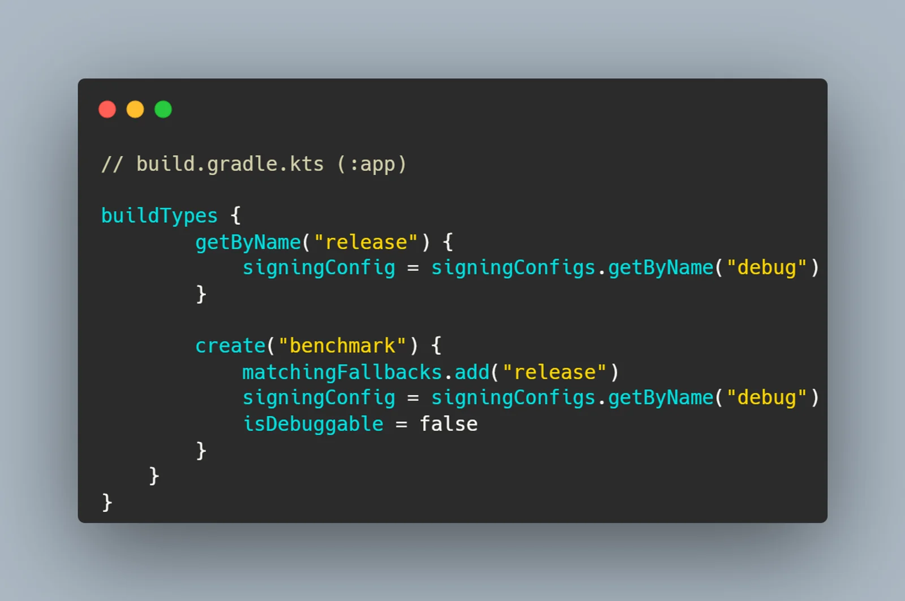{width=100 align=center}

또한, benchmark를 build variant에 추가하였고, 적절한 설정을 해주었다. 별도로 난독화는 하지 않았다.

### Test 기기 세팅

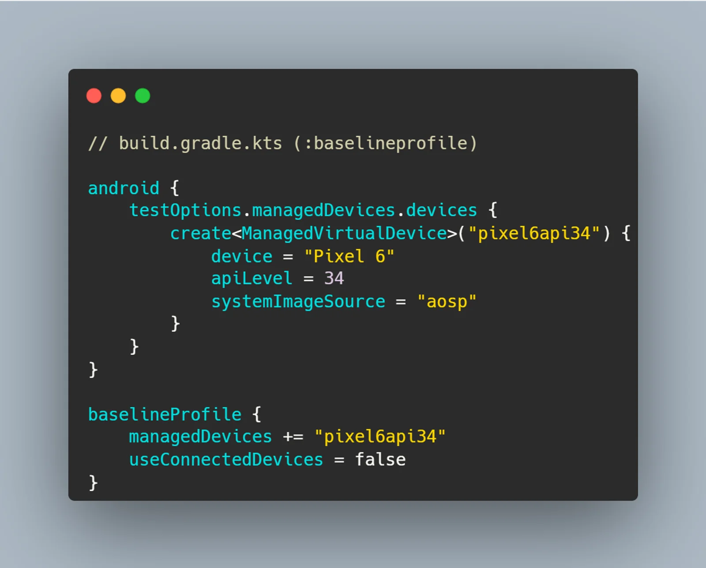{width=100 align=center}

이제 baseline profile 모듈에 테스트 에뮬레이터에 대한 정보를 추가하였다. 가장 최근 기기에서의 성능을 테스트하기 위해 API 34 버전으로 하였으나, 실기기로 테스트하는 것이 더 정확할 것이다.

### Baseline Profile 생성

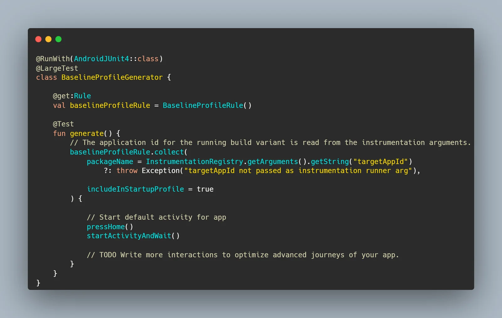{width=100 align=center}

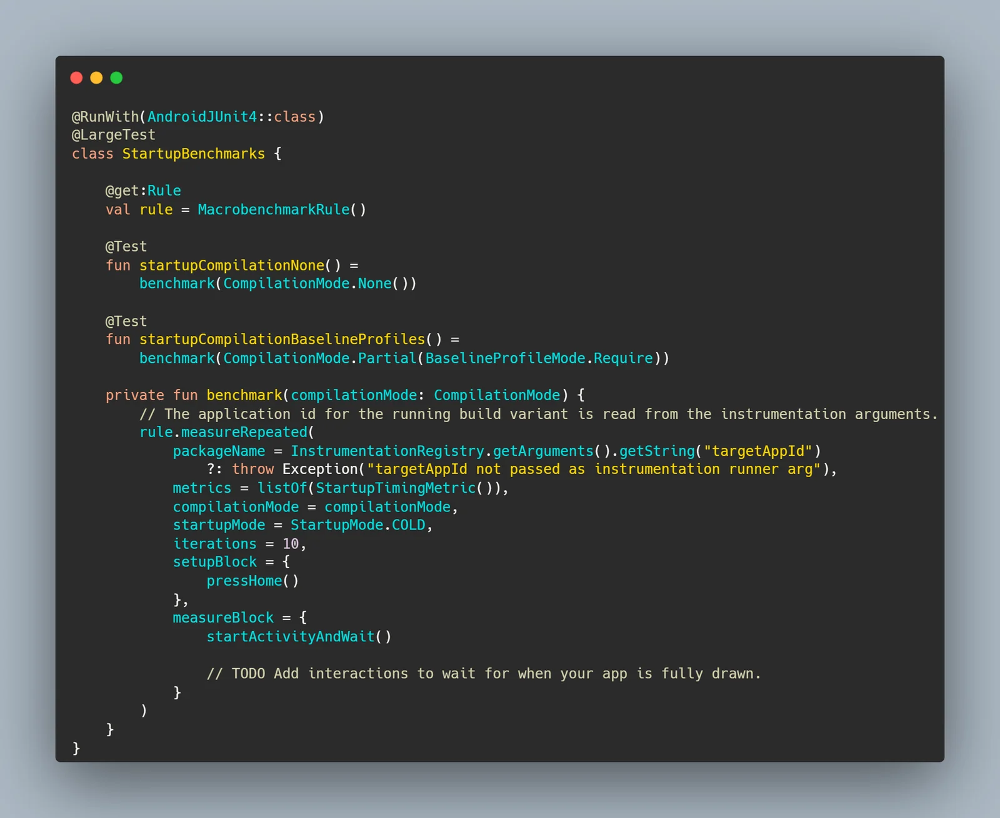{width=100 align=center}

마지막으로 별도의 시나리오 측정을 하지 않고 앱 시작 속도에 대해서만 성능 측정을 하였다. 이때 `Baseline Profile Generator`로 생성된 기본 class들을 활용하였다.

이제 터미널을 통해 명령어를 입력하여 Baseline Profile을 생성하였다.

`./gradlew :app:generateBaselineProfile`

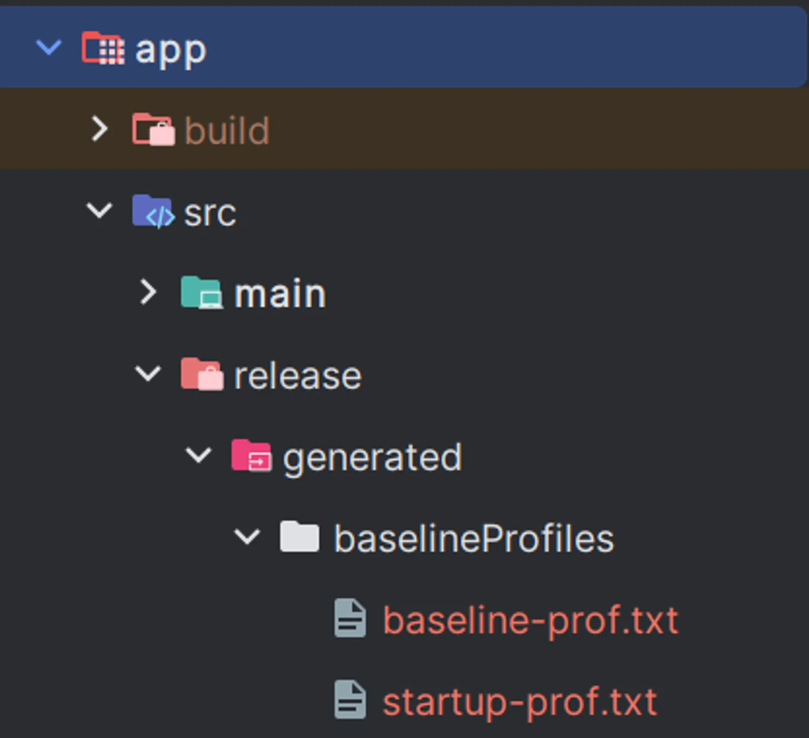{width=100 align=center}

위와 같이 `app/src/release/generated/baselineProfiles` 경로에 두 가지 txt 파일이 생성되었다. Baseline Profile에는 애플리케이션이나 라이브러리와 관련된 클래스 및 메서드 정보가 포함된다. 이 정보는 Android 런타임 환경 내에서 효율성을 위해 실행을 최적화하는데 활용된다.

### 테스트 진행

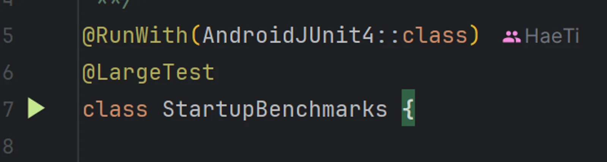{width=100 align=center}

마지막으로 StartupBenchmarks class 왼쪽의 run 버튼을 눌러 테스트를 시작한다.

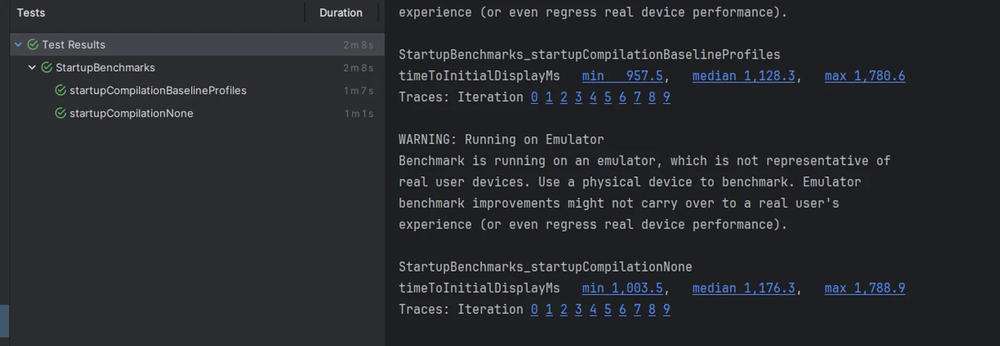{width=100 align=center}

```
StartupBenchmarks_startupCompilationBaselineProfiles 
timeToInitialDisplayMs min 957.5, median 1,128.3, max 1,780.6 
Traces: Iteration 0 1 2 3 4 5 6 7 8 9 

StartupBenchmarks_startupCompilationNone 
timeToInitialDisplayMs min 1,003.5, median 1,176.3, max 1,788.9 
Traces: Iteration 0 1 2 3 4 5 6 7 8 9
```

첫 측정 시 너무나도 적은 성능이 나왔다. 보통 12% ~ 20%의 속도 개선이 일어난다고 하기에, 다시 한번 돌려보았다.

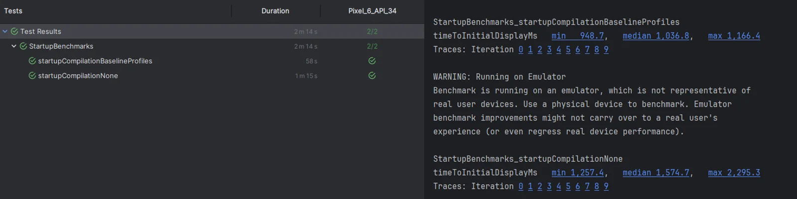{width=100 align=center}

```
StartupBenchmarks_startupCompilationBaselineProfiles
timeToInitialDisplayMs   min   948.7,   median 1,036.8,   max 1,166.4
Traces: Iteration 0 1 2 3 4 5 6 7 8 9

StartupBenchmarks_startupCompilationNone
timeToInitialDisplayMs   min 1,257.4,   median 1,574.7,   max 2,295.3
Traces: Iteration 0 1 2 3 4 5 6 7 8 9
```

다시 한번 돌려보니 평균적으로 35%의 속도 개선이 일어났다. 이를 통해 사용자들이 앱 로딩을 기다리는 속도를 유의미하게 줄일 수 있고, 라이브러리 컴파일 속도에도 영향을 미칠 수 있다.

#### Pull Request

[https://github.com/droidknights/DroidKnightsApp/pull/318](https://github.com/droidknights/DroidKnightsApp/pull/318)

## 추후 계획 및 느낀 점

DroidKnights 앱에는 스크롤과 전환이 빈번하게 일어나기에 이에 대한 시나리오를 작성해보고 성능을 측정해보고 싶다. 또 Github Action을 사용해 각 릴리즈 버전에 대한 Baseline Profile 생성 자동화도 경험해보고 싶다.

꽤 무거운 앱이라 빌드하는데 꽤 시간이 많이 들었다. main 브랜치가 빌드가 되지 않아, 임의로 여러파일을 수정해 빌드를 진행하였고 `"/META-INF/LICENSE.md"` 에 관한 에러도 발생해서 초기 빌드가 처음 성공했을때 무척이나 기뻤다.

첫 오픈소스 기여이자 많은 사람들이 이 프로젝트를 보고 있고, 대단한 사람들과 작은 협업을 할 수 있는 기회이기에 더 신중하게 임했다. 평소 조심스러운 성격때문에 오랜 시간이 걸렸고, 빌드 문제를 해결하는데 힘이 너무 빠져서 힘들었던 것 같다. 아직까지도 낯선 멀티모듈 환경과 Build-logic 환경에서 처음해보는 Baseline Profile에 대한 기능 추가를 했어야 했기에 많이 힘들었지만, 그만큼 값지고 단단한 경험이 될 것 같다.

앞으로도 더 자주, 더 많이 오픈소스에 기여하여 좋은 동기부여를 받고 값진 경험을 얻고 싶다.

### 참고 자료

[https://codelabs.developers.google.com/android-baseline-profiles-improve#0](https://codelabs.developers.google.com/android-baseline-profiles-improve#0)

[https://github.com/skydoves/pokedex-compose](https://github.com/skydoves/pokedex-compose)

[https://developer.android.com/topic/performance/baselineprofiles/overview](https://developer.android.com/topic/performance/baselineprofiles/overview)
