> 2025/07/21 Updated❗

You have to update targetSDK to 35 by August 31, 2025, or your app gets pulled and rejected. Adding the line below to themes.xml temporarily opts the whole app out of enforced edge-to-edge. Your app keeps the legacy behavior from Android 14 (API 34) and below, where content isn't drawn outside the system bar areas.

```
<item name="android:windowOptOutEdgeToEdgeEnforcement">true</item>
```

🚨 **Heads-up**: once you target **Android 16 (API 36) or higher**, this attribute is deprecated and no longer works, so you can't opt out anymore.

---

Apps that target Android 15 (API level 35) or higher draw across the entire display by default, past the system UI boundaries. This is called `edge-to-edge`. The window covers the full width and height, including the area behind the system bars. (The system bars here are the status bar, the navigation bar, and the caption bar.)

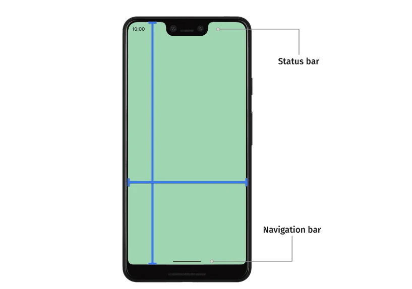{width=100 align=center caption="Notches only exist on iPhones, so ignore that part"}

Plenty of apps have a TopAppBar or a BottomNavigationBar, and with edge-to-edge those bars can extend all the way to the edge of the screen and show up behind the system status bar or navigation bar.

#### What to keep in mind when building an edge-to-edge layout

1. **Edge-to-edge is on**: if your app targets SDK 35 or higher, edge-to-edge is enabled automatically on Android 15+ devices.
2. **Handle visual overlaps**: some of your views may be drawn behind the system bars, so you need insets to fix the overlap.
3. **Consider a scrim behind the system bars**: you can also add a scrim (a translucent overlay) behind the system bars.

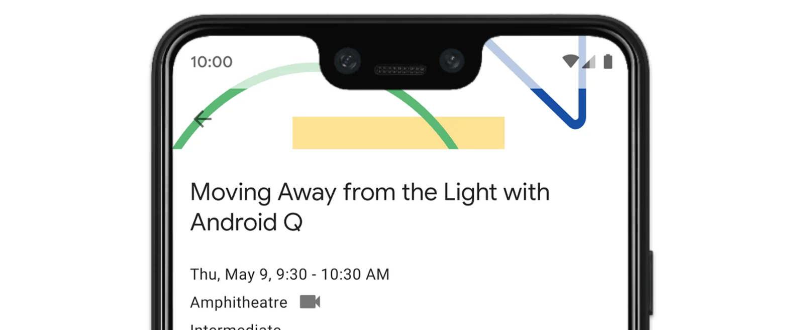{width=100 align=center}

> 💡 If your app targets SDK 35, edge-to-edge is enforced on Android 15 (API level 35) and higher. If your app wasn't already edge-to-edge, parts of it may be covered, and you'll need to handle insets. How much this matters depends on the app.

#### Android 15

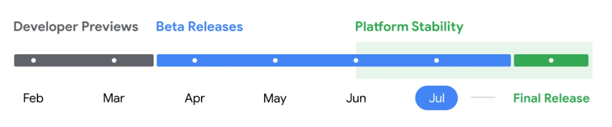{width=100 align=center caption="As of 2024"}

It's supposed to be released soon. Right now it's in beta.

Once it's out, it'll be available on phones that launched with [Android 13](https://namu.wiki/w/%EC%95%88%EB%93%9C%EB%A1%9C%EC%9D%B4%EB%93%9C%2013) (in Korean) or later, and on phones that launched with [Android 11](https://namu.wiki/w/%EC%95%88%EB%93%9C%EB%A1%9C%EC%9D%B4%EB%93%9C%2011) (in Korean) but get four OS updates. On Samsung, that starts with the [Galaxy S21](https://namu.wiki/w/%EA%B0%A4%EB%9F%AD%EC%8B%9C%20S21) (in Korean), which launched with Android 11, and the rollout is expected to begin with [One UI](https://namu.wiki/w/One%20UI) (in Korean) 7.0.

Source: [https://android-developers.googleblog.com/2024/05/the-second-beta-of-android-15.html](https://android-developers.googleblog.com/2024/05/the-second-beta-of-android-15.html)

### What are insets?

An `Inset` describes **where an area of the screen intersects with system UI** such as the status bar or navigation bar. Put simply, an `Inset` is **a value that defines where your app's content overlaps the system UI**. That intersection can mean content is drawn behind a system bar, and it also tells your app where system gestures apply.

Android's `WindowInsets` API exposes several kinds of `Inset` so you can deal with these overlaps.

There are three main types:

#### **1. System bars insets**

- **What it is**: the Y-axis area where the system bars (status bar, navigation bar, and so on) are shown.
- **What it's for**: mostly moving tappable areas or adding padding so the system bars don't cover them. For example, if a floating action button (FAB) is partly hidden by the navigation bar, the `systemBars` insets fix that.

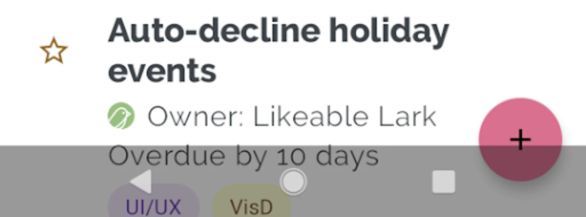{width=100 align=center}

When the navigation bar covers the FAB like this, here's how to handle it:

```kotlin
ViewCompat.setOnApplyWindowInsetsListener(fab) { v, windowInsets ->
  val insets = windowInsets.getInsets(**WindowInsetsCompat.Type.systemBars()**)
  // Apply the insets as a margin to the view. This solution sets// only the bottom, left, and right dimensions, but you can apply whichever// insets are appropriate to your layout. You can also update the view padding// if that's more appropriate.
  v.updateLayoutParams<MarginLayoutParams> {
      leftMargin = insets.left,
      bottomMargin = insets.bottom,
      rightMargin = insets.right,
  }

  // Return CONSUMED if you don't want want the window insets to keep passing// down to descendant views.WindowInsetsCompat.CONSUMED
}
```

- `ViewCompat.setOnApplyWindowInsetsListener(fab)` sets a window insets listener on the FAB. It's called every time the system window insets change.
- `windowInsets.getInsets(WindowInsetsCompat.Type.systemBars())` gets the insets where the screen currently intersects the system bars. Each value is the space the system bars take up on that side (left, right, bottom).
- Inside `v.updateLayoutParams<MarginLayoutParams> { ... }`, the view's (the FAB's) `MarginLayoutParams` get updated. `leftMargin`, `bottomMargin`, and `rightMargin` are set to the system bar insets, which adjusts the margins so the FAB doesn't overlap the navigation bar.
- Returning `WindowInsetsCompat.CONSUMED` stops the insets from propagating further down to the FAB's children. The FAB has no children, so it doesn't matter much here, but it makes it explicit that nothing below needs the insets.

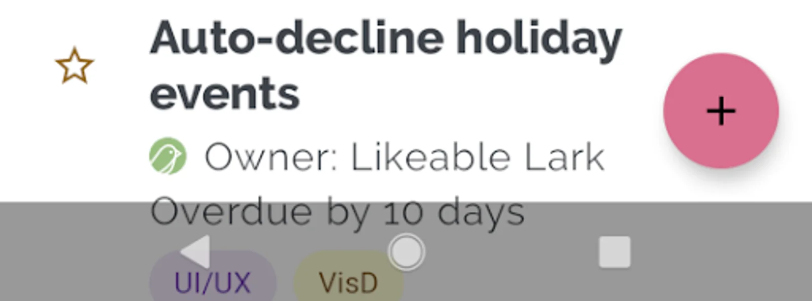{width=100 align=center}

Now the FAB and the navigation bar no longer overlap.

#### **2. Display cutout insets**

- **What it is**: the position and size of a cutout (a notch or camera hole, for example) on devices that have one.
- **What it's for**: adding padding so the cutout doesn't cover content. For example, you can add top padding from the cutout insets so a list isn't clipped by a notch at the top of the screen.

On a device with a display cutout, your app's content is drawn across the whole screen by default, cutout area included. That risks hiding important UI or content behind the cutout. If users can't see UI placed along the top or sides, the experience suffers.

For example:

- If a list item sits at the top of the screen, the display cutout can cover it.
- In landscape, when the cutout is on the side of the screen, part of the content can get clipped.

To prevent this, use the `Display Cutout Inset` to add padding so content isn't drawn into the cutout area:

```kotlin
ViewCompat.setOnApplyWindowInsetsListener(binding.recyclerView) { v, insets ->
  val bars = insets.getInsets(
    WindowInsetsCompat.Type.systemBars()
      or WindowInsetsCompat.Type.displayCutout()
  )
  v.updatePadding(
    left = bars.left,
    top = bars.top,
    right = bars.right,
    bottom = bars.bottom,
  )
  WindowInsetsCompat.CONSUMED
}
```

`WindowInsetsCompat.Type.displayCutout()` gives you the display cutout insets, and combining types with `or` gets you a more fitting set of insets.

```kotlin
<androidx.recyclerview.widget.RecyclerView
    android:id="@+id/recycler_view"
    android:layout_width="match_parent"
    android:layout_height="match_parent"
    android:clipToPadding="false"
    app:layoutManager="androidx.recyclerview.widget.LinearLayoutManager" />
```

On top of that, setting `clipToPadding=”false”` on the RecyclerView, as above, lets the whole content scroll, padding area included. That way list items don't get clipped even when they scroll behind a system bar or cutout.

#### **3. System gesture insets**

- **What it is**: the areas where system gestures (such as the home and back gestures) take priority.
- **What it's for**: keeping swipeable areas away from the gesture areas, or adjusting padding to match. Think bottom sheets, swipe gestures in games, or carousels built with `ViewPager2`.

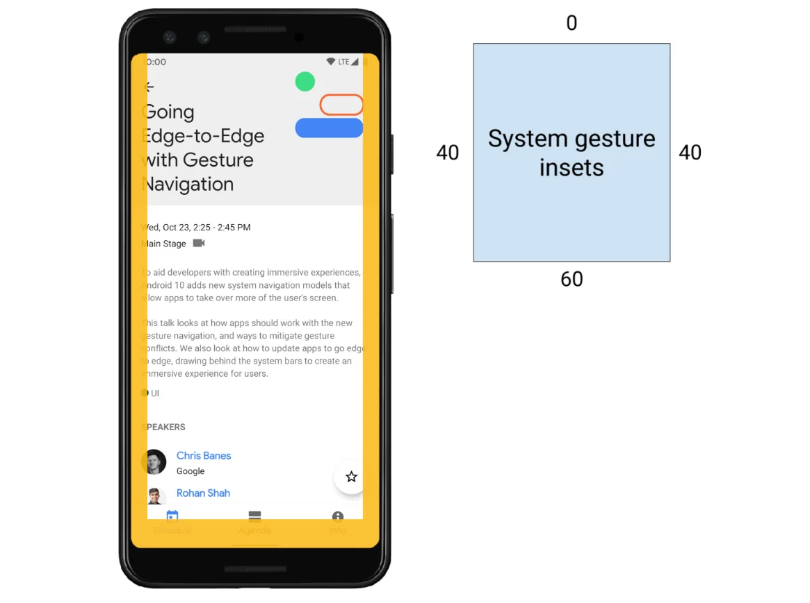{width=100 align=center}

Android 10 introduced gesture navigation, so users can swipe in certain areas of the screen to go home or back. These gestures start at the edges of the screen, so if important UI in your app overlaps those areas, it hurts the user experience.

Lots of Galaxy users rely on One Hand Operation from Good Lock (Samsung's customization app). If an overlap in your app stopped it from working, I think users would have a pretty bad time.

```kotlin
ViewCompat.setOnApplyWindowInsetsListener(view) { view, windowInsets ->
    val insets = windowInsets.getInsets(WindowInsetsCompat.Type.systemGestures())
    // Apply the insets as padding to the view. Here, set all the dimensions
    // as appropriate to your layout. You can also update the view's margin if
    // more appropriate.
    view.updatePadding(insets.left, insets.top, insets.right, insets.bottom)

    // Return CONSUMED if you don't want the window insets to keep passing down
    // to descendant views.
    WindowInsetsCompat.CONSUMED
}
```

`WindowInsetsCompat.Type.systemGestures()` gets the system gesture insets, which you can then apply as padding.

> So do you have to apply padding by hand every time, in all three of these ways? 🤔

### Use Material Components

**Material Components** is Android's UI component library, with a wide range of view components. Many of these views are designed to handle system insets on their own.

#### Material Components that handle insets automatically

> ⚠️ This may vary by version, so check the official docs.

- **BottomAppBar**
- **BottomNavigationView**
- **NavigationRailView**
- **NavigationView**

These views **handle system insets such as system bar and gesture insets automatically**, so their content doesn't overlap the system UI. When you use them, **you may not need to handle insets yourself**.

#### AppBarLayout doesn't handle insets automatically

- **AppBarLayout** doesn't handle system insets on its own, so you have to do it yourself.
  - Add `android:fitsSystemWindows="true"` to the XML layout, and AppBarLayout handles the system insets so the status bar doesn't cover it.
  - Or handle the insets manually with `setOnApplyWindowInsetsListener`, which gives you finer control.

### Immersive mode

**Immersive mode** hides the system bars (status bar and navigation bar) to give users a more immersive, full-screen experience. Your app's content fills the whole screen, and the system bars only appear when the user interacts with them.

#### Turning immersive mode on and off

To implement immersive mode, use `WindowInsetsController` or the `WindowInsetsControllerCompat` library:

```kotlin
val windowInsetsController =
      WindowCompat.getInsetsController(window, window.decorView)

// Hide the system bars.
windowInsetsController.hide(Type.systemBars())

// Show the system bars.
windowInsetsController.show(Type.systemBars())
```

- `windowInsetsController.hide(Type.systemBars())` hides the status bar and navigation bar so you can use the full screen. This turns immersive mode on.
- `windowInsetsController.show(Type.systemBars())` brings the hidden system bars back. Use it to show them again when the user interacts or whenever you need them.

## Working through an example

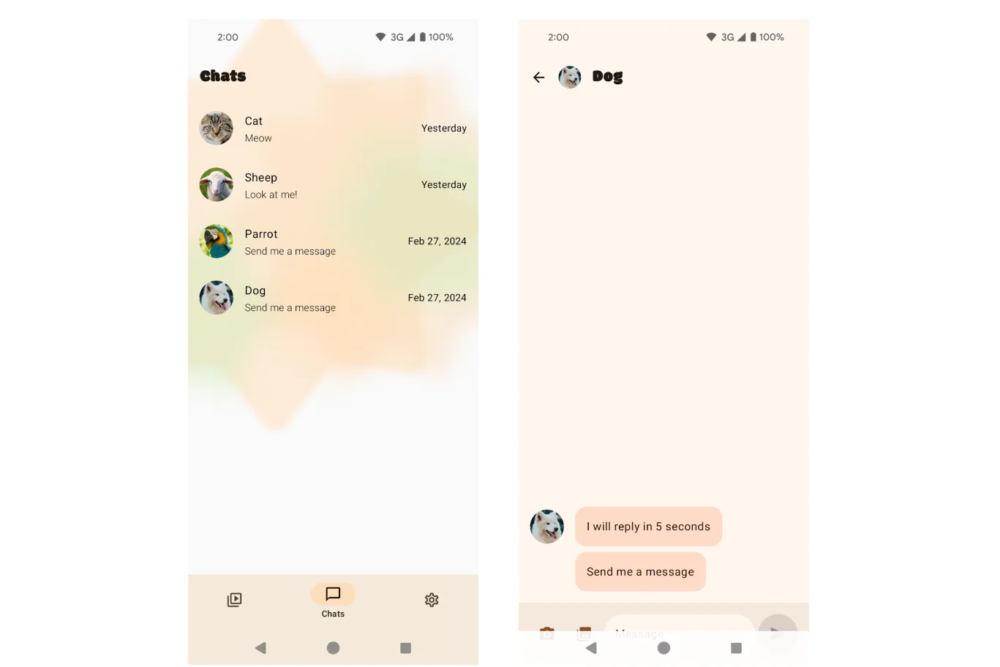{width=100 align=center}

By default, `enableEdgeToEdge()` makes the system bars transparent, except in 3-button navigation mode, where the status bar gets a translucent scrim. The colors of the system icons and the scrim follow the system's light or dark theme.

`enableEdgeToEdge()` automatically declares that the app should be laid out edge-to-edge and adjusts the system bar colors.

To remove the navigation bar's default background protection shown above, add this code:

```kotlin
class MainActivity : ComponentActivity() {
    override fun onCreate(savedInstanceState: Bundle?) {
        installSplashScreen()
        super.onCreate(savedInstanceState)
        setContent {
            // Add this block:
            if (Build.VERSION.SDK_INT >= Build.VERSION_CODES.Q) {
                window.isNavigationBarContrastEnforced = false
            }
        }
    }
    ...
}
```

`window.isNavigationBarContrastEnforced` makes sure the navigation bar has enough contrast when a fully transparent background is requested. Setting it to false effectively **makes the 3-button navigation bar's background transparent**. It only affects the 3-button navigation bar, not the gesture (dynamic) bar.

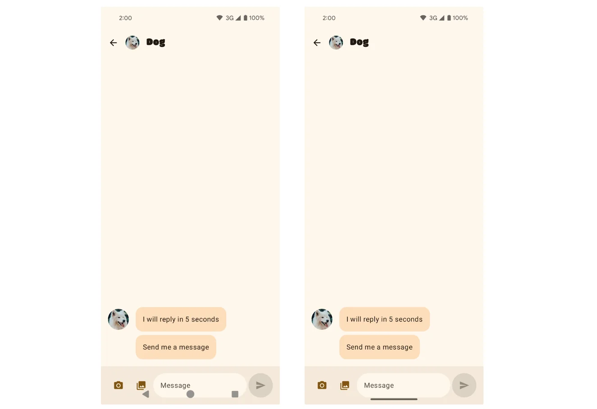{width=100 align=center}

Other screens, though, still have views hidden behind the navigation bar. If you're using a `Scaffold` in Compose, `innerPadding` solves this easily:

```kotlin
InputBar(
    ...
    contentPadding = innerPadding.copy(layoutDirection, top = 0.dp), 
    ...
 )
```

But how do you fix it with XML views? To dig into that, here's an example situation and its code:

```kotlin
abstract class BindingActivity<T : ViewBinding>(
    @LayoutRes private val layoutResId: Int
) : AppCompatActivity() {

    protected val binding: T by lazy { getViewBinding() }

    override fun onCreate(savedInstanceState: Bundle?) {
        enableEdgeToEdge()
        setupWindowInsets()
        super.onCreate(savedInstanceState)
        setContentView(binding.root)
    }

    protected abstract fun getViewBinding(): T

    private fun setupWindowInsets() {
        ViewCompat.setOnApplyWindowInsetsListener(findViewById(android.R.id.content)) { view, insets ->
            val systemBars = insets.getInsets(WindowInsetsCompat.Type.systemBars())
            view.setPadding(systemBars.left, systemBars.top, systemBars.right, systemBars.bottom)
            insets
        }
    }
}
```

This is the code a new Android project generates by default: it calls `enableEdgeToEdge` and pads the whole view by the `systemBar` insets.

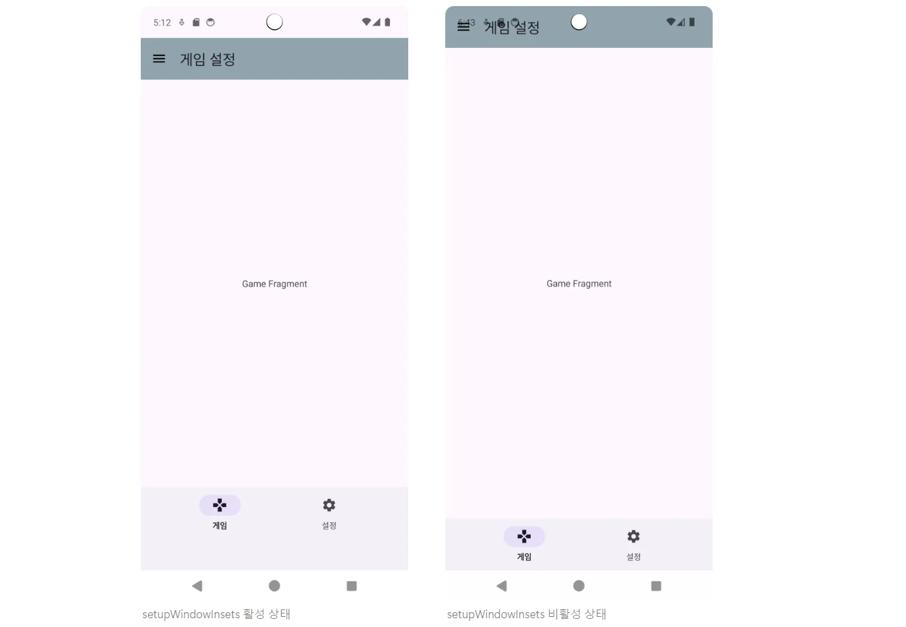{width=100 align=center}

Since `enableEdgeToEdge()` declares that the app uses the entire screen, if you don't pad the screen by the size of the system bars, the views overlap the system bars, as in the screen on the right.

Two basic approaches come to mind:

1. Pad the whole view by the size of the system bars.
2. Apply insets only to the views that need them to avoid the overlap.

Which one fits probably depends on the app. Since a new Android project already ships with code that pads the whole view by the system bars, I'll build on that.

Looking at the screen on the left, the problem to fix is the padding at the bottom of the `Bottom Navigation Bar`. Why does it happen? As we saw earlier, **Material Components** come with `Inset` handling built in. So when `setOnApplyWindowInsetsListener` lays out the screen's insets, I think the situation looks like this:

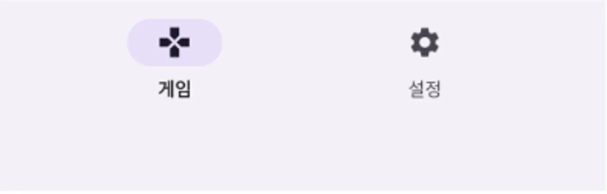{width=100 align=center}

This is what the bottom navigation really looks like with its insets already applied. In the screen on the right, its lower part was hidden because it overlapped the navigation bar.

So there are two easy ways to fix it:

1. Remove the system bar padding.
2. Set the bottom navigation's own padding to 0.

Removing the system bar padding could affect other components, so I set the bottom navigation's own padding instead:

```kotlin
    private fun setInsets() {
        val bottomNav = binding.bnvGame
        ViewCompat.setOnApplyWindowInsetsListener(bottomNav) { view, insets ->
            view.setPadding(0, 0, 0, 0)
            insets
        }
    }
    
 // Or this code (in onViewCreated())
 binding.bottomNavigationView.setOnApplyWindowInsetsListener { view, insets ->
        view.updatePadding(bottom = 0)
        insets
    }
```

With that, the screen finally looks the way it should.

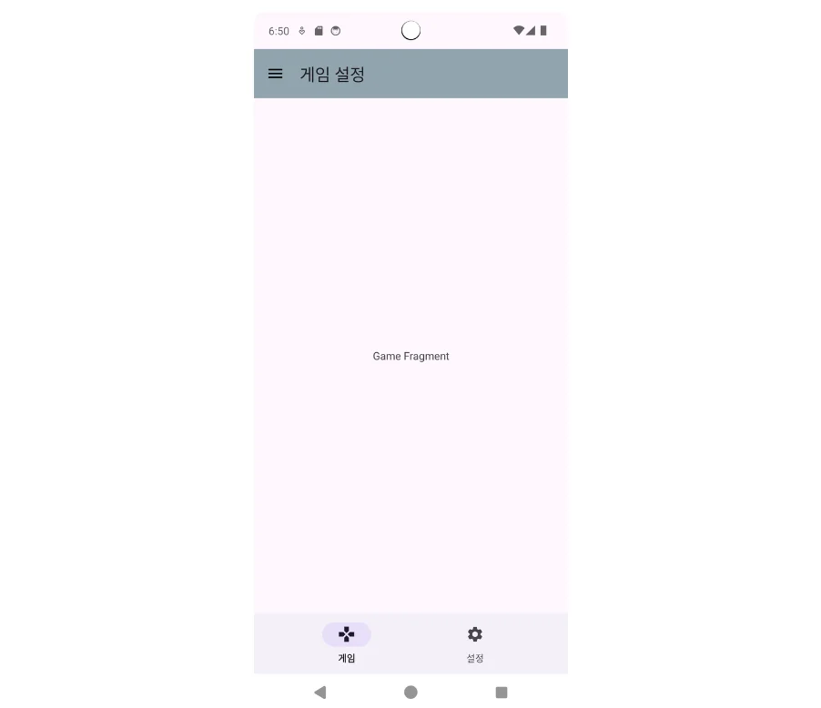{width=100 align=center}

#### How should you apply this in a real product?

Edge-to-edge forces you to deal with system bar padding. If you had to handle this in a project that's already shipped, what's the best approach?

In a product built on `Material Component`, almost every component handles its own `Inset`, so you probably don't need to do anything. You'd only add system-bar-sized padding to elements like `AppBarLayout` that don't handle their own `Inset`.

In a product built on its own design system, check whether any components already apply an `Inset`, then pad the whole screen by the system bars. That should be enough to support the latest Android devices.

### Bonus: adjustResize doesn't work with edge-to-edge…!

That heading is a little wrong. It's not that it doesn't work. It's that you used to be able to just set `adjustResize` to keep a button above the keyboard when the user taps an `EditText`, and that's no longer enough..!

You still need `adjustResize`. It's what lets your app receive the size of the software `IME` as insets.

The old approach stops working with `enableEdgeToEdge()` because `adjustResize` adjusts the layout based on the size of the system bars, but in `Edge-to-Edge` mode the system bars are treated as if they've been removed from the screen, so the resize doesn't behave the way you'd expect.

`Edge-to-Edge` and `adjustResize` have fundamentally different goals. `Edge-to-Edge` is about extending content behind the system bars, and `adjustResize` is about pushing content above the keyboard. They're bound to conflict, so you have to pick one and handle the other manually.

So what do you do? The answer is simple: adjust the layout yourself.

Add the code below to the activity bound to the view in question:

```kotlin
private fun setupKeyboardListener() {
      ViewCompat.setOnApplyWindowInsetsListener(findViewById(android.R.id.content)) { view, insets ->
            val imeInsets = insets.getInsets(WindowInsetsCompat.Type.ime())
            val systemBars = insets.getInsets(WindowInsetsCompat.Type.systemBars())

            // Move the button up when the keyboard appears (when there's an IME inset)
            binding.btnNext.translationY = if (imeInsets.bottom > 0) {
                -(imeInsets.bottom - systemBars.bottom).toFloat()
            } else {
                0f
            }

            view.setPadding(
                systemBars.left,
                systemBars.top,
                systemBars.right,
                systemBars.bottom
            )

            insets
        }
    }
```

- `WindowInsetsCompat.Type.ime()` gets the keyboard (IME) insets. The bottom inset grows when the keyboard appears and drops to 0 when it goes away.
- `nextButton.translationY` is adjusted to move the `Next` button up when the keyboard appears. The `imeInsets.bottom` value moves the button up by the keyboard's height. But `imeInsets.bottom` includes the navigation bar's height, so that gets subtracted.
- System bar insets: `systemBarsInsets` is applied to the whole screen so nothing overlaps the status bar or navigation bar.

With this in place, when an EditText gets focus and the keyboard comes up, the button at the bottom of the view moves up above the keyboard.

---

> Sources

[https://developer.android.com/develop/ui/views/layout/edge-to-edge](https://developer.android.com/develop/ui/views/layout/edge-to-edge)

[https://developer.android.com/develop/ui/views/layout/sw-keyboard?hl=ko](https://developer.android.com/develop/ui/views/layout/sw-keyboard?hl=ko)

[https://developer.android.com/codelabs/edge-to-edge?hl=ko#2](https://developer.android.com/codelabs/edge-to-edge?hl=ko#2)

[https://developer.android.com/develop/ui/views/layout/display-cutout?hl=ko](https://developer.android.com/develop/ui/views/layout/display-cutout?hl=ko)
