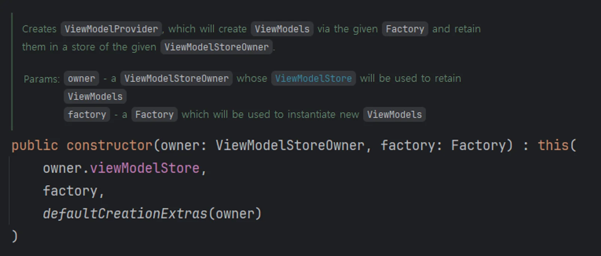
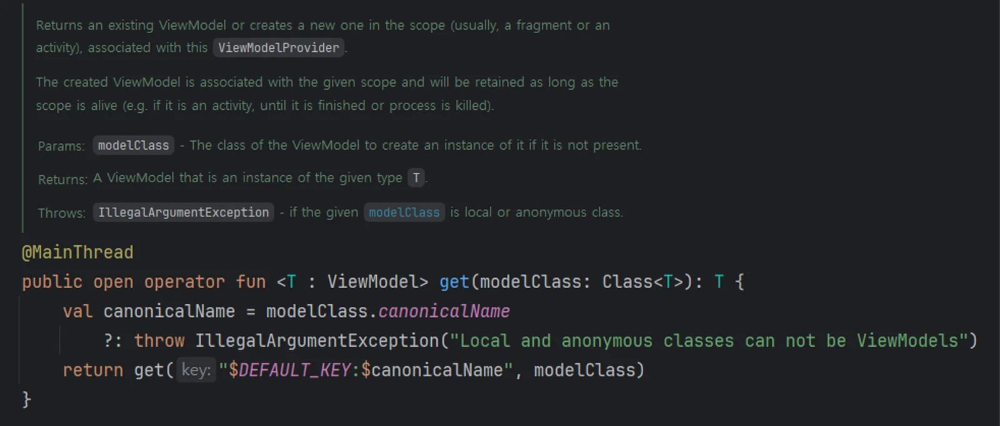
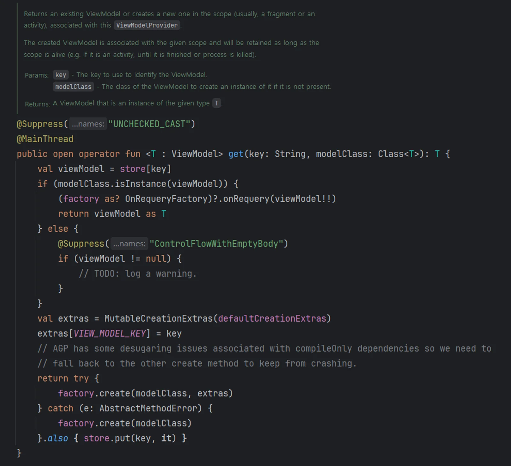
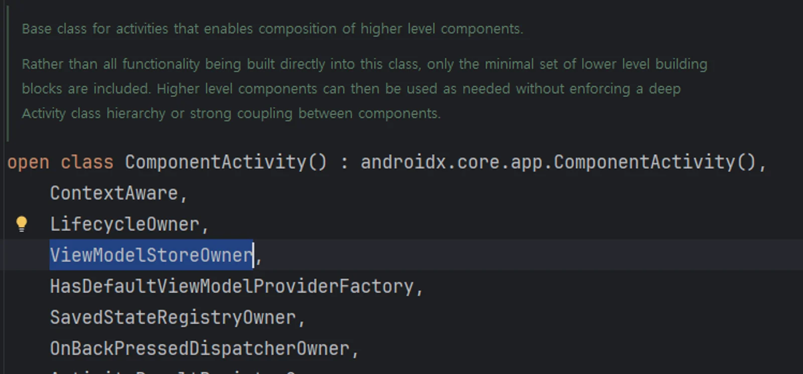
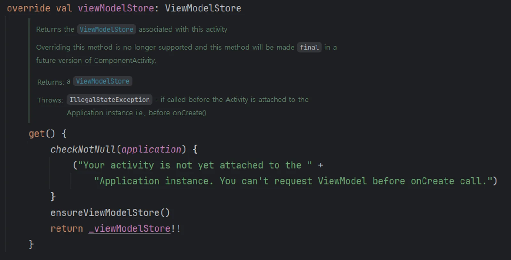
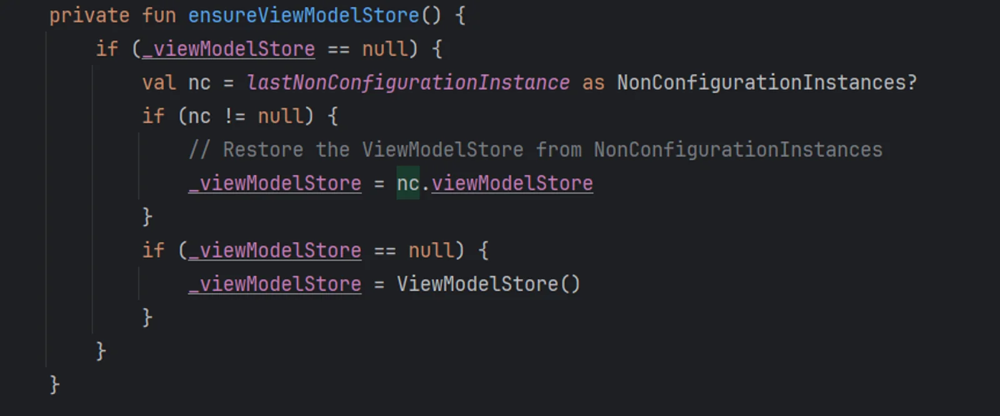
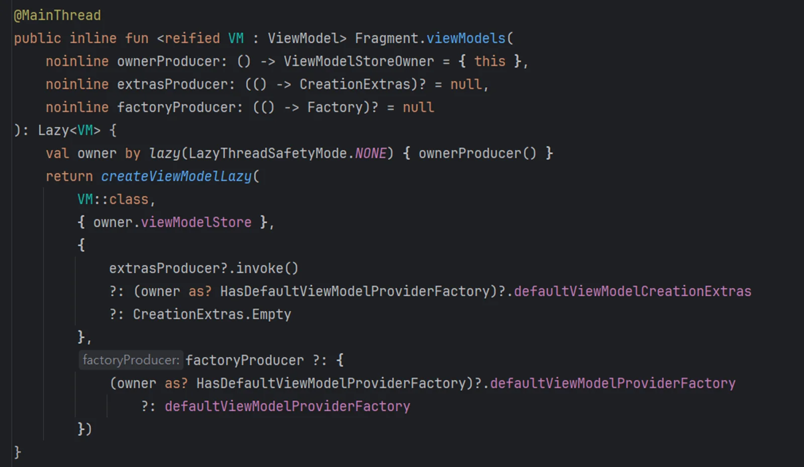
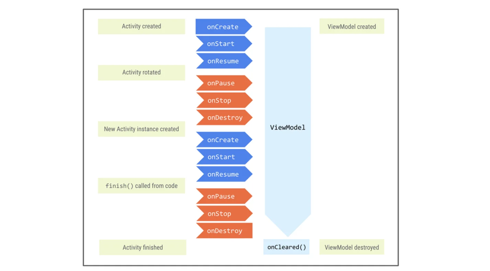
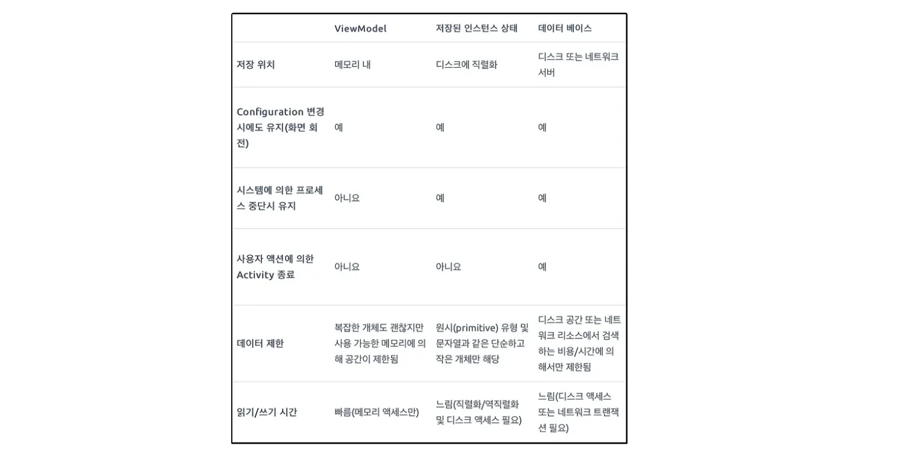
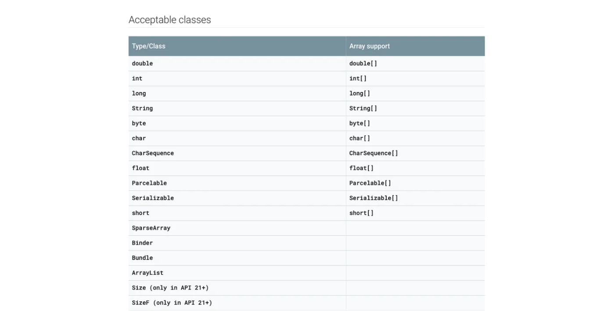

Rotate the phone and your Activity is gone, but its `ViewModel` isn't. In this post I want to look at why: what a ViewModel is good for, how it's wired up internally, and how to save and restore data safely with it, including through `SavedStateHandle`.

## What is a ViewModel?

The `ViewModel` class is designed to store and manage UI-related data in a lifecycle-aware way. It exposes state to the UI and encapsulates the business logic behind it. Its main selling point is that **it caches state and keeps it across configuration changes** such as screen rotation. That means the UI doesn't have to fetch its data again after a configuration change like moving between activities or rotating the screen.

As the name suggests, it was inspired by the ViewModel in the MVVM (Model-View-ViewModel) architecture pattern, and it plays a similar role.

## Why use a ViewModel?

1. **It stores and shares UI data.** A `ViewModel` holds UI-related data and exposes it to the classes that handle the UI through `LiveData`. Different fragments within the same activity can share that data.
2. **Data survives rotation.** When the screen rotates, the current activity instance is destroyed and a new one is created, but the `ViewModel` keeps its data, so you can keep using it as-is without losing anything.
3. **It's lifecycle-aware.** A `ViewModel` knows about the lifecycle it's scoped to and is cleaned up automatically once that lifecycle is destroyed for good. That prevents memory leaks and keeps data management predictable.
4. **It's where business logic lives.** Instead of activities and fragments processing data directly, they go through the `ViewModel`, which separates the UI from the business logic.

So a `ViewModel` is tightly tied to the activity and its lifecycle.

> 💡 So how does a `ViewModel` hold on to its instance through a **configuration change** like screen rotation?

**Note**: ViewModel works out of the box with major Jetpack libraries like Hilt, Navigation, and Compose.

## How a ViewModel is put together

To create a `ViewModel` object, you need the `ViewModelProvider` class. `ViewModelProvider` is a utility class for creating `ViewModel` instances, and you use it in two steps.

1. **Create a ViewModelProvider instance**

   Creating a `ViewModelProvider` takes two arguments.

{width=100 align=center}

- **ViewModelStoreOwner**: `ViewModelStoreOwner` is an interface with a single method that returns a `ViewModelStore`. Activities and fragments are `ViewModelStoreOwner`s by default, because the Android SDK's `ComponentActivity` and `Fragment` classes implement this interface.
- **Factory**: `Factory` is an interface nested in `ViewModelProvider`, and it's what creates `ViewModel` objects. If you don't pass one, a default factory is created. You can also write your own factory to create a `ViewModel` that takes parameters.

From here on, this **ViewModelProvider is responsible for creating and reusing ViewModel instances**.

**2. Create the ViewModel instance**

{width=100 align=center}

Once you have a `ViewModelProvider`, you call its `get` method with the `ViewModel` class you want, and it hands you a `ViewModel` object.

`get` first takes the canonical name of the `ViewModel` class and prefixes it with `DEFAULT_KEY` to build a key. It then calls another `get` overload with that key and the `ViewModel` class reference.

{width=100 align=center}

That function looks up the `ViewModel` instance in the `ViewModelStore` first. If an instance exists, it returns it. If not, it **uses the factory to create a new instance, stores it in the** `ViewModelStore`**, and returns it**.

The `ViewModelStore` belongs to a `ViewModelStoreOwner`, and every activity or fragment has its own `ViewModelStore`. That `ViewModelStore` survives rotation, which is why the new activity instance gets back the same `ViewModel` instance.

> ***If the Activity or Fragment is destroyed and recreated, how does the ViewModelStore survive?***

{width=100 align=center}

`ViewModelStoreOwner` is an interface, and `ComponentActivity` implements it.

So what does that implementation look like?

{width=100 align=center}

- If the `Application` isn't attached to the activity yet, it throws an exception.
  - In other words, don't ask for a `ViewModel` before `onCreate()` is called.
- It calls `ensureViewModelStore()` and returns the `ViewModelStore`.

{width=100 align=center}

- As the code shows, when the new activity object's `ViewModelStore` is `null`, it first tries to pull the previous activity's `ViewModelStore` out of the `NonConfigurationInstance`.
- If the activity is being created for the first time, it always creates a new `ViewModelStore`.
- So on rotation, the `NonConfigurationInstance` of the destroyed activity is handed to the newly created one. That object holds the previous activity's `ViewModelStore`, and that's how the same `ViewModel` instance carries over.

> **That's how a** `ViewModel` **keeps its instance through a** `Configuration Change`.
>
> **So how do you actually create one and put it to work?**

### Creating a ViewModel with a delegate

Kotlin's **delegated properties** make a `ViewModel` easier to create and manage. The code gets shorter, and using the `ViewModel` feels more natural.

{width=100 align=center}

- `viewModels` returns a `Lazy`, so the `ViewModel` instance is created the first time you access it, and the same instance is returned after that.
- `ownerProducer` (default: `this`)
  - `ownerProducer` is a function that provides the `ViewModelStoreOwner`. By default, the current `Fragment` is the `ViewModelStoreOwner`.
  - This parameter changes the `ViewModel`'s scope. For example, pass `requireParentFragment()` to use the parent fragment's `ViewModelStore`.
  - That's handy when a parent and child fragment need to share data.
- `extrasProducer` (default: `null`)
  - `extrasProducer` is a function that provides the `CreationExtras` used when creating the `ViewModel`. `CreationExtras` carries extra data into `ViewModel` creation.
  - It's mostly for advanced setups. By default, `CreationExtras.Empty` is used.
- `factoryProducer` (default: `null`)
  - `factoryProducer` is a function that provides a custom `ViewModelProvider.Factory` for creating the `ViewModel`, so you can plug in your own factory.

#### 1. **Using the default ViewModel delegates**

In Kotlin, `by viewModels()` or `by activityViewModels()` creates a `ViewModel` through a delegate with very little code.

- `by viewModels()`: Use it in an activity or fragment to create a `ViewModel` instance that belongs to that class alone.
- `by activityViewModels()`: Use it to share a `ViewModel` between an activity and its fragments. Multiple fragments in the same activity get the same `ViewModel` instance.

```
class MyFragment : Fragment() {

    // Fragment-only ViewModel instance
    private val viewModel: MyViewModel by viewModels()

    // ViewModel instance shared between the Activity and its Fragments
    private val sharedViewModel: MyViewModel by activityViewModels()
    
    override fun onViewCreated(view: View, savedInstanceState: Bundle?) {
        super.onViewCreated(view, savedInstanceState)
        
        // Process data and update the UI through the ViewModel
        viewModel.someLiveData.observe(viewLifecycleOwner) { data ->
            // Update the UI
        }
    }
}
```

When you read this code, keep in mind that it goes through these steps under the hood:

1. Create a `ViewModelProvider` instance
2. Call `ViewModelProvider.get()`
3. Look up the `ViewModel` in the `ViewModelStore`, or create a new one

#### 2. **Creating a custom ViewModel with ViewModelProvider.Factory**

When a `ViewModel` **needs specific parameters in its constructor**, you create it with a `ViewModelProvider.Factory`. Even then, the delegate keeps it short.

```
class MyViewModelFactory(private val repository: MyRepository) : ViewModelProvider.Factory {
    override fun <T : ViewModel> create(modelClass: Class<T>): T {
        if (modelClass.isAssignableFrom(MyViewModel::class.java)) {
            @Suppress("UNCHECKED_CAST")
            return MyViewModel(repository) as T
        }
        throw IllegalArgumentException("Unknown ViewModel class")
    }
}
```

First, write a custom factory like the one above.

```kotlin
class MyFragment : Fragment() {

    private val repository by lazy { MyRepository() }
    
    private val viewModel: MyViewModel by viewModels {
        MyViewModelFactory(repository)
    }

    // Or
    
    val viewModel2 = ViewModelProvider(this, MyViewModelFactory(repository))
    .get(MyViewModel::class.java)

    override fun onViewCreated(view: View, savedInstanceState: Bundle?) {
        super.onViewCreated(view, savedInstanceState)
        
        // Process data and update the UI through the ViewModel
        viewModel.someLiveData.observe(viewLifecycleOwner) { data ->
            // Update the UI
        }
    }
}
```

Then pass that factory to the delegate. When `by viewModels` is called, the lambda becomes the `factoryProducer`, and that factory is what creates the ViewModel.

You can also use `ViewModelProvider` directly:

- `ViewModelProvider(this, MyViewModelFactory(repository))`: `this` is the `ViewModelStoreOwner` (an `Activity` or a `Fragment`, for example). The second argument is the factory, which carries the parameters the ViewModel needs.
- `get(MyViewModel::class.java)`: returns the instance for the given ViewModel class.

> **Think of it this way: the** `Factory` **defines how a** `ViewModel` **is built, and the** `Provider` **uses that** `Factory` **to actually create and manage it.**

### The ViewModel lifecycle

{width=100 align=center}

- Creation: A `ViewModel` is created the first time it's accessed through a `ViewModelProvider`. When an activity or fragment initializes its `ViewModel`, the `ViewModelProvider` supplies the instance, and that's the moment the `ViewModel` is first created.
- Retention: When the UI controller (activity or fragment) goes through a **configuration change**, the `ViewModel` stays in memory, and the newly created UI controller reuses the existing `ViewModel`. The `ViewModelStore` and `NonConfigurationInstance` mechanism handles this.
- Destruction: When the UI controller **finishes for good**, the `ViewModel` goes away too. At that point its `onCleared()` method is called, so it can clean up before it's released from memory.

**Finishing for good** doesn't just mean "after `onDestroy`". It means cases like these:

- The user presses the back button and the Activity finishes
- A Fragment is removed through a Fragment transaction (remove or replace)

`onDestroy` is called on a configuration change too, but in that case the `ViewModel` stays in memory and the existing instance is reused. In the cases above, the controller never comes back after `onDestroy`, so the `ViewModel`'s `onCleared` is called and the `ViewModel` is removed from memory.

> **This is exactly why we use a** `ViewModel` **to keep data across screen changes, and it's also why you have to clean up data and resources you no longer need in** `onCleared`**. Otherwise you'll leak memory.**

A ViewModel also must never reference a `View`, `Lifecycle`, `Activity`, or `Context`. A `ViewModel` outlives the UI, so holding those references can cause **memory leaks**.

- On top of that, starting with `androidx.lifecycle` 2.5, you can pass one or more `Closeable` objects to the ViewModel constructor, and they're closed automatically when the ViewModel instance is cleared.

  ```kotlin
  class CloseableCoroutineScope(
      context: CoroutineContext = SupervisorJob() + Dispatchers.Main.immediate
  ) : Closeable, CoroutineScope {
      override val coroutineContext: CoroutineContext = context
      override fun close() {
          coroutineContext.cancel()
     }
  }
  
  class MyViewModel(
      private val coroutineScope: CoroutineScope = CloseableCoroutineScope()
  ) : ViewModel(coroutineScope) {
      // Other ViewModel logic ...
  }
  ```

> A `ViewModel` keeps data safe through configuration changes. But what if you want to keep data even when a bottom navigation bar `replace`s the Fragment, that is, even after the `ViewModel` has gone through `onCleared`?

## Keeping data safe with SavedStateHandle

`SavedStateHandle` is part of the Android Architecture Components: a data structure for saving and restoring state inside a `ViewModel`. Like a `Bundle`, it stores data as **key-value pairs**, and it keeps that data across configuration changes and fragment transactions.

SavedStateHandle is tied to the task stack. When the task stack goes away, so does the saved state. That happens when the app is force-stopped, swiped away from the recents screen, or the device reboots. In those cases the task stack is gone and the saved state can't be restored.

With `SavedStateHandle`, a query value survives process death. The user sees the same filtered data set before and after the recreation, without the activity or fragment having to save and restore the value by hand and pass it back to the `ViewModel`.

```kotlin
class MyViewModel(private val savedStateHandle: SavedStateHandle) : ViewModel() {

    companion object {
        private const val KEY_SOME_DATA = "some_data"
    }

    // Save data
    fun saveData(data: String) {
        savedStateHandle.set(KEY_SOME_DATA, data)
    }

    // Restore data
    fun getData(): String? {
        return savedStateHandle.get(KEY_SOME_DATA)
    }
}
```

To work with a SavedStateHandle in a ViewModel, give the ViewModel a constructor that takes a SavedStateHandle, as above. You used to need `SavedStateViewModelFactory` to create the ViewModel instance, but with recent versions of the Fragment library you get the `ViewModel` instance without it and without any extra setup. The default `ViewModel` factory provides the right `SavedStateHandle` to your `ViewModel`.

`SavedStateHandle` also has the other methods you'd expect from a key-value map:

- `contains(String key)` - checks whether there's a value for the given key.
- `remove(String key)` - removes the value for the given key.
- `keys()` - returns every key in the `SavedStateHandle`.

You can also read values from a `SavedStateHandle` through an observable data holder. The supported types are:

- `LiveData`
- `StateFlow`
- [Compose's state API](https://developer.android.com/jetpack/compose/state?hl=ko)

#### Example

```kotlin
class MyViewModel : ViewModel() {

    private val _name = MutableStateFlow("")
    val name = _name.asStateFlow()
    
    fun updateName(name:String){
        _name.value = name
    }
}    
```

Here's the same data-updating code refactored to use `savedStateHandle`:

```kotlin
class MyViewModel(private val savedStateHandle: SavedStateHandle) : ViewModel() {

    companion object {
        private const val NAME_KEY = "name"
    }

    val name: StateFlow<String> = savedStateHandle.getStateFlow(NAME_KEY, "")
 
    fun updateName(name: String) {
        savedStateHandle[NAME_KEY] = name
    }
}
```

Call `updateName()` at the right moments, and the data stays safe when the system kills the process.

I think this would work well for keeping a RecyclerView's scroll position and other variables when you move between screens with bottom navigation.

#### Things to watch out for with SavedStateHandle

{width=100 align=center}

According to the official docs, it sits right in the middle between keeping data through a simple configuration change and saving data to local storage. So `SavedStateHandle` is the wrong tool **when the data only needs to survive simple configuration changes** or **when it has to survive the user finishing the Activity**.

In short, **reach for** `SavedStateHandle` **when you need to keep data temporarily and the data isn't complex**.

> **Key point**: Data stored in saved instance state is usually transient state that depends on user input or navigation. Examples include a list's scroll position, the ID of the item the user wants more detail on, an in-progress selection of user preferences, or text field input.
>
> **Important**: Which API to use depends on where the state is held and what logic it needs. For state used in [business logic](https://developer.android.com/topic/architecture/ui-layer/stateholders?hl=ko#logic), hold it in a ViewModel and save it with `SavedStateHandle`. For state used in [UI logic](https://developer.android.com/topic/architecture/ui-layer/stateholders?hl=ko#logic), use the `onSaveInstanceState` API in the View system or `rememberSaveable` in Compose.
>
> **Note**: State should be simple and lightweight. For complex or large data, use [local persistence](https://developer.android.com/topic/libraries/architecture/saving-states?hl=ko#local).

That's what the official docs say about the typical uses of `SavedStateHandle` and what to watch out for, so keep it in mind.

{width=100 align=center}

Also, whatever you put in a SavedStateHandle ultimately ends up in a **Bundle**, so it has to be something a Bundle can handle.

That said, `Parcelable` or `Serializable` lets you store more complex data structures:

```kotlin
@Parcelize
data class User(val name: String, val age: Int) : Parcelable

class MyViewModel(private val savedStateHandle: SavedStateHandle) : ViewModel() {

    companion object {
        private const val USER_KEY = "user"
    }

    fun saveUser(user: User) {
        savedStateHandle.set(USER_KEY, user)
    }

    fun getUser(): User? {
        return savedStateHandle.get(USER_KEY)
    }
}
```

Here, a `User` object that implements `Parcelable` is saved and restored when needed. For large or complex data, though, a **local database** (Room, for example) or **external storage** is probably a better fit than `SavedStateHandle`.

`SavedStateHandle` pays off even more alongside **Jetpack Navigation**. I'll cover that in a future post.

---

> Sources and further reading

[https://developer.android.com/topic/libraries/architecture/viewmodel?hl=ko](https://developer.android.com/topic/libraries/architecture/viewmodel?hl=ko)

[https://developer.android.com/topic/libraries/architecture/viewmodel/viewmodel-savedstate?hl=ko](https://developer.android.com/topic/libraries/architecture/viewmodel/viewmodel-savedstate?hl=ko)

[https://pluu.github.io/blog/android/2020/03/15/savedstate-flow/](https://pluu.github.io/blog/android/2020/03/15/savedstate-flow/) (in Korean)
