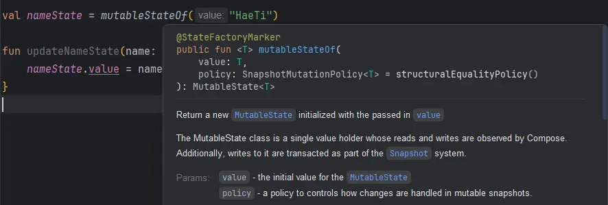
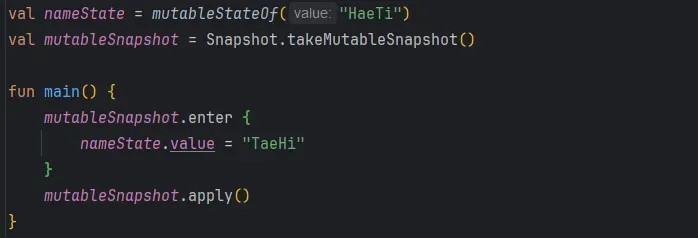
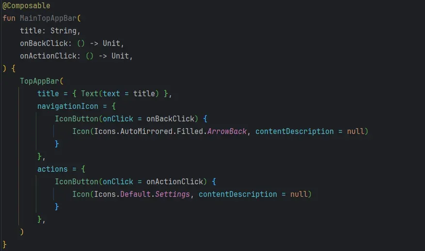
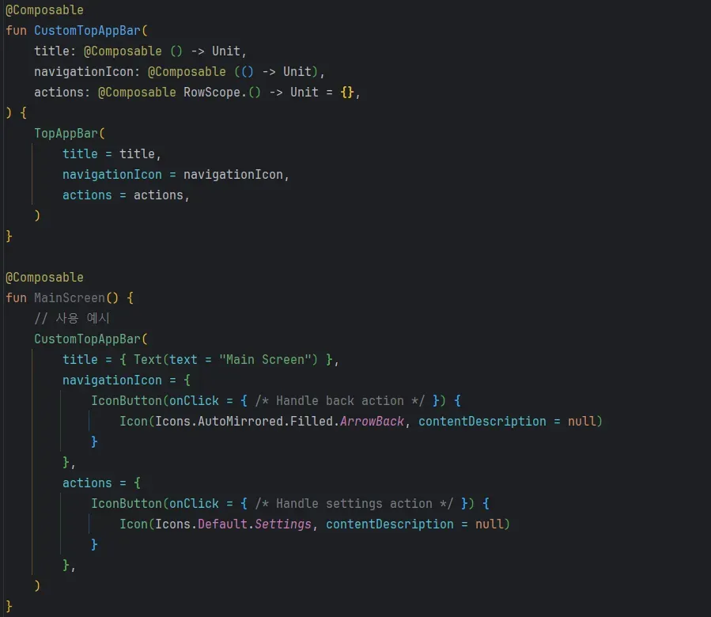

My Effective Kotlin study group, where we read the book together and shared what we learned, wrapped up on 2024/11/07. To mark the occasion, I took some of the book's topics a step further and thought through how they apply to Jetpack Compose.

### Item 1. Limit mutability: safety

Kotlin is a language that values safety and leans toward immutability. Keeping things immutable makes code more predictable and makes it easier for developers to reason about what it does.

When people think of the easiest way to get immutability in Kotlin, they usually think of `val`. A poll run by skydoves shows just how many developers treat Kotlin's `val` keyword as immutable.

{width=100 align=center caption="Source: https://proandroiddev.com/the-val-property-immutable-in-kotlin-2e4cf49207d0"}

But that's only half right. In Kotlin, `val` **doesn't fully guarantee immutability. All it gives you is an immutable reference.** The simplest example is a `List` declared with `val` that actually points to a `MutableList`: elements can still be added to or removed from it.

To guard against cases like this, the book recommends separating mutable collections (`MutableList`, `MutableSet`, etc.) from immutable ones (`List`, `Set`, etc.), using **defensive copies** so outside code can't change the original object's state, or relying on the immutability of a `data class`.

Limiting mutability with these techniques has a few benefits:

- **Better safety**: state doesn't change, so the code is more predictable.
- **Thread safety**: immutable objects are thread-safe, so you can use them safely without synchronization.
- **The benefits of functional programming**: immutability lets you write pure functions, which makes code easier to reuse and test.

Creating immutable objects to limit mutability can cost you **memory allocation and GC overhead**. That said, modern JVMs and the Android runtime handle object allocation and garbage collection efficiently, so in most cases it doesn't hurt performance much. (I haven't verified this myself yet.)

I also think the safety and maintainability you get from immutable objects outweigh that overhead. (Again, that's my personal opinion.)

Building on that immutability, **functional programming** assumes data doesn't change, which lets you write **pure functions** and **code without side effects**. That style of functional programming has had a big influence on Jetpack Compose.

Compose follows a declarative style. You focus on **what** to draw and let the Compose framework handle **how** to update it. Thanks to this declarative approach, you spend your effort declaring the state you need and writing the UI for it, not managing mutability.

On the flip side, mutable state in a declarative UI needs to be handled very carefully. If mutable state changes at an unexpected moment, the UI can become inconsistent, or the state can fall out of sync across threads and cause concurrency bugs.

That's why Compose has its own state management mechanism internally, the **snapshot system**, to control and manage mutability. The snapshot system handles state changes as transactions. It **tracks state changes automatically**, **triggers recomposition only when something changes**, and helps the UI **stay close to immutable**.

Snapshot state is isolated state that can remember and manage its own changes. You get snapshot state when you call functions like `mutableStateOf`, `derivedStateOf`, `produceState`, and `collectAsState`.

{width=100 align=center}

As the docs above show, `mutableStateOf` creates Compose **snapshot state and starts tracking changes to it automatically**. Whenever the state changes, Compose **automatically recomposes every composable that reads it**.

In Compose's snapshot system, state changes are handled like **transactions**. Every time state changes, the snapshot system records it as part of a transaction, and calling the `apply` method finally commits the changes. Because of this structure, Compose manages state changes safely and keeps them **isolated from the UI** until they're committed.

{width=100 align=center}

Here, `takeMutableSnapshot` creates a new mutable snapshot, and calling `apply` commits the state. Even if you change state values inside the `enter` block, **the changes don't reach the global state until** `apply` **is called**; they stay in the snapshot's own isolated state.

On top of that, Compose's snapshot system stays safe across threads using multi-version concurrency control (**MVCC**). **MVCC** is one of the concurrency control techniques used to implement the **I** in **ACID** (Atomicity, Consistency, Isolation, Durability). With it, each thread creates its own independent snapshot of the state to read or modify, and the changes only reach the global state when `apply` is called.

{width=100 align=center}

This code creates a mutable snapshot with `takeMutableSnapshot` and changes state inside the `enter` block. Until `apply` is called, the changes stay **isolated**, so state stays safe even when several threads work on it at once. (The related concepts here are StateObject and StateRecord.)

The values captured in a snapshot are kept until `snapshot.dispose()` is called. Snapshots have a lifecycle, so you must dispose of a snapshot once you're done with it.

If you don't call `snapshot.dispose()`, every resource tied to the snapshot, along with the state it holds, leaks.

Each snapshot also gets an **ID** when it's taken, which makes it easy to tell apart from other versions of potentially the same state held by other snapshots. That lets the program's state be versioned, so it stays consistent from version to version. (That's MVCC.)

#### Summing up

`In Kotlin?`

You limit mutability with immutable objects or the `val` keyword, but that alone can't guarantee full immutability in every situation. So you use a `data class`'s `copy` method or defensive copying to keep the state from being changed from the outside.

`In Compose?`

Compose reinforces immutability through the snapshot system. The snapshot system keeps the state at a specific point in time on its own, so you can still read that state even after it changes later. It keeps mutable state isolated so it doesn't unexpectedly affect other composables, and it uses MVCC to prevent conflicting changes between snapshots, which keeps state management stable and consistent.

## Item 19. Do not repeat knowledge: reusability

> **If you're copying and pasting in your project, you're probably doing something wrong.**

That's how the book sums up this item.

In Kotlin, the DRY (Don't Repeat Yourself) principle matters because it makes code easier to maintain and prevents bugs when the code changes. Repeated logic or UI should be pulled out into its own function or class so it follows the **Single Source of Truth (SSOT)** principle. For example, if several screens need business logic that fetches the same data, you can move it into a separate repository or utility function and manage it in one place.

The item defines "knowledge" as any piece of intentional information, which can be expressed as code or data. Of the kinds of knowledge, developers mostly deal with business logic and general algorithms. Algorithms are stable and don't change much, but logic tends to change over time.

UI design standards and techniques change even **faster**. The book recommends an agile approach to change that's bound to come, and calls **repeated knowledge** **the biggest enemy of change**. My reading is that if you have to change something repeated in many places, updating every copy by hand wastes resources and invites human error, and that's why the book calls it the biggest enemy of change.

#### So when is repetition OK?

Sometimes two pieces of code look alike but shouldn't be extracted into one. That happens when they only look similar but represent **different knowledge**.

When you **abstract** something, you're designing an **API** of your own, and every developer who uses it has to learn it. If the abstraction doesn't actually cover the same knowledge, extracting it is likely to cause problems.

When deciding whether two pieces of code represent the same knowledge, the most important question is: **are they more likely to change together, or separately?** It matters most because **extracting the common part makes changing both together easier, but changing just one of them harder**.

A useful rule of thumb: if the **business rules** come from **different sources**, assume they're likely to change independently. For those cases, there's a rule that keeps us from extracting code we shouldn't: the **Single Responsibility Principle**.

### Single responsibility principle

The rule that tells you when code should *not* be extracted into something shared is the **single responsibility principle** from **SOLID**. It says **a class should have only one reason to change**. Put simply, there should never be a situation where two actors need to change the same class.

An **actor** here is a source of change, often personified as developers from different departments who don't know much about each other's work or domain. Even if a project has only one developer, multiple managers should still be treated as separate actors. They're two **sources of change** that don't know much about each other's domain. **Two actors having to edit the same code is especially dangerous.**

Compose is very exposed to this risk too. If you combine state or UI changes that serve different purposes into one composable, you can end up with changes you didn't expect.

{width=80 align=center}

Say you have a TopAppBar like the one above. Someone new to Compose might implement it like the code below. Assume the default font size, background color, and so on have been customized in this TopAppBar. (I've left that out to keep the code short.)

{width=100 align=center}

This TopAppBar is used on two screens, and then one screen needs a different icon. In that situation, you might think the best you can do is copy and paste it into two TopAppBars.

But Compose has the **slot API**, which makes it fairly easy to stick to SRP. With slots, you can design composables flexibly and handle changes easily.

{width=100 align=center}

Designed like this, each element comes in as its own slot, so you can swap individual elements freely. That makes the component more reusable and easier to maintain.

#### No silver bullet

Say you've used the slot API in Compose, or split your business logic models properly so they follow SRP. Are you **sure the pieces you split out will never need to be split again**?

During a large app redesign I worked on recently, the structure of a model my predecessor had extracted for shared use changed. Every place that referenced that model needed its own logic changes, so the abstraction that was supposed to improve reusability and maintainability ended up hurting both. Then again, building a separate model for every screen might not have been efficient either.

> **Extreme approaches** aren't healthy; we always have to find a **balance**. **Whether or not to extract something** is sometimes a hard call, and that's why designing information systems well is an **art**. It takes time and a lot of **practice**.

That's how the book describes the conclusion of Item 19. We can never know the future perfectly, so we have to find a good balance, and I think troubleshooting experience gets you some of the way there. Just as the author used the word "art", I think ideal design is very hard work.

## Item 27. Use abstraction to protect code against changes

> "Walking on water and developing software from a specification are easy if both are frozen." – Edward V. Berard

This item is similar to Item 19 above. The book walks through the pros and cons of abstraction, using constants, functions, classes, and interfaces as examples. The conclusion, again, stresses keeping a good balance.

In Compose, state management is everything. If the UI and state are tightly coupled, even a simple change can ripple through the whole UI structure. In that case, it's better to **separate state management from UI logic** and design them to **interact through an abstract interface**.

#### StateFlow and mutableStateOf

In Compose, `State` and `MutableState` automatically trigger recomposition, which gives you reactive state management. But as a project gets more complex, you increasingly need to deal with state changes in layers that aren't UI. That's where an abstract interface comes in.

The most common example is `StateFlow`. `StateFlow` exposes state changes as an observable stream of data, so it's easy to integrate in layers that aren't Compose. That makes it easy to reflect state changes driven by business logic in the UI and keeps state management consistent.

{width=100 align=center}

`collectAsState` is an extension function on `StateFlow` that connects Compose with `StateFlow`, so composables can easily observe changes in a `StateFlow`'s state. It converts the latest value of the `StateFlow` into a `State`, and it's the standard way to observe a `StateFlow` directly from a `Composable` function.

By converting a `StateFlow` into a `State`, `collectAsState` makes Compose's `Composable` functions **react automatically when recomposition is needed**. When `StateFlow<T>.collectAsState` is called in this code, it converts the current `StateFlow` value into a `State`. By default, it passes the `StateFlow`'s `value` property as the initial `State` value.

### Looking back

I don't think I would have read Effective Kotlin without the study group. The book is long, and more of it was hard than I expected. (The covariance and contravariance part still didn't click after three reads...) But the study group kept me accountable, I finished it over 11 weeks, and it cleared up a lot of things I'd been wondering about, so I'm really happy with it.

I wanted to cover more in this post, but Compose is written in Kotlin too, so almost every topic applies as-is and nothing else stood out as worth a special look. Immutability (tied to functional programming), and reusability and abstraction (how far to split up components) are the most important ideas you can bring to Compose, so those are what I covered. Next, I plan to study topics like the snapshot system further through Jetpack Compose Internals.

In any field, the fundamentals matter most and are what makes the difference. I think I should reread my notes on the book every so often to keep it fresh. And finally, I suspect that writing a dev book myself, even a modest one, would make my fundamentals a lot stronger, so I'm going to let myself dream of becoming an author someday.
