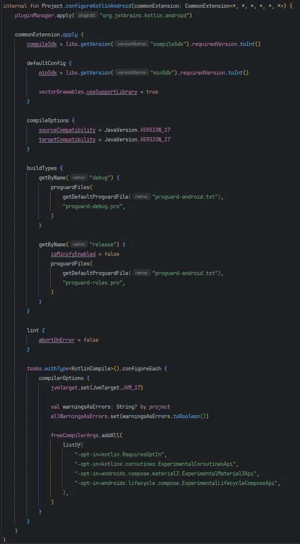

Once you start splitting an app into modules, duplicate files pile up fast. Files like `AndroidManifest.xml`, `proguard-rules.pro`, and `build.gradle.kts` are often either unnecessary or identical to something defined elsewhere. Before this, developers either deleted them by hand, one by one, or just left the duplicated code in place.

A few approaches came out of this, and **buildSrc** was the most popular. It let you manage settings shared across modules **in one place**, which made them easy to maintain.

```kotlin
// buildSrc example 
object Configuration {
  const val majorVersion = 1const val minorVersion = 1const val patchVersion = 2const val versionName = "$majorVersion.$minorVersion.$patchVersion"const val versionCode = 10
}
```

But it came with the problems centralized management always brings: **longer build times** (the same downside a single-module project has) and **a lack of reusability and encapsulation**. The setup needed to be broken up so it could be more flexible, and **build-logic** is how I tackled that.

There are several ways to declare the plugins that make up build-logic, but this post covers the **custom plugin** approach. With custom plugins, you define standalone plugin classes that manage each module's shared configuration, and you share those plugins across modules.

I won't go into how the Gradle and compiler options themselves get applied. This is meant as an introduction and a guide.

### Creating the build-logic module

```kotlin
enableFeaturePreview("TYPESAFE_PROJECT_ACCESSORS")
```

First, add the line above to the `settings.gradle.kts` at the project root. It turns on `TYPESAFE_PROJECT_ACCESSORS`, which makes dependencies between projects safer to declare.

For example, instead of the old way:

```kotlin
dependencies {
    implementation(project(":core:model"))
    implementation(project(":core:ui"))
    implementation(project(":feature:home"))
}
```

you can write this once `TYPESAFE_PROJECT_ACCESSORS` is enabled:

```kotlin
dependencies {
    implementation(projects.core.model)
    implementation(projects.core.ui)
    implementation(projects.feature.home)
}
```

and get compile-time safety.

```kotlin
// setting.gralde.kts(:build-logic)
dependencyResolutionManagement {
	repositories {
		google()
		mavenCentral()
	}
	versionCatalogs {
		create("libs") {
			from(files("../gradle/libs.versions.toml"))
		}
	}
}

rootProject.name = "build-logic"include(":convention")
```

Next, put the code above in the build-logic module's `settings.gradle.kts` so dependency versions are managed centrally in `libs.versions.toml`.

```kotlin
org.gradle.parallel=true
org.gradle.caching=true
org.gradle.configureondemand=true
```

Then add a `gradle.properties` file with these build-speed settings to build-logic. Here's what each property does:

- `parallel`: turns on parallel builds so the build runs faster.
- `caching`: turns on the build cache so tasks whose inputs haven't changed come from the cache.
- `configureondemand`: configures only the projects that are needed, which speeds up build initialization.

```kotlin
// build.gradle.kts (build-logic:convention)
plugins {
	`kotlin-dsl`
}

java {
	sourceCompatibility = JavaVersion.VERSION_17
	targetCompatibility = JavaVersion.VERSION_17
}

dependencies {
	compileOnly(libs.android.gradlePlugin)
	compileOnly(libs.kotlin.gradlePlugin)
	compileOnly(libs.compose.compiler.gradlePlugin)
	compileOnly(libs.ksp.gradlePlugin)
}
```

The dependencies the build logic needs go in as `compileOnly`, so they're only needed at compile time and not at runtime. This project uses Kotlin 2.0.21, so I set up the compose-compiler plugin, plus the KSP plugin for Hilt.

## Which custom plugins should I build?

The project I applied this to is built entirely with Jetpack Compose. It uses Compose-specific libraries like Jetpack Navigation for Compose and Coil for Compose, and I declared them as version catalog bundles in `libs.versions.toml` so they're easy to add:

```kotlin
[bundles]
# Compose Libraries
compose = [
	"compose-ui",
	"compose-ui-graphics",
	"compose-ui-tooling-preview",
	"compose-material",
	"compose-material3",
	"compose-foundation",
	"compose-runtime",
	"androidx-activity-compose",
	"androidx-lifecycle-viewmodel-compose",
]

# Coil Libraries
coil = [
	"coil-compose",
	"coil-network-okhttp"
]
```

With an all-Compose project in mind, I designed these custom plugins:

- **AndroidApplicationPlugin**: shared configuration for the app module
- **AndroidComposePlugin**: shared configuration for modules that use Compose
- **AndroidLibraryPlugin**: shared configuration for Android library modules
- **HiltPlugin**: shared configuration for modules that use Hilt for DI
- **JavaLibraryPlugin**: shared configuration for Java-based common modules that don't depend on Android

On top of these, I combined the plugins above with a few extra libraries into a DataPlugin and a FeaturePlugin. More on those later.

## How should I build them?

> I wrote separate extension functions for `DependencyHandlerScope`, `VersionCatalog`, and `Project`.

This raises a question: **won't the code for these plugins end up duplicated?** The basic Kotlin setup, for example, would go into both AndroidApplicationPlugin and AndroidLibraryPlugin. So why not use extension functions, one form of abstraction, to avoid that?

That line of thinking is why I went with extension functions. Covering every extension function I used to build the plugins would make this post far too long, so I'll only show the Kotlin one.

{width=50 align=center caption="KotlinAndroid.kt"}

This extension function is shared by the Android application and library plugins and **keeps the Kotlin and basic build settings consistent**. Here's what it sets up:

- Applies the Kotlin plugin
- SDK settings
- Vector drawable support
- Java version
- Build types (if build-variant logic grows later, I plan to pull it into its own plugin or extension function)
- Doesn't fail the build on lint errors or when compiling experimental APIs
- JVM target

Then I used the extension function in both plugins:

```kotlin
class AndroidApplicationPlugin : Plugin<Project> {
	override fun apply(target: Project) {
		with(target) {
			pluginManager.apply("com.android.application")

			extensions.configure<ApplicationExtension> {
				configureKotlinAndroid(this)
				configureComposeAndroid(this)

				with(defaultConfig) {
					targetSdk = libs.getVersion("targetSdk").requiredVersion.toInt()
					versionCode = libs.getVersion("versionCode").requiredVersion.toInt()
					versionName = libs.getVersion("versionName").requiredVersion
				}

				dependencies {
					implementation(libs.getLibrary("timber"))
				}
			}
		}
	}
}
```

This applies the Android application plugin, sets up the SDK versions, and makes Timber the logging library everywhere. I didn't show it in this post, but it also applies the Compose extension function.

```kotlin
class AndroidLibraryPlugin : Plugin<Project> {
	override fun apply(target: Project) {
		with(target) {
			pluginManager.apply("com.android.library")

			extensions.configure<LibraryExtension> {
				configureKotlinAndroid(this)
				configureKotlinCoroutine(this)
			}

			dependencies {
				implementation(libs.getLibrary("timber"))
			}
		}
	}
}
```

This one applies the Android library plugin and the coroutine extension function. Timber is added here too, so it's available everywhere.

Next up are the **custom plugins for the feature and data modules** I mentioned earlier. Personally, this is where custom plugins paid off the most. Feature modules use the Android library plugin, and the whole project uses Hilt and Compose. Every feature module also depends on core modules like core:designsystem. (That's true for my project, at least. Obviously these won't always be shared in yours.)

```kotlin
class MapisodeFeaturePlugin : Plugin<Project> {
	override fun apply(target: Project) {
		with(target) {
			pluginManager.apply {
				apply("com.android.library")
				apply("mapisode.android.hilt")
				apply("mapisode.android.compose")
			}

			dependencies {
				implementation(project(":core:ui"))
				implementation(project(":core:designsystem"))
				implementation(project(":core:model"))
				implementation(project(":core:navigation"))
				implementation(libs.getBundle("navigation"))
			}
		}
	}
}
```

That's a plugin for feature modules, designed exactly the way I wanted. You define the shared logic every feature module needs up front by applying the dependencies and plugins described above, then apply it to all the feature modules.

(Some of the plugin IDs being applied above might not make sense yet. I'll explain them shortly.)

```kotlin
	override fun apply(target: Project) {
		with(target) {
			pluginManager.apply {
				apply("mapisode.android.library")
				apply("mapisode.android.hilt")
				apply("org.jetbrains.kotlin.plugin.serialization")
			}

			dependencies {
				val retrofitBom = libs.getLibrary("retrofit-bom")
				implementation(platform(retrofitBom))
				implementation(project(":core:model"))
				implementation(project(":core:network"))
				implementation(libs.getLibrary("kotlinx.serialization.json"))
				implementation(libs.getBundle("retrofit"))
			}
		}
	}
}
```

The plugin for data modules works the same way. It applies the dependencies and plugins every data module needs, and it depends on core:model and on core:network, which holds the OkHttp logic.

## How do I use them?

Once the plugins are written, you need to register them before you can use them:

```kotlin
// build.gradle.kts (build-logic:convention)// Code covered earlier is omitted 

gradlePlugin {
	plugins {
		register("androidApplication") {
			id = "mapisode.android.application"
			implementationClass = "AndroidApplicationPlugin"
		}

		register("androidLibrary") {
			id = "mapisode.android.library"
			implementationClass = "AndroidLibraryPlugin"
		}

		register("feature") {
			id = "mapisode.feature"
			implementationClass = ".MapisodeFeaturePlugin"
		}

		register("data") {
			id = "mapisode.data"
			implementationClass = "MapisodeDataPlugin"
		}
		...

	}
}
```

Inside the `gradlePlugin` block, each plugin gets an `id` and its implementation as `implementationClass`, and `register` registers it. The name passed to `register` is an arbitrary identifier: a local Gradle name used to refer to the plugin within the project. It's separate from the `id` and only distinguishes plugins inside the `gradlePlugin` block.

Add the version catalog on top of this and it gets even safer to use:

```kotlin
# gradle/libs.versions.toml
# Custom Plugins (Build Logic)
mapisode-android-application = { id = "mapisode.android.application", version = "unspecified" }
mapisode-android-library = { id = "mapisode.android.library", version = "unspecified" }
mapisode-feature = { id = "mapisode.feature", version = "unspecified" }
mapisode-data = { id = "mapisode.data", version = "unspecified" }
...
```

Adding the `id` of each custom plugin defined in `build.gradle.kts` puts them under the version catalog. Aliases like `mapisode-feature` make them easy to apply from each module:

```kotlin
// build.gradle.kts(feature:home) 
plugins {
    alias(libs.plugins.mapisode.feature)  
}
```

Before, the `build.gradle.kts` for `feature:home` would have had a lot of duplicated code, from the SDK settings to the dependencies. With **build-logic**, those three lines apply all the shared plugins, Android settings, and dependencies. Dependencies and plugins that only `feature:home` uses still have to be added separately, of course.

## My take

In multi-module projects, I used to have no choice but to write the same code in every module, even though they all used the same libraries. Before version catalogs came along, I even ended up with different versions of the same library across modules.

build-logic makes all of those problems go away. I haven't found a reason not to use it yet. I suspect the downsides will start to show once there are many more projects and modules to manage, so that's something I still need to study and dig into.

That said, extracting shared logic isn't simple. Deciding what to extract is hard, and some people call good system design an art. You always have to find the **balance**, and I think that balance is something you can only learn through experience. I wrote about this in another post if you want to read more:

[**Reading Effective Kotlin and applying it to Compose**](post/effective-kotlin)
