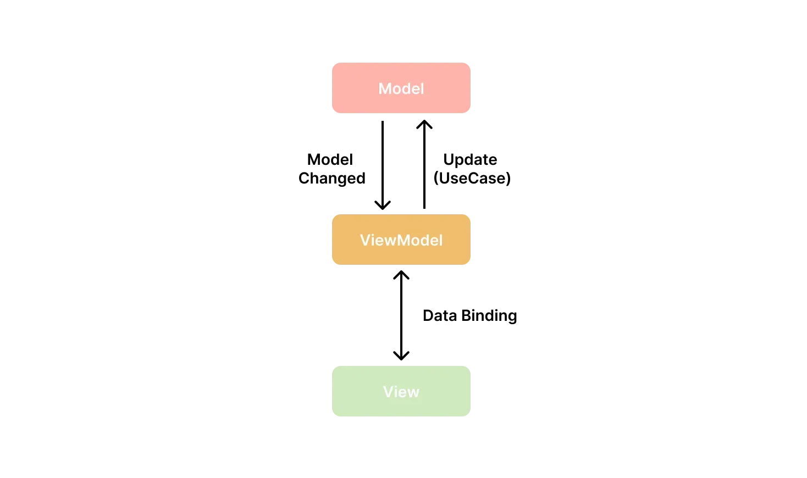
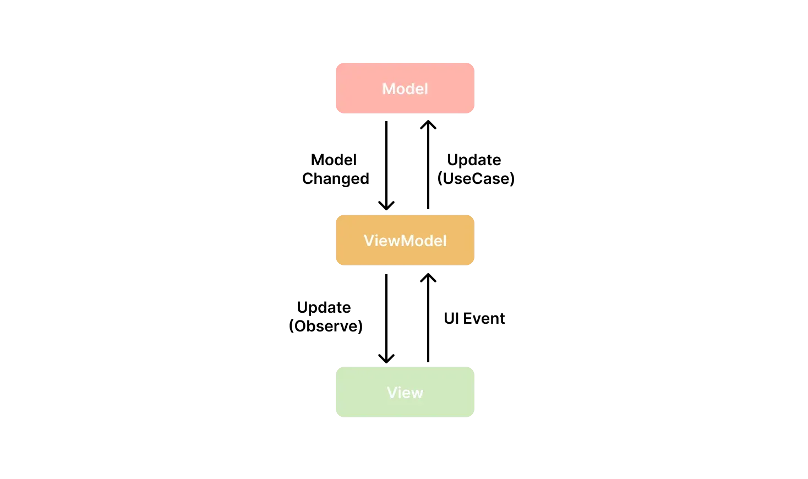
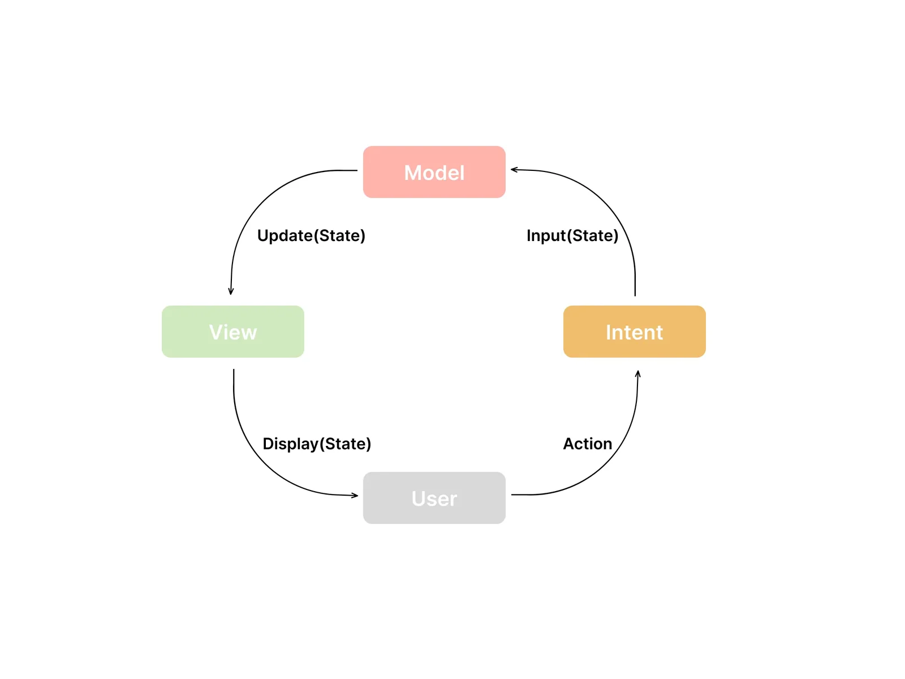
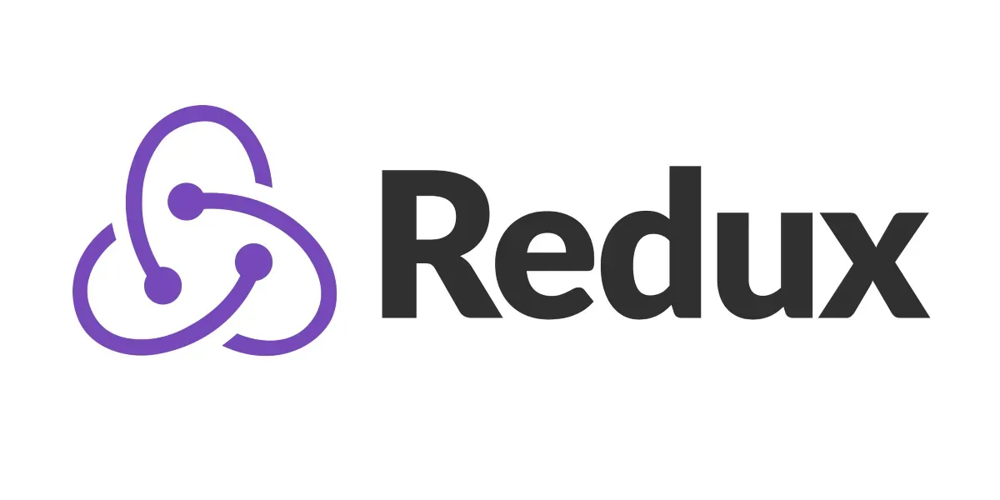
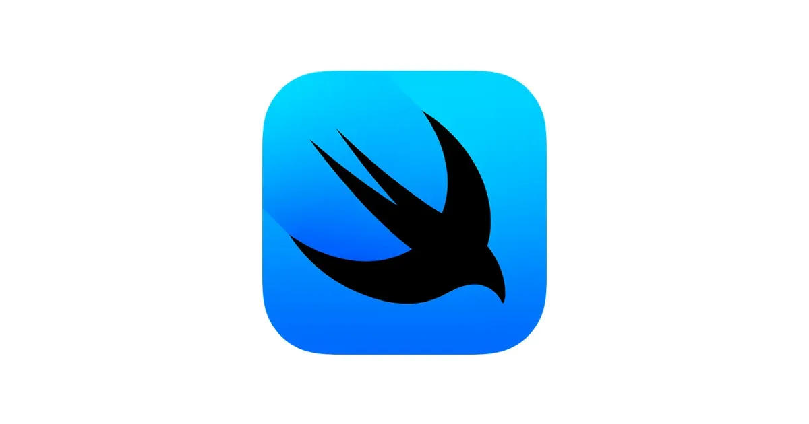
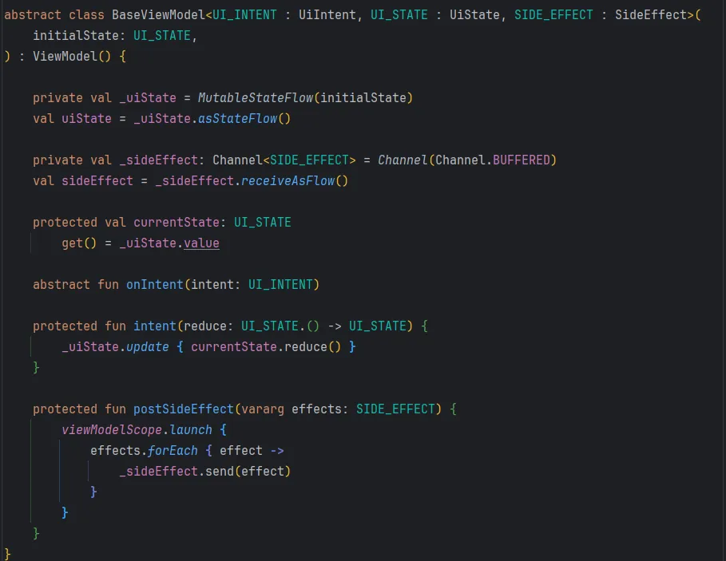
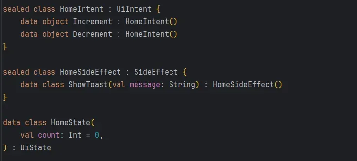
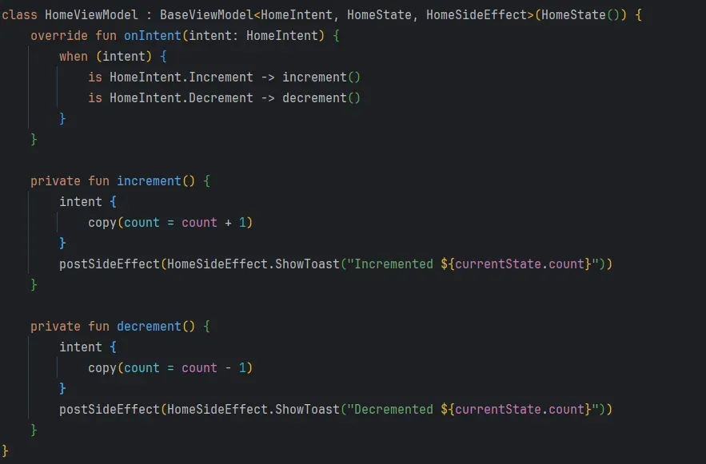

본 아티클은 [Orbit 라이브러리](https://github.com/orbit-mvi/orbit-mvi)로 MVI 아키텍처 구현 경험이 있는 상태에서, MVI 아키텍처를 라이브러리 없이 구현하다가 생긴 여러가지 고민과 고찰이 들어 있는 내용입니다. 다음과 같은 3가지 챕터로 구성되며, 개인적인 생각이 많이 들어간 글이니 양해 부탁드립니다.

1. MVVM, MVI 중 무엇이 Compose에 적합하고 각각의 장단점과 차이는 무엇인가?
2. Swift UI, React에서는 어떻게 상태 관리를 하고 있고 MVI와 비슷한 점은 무엇일까? (Feat. TCA)
3. 안드로이드에서 라이브러리 없이 MVI 패턴을 어떻게 구현하는 것이 가장 이상적일까?

MVI 패턴을 더 잘 이해하기 위해 공부하며 적은 글이기에, 다시 한 번 말씀드리지만 정확성이 떨어질 수 있으니 주의 부탁드립니다. 특히 React, Swift 부분은 간단하게 살펴본 정보를 작성한 것이기 때문에 틀린 부분이 많을 수 있습니다 😢

## 1. MVVM과 MVI, 그리고 Compose에서는?

#### MVVM과 MVI의 공통점

먼저, MVVM과 MVI는 모두 **프레젠테이션 계층**을 분리하기 위한 아키텍처 패턴이다. 이들은 애플리케이션의 전체 아키텍처를 정의하는 것이 아니라, **UI와 관련된 부분을 관리**하고 **비즈니스 로직과 UI 렌더링 로직을 분리**하는 데 초점을 맞춘다. 이러한 패턴을 사용하면 코드의 **유지보수성**이 향상되고, **테스트 용이성**이 증가하며, **가독성**이 높아진다.

이름으로부터 알 수 있듯이 두 패턴 모두 **Model**과 **View**를 포함한다.

- **Model**: 애플리케이션의 데이터와 비즈니스 로직을 담당한다.
- **View**: 사용자에게 보여지는 UI를 담당하며, 상태를 화면에 렌더링한다.

하지만 이 두 패턴은 **상태 관리 방식**과 **데이터 흐름**에서 큰 차이를 보인다.

#### MVVM (Model - View - ViewModel)

MVVM은 View와 ViewModel이 상호작용하는 구조를 가진다. **ViewModel**은 **View**에 필요한 데이터를 제공하고, 사용자의 입력을 받아서 **Model**을 업데이트한다. 이때 종종 **데이터 바인딩**을 사용하여 **ViewModel**과 **View** 사이를 연결한다.

{width=100 align=center}

위와 같이 View와 ViewModel은 밀접하게 서로 연결되어, View의 변경 사항이 ViewModel에 반영되고 ViewModel의 변경 사항이 View에 자동으로 반영된다.

필자는 이러한 데이터 바인딩을 안드로이드를 처음 접했을 때에 아주 애용했다. 간단한 코드로도 UI를 업데이트할 수 있었으며, BindingAdaptor를 함께 사용하여 더 복잡한 로직을 첨가하여 UI를 업데이트 할 수 있었다. 하지만 아는 것이 더 많아져서 코드를 더 다채롭게 작성하면 할수록, UI 상태가 복잡해지고 의도하지 않은 화면이 나타나는 경우가 많아졌다.

또 기존에 개발이 완료된 프로젝트에 유지보수 및 신규 기능 개발 담당으로 중간에 합류하게 된 경우가 있었는데, UI를 업데이트하는 부분이 ViewModel, XML 레이아웃 파일, BindingAdaptor, CustomView 등등 많은 곳에 퍼져 있기에 복잡하고 가독성이 떨어져서 유지보수하기 굉장히 힘들었던 경험이 있다.

이러한 문제상황을 **Unidirectional Data Flow**, 즉 **단방향 데이터 흐름**을 가지게 하는 패턴으로 극복할 수 있었다.

{width=100 align=center}

Compose 방식, XML 방식과는 상관 없이 이 방법에는 옵저버 패턴이 필수적으로 들어간다. Compose에서는 데이터 흐름을 `collectAsState()`, 말 그대로 구독하고 State로 변환하여 사용하고, XML에서도 마찬가지로 구독하여 사용한다. LifeCycle 관점에서 주의할 점이 있지만 모두 다 대처가 가능하다.

이런 방식을 굉장히 자주 사용하고, 개인적으로 `out` 키워드를 통해 공변성을 가지게 하여 타입 호환성을 높인(데이터를 소비하지 않게 함) UiState 인터페이스으로 상태를 정의하여 UDF를 가지게 하는 것을 선호하였다.

하지만 프로젝트의 규모가 커지고, 협업하는 개발자의 수도 적지 않았기에 이벤트 처리에 대한 일관성이 부족하고 상태 변경에 대한 통제가 부족하다는 우려가 생겼다. Compose의 경우 더 긴밀하게 상태를 관리해야 하는데, 사소한 휴먼 에러가 앱에 치명적인 영향을 미치면 어떡하지? 라는 고민을 가지고 있었다.

위와 같은 우려를 해결하는데 다양한 방법이 있는 것으로 알고 있다. 그 중 하나인 MVI 패턴을 다뤄보겠다.

#### MVI (Model - View - Intent)

**MVI** 패턴은 다음과 같은 구성 요소로 이루어진다.

- **Model**: 데이터와 비즈니스 로직을 나타낸다.
- **View**: 상태에 기반하여 UI를 렌더링한다.
- **Intent**: 사용자의 행동이나 이벤트를 나타낸다.

MVI는 **단방향 데이터 흐름**과 **불변 상태**를 강조하고 아래와 같은 데이터 흐름을 가진다.

{width=100 align=center}

1. **Intent**: 사용자의 행동이 Intent로 캡처된다.
2. **ViewModel**(선택): Intent를 처리하고, 필요한 작업을 수행하여 Model을 업데이트한다. 개인적으로 이 과정에서 ViewModel이 존재하지 않아도 Intent를 처리할 수 있다고 생각한다.
3. **Model**: 업데이트된 상태를 기반으로 새로운 불변 State를 생성한다.
4. **View**: 새로운 State를 관찰하여 UI를 업데이트한다.

위 데이터 흐름으로 부터 알 수 있듯이 MVI패턴은 반응적이며 MVC의 핵심 아이디어를 따른다. Intent가 사용자를 관찰하고, Model이 Intent를 관찰하고, View가 Model을 관찰하고, 사용자가 View를 관찰하기 때문에 매우 반응적이다. 이러한 각 구성 요소가 스트림을 통해 참조적으로 투명한 함수로 표현하고, View와 Intent는 각각 한 방향으로 사용자와 Model 사이의 간극을 메우기 때문에 원래의 MVC 목적에 부합한다.

이런 특징을 가진 MVI 패턴은 아래와 같은 장점을 가진다.

1. **UDF 강제** : 흔히 강제한다고 표현하긴 하지만, 완벽하게 동의하지는 않는다. 이 부분에 대해서는 본 글의 마무리 부분에서 다시 다룰 예정이다.
2. **불변 상태 관리** : 모든 상태를 불변 객체로 관리하여 상태 변경 추적이 용이하고, SideEffect를 최소화한다.
3. **이벤트 처리의 단일화** : 모든 이벤트를 **Intent**로 캡슐화하여 이벤트 처리 방식을 일관되게 구축한다.
4. **선언형 UI 방식과의 조화** : Compose는 선언형 UI 프레임워크이고, UDF를 지향한다. MVI는 **상태 관리를 단순화하고 예측 가능하게** 하므로 상태에 따라 UI를 재구성하는 Compose에서 적합한 패턴이다.

위 내용만 보면 Compose에서 쓰지 않을 이유가 없어 보인다. 하지만 아래와 같은 단점도 존재한다.

- **보일러플레이트 코드 증가** : 각 화면에 대한 State, Intent, SideEffect 등을 정의해야 하므로 코드량이 늘어난다.
- **복잡함** : 간단한 앱에는 과도하다. 불필요한 복잡성을 초래할 수도 있다.
- **성능 오버헤드 가능성** : 항상 새로운 상태 객체를 생성하므로 성능 문제가 발생할 수 있다. (직접 경험해본 적은 아직 없다)
- **러닝 커브** : 이 부분은 개인적으로는 동의하지는 않는다. 라이브러리를 통해 학습하니 MVVM 보다는 더 빠르게 적응할 수 있었다. (라이브러리에 대해서는 챕터 3에서 다루겠다.)

위와 같은 특징을 가진 MVI 패턴이 개인적으로는 잘 맞아서 많이 사용했다. 하지만 컨퍼런스를 방문하고 개발을 하면 할수록 궁금증이 하나 생겼다.

> Compose는 선언형 UI 패러다임에서 가장 후발주자인데, 다른 곳에서는 어떻게 하고 있을까?

컨퍼런스 활동을 자주 다닌 경험으로 Compose에서 하고 있는 상태관리가 다른 곳에서는 버림 받은 방식, 잘 안쓰는 방식이라는 말을 자주들었다. 이 정보가 사실인지, 그렇다면 다른 분야들에서는 상태 관리를 어떻게 하고 있는지 궁금해서 공부를 해보았다.

## 2. 선언형 UI 패러다임 선배님들은 어떻게 상태관리를 하고 있을까?

#### **선언형 UI의 부상**

전통적인 명령형 UI 프로그래밍은 개발자가 UI를 어떻게 그릴지 절차적으로 명시해야 했다. 그러나 UI가 복잡해지고 다양한 상태를 관리해야 할 필요성이 커지면서, 이러한 접근 방식은 유지보수성과 가독성 측면에서 한계를 드러냈다.

이에 따라 **선언형 UI** 패러다임이 등장했다. 선언형 UI에서는 어떻게가 아닌 "**무엇을 그릴 것인지**"에 집중하며, **상태**를 기반으로 UI를 선언적으로 구성한다. 개발자는 상태가 변경되면 UI가 자동으로 갱신되도록 설계하여, 코드의 복잡성을 줄이고 유지보수성을 높일 수 있었다. 그러나 상태가 UI를 결정하므로 효율적인 상태 관리에 대한 중요성이 높아졌고 이에 따라 다양한 분야에 방법론들이 2010년대에 주로 등장하였다.

### **1. Redux**

{width=100 align=center}

**Redux**는 자바스크립트 애플리케이션, 특히 **React**와 같은 선언형 UI 라이브러리에서 널리 사용되는 상태 관리 라이브러리이다. Redux는 애플리케이션의 상태를 중앙에서 관리하고, 상태 변경을 일관된 방식으로 처리하여 코드의 가독성과 유지보수성을 높인다.

#### **Redux의 핵심 원칙**

1. **SSOT(Single Source of Truth**)

   애플리케이션의 전체 상태는 하나의 **스토어(Store**)에 객체 트리 형태로 저장된다. 이는 상태 관리의 일관성을 보장하고, 상태를 쉽게 추적할 수 있게 한다.
2. **상태는 읽기 전용(State is Read-Only**)

   상태는 직접 수정될 수 없으며, 상태를 변경하려면 **액션(Action**)을 발생시켜야 한다. 이는 불변성을 유지하여 상태 변경의 예측 가능성을 높인다.
3. **변경은 순수 함수(Reducer)를 통해서만 발생한다**

   상태 변경은 순수 함수인 **Reducer**를 통해 이루어진다. 리듀서는 이전 상태와 액션을 받아 새로운 상태를 반환하며, 부작용 없이 상태를 관리한다.

#### **Redux의 데이터 흐름**

> Redux의 데이터 흐름은 **단방향**으로 이루어진다.

1. **액션(Action) 생성**

   사용자 입력이나 외부 이벤트는 액션 객체로 표현된다.

   ```jsx
   const incrementAction = { type: 'INCREMENT' }
   ```
2. **디스패치(Dispatch**)

   액션은 스토어(Store)에 디스패치되어 리듀서에게 전달된다.

   ```jsx
   store.dispatch(incrementAction);
   ```
3. **리듀서(Reducer**)

   리듀서는 현재 상태와 액션을 받아 새로운 상태를 반환한다.

   ```jsx
   function counterReducer(state = 0, action) {
     switch (action.type) {
       case 'INCREMENT':
         return state + 1;
       case 'DECREMENT':
         return state - 1;
       default:
         return state;
     }
   }
   ```
4. **스토어(Store) 업데이트**

   새로운 상태가 스토어에 저장되고, 스토어는 상태 변경을 구독하고 있는 뷰(View)에 알린다.
5. **뷰(View) 업데이트**

   뷰는 새로운 상태를 기반으로 UI를 갱신한다.

#### **Redux의 장점**

- **예측 가능한 상태 관리**: 단방향 데이터 흐름과 불변성을 통해 상태 변경이 예측 가능하다.
- **디버깅과 테스트 용이성**: 상태와 액션이 순수 함수로 처리되므로, 재현 가능한 디버깅과 단위 테스트가 가능하다.
- **확장성**: 미들웨어를 통해 비동기 작업이나 사이드 이펙트를 관리할 수 있어 확장성이 높다.

#### **Redux의 한계**

- **보일러플레이트 코드 증가**: 액션, 리듀서, 스토어 설정 등으로 인해 초기 설정이 복잡해질 수 있다.
- **작은 애플리케이션에 과도**: 단순한 프로젝트에서는 오히려 복잡성을 증가시킬 수 있다.

MVI가 Redux에서 영감을 받아서 탄생했다고 알고 있다. 위 장점과 한계에서 알 수 있듯이 MVI 패턴이 가지고 있는 특징과 상당히 유사한 것을 알 수 있다. Redux의 리듀서 역할을 ViewModel에서 비슷하게 수행할 수 있을 것 같다.

### **2. SwiftUI**

{width=100 align=center}

#### **SwiftUI 소개**

**SwiftUI**는 애플이 발표한 선언형 UI 프레임워크로, Swift 언어를 사용하여 UI를 선언적으로 작성한다. 상태에 따라 UI가 자동으로 갱신되며, iOS, macOS, watchOS 등 다양한 플랫폼에서 사용할 수 있다.

#### **SwiftUI의 상태 관리 기법**

SwiftUI는 다양한 속성 래퍼(Property Wrapper)를 통해 상태를 관리한다.

#### **1**. `@State`

- **용도**: View 내부에서 상태를 관리할 때 사용한다.
- **특징**: 값 타입(Value Type)이며, View 외부로 노출되지 않는다.

```swift
struct CounterView: View {
    @State private var count: Int = 0

    var body: some View {
        VStack {
            Text("Count: \\(count)")
            Button("Increment") {
                count += 1
            }
        }
    }
}
```

#### **2**. `@Binding`

- **용도**: 부모 View로부터 전달받은 상태를 자식 View에서 수정할 때 사용한다.
- **특징**: 상위 View의 상태와 동기화된다.

```swift
struct ParentView: View {
    @State private var count: Int = 0

    var body: some View {
        ChildView(count: $count)
    }
}

struct ChildView: View {
    @Binding var count: Int

    var body: some View {
        Button("Increment") {
            count += 1
        }
    }
}
```

#### **3**. `@ObservedObject`**와** `@Published`

- **용도**: 클래스 타입의 객체를 관찰하고, 해당 객체의 상태 변경에 따라 View를 업데이트한다.
- **특징**: 객체 내부의 프로퍼티에 `@Published`를 적용하여 상태 변경을 알린다.

```swift
class CounterModel: ObservableObject {
    @Published var count: Int = 0
}

struct CounterView: View {
    @ObservedObject var model = CounterModel()

    var body: some View {
        VStack {
            Text("Count: \\(model.count)")
            Button("Increment") {
                model.count += 1
            }
        }
    }
}
```

#### **4**. `@EnvironmentObject`

- **용도**: 애플리케이션 전역에서 공유되는 객체를 관리할 때 사용한다.
- **특징**: View 계층 구조에서 자동으로 전달된다.

```swift
class UserSettings: ObservableObject {
    @Published var username: String = ""
}

struct ContentView: View {
    @EnvironmentObject var settings: UserSettings

    var body: some View {
        TextField("Username", text: $settings.username)
    }
}
```

#### **SwiftUI의 상태 관리 한계**

- **상태 분산**: 대규모 애플리케이션에서는 상태 관리가 여러 곳에 분산되어 복잡해질 수 있다.
- **복잡한 상태 로직 처리의 어려움**: 복잡한 상태 전이나 비동기 작업을 처리하기 위한 구조화된 방법이 부족하다.
- **테스트의 어려움**: View와 상태가 밀접하게 결합되어 단위 테스트 작성이 어려울 수 있다.

### **3. The Composable Architecture (TCA**)

#### **TCA 소개**

The Composable Architecture (TCA)는 Swift와 SwiftUI를 위한 오픈 소스 애플리케이션 아키텍처로, Point-Free에서 개발하였다. Redux의 아이디어를 기반으로 하며, 복잡한 상태 관리와 사이드 이펙트 처리를 구조화된 방식으로 제공한다.

#### **TCA의 핵심 구성 요소**

1. **State**
   - 애플리케이션의 상태를 나타내는 구조체이다.
   - 불변성을 유지하며, 상태 변경은 리듀서를 통해 이루어진다.

   ```swift
   struct AppState: Equatable {
       var count: Int = 0
   }
   ```
2. **Action**
   - 상태를 변경시키는 이벤트를 나타내는 열거형이다.
   - 사용자 입력이나 외부 이벤트를 표현한다.

   ```swift
   enum AppAction: Equatable {
       case increment
       case decrement
   }
   ```
3. **Environment**
   - 외부 시스템과의 상호작용을 정의한다.
   - API 클라이언트, 데이터베이스 접근, 타이머 등 비동기 작업을 처리한다.

   ```swift
   struct AppEnvironment {
       var mainQueue: AnySchedulerOf<DispatchQueue>
   }
   ```
4. **Reducer**
   - 액션과 현재 상태, 환경을 받아 새로운 상태와 이펙트를 반환하는 순수 함수이다.
   - 상태 변경 로직이 집중되어 있다.

   ```swift
   let appReducer = Reducer<AppState, AppAction, AppEnvironment> { state, action, environment in
       switch action {
       case .increment:
           state.count += 1
           return .none
       case .decrement:
           state.count -= 1
           return .none
       }
   }
   ```
5. **Store**
   - 상태와 리듀서를 보관하며, View와 연결된다.
   - View는 Store를 통해 상태를 구독하고 액션을 보낸다.

   ```swift
   let store = Store(
       initialState: AppState(),
       reducer: appReducer,
       environment: AppEnvironment(mainQueue: DispatchQueue.main.eraseToAnyScheduler())
   )
   ```

#### **TCA의 데이터 흐름**

1. **View**
   - 상태를 구독하고 UI를 렌더링한다.
   - 사용자 입력이나 이벤트를 액션으로 변환하여 Store에 보낸다.
2. **Action**
   - 이벤트가 액션으로 표현된다.
3. **Reducer**
   - 액션을 처리하여 새로운 상태를 생성하고, 필요한 이펙트를 반환한다.
4. **Effect**
   - 비동기 작업이나 사이드 이펙트를 처리한다.
   - 완료 시 추가적인 액션을 Store에 디스패치한다.
5. **State**
   - 새로운 상태가 Store에 저장되고, View는 이를 관찰하여 UI를 업데이트한다.

#### **TCA의 장점**

- **모듈성**: 상태, 액션, 리듀서를 모듈화하여 재사용성과 유지보수성을 높인다.
- **테스트 가능성 강화**: 순수 함수인 리듀서를 통해 상태 변경 로직을 쉽게 테스트할 수 있다.
- **사이드 이펙트 관리**: Effect를 통해 비동기 작업과 사이드 이펙트를 명확하게 분리하여 관리한다.

#### **TCA의 한계**

- **초기 복잡성**: 설정과 구조가 복잡하여 작은 프로젝트에는 과도할 수 있다.
- **러닝 커브와 불안정성** : TCA 관련 학습 자료가 거의 대부분 유료라고 한다. 또, 매우 빠르게 변화되는 Swift 구조에서 합성을 기반으로 하고 있는 TCA가 오히려 리소스를 많이 잡아 먹을 것 같다는 우려가 있다.

여기까지 간단하게 3가지 상태 관리 분야를 알아 보았다. 특히 Redux와 TCA는 본 글 상단부에서 다룬 MVI와 매우 유사하다는 것을 알 수 있다. 가장 중요하고 공통된 키워드는 **불변, Reducer, UDF, 일관된 이벤트 처리, 사이드 이펙트**가 존재하였다. Redux의 미들웨어나 TCA의 Effect를 참고하여 Compose에서도 사이드 이펙트를 명확하게 분리하여 관리할 수 있을 것 같다는 생각이 들었다.

그럼 이제 안드로이드에서 MVI를 어떻게 구현할 수 있는 지 알아보자.

## 3. 라이브러리 없이 안드로이드에서 MVI를 어떻게 구현할 수 있을까?

{width=60 align=center caption="Orbit-MVI"}

필자는 MVI를 Orbit 라이브러리를 통해 먼저 접하게 되었다. 첫인상은 어려워 보이고 코드량이 많아 부담스러웠지만, 생각보다 사용하기 쉽고 일관성이 있어 아주 재밌게 코드를 작성했었다.

하지만 기업에서 아키텍처 단위를 라이브러리에 의존할 수 있을까? 라는 생각이 들었다. Material에 대한 의존성도 줄이면서 자체적인 디자인 시스템을 만들곤 하는데(물론 이건 다른 이유들이 많긴 한다), 아키텍처를 특정 라이브러리에 종속시키는 것이 라이브러리가 주는 이점에 비해 리스크가 크게 다가왔다.

이런 생각을 가지고 있던 중 새롭게 프로젝트를 하게 되어서 팀원들이 MVI에 대해 잘 몰라도, 일**관된 상태 관리 방법**으로 프로젝트를 진행하게 설계한다면 MVI의 장점을 모두 취하면서 낮은 러닝 커브로 프로젝트 진행 속도를 올릴 수 있지 않을까? 라는 생각이 들어서 core:ui 모듈에 아래와 같은 Base 코드들을 작성하였다.

```kotlin
interface UiIntent
interface UiState
interface SideEffect
```

- **UiIntent**: 사용자 이벤트나 액션을 표현하는 인터페이스이다.
- **UiState**: UI의 상태를 나타내는 인터페이스로, 불변성을 유지한다.
- **SideEffect**: 네비게이션, 알림 등 일회성 이벤트를 표현하는 인터페이스이다.

위 인터페이스를 통해 공통 로직을 한 곳에서 관리하고자 했고, 타입 안전성을 확보하고자 했다. 또한, 상위 모듈이 하위 모듈(각 화면에서의 State, Intent, SideEffect)에 의존하지 않고, 추상화된 인터페이스에 의존하게 하는 **DIP**(의존성 역전 법칙)을 준수하게 하였다.

{width=100 align=center}

- **상태 관리**: `MutableStateFlow`를 사용하여 상태를 관리하고, 외부에는 `StateFlow`로 노출하여 불변성을 유지한다.
- **사이드 이펙트 관리**: `Channel`을 사용하여 일회성 이벤트를 처리한다.
- **접근 제한자 활용**: `intent` 함수와 `postSideEffect`,  `currentState`를 `protected`로 설정하여 ViewModel 외부에서 상태를 변경할 수 없도록 한다. (orbit과 같은 함수명을 가지게 하였다.)
- **onIntent 함수 강제화**: 모든 ViewModel에서 `onIntent` 함수를 구현하도록 강제하여 이벤트 처리를 일관성 있게 유지한다.

이벤트 유실 관점에서 Channel과 SharedFlow 중 무엇을 사용할 지 고민을 정말 많이 하였다. 아직 정답을 찾지 못한 상태이며, 목적은 최대한 간단하게 이벤트 유실을 막고자 한 것이었지만, 이벤트 유실에 대한 정의부터 혼동이 조금 와서 이 부분은 나중에 다시 정리를 해보려고 한다. (애초에 이벤트 유실을 완전히 방지할 수 있나? 오히려 유저가 화면을 떠났을 때 사이드 이펙트를 생략하는 것이 UX 측면에서 문제가 되지 않을 수도 있지 않나? 라는 생각이 든다..)

그럼에도 Channel을 사용한 이유는 아래와 같다.

- **일회성 이벤트 보장**: Channel은 수신자가 없더라도 이벤트를 버퍼에 저장하여 유실을 방지한다.
- **백프레셔 지원**: Channel은 송신자가 수신자의 처리 속도를 따라가지 못할 경우 suspend되어 백프레셔를 적용한다.
- **단일 구독자** : SharedFlow는 다중 구독자를 지원하나, 현재 ViewModel이 1:1 관계를 가지도록 설계했기에 단일 구독자만 필요한 상황이다.

이제 간단한 예시를 통해 현재 MVI 구조를 사용하는 방법을 알아보자

#### 1. State, Intent, SideEffect 정의

{width=100 align=center}

가장 먼저 UI가 가지는 상태와 유저가 행할 수 있는 Intent, 그리고 그로 인해 발생할 수 있는 SideEffect를 정의한다. 현재 앱에는 두 버튼으로 숫자를 증가/감소 시키는 간단한 기능만 있다.

#### 2. 리듀서 적용 및 인텐트 처리

{width=100 align=center}

ViewModel에서 기존에 설계했던 BaseViewModel을 상속받는다. 이후 onIntent 함수를 오버라이딩하여 개발자가 이 함수를 통해서만 상태를 변경할 수 있도록 강제한다. 그리고 각 Intent에 맞게 기존에 BaseViewModel에서 정의해둔 intent를 호출해 리듀서 동작을 하도록 하고, postSideEffect를 통해 이벤트를 방출한다.

그리고 이제 UI에서 데이터 스트림을 구독하고, 이벤트를 적절하게 처리하면 된다.

여기까지 Orbit, Mavericks와 같은 라이브러리 없이 MVI 패턴을 구현해보았다. 여전히 보일러 플레이트 문제는 어쩔 수 없이 발생하고 있지만, 일관된 코드 스타일과 UDF가 주는 이점을 전부 가질 수 있다. 멀티 스레드 문제도 `update` 를 통해 어느정도 방지하고 있지만 라이브러리에서 수행하는 완벽한 처리는 하지 못하였다. 이런 부분에서는 라이브러리를 사용하는 것에서 안정성의 이점이 확실하게 있는 것 같긴 하다.

## 소감

개인적으로 이번 아티클을 작성하면서 아키텍처에 관한 큰 혼동이 왔다. 챕터 1에서 MVI는 UDF를 강제한다 라고 언급했지만 동의하지 않는다고 하였다. BaseViewModel에 onIntent 함수를 오버라이딩 하였고, 접근 제어를 통해 다른 곳에서 상태를 수정하지 못하게 하였지만 여전히 휴먼 에러로 이러한 패턴이 깨질 우려가 있다.

그렇다면 MVI, MVVM을 다 떠나서 어떠한 아키텍처에 휴면에러나 다른 이슈로 기존 아키텍처 패턴과 다른 스타일의 코드가 첨가된다면 그 프로젝트가 혹은 모듈이 특정 아키텍처를 따른다고 볼 수 있는가? UDF를 강제할 수 있는 방법이 존재하긴 하나? 라는 의문이 들었다. 결국 이를 최대한 방지하기 위해서 접근 제어나 상속을 사용해서 또는 코드리뷰와 코드 분석 도구를 통한 검사를 사용해야 하는 것 같다.
