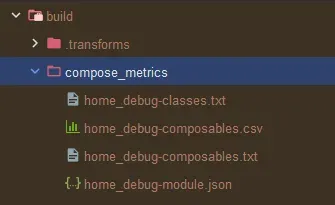
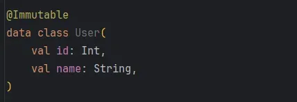
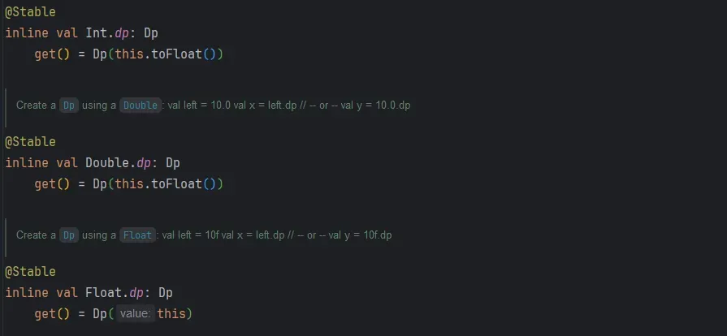
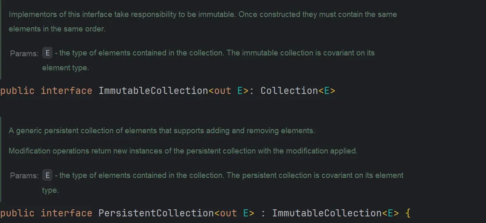
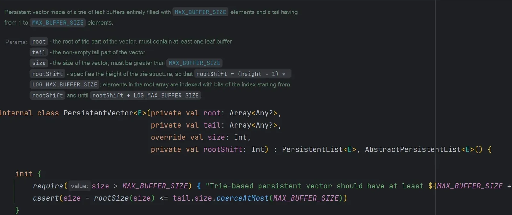
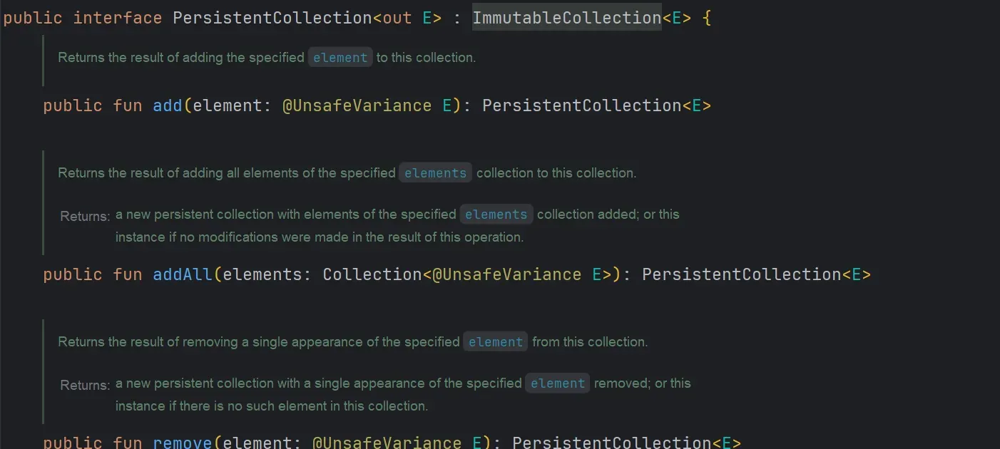

Jetpack Compose는 선언형 UI 프레임워크로 “**어떻게 그릴지**” 보다 “**무엇을 그릴지**”에 더 집중한다. 여기서 말하는 “**무엇**”은 대게 **상태**로 표현된다. Compose에서는 이 상태가 변경될 때 해당 상태와 관련 있는 UI를 재구성한다. 이를 **Recomposition**이라고 한다.

이러한 재구성은 상태 변경 시 자동으로 발생하므로 개발자는 별도의 UI 갱신 로직을 관리할 필요가 적다. 하지만 모든 상태 변화에 대해 화면을 전부 새로 그려버리면 [Compose Phase](https://developer.android.com/develop/ui/compose/phases?hl=ko)의 가장 첫 번째 단계인 구성 단계부터 시작한다. 이에 따라 **성능 저하, 불필요한 연산** 등의 문제가 발생할 수 있다. 이때 Compose에서는 **안정성(Stability**)이라는 개념을 활용하여 불필요한 재구성을 방지하고 최적화한다.

오늘은 이러한 안정성을 지키는 방법들을 알아보고, 그 중 불변 컬렉션을 제공하는 라이브러리의 코드를 분석해보겠다.

## 1️⃣ Compose에서 안정성이란 무엇일까?

안정성이란, "**이 객체가 변경되지 않았음을 Compose가 신뢰할 수 있는가**?"를 나타내는 성질이다. 안정적인(Stability를 가진) 객체를 받는 `@Composable` 함수는 동일한 인자를 다시 전달받을 때 재구성을 건너뛸 수 있어, 화면 성능 최적화에 유리하다. 반대로 객체가 불안정(Unstable)하다면, 해당 객체가 내부적으로 변경되었을 수 있다고 판단하는 Compose는 재구성을 스킵하지 못하고, 결과적으로 성능 상의 이점을 놓칠 수 있다.

다시 말해, "안정성"은 Compose가 UI를 효율적으로 다시 그리고, 불필요한 CPU 사용을 방지하도록 돕는 핵심 개념이다. 안정적인 데이터일수록 Compose의 스마트한 재구성 전략(Smart Recomposition)이 최대한 발휘되며, 이는 곧 앱의 전반적인 퍼포먼스 개선으로 이어진다.

#### Stable과 Unstable의 차이

Compose에서 안정성은 크게 두 분류로 나뉜다.

1. **Stable한 객체**
   - 변경되지 않는 속성들만으로 이루어진 불변 객체나, Compose가 불변임을 확신할 수 있는 데이터 구조를 가리킨다.
   - 예를 들어, 모두 불변 타입의 필드만 갖는 `data class`, `@Stable` 어노테이션으로 안정성을 명시한 클래스, 혹은 Compose가 내부적으로 Stability를 확실히 아는 자료형(기본 타입, immutable 리스트 등)이 Stable로 간주될 수 있다.
   - Stable한 객체를 Composable 함수의 파라미터로 전달하면, 동일한 인스턴스를 다시 전달받을 때 해당 Composable은 재구성을 건너뛸 수 있다. 즉, "**이 값은 바뀌지 않았으니 다시 그릴 필요가 없다**"고 판단한다.
2. **Unstable한 객체**
   - 내부적으로 언제든 변경 가능한 프로퍼티를 갖거나, Compose가 불변성을 확신할 수 없는 객체를 의미한다.
   - 대표적인 예로, `var`로 선언된 변경 가능한 속성, 멀티스레드 환경에서 안전하지 않은 참조를 갖는 객체, 혹은 Compose가 알 수 없는 외부 라이브러리의 복잡한 타입 등이 있다.
   - Unstable한 객체는 겉으로 보기에는 참조가 바뀌지 않았더라도, 내부 상태가 변했을 가능성을 Compose가 배제할 수 없다. 따라서 동일한 인스턴스를 다시 전달받아도 Compose는 "**혹시 모르니 다시 그려야겠다**"는 결정을 하게 되고, 재구성을 최소화하기 어렵다.

#### Smart Recomposition

Compose는 **Smart Recomposition**을 통해 상태 변화가 발생했을 때, 변경된 부분만 효율적으로 다시 그린다. 이 과정에서 Compose는 다음과 같은 질문을 던진다.

- "이 Composable 함수의 인자로 넘겨진 객체가 이전과 같은 것인가?"
- "이 객체를 동일 참조로 다시 받았는데, 내부 상태가 변하지 않았다는 것을 확신할 수 있는가?"

여기서 안정성이 확보된 객체라면 Compose는 "**이건 변하지 않는다고 했으니 다시 그리지 않아도 되겠군**"이라고 판단한다. 즉, Stability를 통해 Compose는 불필요한 Render Pass를 줄일 수 있으며, 이는 곧 성능 개선으로 이어진다. 한편, Unstable한 객체라면 비록 인스턴스 참조가 같더라도 내부 상태 변화를 배제할 수 없으므로 다시 그리게 된다.

#### Skippable: 재구성을 건너뛸 수 있는 조건

Compose는 `@Composable` 함수 호출 시 동일한 파라미터를 전달받으면 이전 결과를 재사용하려 하며, 이를 "Skippable"하다고 표현한다. Skippable하려면 함수가 Pure하고, 파라미터가 Stable하여 내부 값 변동이 없다는 확신이 필요하다. 이때 Stable한 객체가 핵심 조건으로 작용한다.

- **Stable한 객체 사용 시**: 동일 객체 전달 -\> 내부 변화 없음 확신 -\> 재구성 Skippable
- **Unstable한 객체 사용 시**: 동일 객체 전달해도 내부 변화 감지 불가 -\> 재구성 필요

#### 안정성을 지키고 있는지 어떻게 확인할까?

개발 과정에서 "어떤 Composable 함수나 객체가 Stable한지" 진단하고, 안정성을 개선하는 것은 중요하다. 보통은 Compose Compiler를 활용하며 여러 가지 방법이 있는 것으로 알고 있다. 나는 이 방법 중 Compose Compiler Metrics를 활용하여 런타임 안정성을 확인하였다.

{width=50 align=center}

이외에도 Compose Compiler Reports을 이용하여 안정성 추론 결과를 확인하는 방법도 있으니 참고하시길 바란다.

[https://developer.android.com/develop/ui/compose/performance/stability/diagnose?hl=ko](https://developer.android.com/develop/ui/compose/performance/stability/diagnose?hl=ko)

## 2️⃣ 어떻게 안정성을 챙길 수 있을까?

챕터 1에서 성능 저하와 불필요한 연산을 줄이고 Smart Recomposition을 위해 안정성을 챙겨야 된다는 사실을 알 수 있었다. 이제 어떻게 안정성을 챙길 수 있는지에 대해서 알아보겠다.

### 1. 어노테이션 활용하기

Compose에서는 안정성 판단을 돕기 위해 `@Stable`과 `@Immutable`이라는 두 가지 어노테이션을 제공한다. 이 어노테이션들은 Compose에게 해당 타입 또는 반환 값이 "**안정적**"임을 명시적으로 알리는 역할을 한다. 다만 둘 사이에는 미묘한 차이가 있으며, 상황에 따라 적합한 어노테이션을 선택해야 한다.

#### `@Immutable`

- **의미**: 이 어노테이션은 해당 클래스나 인터페이스가 "**불변(Immutable**)"임을 Compose에 알린다.
- **불변(Immutable) 조건**:
  - 필드는 **모두 불변 타입**이어야 한다.
  - 더 이상 상태 변화가 일어날 수 없는 구조여야 한다.
  - 즉, 한 번 생성하면 내부 필드가 절대 바뀌지 않는 객체를 의미한다.
- **효과**: `@Immutable`을 붙인 객체는 내부적으로 어떤 변경도 일어나지 않을 것이므로, Compose는 해당 객체를 "**완전한 불변**"으로 간주하고 동일 참조가 재사용될 때 재구성을 스킵할 수 있다.

{width=60 align=center}

위 예시의 `User`는 모든 필드가 불변 타입(Int, String)이며, 상태 변화가 불가능하므로 `@Immutable`을 붙여 완전한 불변임을 표시한다.

`@Immutable` 어노테이션을 활용하여 불필요한 Recomposition을 건너 뛰어 앱 성능을 향상시킬 수 있지만, 부적절한 경우에 사용할 때 Recomposition을 의도하지 않게 건너뛰어 화면이 업데이트 되지 않을 수 있으니 주의해야 한다.

#### `@Stable`

- **의미**: `@Stable`은 "이 타입의 인스턴스는 **동일한 참조를 유지하는 한 안정적**"이라는 것을 의미한다. 하지만 `@Immutable`에 비해 조금 더 느슨한 조건을 가지며, 필드가 완전히 불변이 아닐 수 있다. 단, Compose가 타입의 변화를 추론할 수 없을 정도로 불안정해서는 안 된다.
- **활용 시점**:
  - 완전한 불변은 아니지만, 사용자가 해당 객체가 특정 조건 하에 변경되지 않는다고 보장할 수 있는 경우
  - 또는 내부적으로 변경 가능성이 있으나, Compose가 변화 추적을 통해 상태 변화를 쉽게 판단할 수 없는 경우
- **효과**: `@Stable`로 표시된 객체는 Compose가 "**이 객체는 쉽게 변하지 않을 것**"이라 가정한다. **동일한 객체를 다시 전달받을 경우 내부 변화를 가정하지 않고 재구성을 건너뛸 수 있다**. 다만 `@Immutable`보다 제약이 적으므로, 개발자가 책임지고 불변성을 관리해야 한다.

예를 들어, Compose 자체 코드에서 `Dp`, `Modifier` 등은 `@Stable`로 선언되어 있는데, 이는 해당 타입들이 실제 변경될 가능성이 거의 없고, 변경되더라도 Compose가 쉽게 추론 가능하다는 의미를 담고 있다.

{width=100 align=center}

위와 같은(실제 구현과 일부 차이가 있을 수 있는) Compose 내부 코드 예시를 보면, `Dp`는 `@Immutable` 대신 `@Stable`을 사용한다. `Dp`는 사실상 불변처럼 취급할 수 있으나 Compose에서는 이를 `@Stable`로 관리한다.

#### `@Immutable` vs `@Stable`

처음이 어노테이션을 보았을 때 둘의 차이가 잘 느껴지지 않았다. 하지만 핵심을 알게 된 후로 구분을 쉽게 할 수 있었다. 핵심은 “**가변**”, 즉 **변화할 가능성**이 있는 상황이다.

각 어노테이션의 특징과 활용 시점을 정리해보았다.

- `@Immutable`
  - 완전한 불변 객체
  - 객체 생성 이후 절대 변하지 않을 때 사용
  - Compose는 이 객체가 바뀌지 않는다고 100% 신뢰
  - 안정성 제고에 가장 확실한 방법
- `@Stable`
  - 완전한 불변은 아니지만 "**안정적으로 사용**"할 수 있는 객체
  - 불변 타입들로만 구성되지 않은 경우에도 사용 가능
  - 객체 내부 상태 변경이 드물거나, 개발자가 안정성을 보장할 수 있을 때 사용
  - `@Immutable`보다 약한 보장이지만, 여전히 재구성 최소화에 도움

정리하자면, 완전히 변화 없는 데이터 모델(`User`, `Color`, `Point` 등)을 다룰 때는 `@Immutable`을, 약간의 유연성을 두면서도 안정성을 강조하고 싶다면 `@Stable`을 사용하는 식으로 선택할 수 있다. 가능한 한 `@Immutable`을 우선 고려하되, 상황에 따라 `@Stable`을 활용하는 전략을 택하면 된다.

### 2. 람다 안정성 확보하기

Compose에서 람다(Lambda)는 UI 이벤트 처리나 비즈니스 로직 전달에 필수적인 요소다. 그러나 람다 사용 시 유의해야 할 점은, **람다가 어떤 값을 캡처하느냐**에 따라 Compose가 해당 람다를 어떻게 최적화하고 안정성(Stability)을 판단하느냐가 달라질 수 있다는 것이다. 이를 제대로 이해하지 못하면 불필요한 재구성과 성능 저하를 초래할 수 있다.

#### Compose 컴파일러와 람다의 특수한 처리 방식

일반적인 Kotlin 코드에서 람다는 **외부 변수를 캡처하면 클로저를 형성**한다. 이때 람다는 실행될 때마다 해당 변수를 참조하므로 상황에 따라 결과가 달라질 수 있다. Compose 컴파일러는 IR(Intermediate Representation) 변환 과정에서 이러한 람다를 특별히 처리한다. 어떤 **람다가 외부 값을 캡처하는지 여부**에 따라, 그리고 그 캡처된 값이 안정적인지(Unstable인지), 불변성(Immutable)을 갖는지에 따라 최적화 전략을 결정한다.

- **값을 캡처하지 않는 람다**

  외부 변수를 참조하지 않는 람다는 싱글톤으로 취급되어 매 **재구성 시 새로운 인스턴스를 만들지 않는다**. 이는 곧 람다가 **안정적**으로 유지될 수 있음을 의미한다.

```kotlin
// 외부 변수를 전혀 참조하지 않는 간단한 람다
@Composable
fun StaticContent(showMessage: () -> Unit) {
    showMessage() // 항상 같은 행동을 수행
}

// 이 람다는 어떤 변수도 캡처하지 않음
StaticContent {
    println("This lambda does not capture any external values.")
}
```

위 예제에서 `StaticContent`에 전달한 람다는 외부 상태에 의존하지 않으므로 안정적으로 재사용 가능하다.

- **값을 캡처하는 람다**

람다가 외부 변수를 참조하면, 해당 변수의 변화에 따라 람다의 결과가 달라질 수 있다. 이러한 경우 Compose 컴파일러는 람다를 IR 변환 과정에서 특수 처리한다.

예를 들어, 다음과 같이 외부 변수를 참조하는 람다를 생각해보자.

```kotlin
val factor = 2
val numbers = listOf(1, 2, 3)

// 이 람다는 외부 변수 factor를 캡처함
val multipliedValues = numbers.map {
    factor * it
}
```

여기서 `it`은 리스트의 요소를, `factor`는 외부 변수를 가리킨다. 만약 `factor`가 재구성 과정에서 다른 값으로 바뀔 수 있다면, 이 람다는 재구성 시마다 다른 결과를 낼 수 있다고 Compose는 판단한다. 즉, 람다 자체는 안정적으로 보이더라도, 캡처한 값의 상태에 따라 불필요한 재구성이 발생할 수 있다.

#### Stable vs Unstable한 캡처 값의 영향

Compose는 람다를 함수 타입으로 인식하고, 일단 함수 자체는 비교적 안정적인 형태로 분류하려고 한다. 하지만 **캡처한 값이 Unstable한 경우 실제 런타임에서 재구성을 스킵하기 어려워진다**. 즉, 람다가 stable로 표시되었다 하더라도, **내부적으로 불안정한 값을 참조하면 재구성을 건너뛰지 못한다**.

예를 들어, 다음과 같이 Unstable한 값을 반환하는 함수가 있다고 하자.

```kotlin
// 매 호출 시 다른 값을 반환하는 불안정한 함수
fun unstableValueProvider(): Any? {
    return System.currentTimeMillis()
}
```

이 함수를 람다에서 캡처하면, 람다가 stable하더라도 매번 다른 결과를 낼 수 있으므로 Compose는 재구성을 피하기 어렵다.

```kotlin
@Composable
fun DisplayData(getData: () -> Any?) {
    Text(text = (getData() ?: "No Data").toString())
}

// 불안정한 값을 캡처하는 람다
DisplayData {
    // 매번 다른 값을 반환하므로 재구성 필요
    unstableValueProvider()
}
```

여기서 `getData` 람다는 함수 타입이라 stable로 표시될지 몰라도, 실제로는 매 호출 시 값이 달라지므로 Compose는 재구성을 생략할 수 없다.

#### 안정성 확보: remember와 key 활용하기

이러한 문제를 해결하기 위한 핵심은 `remember`를 활용한 람다 안정화다. `remember`를 사용하면 특정 조건이 변하지 않는 한 동일한 람다 인스턴스를 재사용할 수 있다.

```kotlin
@Composable
fun UseStableLambda(name: String, fetchData: (String) -> String) {
    val stableFetcher = remember(name) { { fetchData(name) } }
    // stableFetcher는 name이 바뀔 때만 새로운 람다 생성
    // 그 외에는 동일한 람다 인스턴스 재사용
    Text(stableFetcher())
}

// 외부 함수는 안정적일 수 있음
fun stableDataFetcher(input: String): String = "Data for $input"

// stable한 값을 캡처하는 예
UseStableLambda(name = "User") { input ->
    stableDataFetcher(input) // stableDataFetcher는 항상 동일한 결과를 예측 가능하게 만듦
}
```

위 예제에서는 `remember(name)`를 통해 `stableFetcher` 람다를 안정적으로 관리한다. `name`이 바뀔 때만 새로운 람다가 생성되고, 그렇지 않으면 이전 람다를 재사용한다. 이를 통해 Compose는 이 람다가 불필요한 재구성을 일으키지 않는다고 판단할 수 있다.

반면, 여전히 Unstable한 함수를 캡처한다면 어떻게 될까?

```kotlin
@Composable
fun UseUnstableLambda(id: Int, fetchData: (Int) -> Any?) {
    val dynamicFetcher = remember(id) { { fetchData(id) } }
    Text(dynamicFetcher()?.toString() ?: "No Data")
}

// Unstable한 값 반환 (매번 달라짐)
fun unstableDataFetcher(input: Int): Any? = System.nanoTime()

UseUnstableLambda(id = 42) { input ->
    unstableDataFetcher(input)
}
```

여기서 `remember(id)`를 써도, `unstableDataFetcher`가 매번 다른 값을 반환한다면 재구성이 불가피하다. 다시 말해, `remember`는 람다 인스턴스를 안정적으로 유지하지만, 람다가 반환하는 결과가 매번 달라지면 결국 Compose는 새로운 UI 상태를 반영하기 위해 재구성을 수행해야 한다.

#### 정리

- **캡처 없는 람다**: 별도의 처리 없이도 안정적이며, 컴파일러가 싱글톤으로 취급해 재구성을 최소화한다.
- **Stable한 값을 캡처하는 람다**: `remember` 등을 활용해 람다 인스턴스를 재활용하면 재구성을 효과적으로 줄일 수 있다.
- **Unstable한 값을 캡처하는 람다**: 캡처하는 값 자체가 변한다면, 람다를 remember로 감싸도 불필요한 재구성을 완전히 제거할 순 없다. 불변 자료 구조나 안정적 데이터 소스로 전환, `@Immutable` 어노테이션 등의 추가 전략을 고려해야 한다.

### 3. Immutable Collection 활용하기

안정성을 높이기 위한 또 다른 중요한 전략은 불변 컬렉션을 사용하는 것이다. 기본적인 Kotlin의 컬렉션은 읽기 전용이지만 완전한 불변성을 보장하지 않는다. 불변 컬렉션은 한 번 정의하면 내부 상태가 바뀌지 않는 구조를 제공한다. 이를 통해 Compose는 컬렉션이 재사용될 때 내부 변화가 없음을 확신하고 재구성을 최소화할 수 있다. 함수형 프로그래밍의 기본인 불변성을 보장하기 위해 매번 새로운 컬렉션을 반환하는 것이 Compose 성능 최적화에도 중요한 것이다.

이 부분은 다음 챕터에서 더 자세히 다룰 예정이다. 여기서는 "불변 컬렉션을 활용하면 안정성을 높일 수 있다"는 개념만 염두에 두자.

## 3️⃣ Kotlinx Immutable Collection 톺아보기

앞선 챕터들에서 Compose에서 안정성을 확보하기 위한 방법 중 하나로 "불변(Immutable) 컬렉션"을 활용할 수 있음을 언급했다. 이번 장에서는 `kotlinx.collections.immutable` 라이브러리를 통해 제공되는 불변 자료구조들이 무엇이며, 어떻게 동작하는지 깊이 살펴보겠다.

#### 1. Kotlin Collection은 왜 불안정할까?

{width=100 align=center}

[https://developer.android.com/develop/ui/compose/performance/stability/fix?hl=ko#immutable-collections](https://developer.android.com/develop/ui/compose/performance/stability/fix?hl=ko#immutable-collections)

Android 공식 문서에 기재되어 있는 내용이다. 위에서도 확인할 수 있듯이 Kotlin에서 List, Map, Set과 같은 컬렉션은 `read-only` 인터페이스를 제공한다. 하지만 어떻게 구현될지 모르고 구현체는 수정 가능하기 때문에 불변성과 영구성을 보장할 수 없다.

이에 대한 대응으로 우리는 변경 불가능한 컬렉션을 사용할 수 있다. 공식문서에서 추천하는 Kotlinx Immutable Collections에 대해 자세히 알아보자.

#### 2. Kotlinx Immutable Collection의 두 가지 종류

[https://github.com/Kotlin/kotlinx.collections.immutable](https://github.com/Kotlin/kotlinx.collections.immutable)

공식문서에서 언급한 위 Kotlinx.collections.immutable 라이브러리에는 크게 두 가지 유형의 콜렉션을 제공한다. 먼저 이 두 유형에 대해 알아보자

- **Immutable**: 불변성을 의미하며, 한 번 생성하면 그 객체의 내부 상태가 절대 변하지 않는다는 것을 뜻한다. 예를 들어, `listOf(1, 2, 3)`는 외부에서 변경할 수 없는 읽기 전용 리스트를 반환한다. 그러나 표준 Kotlin 컬렉션에서는 이게 진정한 불변성이라고 보긴 어렵다. 왜냐하면 이러한 리스트가 완전히 새로운 리스트를 반환할 때, 내부적으로 복사나 별도의 작업이 필요할 수 있으며, 원본을 공유하는 구조적 불변성이 보장되지 않기 때문이다.
- **Persistent**: 영구성(Persistence)을 말한다. Persistent 컬렉션은 "버전 관리"가 가능한 불변 컬렉션으로, 어떤 변경 연산(`add`, `remove`)을 수행하더라도 기존 컬렉션을 수정하지 않고, 변경된 새로운 컬렉션을 반환하면서, 동시에 이전 버전의 컬렉션도 여전히 유효한 상태로 참조 가능하다. 이 과정에서 효율성을 높이기 위해 "**구조적 공유(Structural Sharing**)" 개념을 활용한다. 즉, 기존 데이터를 전부 복사하지 않고, 변경된 부분만 새로운 노드로 만들어 연결하는 식으로 메모리 사용량과 연산 비용을 최소화한다.

정리하자면, `Persistent`는 "**상태 변경 이력을 효율적으로 관리할 수 있는 불변 컬렉션**"이고, `Immutable`은 "**한 번 정해진 상태를 변경할 수 없는 객체**"를 의미한다. `Persistent`한 컬렉션은 내부적으로 `Immutable`한 상태를 유지하면서도, 변경 연산 시 효율적으로 새로운 불변 컬렉션 인스턴스를 생성한다.

{width=100 align=center}

위에서 확인할 수 있듯이 `ImmutableCollection`은 기존 Kotlin의 `Collection`을 상속하고 `PersistentCollection`은 `ImmutableCollection`을 상속한다.

#### 3. Immutable Collection 내부 구조 분석

이전에 함수형 프로그래밍의 불변성을 공부하기 위해 불변 링크드리스트를 직접 구현해본적이 있다. 직접 구현이 생각보다 어렵지 않아서 이번 장에서 다루고 있는 Immutable, Persistent Collection들도 직접 구현해볼 수 있지 않을까? 라는 생각이 들어 내부를 분석해보았다.

앞서 언급한 것처럼 이 라이브러리의 핵심은 한 번 만들어진 컬렉션의 이전 버전을 항상 유지하면서도, 새로운 변경에 따른 새 버전을 효율적으로 생산하는 **구조적 공유(Structural Sharing**)를 가능케 한다는 점이다.

이러한 구현은 결코 단순하지 않다. Kotlin의 기본 컬렉션을 사용하는 것과 달리, Persistent 자료구조는 내부적으로 **트라이(Trie) 기반**의 복잡한 구조나 특정한 배열 청크 구조 등을 활용하여, **전체 복사를 피하고 "변경된 부분만" 새로운 버전으로 만드는 방식**을 택한다.

[https://github.com/Kotlin/kotlinx.collections.immutable/blob/master/core/commonMain/src/implementations/immutableList/PersistentVector.kt](https://github.com/Kotlin/kotlinx.collections.immutable/blob/master/core/commonMain/src/implementations/immutableList/PersistentVector.kt)

라이브러리 코드 중 `PesistentVector.kt` 파일을 통해 트라이 구조를 살펴볼 수 있다.

{width=100 align=center}

위 라이브러리 코드의 KDoc 주석 부분에서 trie, leaf buffer, tail 등등 구조와 관련된 용어들을 살펴볼 수 있다. 이 구조의 핵심 아이디어 2가지를 살펴보자.

**1. 2차원 이상의 배열 구조로 인덱싱 분할**

트라이(Trie) 기반 구조는 단순히 1차원 배열을 사용하는 대신, 요소를 여러 레벨에 걸쳐 배열에 담는 계층적 구조를 사용한다. 여기서 `root` 필드는 최상위 수준의 배열을 가리키며, 각 원소가 또 다른 배열을 가리켜 트리 형태를 이루게 된다. 이때 한 노드(배열)는 최대 `MAX_BUFFER_SIZE`개의 요소나 하위 배열 참조를 가진다.

**2. LOG_MAX_BUFFER_SIZE를 이용한 비트 마스킹 인덱싱**

코드 중 `rootShift` 변수를 보면, `rootShift = (height - 1) * LOG_MAX_BUFFER_SIZE` 형태로 높이를 나타낸다. `indexSegment(index, shift)` 함수 호출을 통해 인덱스를 비트 단위로 나누어 트라이의 어느 "레벨"과 "노드"에 해당하는지 결정하는데, 이를 통해 **O(log n**) 시간 안에 특정 인덱스에 해당하는 요소를 찾는다.

- `shift`가 클수록 상위 레벨을 의미한다.
- `indexSegment(index, shift)`는 `index`에서 특정 비트 범위를 추출하여 해당 레벨에서 어떤 배열 원소를 참조할지 결정한다.

이런 접근 방식을 통해, 원소 하나를 찾기 위해 단순 배열 인덱싱처럼 **O(1**)에 가까운 성능을 유지하면서도, 끝에 요소를 추가하거나 중간 삽입을 효율적으로 처리할 수 있다.

#### 구조적 공유(Structural Sharing)와 Trie

`PersistentVector`는 "영구(Persistent)" 특성을 갖추기 위해, 변경 시 전체 복사 대신 기존 노드들을 공유(Structural Sharing)한다. 예를 들어, 새로운 요소를 추가하는 경우:

- Tail(끝부분)을 먼저 활용한다. Tail에 여유 공간이 있다면 바로 tail 배열에 새로운 요소를 추가한다.
- Tail이 가득 차면, tail 배열을 "가득 찬 leaf 노드"로 간주하고, 이 leaf를 `pushTail` 과정을 통해 `root` 트라이에 삽입한다.
- `pushTail`은 기존 트라이 구조를 대부분 재사용하고, 필요한 일부 노드만 새로 할당한다. 이때 기존 노드는 그대로 두어 이전 버전의 컬렉션도 유지된다.

이렇게 매번 새로운 `PersistentVector` 인스턴스를 반환하지만, 내부적으로는 대부분의 노드를 재사용하므로 메모리와 연산 비용을 크게 절약한다.

그럼 이제 정리해보자

위 코드에서 `PersistentVector`는

- Trie(트라이) 기반의 계층적 배열 구조를 사용하며,
- `rootShift`, `indexSegment`를 통해 인덱스를 레벨별로 분해하여 접근하고,
- `pushTail` 등 함수를 통해 tail을 트라이 상단에 "올리는" 방식으로 새로운 버전을 생성한다.

이로써

- 큰 리스트를 효율적으로 다룰 수 있고,
- 변경 시 전체 복사 없이 새로운 버전을 생성할 수 있으며,
- 이전 버전을 유지하면서도 성능을 확보하는 Persistent 특성을 구현한다.

이러한 트라이 기반 자료구조는 완전한 불변성과 함께 대규모 리스트를 효율적으로 처리하는 핵심적인 방법이며, 바로 이러한 이유로 `kotlinx.collections.immutable` 라이브러리가 복잡한 Trie 기반 구현을 채택하고 있는 것이다.

#### 공변성과 제네릭 처리

{width=100 align=center}

라이브러리 코드를 보면 out 키워드와 `@UnSafeVariance` 어노테이션을 확인할 수 있다. 이 코드들이 어떤 의미와 역할을 하는지 살펴보자.

- **Immutable 특성에 맞는 공변성**

  `out`은 해당 리스트가 `E` 타입의 요소를 "내보낼" 순 있어도 "받는" 데는 제한이 있음을 나타낸다.

  불변 자료구조는 외부에서 내부 상태를 변경할 수 없으므로, 상위 타입으로 안전하게 업캐스팅이 가능하다. 예를 들어, `PersistentList<Cat>`는 리스트 내 요소를 바꿀 수 없으니 `PersistentList<Animal>`로 다뤄도 문제가 없다. 이는 불변 컬렉션이기 때문에 가능한 것이다.
- **내부 구현의 복잡성**:

  하지만 Persistent 컬렉션은 새로운 원소를 추가할 때마다 새로운 컬렉션을 반환하는 특성을 갖는다. 컬렉션이 불변이므로 문제 없이 공변성을 적용할 수 있어야 하는데, 정작 요소를 "추가"하는 연산이 들어가면 형식 안정성을 유지하기가 쉽지 않다.

  이를 해결하기 위해 라이브러리 내부 코드에서는 `@UnsafeVariance` 어노테이션 등을 사용하여 `out`으로 정의된 타입 파라미터에 원소를 추가하는 상황을 처리한다. 이는 라이브러리 개발자가 제네릭 타입 안정성을 최대한 유지하면서도, Persistent 컬렉션이 필요로 하는 연산을 수행할 수 있도록 한다.

### 마무리

이번 글에서는 Jetpack Compose에서의 안정성(Stability) 개념부터 시작해, 어떻게 안정성을 확보하고(안정성 어노테이션, 람다 안정성, 불변 자료구조 활용), 그리고 이를 구현하는 기술 중 하나인 `kotlinx.collections.immutable` 라이브러리의 구조적 특성까지 살펴보았다.

Compose에서 안정성을 확보한다는 것은 단순히 UI 성능 최적화를 넘어, 애플리케이션의 전반적 유지보수성과 확장성을 높이는 중요한 요인이다. 불필요한 재구성을 줄여 성능을 개선하고, 예측 가능한 상태 관리를 통해 UI 로직을 단순화할 수 있다. 이러한 목표를 달성하기 위해, 불변(Immutable) 컬렉션과 영구(Persistent) 컬렉션의 개념을 확실히 이해하고 적절히 활용하는 것이 큰 도움이 될 것이라 확신한다.
