In my last post, [**Reading Effective Kotlin and applying it to Compose**](post/effective-kotlin), I mentioned that Compose uses something called the **snapshot system** internally to keep mutable state under control, and I showed with a small example how it stays safe across threads using multi-version concurrency control (MVCC). This time I want to look at how the snapshot system actually works, and how it's used by the code we write to avoid unintended side effects (`derivedStateOf`, for example).

## What is the snapshot system?

You've probably taken a photo at some point. You snap a moment to keep it, and later you look at the picture to bring that scene back. Compose's snapshot system works on a similar idea.

In Jetpack Compose, the snapshot system is the mechanism that **captures the current state at a specific moment** and manages it safely. Think of a piece of `state` whose value changes over time: the snapshot system takes a "photo" of that state at a given point and keeps it. Because of that, even when several threads or operations change the state at the same time, **Compose can update the UI reliably from the photo it took earlier**.

Let's look a little closer.

In Compose, optimizing recomposition is the most important job. Compose cares more about *what* to draw than *how* to draw it, which is a defining trait of declarative UI. If state changes when you didn't mean it to, the UI changes when you didn't mean it to, and that confuses users and can lead to serious bugs. Say the state is in the middle of changing because a network call came back, and the user taps something that changes the same state. In a multithreaded environment, reading and writing state at the same time like this can corrupt it.

The snapshot system handles state changes like **transactions**, so the state always stays consistent and thread-safe.

## Multi-version concurrency control (MVCC)

Of the available concurrency control techniques, **Jetpack Compose uses multi-version concurrency control (MVCC)**. As the name suggests, it keeps several versions of the same data (state) at once.

One way to control concurrency is to isolate state. The simplest form of isolation is to block every reader until the writer finishes, but that tends to hurt performance. MVCC does better.

To get isolation, MVCC keeps multiple copies (versions) of the data, so each thread works with its own isolated version of the state at a given moment: a snapshot. Changes made by one thread aren't visible to other threads until all of its work is done and the changes are propagated.

Here's a simpler way to think about it:

- **It keeps several versions of the photo.** Every time a piece of state changes, the previous state is kept as a version. It's like taking a new photo every time the state changes.
- **It supports concurrent reads and writes.** A thread can read the state while another thread is changing it, and nothing breaks. **The reader looks at the photo from the point in time it's referencing, and the writer produces a new photo.**
- **There's a single point where changes take effect (commit).** After a batch of changes, there's a moment where you **declare (apply)** "this photo is now the official version." Only then does the global state actually change.

With MVCC, every thread behaves as if it had its own time machine. It reads state from a point in the past, produces a new version, and finally writes it back to the global state. If that conflicts with another thread along the way, the conflict is detected clearly and handled. Looked at from another angle, a conflict that happens while producing a new version is only detected when the changes are propagated. In other words, the approach is **optimistic**.

### The snapshot lifecycle

Earlier I compared a snapshot to a photo of the state at some point in time. Let's take it one step further and walk through **how a snapshot is created, used, and thrown away**.

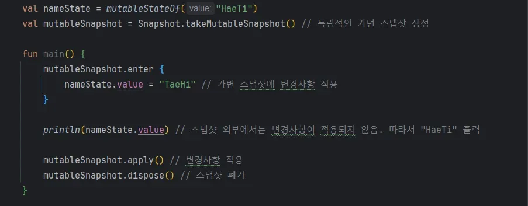{width=100 align=center}

1. **Create**

   Call an API like `takeSnapshot()` or `takeMutableSnapshot()` to make a new snapshot. The snapshot captures the global state exactly as it is at that moment.
2. **Modify (optional)**

   If you made a mutable snapshot, this is where you change actual state values. The changes don't show up outside right away; they stay inside the snapshot.
3. **Apply or dispose**

   To push the changes to the global state, call `apply()`. That swaps the existing global state for the new version. If you don't need the changes anymore, call `dispose()` to throw the snapshot away and free its memory.
4. **Observe**

   Composables and other parts of the code observe state through the snapshot. Once a snapshot has been replaced by another one and nothing needs it anymore, it naturally becomes eligible for garbage collection.

This lifecycle cleanly separates the state before and after a change, and cleaning up unneeded snapshots keeps state management from getting complicated.

### The snapshot tree: how multiple versions are organized

With MVCC, a single piece of state has several versions. So how are those versions structured?

Snapshots form parent-child relationships and are managed as a hierarchical **tree**. The global snapshot is the root, and mutable snapshots branch off from it.

- **Global snapshot**: represents the "currently approved (applied) version" of all state. Recomposition mostly happens against the global snapshot.
- **Mutable snapshot**: derived from the global snapshot when you want to make a new state change. It depends on its parent snapshot and holds changes that haven't reached the global state yet.

Here's an example:

1. **Initial state**

   Say there's a global snapshot, G0. Right now all UI and logic read state from G0.
2. **Creating a mutable snapshot**

   Thread A creates a mutable snapshot S1 from G0 and changes the state in S1 several times. The global state is still G0, so nothing else is affected.
3. **Apply**

   When A commits (applies) the changes in S1, a new global snapshot G1 is created. G1 is the latest state, with S1's changes in it, and from now on everything references G1.

I put that scenario into code:

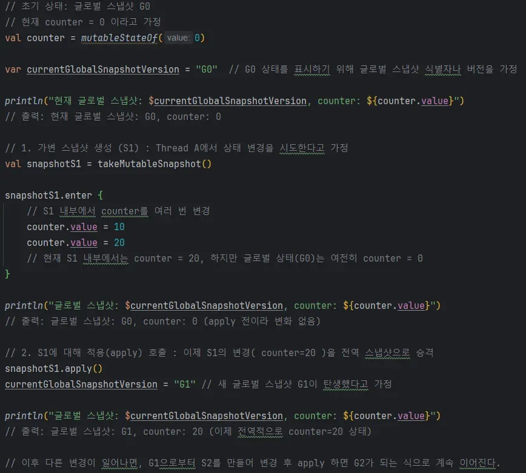{width=100 align=center}

As a tree, S1 branches off G0, and applying it produces G1. Changes are versioned this way: G0 → G1 → G2, and so on.

#### Snapshot trees vs. Git Flow

Thinking through this reminded me of Git Flow, which you run into all the time when working on a team. The two felt similar enough that I tried mapping one onto the other:

- **Global snapshot**: the `main` (or `master`) branch in Git. It's the "official" state that every developer and system shares.
- **Mutable snapshot S1**: like a `feature` branch you create to add a new feature. You can change code there as much as you like, but those changes aren't in `main` yet, so they don't affect anyone else or any other system.
- **Calling `apply` to update the global snapshot (S1 → G1)**: the step in Git Flow where you merge the `feature` branch into `main`. Once the merge succeeds, the `main` branch (the global snapshot) contains the new changes. It's like the "version" moving from the old `main` (G0) to the new `main` (G1).
- **Repeating it**: just as you create several `feature` branches in Git and merge them into `main` one after another, creating and applying mutable snapshots S2, S3, and so on in Compose produces new global snapshot versions G2, G3, and so on.

So the snapshot system manages state changes in stages and updates the "official state" in a clear way, which is conceptually close to working on a `feature` branch and merging it into `main` in Git Flow. Git Flow lets many developers build different features safely at the same time and land a stable result in `main`. The snapshot system does the same thing for state: changes happen independently in separate snapshots and are finally applied to the global state, which keeps it **consistent and stable**.

### StateObject and StateRecord: the internals

Compose doesn't just manage a single value like `counter.value`. It has to track many pieces of state, each with its own versions. To do that, it uses two layers of abstraction internally: **StateObject** and **StateRecord**.

#### StateObject

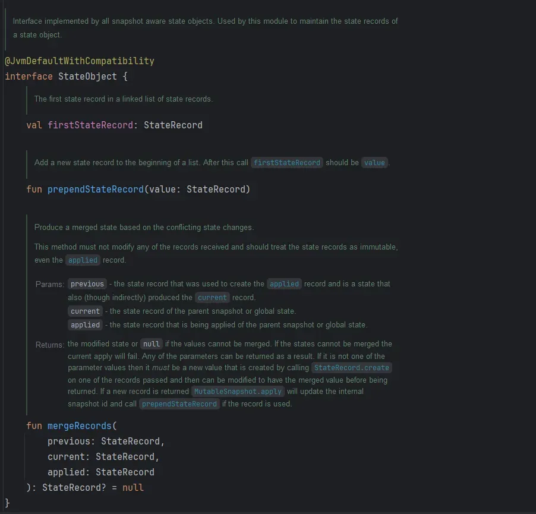{width=100 align=center}

`StateObject` is the interface implemented by every snapshot-aware (state-aware) state object. Its main job is managing the `StateRecord`s that hold the state at different points in time.

As the code above shows, it has `prependStateRecord`, which adds a new `StateRecord` to the front of the list, and `mergeRecords`, which holds the logic for merging the state of different `StateRecord`s when snapshots conflict.

#### StateRecord

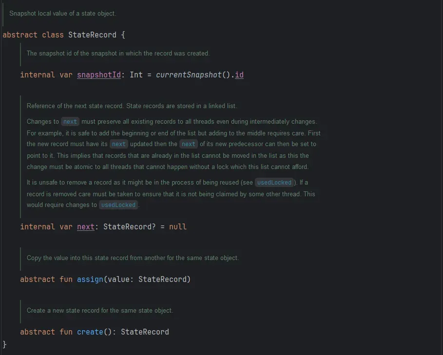{width=100 align=center}

A `StateRecord` holds **what value a piece of state had at a specific snapshot**. If `StateObject` is what manages state across points in time, `StateRecord` is the unit that actually stores the concrete state at one of those points.

`StateRecord`s are linked to each other through a `next` pointer, and `StateObject` keeps the head of that linked list (`firstStateRecord`). Through `next`, a new record can be linked after an earlier one.

Each `StateRecord` also has a `snapshotId` that says which snapshot it was created in. That's how Compose decides which state each snapshot should read.

It also supports two functions for copying and creating state:

- `assign(value: StateRecord)`: copies the state value from another `StateRecord` that shares the same `StateObject` type. This makes it easy to reuse an existing record or set up the state for a new snapshot.
- `create()`: creates a new `StateRecord` instance of the same type as the current record. When making a new snapshot version, the existing record serves as a template for the new state record.

## How do the Effect APIs use it? (feat. derivedStateOf)

To avoid unintended side effects, Compose gives you a set of **Effect APIs**. `LaunchedEffect` and `derivedStateOf` are probably the most common examples. In this post I'll dig into how `derivedStateOf` uses the snapshot system.

The official docs ([Side-effects in Compose](https://developer.android.com/develop/ui/compose/side-effects?hl=ko)) cover the Effect APIs in detail.

Let's start with the concept. `derivedStateOf` defines a state that's derived from other state. It updates the derived state only when the source state changes, which keeps change propagation to a minimum.

Say a button's enabled state (A) depends on a condition over some number (B). If A gets updated every time B changes, you end up updating A's state for no reason. `derivedStateOf` prevents those unnecessary updates. [This article](https://velog.io/@beokbeok/%EC%96%B8%EC%A0%9C-derivedStateOf%EB%A5%BC-%EC%8D%A8%EC%95%BC%ED%95%A0%EA%B9%8C) (in Korean) goes into more detail.

Now let's take the internals apart.

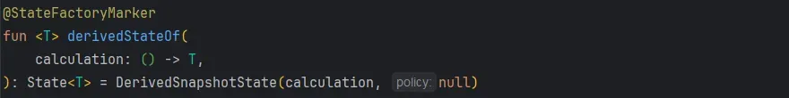{width=100 align=center}

`derivedStateOf` takes a `calculation` lambda and creates a `DerivedSnapshotState` instance. `DerivedSnapshotState` is the key class that uses the `StateObject` and `StateRecord` mechanism we've been talking about.

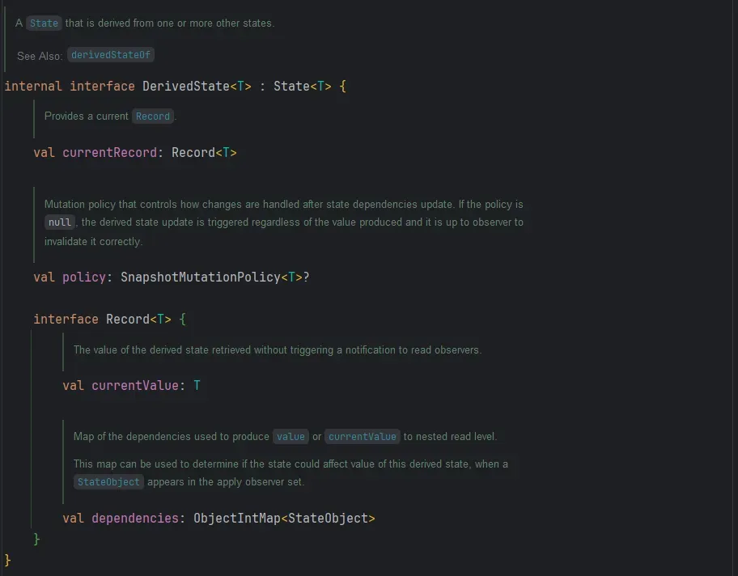{width=100 align=center}

`DerivedState.Record<T>` defines the structure that holds the information for one point in time (version) of a derived state. In `interface Record<T>`, `currentValue` and `dependencies` represent the value computed at that point and the set of `StateObject`s it read. The `dependencies` field is the key piece: it tracks the various `StateObject`s and tells you which other state this derived state depends on.

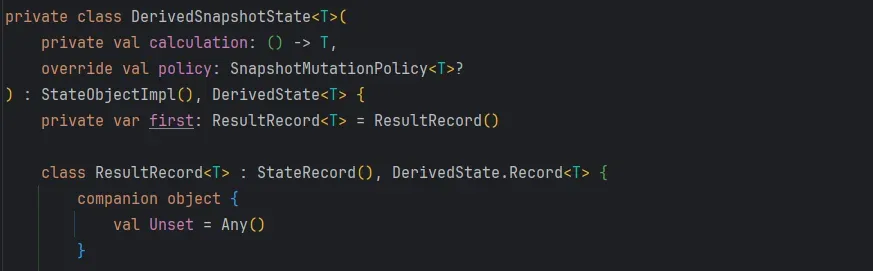{width=100 align=center}

- `DerivedSnapshotState<T>` extends `StateObjectImpl()`, so it acts as a `StateObject`.
- The `private var first: ResultRecord<T>` field points to the `StateRecord` that holds the latest state. `first` is the first node of the record list that the `StateObject` manages.

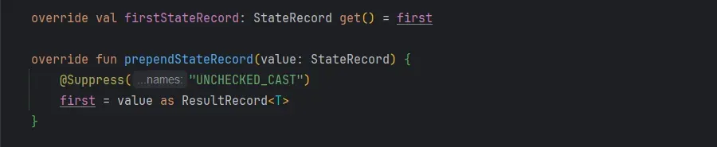{width=100 align=center}

As a `StateObject`, `DerivedSnapshotState` adds new records to the front of the list with `prependStateRecord()` and reaches the current latest record through `firstStateRecord`.

This is the heart of its `StateObject` role: every time a new snapshot state is added, it prepends a `ResultRecord`, and that's how it manages multiple versions.

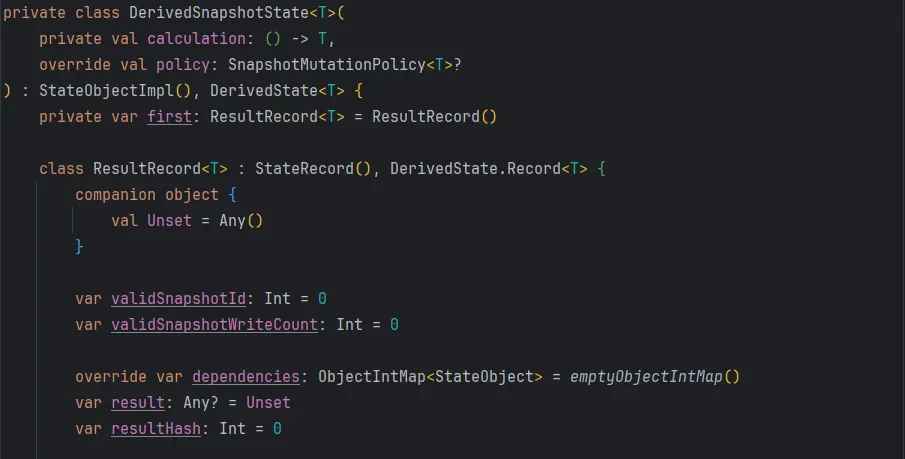{width=100 align=center}

The important point here is that `ResultRecord<T>` extends `StateRecord` and implements `DerivedState.Record<T>`.

- **StateRecord**: the abstraction for a state value at a specific snapshot
- **DerivedState.Record\<T\>**: the interface a derived state needs, providing `currentValue` and `dependencies`

`ResultRecord<T>` is the implementation that combines the two. It stores the result of the derived calculation in the `result` field and tracks the `StateObject`s read during that calculation in the `dependencies` field. Its `assign()` and `create()` methods let it reuse an existing record or make a new one:

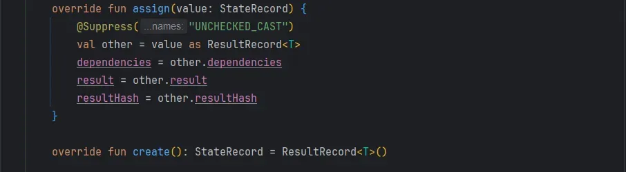{width=100 align=center}

`assign()` copies the contents of the previous record, and `create()` makes a new empty record. With these methods, Compose can cut down on unnecessary object allocations or update the state record to match a new snapshot.

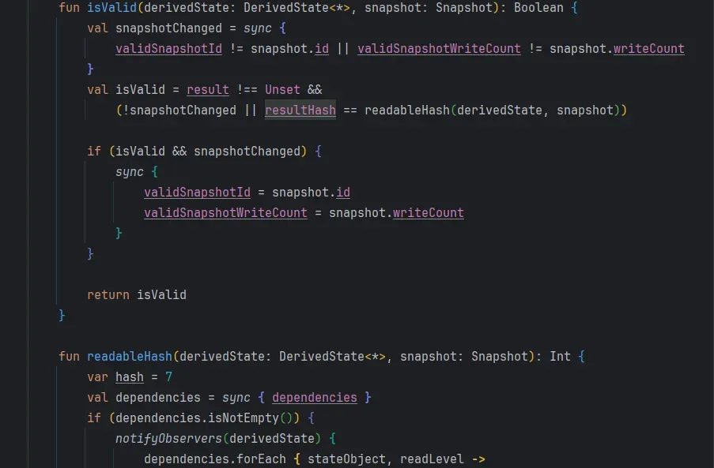{width=100 align=center}

`isValid()` checks whether the current `ResultRecord` is still up to date for the given `snapshot`. If any dependency has changed, `result` has to be recalculated. `readableHash()` computes a hash of the dependencies and is used to detect whether they've changed.

The code below brings this logic together. When a recalculation is needed, it calls `calculation()` again through `Snapshot.observe(...)` and sets new `dependencies` and a new `result`:

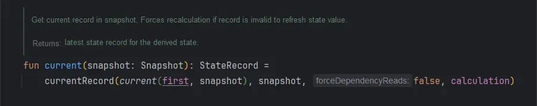{width=100 align=center}

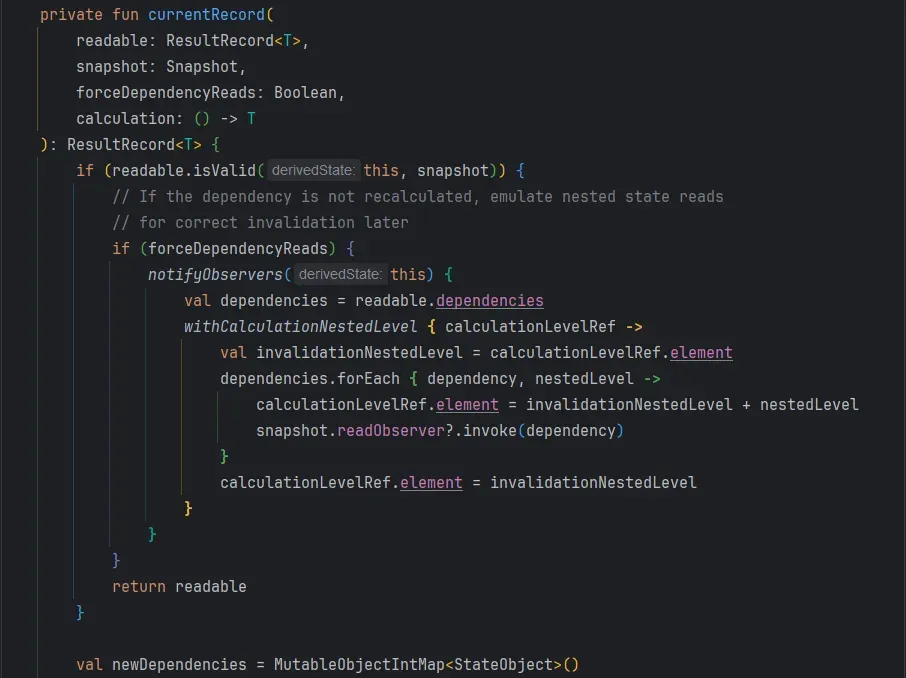{width=100 align=center}

`currentRecord()` checks `isValid()`, and if the record isn't valid, it runs `calculation` again inside a `Snapshot.observe` block and re-tracks the dependencies. This is where `derivedStateOf` really leans on the snapshot system. When a `StateObject` is read during the recalculation, the snapshot system tracks it, and later, when a state it depends on changes, the derived state gets invalidated and recalculated.

To put it all together:

1. **StateObject** (`DerivedSnapshotState`)
   - The `firstStateRecord` and `prependStateRecord()` implementations clearly show its role as the "container" that manages the derived state's points in time (`ResultRecord`s).
2. **StateRecord** (`ResultRecord<T>`)
   - The `ResultRecord<T>` class definition: through `result`, `dependencies`, `assign()`, and `create()`, it stores and manages the derived result for a specific snapshot.
   - The `isValid()` / `readableHash()` methods: they check whether the record is still valid for the current snapshot and trigger a recalculation when needed.
3. **The recalculation flow** (`currentRecord()`, `Snapshot.observe`)
   - The `currentRecord()` implementation: when the record isn't valid, it runs `calculation` again through `Snapshot.observe`, and the snapshot system tracks which `StateObject`s were read along the way.
   - After the recalculation, it updates `dependencies` and `result` and, if needed, prepends a new `StateRecord`. Through these steps, the MVCC-based snapshot system keeps the derived state up to date.

Pointing at specific classes and methods in the source like this makes it concrete how `derivedStateOf` uses the snapshot system (`StateObject` and `StateRecord`). Thanks to this structure, a derived state reacts to changes in the state it depends on and only recalculates when it has to, which gets you both performance and consistency.

## Looking back

I had no idea that `mutableStateOf` and `derivedStateOf`, which I use all the time, had this much going on inside. I learned a lot writing this. Software solutions are always closely tied to data structures, and it reminded me that the way to survive in a field that keeps changing is to get the fundamentals right. I'll wrap up with a promise to myself: don't get comfortable, and keep sharpening the basics.
