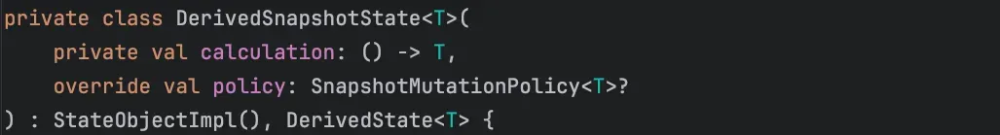
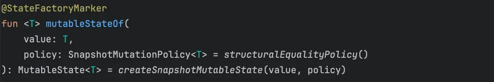
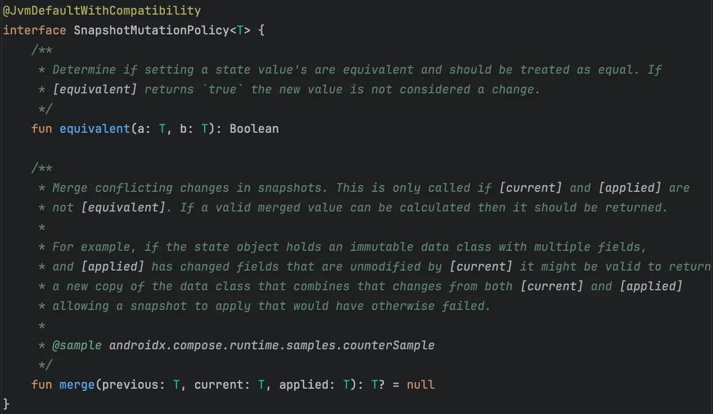
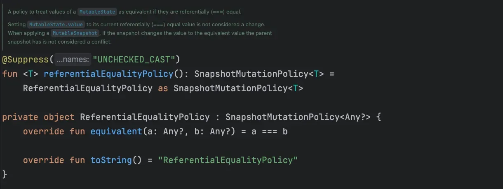
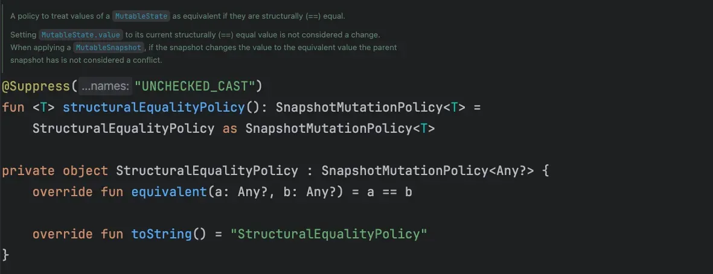
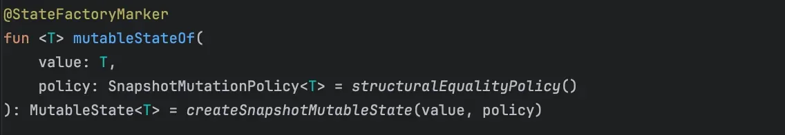
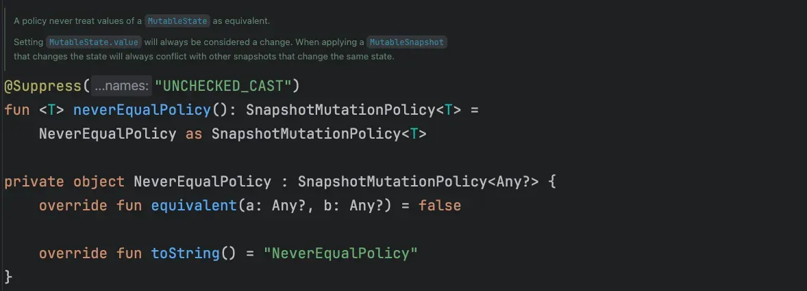
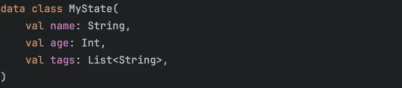
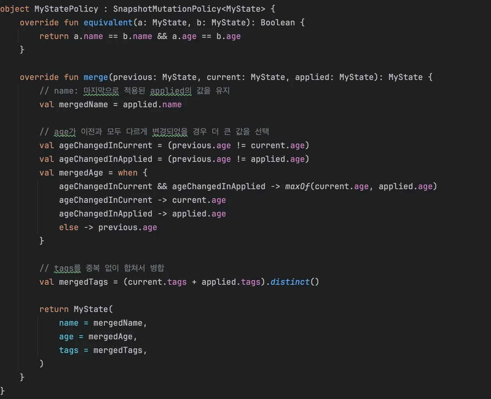
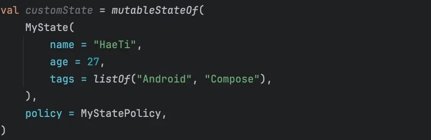

{width=100 align=center}

My [previous post on the Compose Snapshot system](post/compose-snapshot-system) left out one thing I was really curious about: **SnapshotMutationPolicy**. From the name alone I figured it was some kind of rule set and moved on. Then I noticed `mutableStateOf` uses it too, and decided it deserved a proper look.

{width=100 align=center}

## Why care about this?

Once you build UI with Jetpack Compose, how you manage state becomes a big deal. Compose tracks state changes through snapshots, so the rule it uses to decide whether a new value is the same as the old one or a different one matters more than you'd expect. That rule is what SnapshotMutationPolicy defines.

Understanding it helps you write sturdier Compose code in situations like these:

- A value has a new reference but is effectively the same, and you want to skip a pointless recomposition.
- State conflicts in a multi-snapshot setup, and you need a rule for deciding whether it's really a conflict and how to merge it.
- You're working with complex data structures and want fine-grained control over what counts as a change.

I'll go through how the SnapshotMutationPolicy interface works, what sets the three built-in policies apart (referentialEqualityPolicy, structuralEqualityPolicy, and neverEqualPolicy), and when and how to use each one.

## What is SnapshotMutationPolicy?

Compose tracks all UI state and redraws (recomposes) the UI whenever that state changes. But **what counts as a change** depends on the situation. If a value only has a different reference but is really the same object, you might not want to treat it as a change. On the other hand, you might want any new object reference to count as a new value, no matter what.

Before digging into the structure, here's what the KDoc says:

> A policy to control how the result of mutableStateOf report and merge changes to the state object.

> A mutation policy can be passed as an parameter to mutableStateOf, and compositionLocalOf.

> Typically, one of the stock policies should be used such as referentialEqualityPolicy, structuralEqualityPolicy, or neverEqualPolicy. However, a custom mutation policy can be created by implementing this interface, such as a counter policy,

So `compositionLocalOf` uses it as well, and you can write a custom policy of your own. Now for the interface itself:

{width=100 align=center}

It has two jobs:

1. `equivalent(a, b)` decides whether the new values a and b should be treated as **equivalent**.
2. `merge(previous, current, applied)` defines how to **merge** the three values (previous, current, applied) into one when snapshots conflict.

As the KDoc suggests, the interface does exactly what its name says: it sets the policy. Next up are the three policies Compose ships with.

## The built-in policies

#### 1. `referentialEqualityPolicy`

> Same reference (===), same value.

{width=100 align=center}

This policy treats `MutableState.value` as equivalent when the two values are referentially equal (===).

I can see it fitting cases like these:

- **Singletons.** If it's always the same instance, setting it again with the same reference isn't treated as an update.
- **State that holds a reference to a large object** rather than an immutable primitive. As long as the object hasn't changed (the reference is the same), you avoid a recomposition.

Be careful, though: it treats **any value with a different reference as a different value**, even if the contents are identical. Two separate list instances with exactly the same items still count as a change.

#### 2. `structuralEqualityPolicy`

> Structurally equal (==), same value.

{width=100 align=center}

This policy treats the values of a `MutableState` as equivalent when they're structurally equal (==).

{width=100 align=center}

As you can see above, it's the default policy when you create state with `mutableStateOf`.

It's useful in cases like these:

- **Data classes.** Kotlin data classes compare their properties in `==`, so if every property matches, it's the same state.
- **Lists, maps, and other collections.** If you swap in a new collection whose contents are the same as before, there's no recomposition.

The catch is that structural comparison has a cost if it happens a lot. Keep updating a data class with a huge number of properties, and every update compares all of its fields.

#### 3. `neverEqualPolicy`

> Always a different value, no matter what.

{width=100 align=center}

This one always treats the value as changed. It returns false whether a and b have the same contents or even the same reference.

It looks like an easy fit for state that changes often and always needs the latest value on screen. But I suspect every trivial write would trigger a recomposition and hurt performance.

I think it'd be pretty handy for debugging, though.

## Writing a custom policy

Beyond the three built-ins, you can implement `SnapshotMutationPolicy<T>` yourself and define your own rules. That lets you spell out fine-grained conditions, like comparing only some fields of a complex structure, or merging with the previous version when both the existing and the new value have changed.

{width=100 align=center}

Say we have a `MyState` data class with a name, an age, and tags, as above.

Two people can share a name, so two states only count as equal when both the name and the age match.

And when the previous value, the current snapshot, and the applied value conflict in a multi-snapshot setup, say they merge by these rules:

- name: keep the value from `applied`, the last one applied
- age: if `current` and `applied` both differ from the previous snapshot, take the larger one
- tags: combine `current.tags` and `applied.tags`, without duplicates

Implementing `SnapshotMutationPolicy` with those rules looks like this:

{width=100 align=center}

And here's `MyStatePolicy` applied to a state:

{width=100 align=center}

This state now follows the rules you defined up front for when two values are equal and how conflicts get merged. That cuts unnecessary recompositions, and when several snapshots change the value at the same time, they merge the way you want.

It's similar to [the comparison between the snapshot tree and Git in my previous post](post/compose-snapshot-system). It's the same question Git faces when deciding how to combine two versions of a file.

## So when should you use which?

In most cases the default `structuralEqualityPolicy()` is all you need, but a few special cases call for something else.

1. **When you need to optimize performance**
   - If values are compared too often, or structural comparison is too heavy, try switching to `referentialEqualityPolicy()`.
   - In Compose UI built on a large list, you may hand it a new list instance every time while the items inside stay the same, so this can prevent unnecessary recompositions.
2. **When every change has to show up**
   - If the requirement is that every change, however small, must reach the UI, consider `neverEqualPolicy()`.
3. **When you need fine-grained conflict handling across threads or snapshots**
   - Implement `SnapshotMutationPolicy` yourself and customize how `merge` resolves conflicts.

Compose is a declarative UI toolkit that runs on snapshots, so controlling **when and how state changes** really matters. By letting you choose how values are compared and how snapshot conflicts get resolved, SnapshotMutationPolicy gives you a handle on both performance and efficient state management.

I think it's a good exercise to ask, in your own project, when a piece of state should count as changed, and then set a policy for it. I hope this post helps other developers out there.
