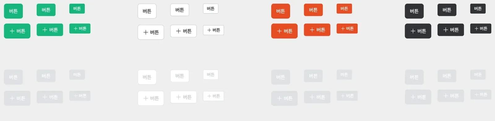
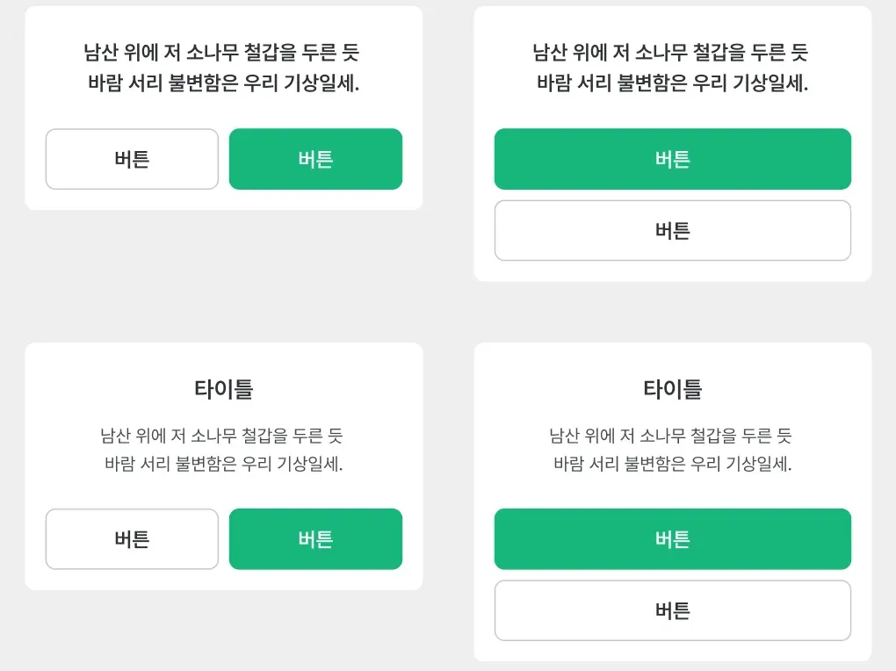
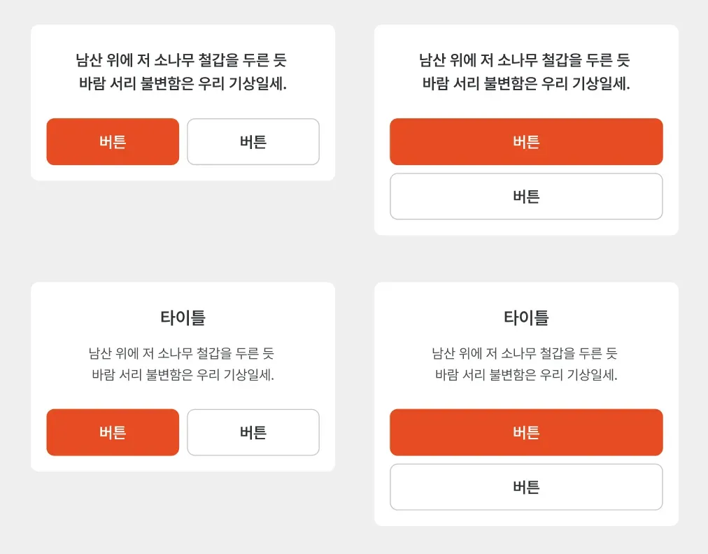
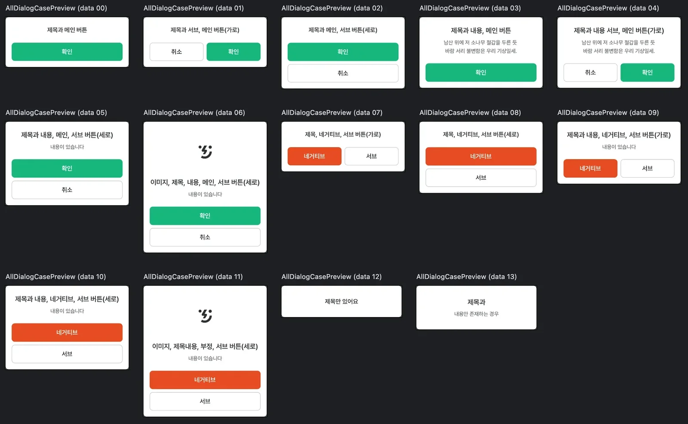
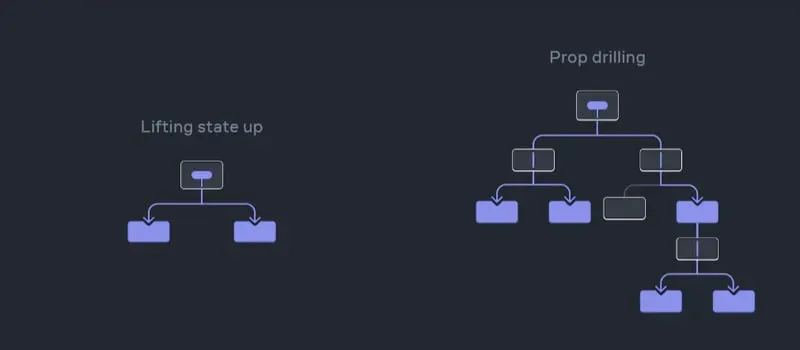

I'm in the middle of migrating a design system from Java/Kotlin + XML to Jetpack Compose. Some of the legacy code is built on a pile of nested conditionals, and in this post I want to walk through how I refactored it with the **compound component pattern**, with examples and what it bought me. At the end, I'll also take a quick look at React's Context API.

I learned the pattern from Suhyeon Kim's article [Advanced UI composition in Jetpack Compose](https://medium.com/@wisemuji/jetpack-compose-ui-%EC%A1%B0%ED%95%A9-composition-%ED%95%98%EA%B8%B0-%EC%8B%AC%ED%99%94-33910e8f09df) (in Korean). If you want to go deeper on the pattern or the software design thinking behind it, I'd recommend reading it closely. It helped me a lot.

## The problem

{width=100 align=center}

If you work with a design system, this is the kind of spec you get handed. Building a button like this from scratch every time you need one wastes effort, and sooner or later two of them won't match. Implementing the design system up front keeps the code consistent and saves you that wasted effort. Even without a formal design system, pulling out components that get used in many places pays off.

When I first started Android development, I set up font and color systems ahead of time. That counts as building a design system too. These days I put the design system in its own module and make every module that has UI depend on it by default.

While building a design system, you sometimes hit a component with so many variations that it's hard to see a good way to build it. A lot of people run into this with TopAppBar when they're first learning Compose, and there the [Slot API](https://developer.android.com/develop/ui/compose/layouts/basics?hl=ko#slot-based-layouts) is a great fit. But when the UI logic is far more complex than slots can handle, **the Slot API can actually work against you**. The [article](https://medium.com/@wisemuji/jetpack-compose-ui-%EC%A1%B0%ED%95%A9-composition-%ED%95%98%EA%B8%B0-%EC%8B%AC%ED%99%94-33910e8f09df) I mentioned above covers this case well, so take a look.

If that sounds abstract, here's an example: the dialog, something you end up building constantly in app development. A dialog usually has a title, a message, and confirm and cancel buttons. Now suppose one new variable gets added.

{width=100 align=center}

Now the sub and main buttons can be laid out either horizontally or vertically. You could build this with the Slot API, but you'd need four composables. The other option is conditionals. They increase coupling and get messier as more conditions pile up, so it's not a great approach. Still, it's convenient right now, and you can't tell yet whether more conditions are coming, so I think a lot of people would go with conditionals. (The article covers this in detail too. And to be clear, building it with the Slot API isn't wrong at all.)

{width=100 align=center}

Most developers don't think much about extensibility, because it's hard to know what's coming. Then a case with a negative button and a sub button shows up, like the one above. In this case the sub button even sits on the right in the horizontal layout (when there was a main button, it was on the left). There's also a variant with an image above the title, plus ones with no buttons at all and ones with only a title. That brings the total to 14 cases.

**With the Slot API you have to punch a lot of slots, and with conditionals you end up in conditional hell.** Either way, every UI addition or change means adding another slot or another branch, which isn't great for maintenance. The parent and child components also become more tightly coupled and tangled up with each other. The code I was dealing with was the conditional-hell version.

## Using the compound component pattern

> [**Compound component pattern**](https://www.patterns.dev/react/compound-pattern): a pattern that shares a parent component's state with its child components, which lowers coupling between components and helps separate the UI from business logic.

For the problem above, this pattern **loosens the coupling between parent and children and makes changes to the UI structure much easier to absorb**. It's one of React's design patterns. In React it's usually built with the [Context API](https://react.dev/learn/passing-data-deeply-with-context), but in Compose you can build it with lambdas with receivers. I'll come back to the Context API at the end of the post.

The core of the pattern is that the parent shares its state with its children. Let's look at an example.

### 1. Defining the scope

```kotlin
@Stable
interface MyDialogScope {
    val onDismissRequest: () -> Unit

    val imageRes: Int?
    val imageTint: Color?

    val title: String?
    val message: String?

    val isButtonLayoutVertical: Boolean

    val negativeButtonText: String?
    val onNegativeClick: () -> Unit

    val subButtonText: String?
    val onSubClick: () -> Unit

    val mainButtonText: String?
    val onMainClick: () -> Unit
}
```

- The scope defines every piece of data and every function the dialog needs to manage. A child component only needs to know this scope to read the parent's state freely and build its UI.
- I also annotated it with `@Stable` so that classes implementing MyDialogScope don't cause unnecessary recompositions.

```kotlin
class DefaultMyDialogScope(
    override val onDismissRequest: () -> Unit,
    override val imageRes: Int?,
    override val imageTint: Color?,
    override val title: String?,
    override val message: String?,
    override val isButtonLayoutVertical: Boolean,
    override val negativeButtonText: String?,
    override val onNegativeClick: () -> Unit,
    override val subButtonText: String?,
    override val onSubClick: () -> Unit,
    override val mainButtonText: String?,
    override val onMainClick: () -> Unit,
) : MyDialogScope
```

- This default class is a plain implementation of MyDialogScope, and it serves as the scope implementation that gets handed to the children. I'll create it with `remember` inside the dialog composable.

### 2. Building the child components

Now for the heart of the compound component pattern: the child components. **Each child takes MyDialogScope as its receiver and draws its UI from the properties defined in the scope.**

```kotlin
@Composable
fun MyDialogScope.MyDialogTitle(
    modifier: Modifier = Modifier,
) {
    val dialogTitle = title ?: return
    val textStyle = if (message.isNullOrBlank()) {
        typography.subHeading1A
    } else {
        typography.subHeading2A
    }

    Text(
        text = dialogTitle,
        modifier = modifier,
        style = textStyle,
        color = colors.gray900,
        textAlign = TextAlign.Center,
    )
}
```

- This composable is the child that renders the title. Each child pulls in only the parent values it needs and builds its own UI logic around them.
- The title uses different typography depending on whether there's a message, so that decision lives in this child.

```kotlin
@Composable
fun MyDialogScope.MyDialogNegativeButton(
    modifier: Modifier = Modifier,
) {
    val negativeText = negativeButtonText ?: return

    MyThrottleButton(
        modifier = modifier,
        text = negativeText,
        onClick = onNegativeClick,
        level = EviButtonLevel.Negative,
    )
}
```

- This one is the negative button. Some dialogs have only sub and main buttons and no negative button, so it uses Kotlin's Elvis operator `?:` to return early when there's no negative button text. That way the child handles both cases, present and absent, and you control which one you get just by changing the values you give the parent.

### 3. `MyDialog`: the parent component

```kotlin
@Composable
fun MyDialog(
    show: Boolean,
    onDismissRequest: () -> Unit,
    title: String,
    message: String? = null,
    imageRes: Int? = null,
    imageTint: Color? = null,
    isButtonLayoutVertical: Boolean = false,
    negativeButtonText: String? = null,
    subButtonText: String? = null,
    mainButtonText: String? = null,
    onNegativeClick: () -> Unit = {},
    onSubClick: () -> Unit = {},
    onMainClick: () -> Unit = {},
    content: @Composable MyDialogScope.() -> Unit,
) {
    if (!show) return

    val scope = remember(


        onDismissRequest, 
imageRes, imageTint,
        title,
        message,
        isButtonLayoutVertical,
        negativeButtonText,

        subButtonText,
        mainButtonText,
        onNegativeClick,
        onSubClick,


        onMainClick,


    ) {
        DefaultMyDialogScope(
            onDismissRequest = onDismissRequest,
            imageRes = imageRes,
            imageTint = imageTint,
            title = title,
            message = message,
            isButtonLayoutVertical = isButtonLayoutVertical,
            negativeButtonText = negativeButtonText,
            onNegativeClick = onNegativeClick,
            subButtonText = subButtonText,
            onSubClick = onSubClick,
            mainButtonText = mainButtonText,
            onMainClick = onMainClick,
        )
    }

    Dialog(onDismissRequest = onDismissRequest) {
        Surface(
            modifier = Modifier.wrapContentHeight(),
            shape = RoundedCornerShape(8.dp),
            color = colors.white,
            shadowElevation = 2.dp,
        ) {
            scope.content()
        }
    }
}
```

- The parent builds the basic dialog skeleton with Compose's `Dialog` and `Surface`.
- It creates the `DefaultMyDialogScope` instance inside a `remember` block, so the scope isn't recreated unless one of its properties changes.
- Finally, the scope's content lambda (`@Composable MyDialogScope.() -> Unit`) hands the actual UI structure over to the children.

The result is a low-coupling structure: the parent only manages the shared state and the UI skeleton, and the children own the UI structure.

### 4. A default layout

If you had to assemble the parent and children by hand every time you needed a dialog, the structure would still fall a bit short. Play to the design system's strengths and predefine the common layouts, and you get the most out of the compound component pattern.

```kotlin
@Composable
fun MyDialogScope.MyDialogDefaultLayout() {
   
    val hasMessage = !message.isNullOrBlank()

    ... omitted ...

    Column(
        modifier = columnModifier,
        horizontalAlignment = Alignment.CenterHorizontally,
    ) {
        MyDialogImage()
        MyDialogTitle()
        MyDialogMessage()

        if (hasButton) {
            Spacer(Modifier.height(24.dp))

            if (isButtonLayoutVertical) {
                Column(
                    modifier = Modifier.fillMaxWidth(),
                    verticalArrangement = Arrangement.spacedBy(8.dp),
                    horizontalAlignment = Alignment.CenterHorizontally,
                ) {
                    MyDialogMainButton(Modifier.fillMaxWidth())
                    MyDialogNegativeButton(Modifier.fillMaxWidth())
                    MyDialogSubButton(Modifier.fillMaxWidth())
                }
            } else {
                Row(
                    modifier = Modifier.fillMaxWidth(),
                    horizontalArrangement = Arrangement.spacedBy(8.dp),
                    verticalAlignment = Alignment.CenterVertically,
                ) {
                    MyDialogNegativeButton(modifier = Modifier.weight(1f))
                    MyDialogSubButton(modifier = Modifier.weight(1f))
                    MyDialogMainButton(modifier = Modifier.weight(1f))
                }
            }
        }
    }
}
```

- With the children I already have, I can predefine all 14 dialog cases.
- Each child already decides whether it shows up and handles its own customization (fonts, spacing, and so on) by reading the parent's state (the scope), so the default layout only has to arrange them.
- I could also push conditions like `hasButton` and `isButtonLayoutVertical` down into the children, but I decided this much branching is fine for readability and maintenance, so I left it as is.

### 5. Checking every case with `PreviewParameterProvider`

Writing a separate preview for each of the 14 dialog cases would mean a lot of duplicated code and a pile of composables, and the file would get very long. Compose's built-in [PreviewParameterProvider](https://developer.android.com/develop/ui/compose/tooling/previews?hl=ko#preview-data) makes this easy.

```kotlin
data class MyDialogPreviewData(
    val title: String,
    val message: String?,
    @DrawableRes val imageRes: Int?,
    val mainButtonText: String? = null,
    val negativeButtonText: String? = null,
    val subButtonText: String? = null,
    val isButtonLayoutVertical: Boolean = false,
)
```

- First, define only the data the previews need. There's no reason to check click events and the like in a preview, so you can leave them out.

```kotlin
class MyDialogPreviewParameterProvider : PreviewParameterProvider<MyDialogPreviewData> {
    override val values: Sequence<MyDialogPreviewData> = sequenceOf(
        // 1) Title and a full-width main button only
        MyDialogPreviewData(
            title = "Title and main button",
            message = null,
            imageRes = null,
            mainButtonText = "OK",
            negativeButtonText = null,
            subButtonText = null,
            isButtonLayoutVertical = false,
        ),

        // 2) Title with sub and main buttons laid out horizontally
        MyDialogPreviewData(
            title = "Title, sub and main buttons (horizontal)",
            message = null,
            imageRes = null,
            mainButtonText = "OK",
            subButtonText = "Cancel",
            negativeButtonText = null,
            isButtonLayoutVertical = false,
        ),

        ... omitted ...
       
        // 14) Title and message only
        MyDialogPreviewData(
            title = "Title and",
            message = "message only",
            imageRes = null,
            mainButtonText = null,
            negativeButtonText = null,
            subButtonText = null,
            isButtonLayoutVertical = false,
        ),
    )
}
```

- Next, write a class that implements `PreviewParameterProvider` and returns the 14 sample cases to test as a sequence. You only fill in the data each dialog needs.

```kotlin
@Preview(showBackground = true)
@Composable
fun AllDialogCasePreview(
    @PreviewParameter(MyDialogPreviewParameterProvider::class) data: MyDialogPreviewData,
) {
    MyTheme {
        MyDialog(
            show = true,
            onDismissRequest = { },
            imageRes = data.imageRes,
            title = data.title,
            message = data.message,
            isButtonLayoutVertical = data.isButtonLayoutVertical,
            mainButtonText = data.mainButtonText,
            negativeButtonText = data.negativeButtonText,
            subButtonText = data.subButtonText,
            onMainClick = { },
            onNegativeClick = { },
            onSubClick = { },
        ) {
            MyDialogDefaultLayout()
        }
    }
}
```

- Now just add a parameter annotated with `@PreviewParameter` to pass the sample data into the preview composable.

{width=100 align=center}

With the data defined up front, a single preview composable gives you a clean set of previews like the one above. It's really handy.

### 6. Using it for real

```kotlin
    if (state.showDialog) {
        MyDialog(
            show = true,
            onDismissRequest = {},
            title = "Title",
            message = "Message",
            subButtonText = "Cancel",
            onSubClick = onCancelClick,
            mainButtonText = "OK",
            onMainClick = onConfrimClick,
        ) {
            MyDialogDefaultLayout()
        }
    }
```

- Wherever you need a dialog, you just pass in the information for the children you want to show.
- If you need a combination or arrangement that isn't one of the 14 predefined cases, skip the default layout at the call site and arrange the children yourself.

## Slot API vs. conditionals vs. compound components

Like any pattern, the compound component pattern isn't always the right tool. To figure out when it fits, I compared its pros and cons with the two approaches that were already widely used: the Slot API and conditionals.

### 1. The Slot API

- **Pros**: You can easily swap out just the part you want, which makes it convenient for general-purpose substitution.
- **Cons**: If you need to change the UI structure completely, or the number of slots grows, you can end up in slot hell.
  - For example, if the layout keeps changing (two buttons, three buttons, vertical, horizontal), you either define slot1, slot2, slot3, and so on, or write more conditionals inside each slot. Either way it gets complicated.

### 2. Conditionals

- **Pros**: Very intuitive at first, and quick to build.
- **Cons**: Every new requirement adds another branch, and as they pile up, readability and maintainability suffer.

### 3. Compound components

- **Pros**
  1. The conditionals don't all pile up in one place. Each child decides for itself whether it should exist (is there text or not?).
  2. Parent and children are loosely coupled, so changing the UI structure (vertical or horizontal buttons, moving the image, and so on) is much easier.
  3. Changing the overall layout is easier than with the Slot API.
  4. It extends well: you build the design system plus a default layout, and callers assemble special arrangements themselves.
- **Cons**
  1. If you're not used to lambdas with receivers, the learning curve is steeper than with the other approaches.
  2. For a very simple scenario like swapping out a single button, the Slot API may well be more intuitive.

There are other approaches beyond these, but if you understand the trade-offs and use each one where it fits, you end up with a design system that's easy to maintain, read, and extend. The [article I learned from](https://medium.com/@wisemuji/jetpack-compose-ui-%EC%A1%B0%ED%95%A9-composition-%ED%95%98%EA%B8%B0-%EC%8B%AC%ED%99%94-33910e8f09df) ends on the same note: "Simple is the Best." It made me want to learn more patterns so I can reach for the best solution in whatever situation I'm in.

## React's Context API and props drilling

In React, the compound component pattern is built with the [Context API](https://www.patterns.dev/react/compound-pattern).

```jsx
// 1) Create the context
const ModalContext = React.createContext();

// 2) The parent (compound): the Provider's scope
function ModalProvider({ text, onClose, children }) {
    const value = { text, onClose };

    return (
        <ModalContext.Provider value={value}>
          <div className="modal-backdrop">
            <div className="modal-content">
              {children}
            </div>
          </div>
        </ModalContext.Provider>
    );
}

// 3) The children (compound): read state straight from the context
function ModalTitle() {
    const { text } = React.useContext(ModalContext);
    return <h2>{text}</h2>;
}

function ModalCloseButton() {
  const { onClose } = React.useContext(ModalContext);
  return <button onClick={onClose}>Close</button>;
}

// 4) Usage
function MyScreen() {
    const [showModal, setShowModal] = React.useState(false);

    return (
        <div>
          <button onClick={() => setShowModal(true)}>Show Modal</button>
          {showModal && (
            <ModalProvider
              text="This is a modal"
              onClose={() => setShowModal(false)}
            >
              <ModalTitle />
              <p>Modal Body here</p>
              <ModalCloseButton />
            </ModalProvider>
          )}
        </div>
    );
}
```

You don't need to read the code closely. What matters is that, just like the lambda-with-receiver approach in Compose, the children use the parent's state directly to get rid of props drilling. In other words, React uses a context that behaves like global state, scoped to the modal.

Both the Compose and React approaches let multiple children easily reference the parent's shared state, and both share the same composable UI philosophy.

### Do you always have to get rid of props drilling?

{width=100 align=center}

Props drilling is when you have to pass props down through several levels from parent to child, including levels in between that don't actually use them. The problem is that it's hard to trace where the data goes as it moves from parent to child.

[Frontend Fundamentals](https://frontend-fundamentals.com/), a guide from Toss (a Korean fintech company) that's been getting a lot of attention lately, had [a discussion about props drilling](https://frontend-fundamentals.com/code/examples/item-edit-modal.html).

{width=100 align=center}

The usual fixes for props drilling are global state management and composition, but a lot of people in that discussion made the same point: **removing props drilling isn't always the answer. You should decide based on your team's conventions and the situation in front of you, and overusing global state is bad too.** That gave me two things to keep in mind: when I create global state, it should live in a properly scoped context, and in Compose I should use lambdas with receivers where they actually make sense.

{width=100 align=center}

A developer who worked on Compose itself also points out that using CompositionLocal can break module dependencies and make code harder to maintain. So I don't think removing props drilling is always the right call either. Talk it through with your team, stay consistent, and pass things explicitly when they need to be explicit.

On a related note, there's [a short discussion about the golden age of global state management libraries in React](https://github.com/toss/frontend-fundamentals/discussions/5#discussioncomment-11831458) that I think every frontend developer should read at least once.

## One last thing

JK, the iOS lead mentor at Naver Boostcamp (a Korean developer training program), co-wrote a book called \[개발자 원칙\] (roughly "Developer Principles", in Korean), and it has a chapter on study habits. It lays out what developers should be studying going forward and recommends spending about 50% of your learning on knowledge related to your current job, 30% on things that will probably become relevant, and 20% on things you're interested in that have nothing to do with work. While studying Compose, I keep picking up ideas from React, even though I can't write React code at all. I'm going to keep at it anyway, to find inspiration and broaden my view.
