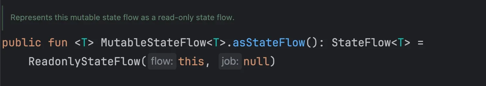
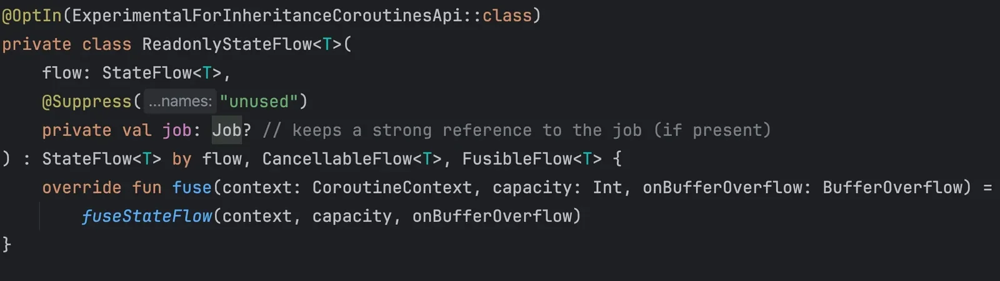
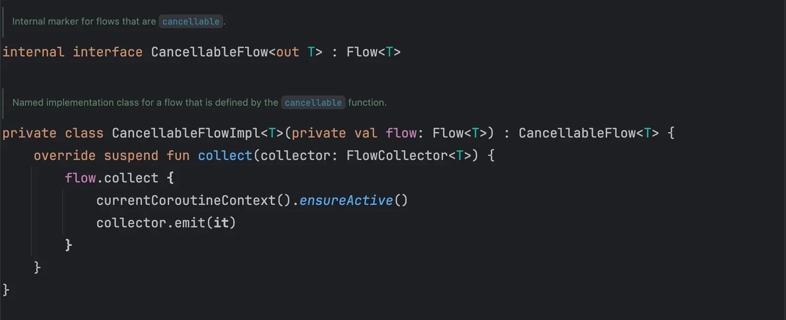
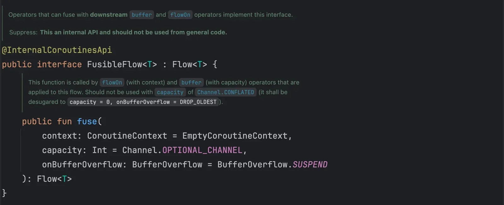
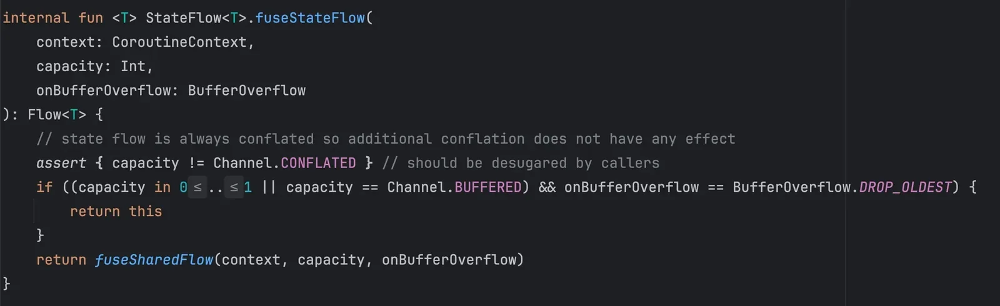
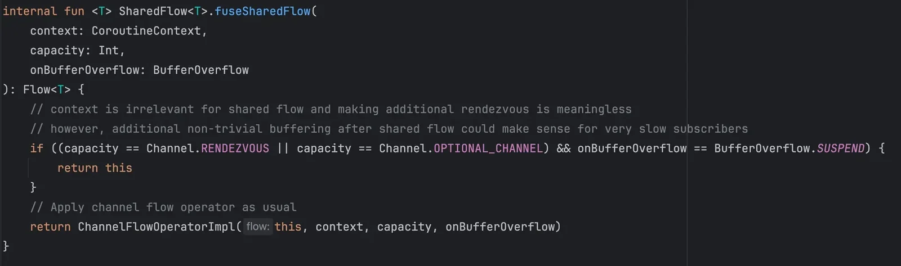
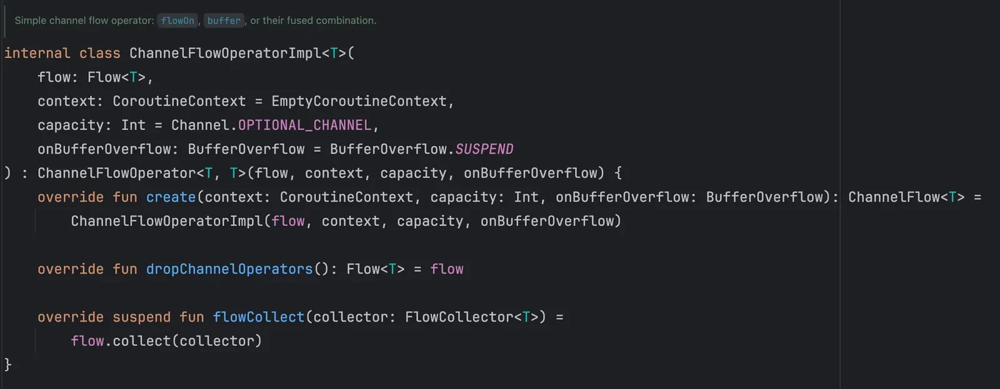

### 들어가며

Kotlin을 쓰다 보면 흔히 **백킹 프로퍼티(Backing Property**) 기법을 자주 보게 된다.

```kotlin
private val _counter = MutableStateFlow(0) 
val counter : StateFlow<Int> = _counter 
```

여기서 `_counter`은 **내부에서만** 수정 가능한 `MutableStateFlow`이고, `counter`은 외부에서 볼 때 **읽기 전용**인 `StateFlow` 타입으로 노출된다. 안드로이드 개발을 하면서 Observer 패턴은 자주 사용되는데, 보통 **LiveData**, **Rx**, **Flow**와 같은 데이터 스트림을 활용해 “**변경 사항이 발생할 때마다 자동으로 UI나 로직을 갱신**”하는 구조를 설계한다.

위와 같이 백킹 프로퍼티 기법을 사용하는 이유는 **외부에서 수정하는 것을 막기 위해서다**. **많은 개발자들이 이러한 특성을 불변성이라고 생각할 것인데, 한 걸음 더 들어가보면 틀린 이야기이다**. 정확하게 말하면 **읽기 전용(read-only**)으로 사용하기 위해서 이러한 구조를 사용하는 것이다. 읽기 전용으로 변수를 생성하면 외부에 공개된 인터페이스로는 수정할 수 없지만, 내부에서는 계속 값이 변할 수 있기 때문이다. 이와 관련되어 이전에 포스팅한 [Effective Kotlin 읽고 Compose에 적용하기 글](post/effective-kotlin)의 “가변성을 제한하라” 부분을 참고하면 좋을 것 같다.

(참고 : 예시에서 사용한 데이터 스트림에 대해서는 재할당할 경우가 거의 없으므로 get()을 사용하지 않았다. 하지만, 현재 방식처럼 Assignment(=)을 사용하는 대신에 get() 방식을 사용하는 것이 final 프로퍼티를 하나 더 줄일 수 있으며, 만약 원시 타입이나 binding을 대상으로 백킹 프로퍼티를 적용하는 경우 get() 방식을 사용해서 변경에 대한 실시간 반영을 지원해야 한다.)

그렇다면 왜 읽기 전용으로 노출시킬까? 아래 두 가지 이유가 떠오른다.

- **캡슐화(encapsulation**)
  - 내부 로직은 자유롭게 값을 업데이트 할 수 있으면서도,
  - 외부에서는 잘못된 직접 수정을 막을 수 있다.
- **코드의 의도 명시**
  - 외부에서 변경하면 안된다라는 의도로 코드를 명확히 표현할 수 있다.

#### asStateFlow()? 안써도 되는 거 아닌가?

이렇게 이미 백킹 프로퍼티 기법을 통해서 읽기 전용의 목적을 달성하고 있는데 굳이 `asStateFlow()`를 사용해야 할까? 사용해야 한다면 언제, 왜 사용해야 할까?

```kotlin
private val _counter = MutableStateFlow(0) 
val counter = _counter.asStateFlow()
```

둘 다 결국 MutableStateFlow를 “StateFlow처럼” 쓰는 것이니, 기능적으로 큰 차이는 없어 보인다. 그래서 실제로 많은 개발자들이 `asStateFlow()`라는 확장 함수를 사용하지 않고도 큰 문제 없이 사용해왔다.

하지만, 팀원이나 다른 개발자가 실수로(혹은 의도적으로) downcast를 해버릴 수도 있다.

```kotlin
val counterAttack = (MViewModel.counter as? MutableStateFlow<Int>)
counterAttack?.value = -1
```

물론 이런 코드는 아무나 막 짜지는 않을 거다. 하지만 **가능성**은 항상 열려 있다는 점이 문제라고 할 수 있다.

그래서 “명시적으로” **읽기 전용**임을 강조하기 위해 `asStateFlow()`가 존재한다.

또 다른 중요한 이유는, **asStateFlow() 내부에 적용된 최적화**가 있어서 단순히 “타입만” 바꾸는 게 아니라 **추가적인 동작**을 제공한다는 점이다.

자세히 내부 동작을 살펴보기 전에 아직 `asStateFlow()`가 어떤 느낌으로 사용되는 건지 잘 와닿지 않는 분들이 있을 것 같아 예시를 들어보겠다.

필자는 SOPT라는 IT 창업 동아리에서 파트장 직책을 맡아 노션으로 세미나를 진행했었다. 모두가 초대받은 Workspace 속 페이지에서 세미나를 진행하다 보니, **노션의 잠금 기능을 사용하여도 모두가 잠금 해제가 가능하여 세미나 내용을 수정할 수 있었다**. 실제로 세미나 도중 누군가의 실수로 자료가 손상되었던 경험이 있다. (바로 복구하긴 했다) 조금 억지스러운 감이 있지만, 이런 상황이 마치 **다운 케스팅을 사용해 값을 바꾸는 StateFlow의 상황과 비슷하다**고 생각할 수 있을 것 같다. 읽기 전용 의도로 잠금처리를 하였지만, 실제로는 값을 바꿀 수 있는 구조니 완벽한 읽기 전용이 될 수 없었다.

위와 같은 상황 속에서, 만약 개인 노션에 작성한 내용을 **노션의 게시 기능을 통해 공유한다면, 세미나를 듣는 사람들은 자료가 있어도 수정이 불가능하기에 완벽한 읽기 전용으로 만들 수 있다**. (물론 작성자는 수정가능하다) 이렇게 설정하면 세미나 도중 자료가 손상되는 일이 없을 것이다.

위 예시와 같은 상황을 안드로이드 개발에 적용한다면 꽤나 유용할 것 같다고 생각한다. 이제는 이 `asStateFlow()`가 어떻게 동작되는지 내부 코드를 파악해보며 설명해보겠다.

## asStateFlow() 해부 시작

### asStateFlow()

{width=100 align=center}

가장 먼저 `asStateFlow()` 확장함수는 `MutableStateFlow<T>`의 인스턴스를 읽기 전용 인터페이스인 `StateFlow<T>`로 변환하는 역할을 한다.

내부적으로는 `ReadonlyStateFlow`라는 래퍼(wrapper) 클래스를 생성하여 반환한다. 좀 더 면밀히 살펴보기 위해 `ReadonlyStateFlow` 내부를 살펴보겠다.

### ReadonlyStateFlow

{width=100 align=center}

`MutableStateFlow`를 `asStateFlow()`로 감쌌을 때, 실제로 반환되는 클래스가 바로 이 `ReadonlyStateFlow`이다. 클래스 이름에서도 알 수 있듯이 “**내부의 변경 가능 상태(Mutable)를 외부에서 읽기 전용(Read-only)으로 보이게 해주는 래퍼**” 역할을 한다고 볼 수 있다.

#### 위임

이 클래스는 `StateFlow<T> by flow` 구문을 통해 `ReadonlyStateFlow`가 **flow가 가진 모든 StateFlow 기능을 그대로 위임(delegate)받는다**. 따라서 `ReadonlyStateFlow` 자체를 `StateFlow`처럼 사용할 수 있게 된다.

#### Job 사용

파라미터를 통해 `Job`이 전달될 수 있는데, 현재 코드에서는 null로 쓰이지만, 만약 이 Flow를 어느 코루틴 컨텍스트에서 관리하려 한다면, 강한 참조(strong reference)로 잡아두어 Cancellation나 수명 관리 등을 할 수 있는 구조를 갖추고 있다.

#### CancellableFlow

이 인터페이스를 구현하면, Flow를 collect하는 동안 코루틴이 취소될 가능성이 생겼을 때 대응할 수 있다. 바로 다음 단락에서 더 자세히 살펴볼 예정이다.

#### FusibleFlow

이건 조금 생소할 수 있는데, Flow의 다운스트림에서 사용되는 `flowOn`, `buffer`와 같은 연사자들과 결합(fusion)할 수 있도록 만든 인터페이스이다. “**이 Flow를 새로운 스레드 컨텍스트에서 돌리고 싶을 때(flowOn**)”나 “**중간에 버퍼 크기를 바꾸고 싶을 때(buffer**)”와 같은 연산자들이 붙었을 때, **불필요한 중간 단계를 제거하거나 최적화할 수 있다**. 마찬가지로 좀 더 뒤에 내부 구현을 살펴볼 예정이다.

#### **fuse() 메서드**

`fuse`는 `FusibleFlow<T>`가 가진 메서드로, “만약 다운스트림에 flowOn이나 buffer가 달린다면, 이 Flow는 어떻게 최적화할 거냐”를 정의한다. 여기서는 `fuseStateFlow()` 함수를 호출해 실제 로직을 처리하도록 넘기고 있다. `fuseStateFlow()`에 대해서도 역시나 좀 더 뒤에 내부 구현을 살펴보겠다.

결론적으로 이 클래스는 **내부 flow를 그대로 위임하여 읽기 전용 인터페이스의 기능을 지원**하고, CancellableFlow, FusibleFlow 인터페이스를 구현함으로써 **코루틴의 취소 및 다운스트림의 buffer/flowOn 연산자와 fusion, 즉 최적화 처리가 가능하도록 지원**하는 역할을 한다고 볼 수 있다.

### CancellableFlow, CancellableFlowImpl

{width=100 align=center}

여기서 `CancellableFlow`는 말 그대로 “취소가 가능한 Flow”를 나타내는 **internal** **marker 인터페이스**이다. 실제 취소(코루틴이 취소될 때 collect가 멈추는 것)를 어떻게 처리해야 하는지는 `CancellableFlowImpl`에 구현되어 있다.

`collect` 메서드에서 `currentCoroutineContext().ensureActive()`를 통해 “**현재 코루틴이 여전히 살아 있는지(취소되지 않았는지) 확인”하고, 취소되었다면 CancellationException을 발생**시킬 수 있다.

이처럼 `ReadonlyStateFlow`가 `CancellableFlow`를 구현한다는 것은, “**다운스트림에서 collect하는 동안 취소 이벤트가 생기면 정상적으로 멈춰줄 수 있다**”라는 의미로 이해하면 된다.

### FusibleFlow

{width=100 align=center}

`FusibleFlow`는 “**이 Flow가 다운스트림의 buffer 연산자나 flowOn 연산자와 붙었을 때, 어떻게 합쳐질(fuse) 것인가?”를 결정하는 인터페이스**이다.

- **buffer 연산자**: Flow의 버퍼 크기를 조절하는 연산자. ex) `.buffer(capacity = 64)`
- **flowOn 연산자**: Flow를 다른 코루틴 디스패처에서 동작하게 하는 연산자. ex) `flowOn(Dispatchers.IO)`

기본 Flow였다면 `buffer`나 `flowOn`이 붙을 때마다 중간 연산자가 계속 생길 수 있는데, Flow 라이브러리는 “**불필요하게 여러 연산자가 생기지 않도록**” 내부에서 최적화(fusion)할 수 있는 길을 열어둔 것이다. 예를 들어 이미 conflate(가장 최근 값만 유지) 되어있는 Flow에 또 ‘conflate’ 연산자가 붙으면 무의미하므로 제거하는 것과 같이 최적화를 수행할 수 있다.

`ReadonlyStateFlow`는 이를 구현하여, “**나는 이미 conflate가 가능한 StateFlow이니, 다운스트림에서 비슷한 설정이 들어와도 굳이 중복 처리를 안 해도 된다**”와 같은 동작을 할 수 있게 된다.

### fuseStateFlow(), fuseSharedFlow()

{width=100 align=center}

앞서 `ReadonlyStateFlow` 의 내부를 살펴볼 때 사용되었던 함수이다. 이 함수는 “StateFlow에 buffer/flowOn이 붙었을 때 어떻게 처리할지”를 결정한다.

이 함수가 의미하는 것은 다음과 같다.

“StateFlow는 본질적으로 항상 **최신 값 하나만 유지(conflated**) 하는 특징이 있으니, `capacity`를 `0~1`로 주고, `onBufferOverflow`가 `DROP_OLDEST`라면 이미 우리가 하는 동작과 똑같다. 굳이 새로운 중간 연산자를 만들 필요가 없으니 **그냥 this를 반환**한다”라는 논리이다.

주석에서도 확인할 수 있듯이 StateFlow가 이미 conflate 중이라면 중복이기에 `assertion`을 사용하여 `Channel.CONFLATE`인 경우를 검열한다. 주로 디버그 모드에서만 검증한다.

만약 `capacity`가 `0~1` 범위도 아니고, `onBufferOverflow`도 `DROP_OLDEST`가 아니라면, `fuseSharedFlow()`로 넘어간다.

{width=100 align=center}

`SharedFlow<T>`와 관련해서, “어떤 조건에서는 그대로 반환하고, 그렇지 않다면 `ChannelFlowOperatorImpl`로 감싸서 버퍼 정책 등을 제대로 적용한다”는 내용이 담겨 있다.

“**context는 SharedFlow에 큰 의미가 없다**”는 주석처럼, 이미 공유 가능한 Flow라면 추가로 Rendezvous 채널을 붙이는 게 실익이 적다는 얘기도 나와 있다.

### ChannelFlowOperatorImpl

{width=100 align=center}

여기서는 최종적으로 버퍼(capacity), 컨텍스트(context), Overflow 정책(onBufferOverflow) 등을 적용할 수 있는 **채널 기반의 Flow**를 만드는 역할을 한다.

`ChannelFlow`는 코틀린 내부에서 `buffer`, `flowOn` 같은 연산자를 최적화하기 위해 사용하는 추상화 계층이다. 단일 채널로부터 데이터를 받고, 필요한 버퍼나 컨텍스트 전환 등을 수행할 수 있게 해 준다.

`flowCollect`에서는 결국 원본 Flow를 collect하면서, 중간에 필요한 연산을 수행(혹은 덧붙일) 수 있게 된다.

정리하자면, `ChannelFlowOperatorImpl` 같은 클래스가 최후의 채널 기능을 수행해, “아주 느린 구독자(slow subscriber)”가 있을 때나 “버퍼 크기를 조정해야 할 때” 적절히 작동하게 해 주는 역할을 한다.

## 결론

읽기 전용 이야기를 하다가 갑자기 최적화와 관련된 복잡한 흐름이 이어져서 마지막으로 정리를 해보겠다.

1. `ReadonlyStateFlow`가 `MutableStateFlow`를 감싸면서, 외부에는 진짜 **읽기 전용 StateFlow**처럼 보이게 만든다.
2. 동시에, `CancellableFlow`를 구현하여 “**collect 도중에 취소가 발생하면 정상적으로 멈춘다**”는 흐름 제어를 가능케 한다.
3. `FusibleFlow`를 통해 “**flowOn, buffer 등의 다운스트림 연산자와 최적화(fusion)를 진행**”할 수 있다.
4. `fuseStateFlow`, `fuseSharedFlow`, `ChannelFlowOperatorImpl` 등에서 “**이미 conflate 중인데 또 conflate가 들어오면 무의미하다**”거나 “버퍼/컨텍스트 설정을 추가로 붙여야 한다”는 식의 로직을 구현한다.

이 모든 과정을 통해 `asStateFlow()`는 단순히 “타입만 바꿔주는” 일을 넘어, 코루틴 Flow의 **최적화 및 안전성**을 담보해 주는 구조를 갖추게 된다는 점이 핵심이라고 할 수 있다.

더 깔끔하게 정리하자면,

`asStateFlow()` → `ReadonlyStateFlow` → (`CancellableFlow` + `FusibleFlow`) → **내부 최적화와 취소 보장**

이런 흐름으로 돌아간다고 이해하면 될 것 같다.

실제 안드로이드 개발에서 우리가 이 모든 내부 과정을 매번 챙길 일은 없지만, “도대체 왜 `asStateFlow()`라는 확장 함수를 굳이 만들었을까?”라는 의문이 들 때, **그 안에는 이렇게 여러 가지 최적화와 안전성이 녹아 있기 때문**이라고 기억해 두면 좋을 것 같다.
