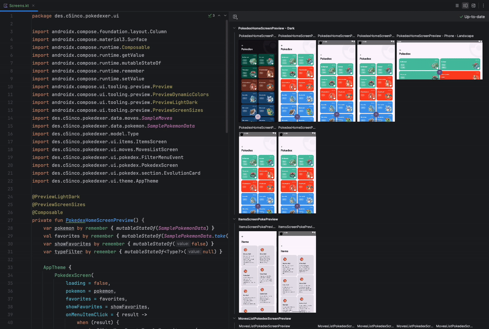
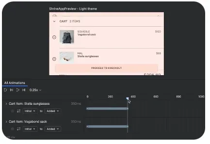
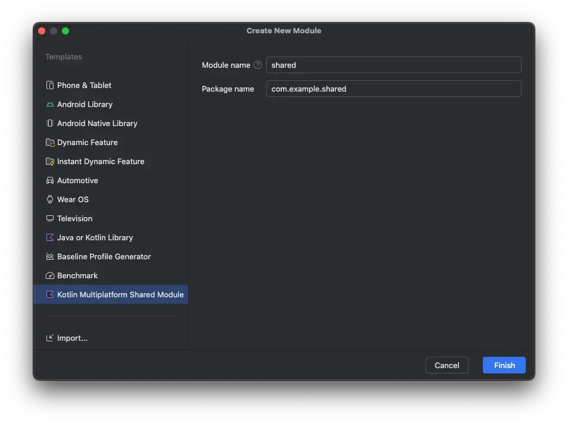
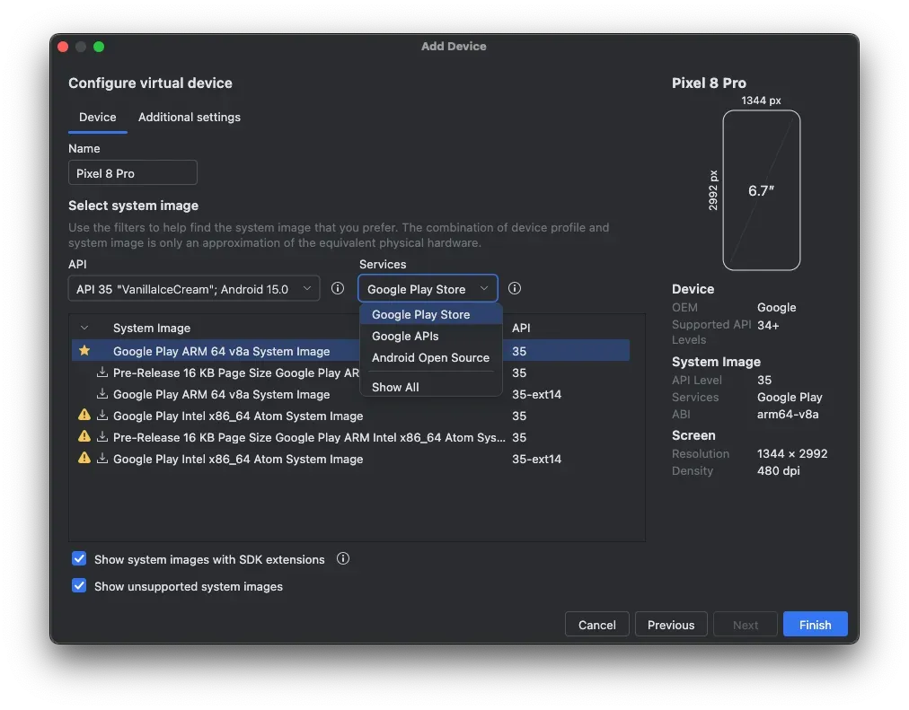
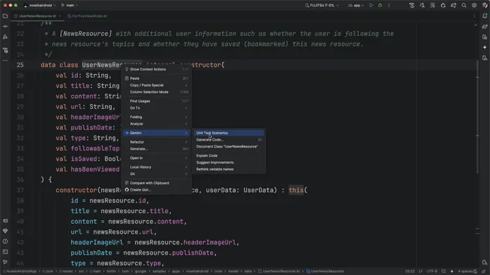
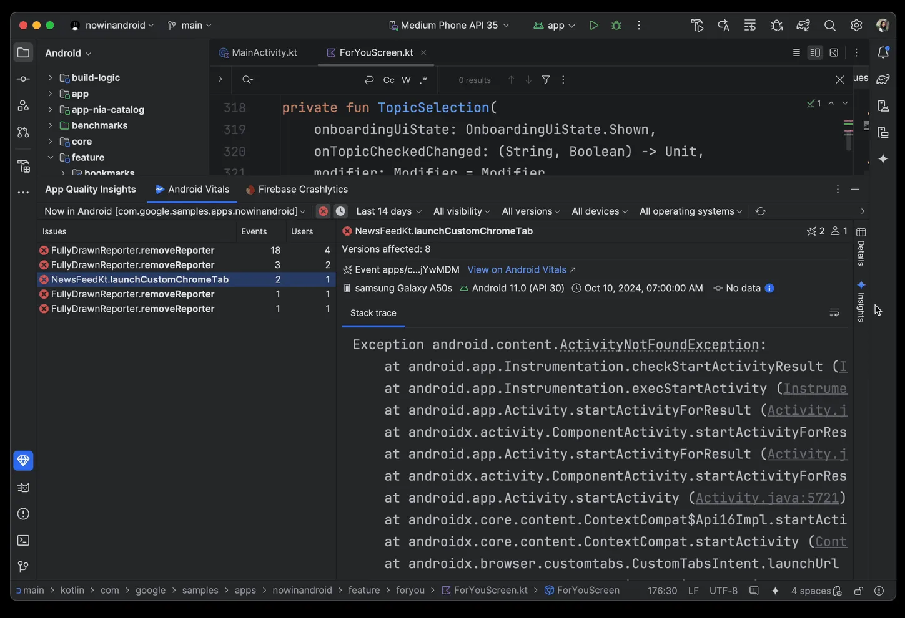
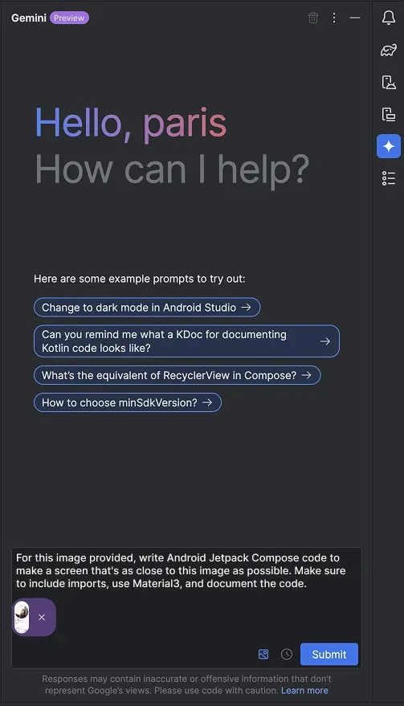
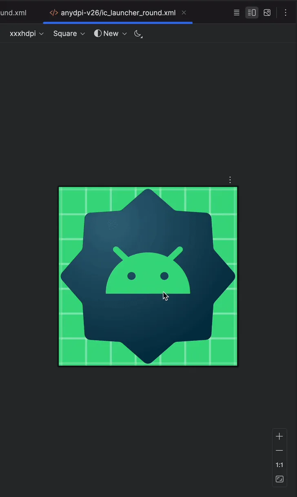
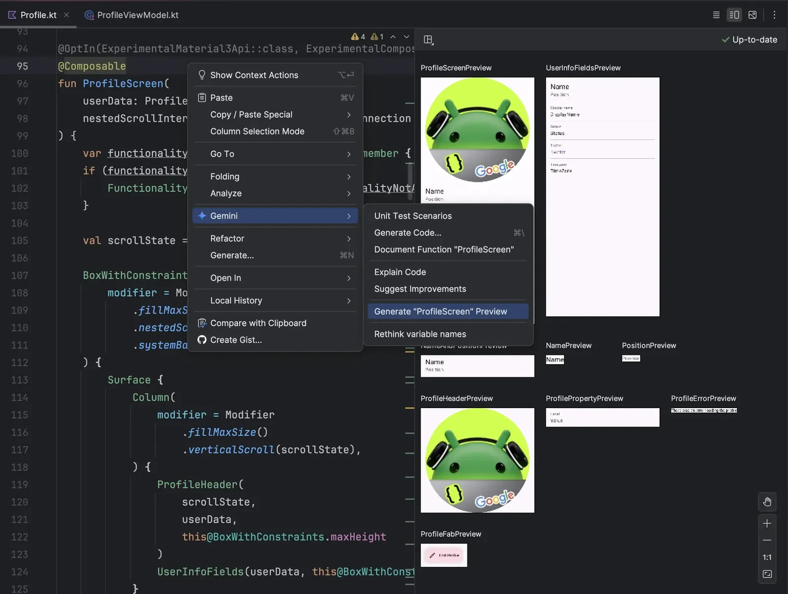

Android Studio **Meerkat** went stable on March 4, 2025, so I went through everything that changed. I also looked ahead at the next release, the 2024.3.2 preview. The parts I found most interesting are marked with ⭐.

## 1. Compose Preview improvements ⭐

{width=100 align=center}

- Zooming in and out of the Preview pane is smoother and more responsive.
- You can now collapse and expand previews by group. It works like a **toggle in Notion**, so a long list of previews stays tidy.
- Grid view is now the default. You can right-click to switch to Gallery mode, and List view is gone.

## 2. Compose Design Tools ⭐

{width=60 align=center}

- You can now step through an animation in millisecond increments and inspect each point.

## 3. KMP Shared Modules in Android projects ⭐

{width=100 align=center}

- After creating a new Android project, go to New → Module and you'll see the option to create a KMP Shared Module, as shown above.
- That means you can add a KMP shared module right from your project instead of going through the [KMP Wizard](https://kmp.jetbrains.com/). I think it's a handy addition.

## 4. Device Manager UX update

{width=100 align=center}

- When you add a device in the Device Manager through Create Virtual Device or Select Remote Devices, you now get filters and recommendations.
- The idea is to help you set up the device that performs best across a range of environments.

## 5. New Gemini features ⭐

{width=100 align=center}

- Right-click a class and pick Gemini → Generate Unit Test Scenarios, and Gemini generates the unit tests it recommends.

{width=100 align=center}

- In the App Quality Insights tool window, Gemini can analyze crash reports, generate stats, and give you a summary.
- It can also pull up sample code and links to related docs.

---

Next up is the **Meerkat Feature Drop**, shipping as **2024.3.2**. Here's what it adds.

## 1. Image attachments in Gemini in Android Studio

{width=50 align=center}

- Plenty of generative UI tools let you attach images, and now the Gemini window in Android Studio does too.

## 2. Testing and developing with app backup and restore

- A new feature lets you test whether your app still works after a user switches to a new device or restores from the cloud.
- The [official docs](https://developer.android.com/studio/preview/features?hl=ko#test-backup-restore) walk through implementing backup and restore in detail.

## 3. Themed icon support ⭐

On Android 13 and up, users can already have their phone's theme applied to app icons. ChatGPT, Galaxy Store, and Google's own stock apps were already doing this.

{width=50 align=center}

To fully control how your icon looks, you need to add an [adaptive launcher icon](https://developer.android.com/develop/ui/views/launch/icon_design_adaptive?hl=ko), and you can check how it'll render in the Preview.

## 4. Android Studio config directory change

- Canary, Beta, and Stable now share the same user configuration.
- As a result, Canary and Beta builds no longer have "preview" in their config directory path.

## 5. Prompt library

- You can save and search the Gemini prompts you use often.

## 6. Android Studio XR support

- This adds XR templates, the XR emulator, and Layout Inspector support for XR.

## 7. Generating Composable previews with Gemini ⭐

{width=100 align=center}

- Right-click a composable and pick Gemini → Generate “Composable Name” Preview to generate a preview for it.
- The result won't always be the preview you wanted, but it definitely helps productivity.

---

Checking on release day whether the features in the release notes actually work was fun, and I think it'll make them stick. This post convinced me to try out every new version hands-on from now on.

P.S. Once Google posts its official YouTube video, I'll add to or update this post.

#### Sources

[https://developer.android.com/studio](https://developer.android.com/studio)

[https://developer.android.com/studio/releases](https://developer.android.com/studio/releases)

[https://developer.android.com/studio/preview/features?hl=ko](https://developer.android.com/studio/preview/features?hl=ko)
