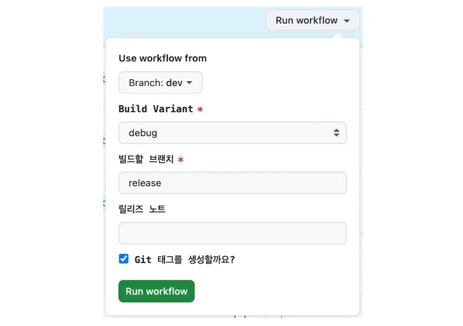

### Why automate it

I use Firebase App Distribution for QA on one of my projects. Until now, I uploaded the debug and release APKs to App Distribution by hand to get them to testers, and I picked the testers and wrote the release notes by hand every time. This post covers how I moved that whole process to GitHub Actions so builds reach testers automatically.

### Goals

> CD (Continuous Delivery) strategies vary from project to project, so here's a summary of the one I went with. Use it as a reference when you set up your own.

- A workflow that lets developers **deploy whenever they want** with a button click and a bit of text input
- **Choose which build type** to deploy, debug or release
- A fixed **tester group**, with **release notes** written by hand (they could come from commit messages, but our commit conventions made that a poor fit)
- An option to **create a Git tag automatically** on deploy

## Building it

### 1. Set up a Firebase service account and find the app IDs

You need two values to set up CD to Firebase App Distribution with GitHub Actions.

Plenty of other blogs walk through this step in detail, so I'll keep it short.

First, go to Firebase Console → IAM & Admin → Service accounts, create a key, and download the **JSON file**. Save its contents as a secret under your GitHub repository's Settings → Secrets and variables → Actions → New repository secret. Think of it as the **credentials** GitHub Actions uses to authenticate with the Firebase API. It's what gives GitHub Actions permission to upload APKs to Firebase App Distribution.

Next, add the **app ID** from Firebase Console → Project settings as a GitHub secret too. I have two apps (debug and release), so I added both IDs. The app ID is the **unique identifier** for a specific app inside your Firebase project.

### 2. Create the GitHub Actions workflow file

Start by creating `.github/workflows/firebase_distribution.yml` at the project root.

#### 1) Add a workflow_dispatch trigger

The requirements say developers should be able to run the workflow by hand. `workflow_dispatch` is the trigger for that:

```yaml
name: Firebase App Distribution

on:
  workflow_dispatch:
    inputs:
      buildVariant:
        description: 'Build Variant'
        required: true
        default: 'debug'
        type: choice
        options:
          - debug
          - release
      branch:
        description: 'Branch to build'
        required: true
        default: 'release'
        type: string
      releaseNotes:
        description: 'Release notes'
        required: false
        type: string
      createTag:
        description: 'Create a Git tag?'
        required: true
        default: true
        type: boolean
```

The `workflow_dispatch` inputs cover the build variant, the branch to build, the release notes, and the Git tag option.

- `required`: whether the input is mandatory.
- `default`: the default value.
- `type`: the input type, such as **string** or **boolean**. With **choice**, you get a UI for picking one of several options.

This gives you a simple GUI right on GitHub. If you'd rather deploy fully automatically, you don't need this part at all.

#### 2) Create the job and the basic setup

```yaml
permissions:
  contents: write

jobs:
  deploy:
    name: Build and Deploy to Firebase
    runs-on: ubuntu-latest

    steps:
      - name: Checkout code
        uses: actions/checkout@v4
        with:
          ref: ${{ github.event.inputs.branch }}
          fetch-depth: 0

      - name: Set up JDK 17
        uses: actions/setup-java@v3
        with:
          java-version: '17'
          distribution: 'temurin'
          cache: gradle
          
      - name: Setup Gradle Cache
        uses: actions/cache@v4
        with:
          path: |
            ~/.gradle/caches
            ~/.gradle/wrapper
            ~/.android/build-cache
          key: ${{ runner.os }}-gradle-${{ hashFiles('**/*.gradle*', '**/gradle-wrapper.properties', '**/libs.versions.toml') }}
          restore-keys: |
            ${{ runner.os }}-gradle-
            
      - name: Grant execute permission for gradlew
        run: chmod +x ./gradlew
```

- `permissions`: creating a tag needs write permission.
- `Checkout code`: checks out the selected branch.
- `Set up JDK 17`: sets up the JDK.
- `Setup Gradle Cache`: sets up the Gradle build cache to speed up builds.
  - It reuses the Gradle cache from earlier workflow runs, which can cut dependency download time a lot.
- `Grant execute permission`: makes the Gradle wrapper executable.

#### 3) Pick the target

Set environment variables based on the selected **build variant**:

```yaml
- name: Set Distribution Target
  id: set-target
  run: |
    if [[ "${{ github.event.inputs.buildVariant }}" == "debug" ]]; then
      echo "APP_ID=${{ secrets.FIREBASE_DEV_APP_ID }}" >> $GITHUB_ENV
      echo "TESTERS=qa-team,android-team" >> $GITHUB_ENV
      echo "VARIANT=Debug" >> $GITHUB_ENV
    else
      echo "APP_ID=${{ secrets.FIREBASE_RELEASE_APP_ID }}" >> $GITHUB_ENV
      echo "TESTERS=qa-team,android-team" >> $GITHUB_ENV
      echo "VARIANT=Release" >> $GITHUB_ENV
    fi
```

**What each variable is for**

- `APP_ID`: the ID of the Firebase app to deploy to.
- `TESTERS`: a comma-separated list of the tester groups that get the APK.
- `VARIANT`: the Gradle build variant name.

#### 4) Create the tag

If the user checks the tag option in the GitHub workflow UI, the workflow creates a Git tag for the version being deployed.

```yaml
- name: Extract Version from toml
  run: |
    VERSION=$(grep -Po 'versionName\\s*=\\s*"\\K[^"]*' gradle/libs.versions.toml)
    echo "APP_VERSION=$VERSION" >> $GITHUB_ENV

- name: Create Git Tag
  if: ${{ github.event.inputs.createTag == 'true' }}
  run: |
    git config --local user.email "your-github@email.com"
    git config --local user.name "your-github-username"
    git tag -a "v${{ env.APP_VERSION }}" -m "Release version ${{ env.APP_VERSION }}"
    git push origin "v${{ env.APP_VERSION }}"
```

- First, it **extracts the app version** from `libs.versions.toml`. If your app version lives in `build.gradle.kts` or some other file, you'll need to change this step.
- Then it creates a tag from that version, e.g. versionName 1.0.1 → tag v1.0.1.
- You also need to set the GitHub account the tag gets created under. I'd recommend a shared account that the whole project can use.

#### 5) Set the release notes and deploy the APK

```yaml
- name: Build APK
  run: ./gradlew assemble${{ env.VARIANT }}

- name: Upload APK to Firebase App Distribution
  uses: wzieba/Firebase-Distribution-Github-Action@v1
  with:
    appId: ${{ env.APP_ID }}
    serviceCredentialsFileContent: ${{ secrets.FIREBASE_SERVICE_ACCOUNT }}
    groups: ${{ env.TESTERS }}
    file: app/build/outputs/apk/${{ github.event.inputs.buildVariant }}/app-${{ github.event.inputs.buildVariant }}.apk
    releaseNotes: ${{ env.RELEASE_NOTES }}
```

- Builds the APK for the selected build variant.
- Deploys it with wzieba's `Firebase-Distribution-Github-Action`.
  - The environment variables set earlier supply everything the upload needs.

## The result, and how to use it

To run the workflow by hand, open the repository's Actions tab, pick the Firebase App Distribution workflow you just wrote, and click Run workflow. You'll see this:

{width=100 align=center}

You'll want to test that the yml file actually works. GitHub's workflow dialog comes with a **Use workflow from** branch picker, set to the default branch out of the box. Pick the branch that contains your new yml file there.

Then fill in the options and click Run workflow. When the run succeeds, the APK shows up in Firebase App Distribution and the Git tag gets pushed.

Now a deploy takes a few clicks. Since you still trigger the workflow by hand, it's really semi(?)-automatic. But you can just as easily deploy on every push or merge to a specific branch, so if your project needs that, adapt the workflow to fit.

### References

[https://github.com/wzieba/Firebase-Distribution-Github-Action](https://github.com/wzieba/Firebase-Distribution-Github-Action)
