작성일 기준(2025년 5월 13일) 새벽에 **Material 3 Expressive**라는 구글의 신규 디자인 시스템이 발표되었다. Material 3 Expressive는 **연말에 배포될 Android 16부터 지원**한다고 한다. 이번 글에서는 Material 3 Expressive에 대한 전반적인 내용을 다루며, 신규로 추가되거나 업데이트 될 예정인 컴포넌트들을 직접 피그마로 다뤄보고 코드를 확인해보겠다.

(다음주에 진행될 예정인 Google I/O 2025에서 더 자세히 다룬다고 하니 발표 이후 수정될 예정입니다.)

## Material 3 Expressive란?

Material Design의 최신 버전인 Material 3 Expressive는 더욱 매력적이고 사용하기 쉬우며 바람직한 제품을 만들 수 있는 새로운 방법을 제공한다고 한다. **Expressive한 인터페이스로 시각적 디자인과 상호 작용을 통해 느낌이나 분위기를 불러일으킴으로써 감정적인 영향을 미치고 연결을 촉진하는 것**이 목적이다. Material 3 Expressive는 Material 3 Design System의 발전된 버전이다. M3가 Deprecated가 되는 것도 아니고 M4도 아니라고 언급하니 기존의 개발자들에게 타격을 주는 업데이트가 아닌 새로운 기회를 창출할 수 있게 도와주는 업데이트이다.

구글에서 제시한 Material 3 Expressive의 효과 4가지는 다음과 같다.

1. 모든 연령대가 선호한다.
2. 장난스러움, 에너지, 창의성, 친근함과 같은 부분에서 높은 점수를 받았다.
3. 사용자들은 M3 Expressive 컴포넌트와 기술을 사용하는 제품으로 전환할 가능성이 높다.
4. Expressive 디자인은 사용하기 쉬우며, 사용자들은 화면에서 주요 UI 요소를 4배 더 빨리 발견할 수 있다.

### Material 3 Expressive가 주는 의미

Google Design 팀에 따르면, Material 3 Expressive는 데이터에 디자인 결정을 위임하는 **41 shades of blue** 방식이 아니라 **연구, 디자인, 엔지니어링을 아우르는 공동 연구를 통해 탄생**했다고 한다.

**41 shades of blue**는 2009년 구글에서 데이터 중심 접근법을 극단적으로 추구한 배경에서 발생한 사건이다. 어떤 색상의 파란색이 가장 효과적인지 결정하기 위해 41가지 서로 다른 파란색 음영을 테스트했으며, 구글 홈페이지와 Gmail 사이트 등에서 A/B 테스트를 하여 가장 많은 클릭을 받은 파란색을 채택한 사례이다. 이 사건은 구글의 디자인 책임자였던 더글라스 보우만이 회사를 떠나는 계기가 되었고, 이 사건은 디자인 커뮤니티에서 데이터 중심 의사결정과 창의적인 직관 사이의 균형에 관한 중요한 논쟁을 촉발했다. 결론적으로 이 헤프닝은 구글에게 **성공적인 디자인은 데이터 분석과 창의적 직관, 사용자 경험에 대한 깊은 이해가 균형을 이루어야 한다**는 교훈을 주었다.

Material 3 Expressive의 출시는 구글 디자인 철학의 성숙함을 보여주는 중요한 이정표라고 할 수 있다. 41 shades of blue 사건으로부터 약 15년이 흐른 지금, 구글은 데이터와 창의성 사이의 균형을 더욱 세련되게 찾아가고 있다. 46개의 별도 연구와 18,000명 이상의 전 세계 참가자를 통해 개발된 Material 3 Expressive는 단순히 효율성만을 추구하는 것이 아니라, 사용자의 감성적 경험과 앱의 개성을 중요시하는 방향으로 발전했다.

이는 안드로이드 개발자들에게도 중요한 의미가 있다. 이제 개발자들은 기능적으로 우수할 뿐만 아니라 감성적으로도 사용자와 더 깊게 연결되는 앱을 만들 수 있게 되었다. Material 3 Expressive는 "**왜 이 앱들이 모두 비슷하게 보이는가?", "왜 이렇게 지루한가**?"라는 물음에서 시작하여, 기술과 감성의 조화를 이루는 디자인 시스템으로 완성되었다. 구글의 이러한 진화는 데이터에 모든 것을 맡기던 과거의 접근 방식에서 벗어나, 연구와 디자인과 엔지니어링의 협업을 통해 사용자 경험의 새로운 지평을 여는 방향으로 나아가고 있음을 보여준다.

이번에 업데이트되는 내용은 크게 3가지로 **Expressive Component, Expressive Styles, Expressive Tactics**이다. 이번 글에서는 컴포넌트 부분을 위주로 다룰 예정이며 나머지 내용들은 좀 더 자세한 내용이 발표되면 업데이트할 예정이다.

## Expressive Component

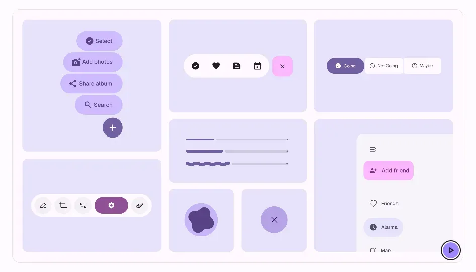{width=100 align=center}

이번에 새로 추가되거나 업데이트되는 컴포넌트는 총 15가지이며, 더 많은 기능과 모양 옵션, 강조된 텍스트 및 기타 표현 업데이트가 적용되었다고 한다.

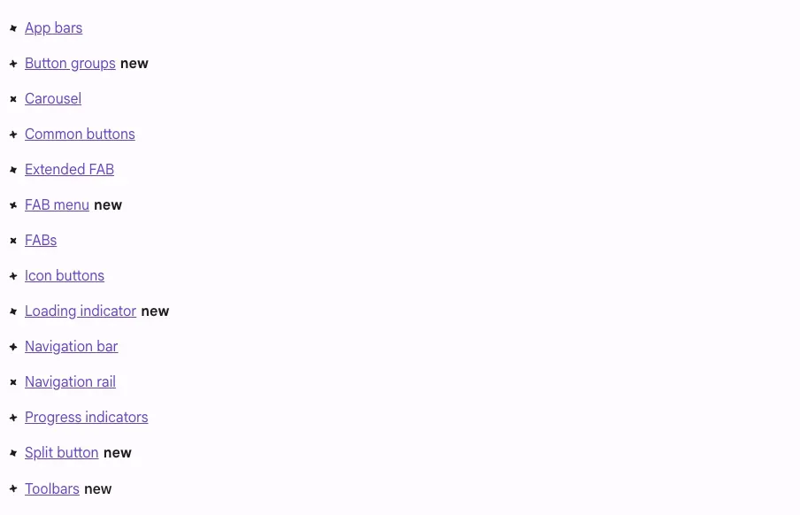{width=100 align=center}

이번 글에서는 신규 업데이트된 컴포넌트를 위주로 다룰 예정이며, Material3 Design kit과 공식문서의 예시 코드를 기반으로 직접 구현해본 코드를 통해 사용법과 주요 특징을 설명해보겠다. 이 업데이트로 **Deprecated**되는 컴포넌트들이 몇 가지 있으니 주의해서 읽어보면 좋을 것 같다.

### 1️⃣ Button Groups

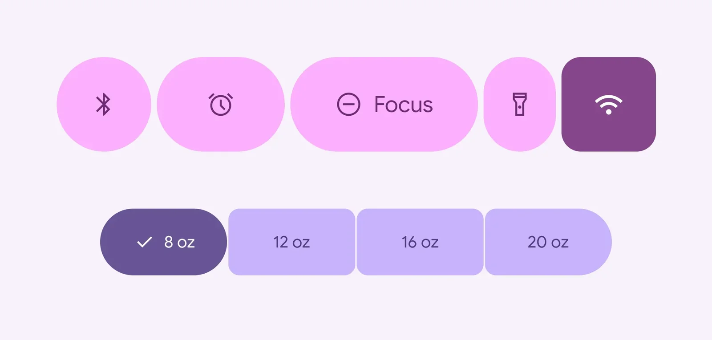{width=100 align=center caption="Button Groups"}

- **Standard / Connected 두 가지 유형이 존재한다**.
- pressed와 selected 상태에서 모양의 변형을 줄 수 있다.
- **Connected Button Group은 기존의 Segmented Button을 대체한다**.
- XS, S, M, L, XL 의 모든 버튼 크기에서 작동한다.
- single-select, multi-select, selection-required를 지원한다.
- icon button도 포함할 수 있다.

#### overflow가 있는 Standard Button Group 예시

```kotlin
val numButtons = 10

ButtonGroup(
    // ★ 오버플로우 메뉴 인디케이터 설정
    overflowIndicator = { menuState ->
        IconButton(
            onClick = {
                // 메뉴 상태 토글
                if (menuState.isExpanded) {
                    menuState.dismiss()
                } else {
                    menuState.show()
                }
            }
        ) {
            Icon(
                imageVector = Icons.Filled.MoreVert,
                contentDescription = "Localized description"
            )
        }
    }
) {
    // 다수의 버튼을 그룹에 추가
    for (i in 0 until numButtons) {
        clickableItem(onClick = {}, label = "$i")
    }
}
```

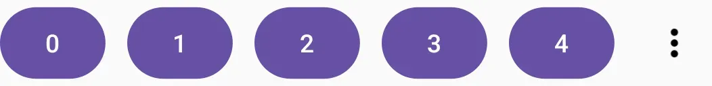{width=100 align=center caption="Standard Button Group 프리뷰"}

- ButtonGroup 컴포넌트를 사용해 여러 버튼을 그룹화한다.
- `overflowIndicator`를 사용해서 화면에 모든 버튼이 표시될 수 없을 때 추가 버튼이 있음을 나타내는 메뉴 버튼을 생성한다.
- `menuState`를 사용해서 오버플로우의 상태를 관리한다.
- `ButtonGroupScope`가 지원하는 `clickableItem()` 함수로 동적으로 버튼을 생성한다.

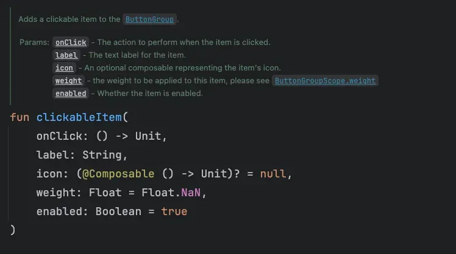{width=100 align=center caption="clickableItem"}

#### Connected Toggle Button Group 예시

```kotlin
val options = listOf("Add", "Call", "Account")
    val unCheckedIcons = listOf(Icons.Outlined.Add, Icons.Outlined.Call, Icons.Outlined.AccountBox)
    val checkedIcons = listOf(Icons.Filled.Add, Icons.Filled.Call, Icons.Filled.AccountBox)
    // 각 버튼의 선택 상태 추적
    val checked = remember { mutableStateListOf(false, false, false) }

    Row(
        Modifier.padding(horizontal = 8.dp),
        // ★ 연결된 버튼 그룹을 위한 간격 설정
        horizontalArrangement = Arrangement.spacedBy(ButtonGroupDefaults.ConnectedSpaceBetween),
    ) {
        // 각 버튼의 가중치 설정 (비율로 너비 조정)
        val modifiers = listOf(Modifier.weight(1f), Modifier.weight(1f), Modifier.weight(1.3f))

        options.forEachIndexed { index, label ->
            // ★ 토글 버튼 사용
            ToggleButton(
                checked = checked[index],
                onCheckedChange = { checked[index] = it },
                modifier = modifiers[index],
                // ★ 위치에 따라 다른 모양 적용 (처음, 중간, 마지막)
                shapes = when (index) {
                    0 -> ButtonGroupDefaults.connectedLeadingButtonShapes()
                    options.lastIndex -> ButtonGroupDefaults.connectedTrailingButtonShapes()
                    else -> ButtonGroupDefaults.connectedMiddleButtonShapes()
                },
            ) {
                // 선택 상태에 따라 다른 아이콘 표시
                Icon(
                    if (checked[index]) checkedIcons[index] else unCheckedIcons[index],
                    contentDescription = "Localized description",
                )
                Spacer(Modifier.size(ToggleButtonDefaults.IconSpacing))
                Text(label)
            }
        }
    }
```

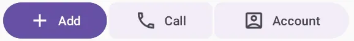{width=80 align=center caption="Connected Toggle Button Group 프리뷰"}

- `ToggleButton`을 사용하여 선택/해제 상태를 가질 수 있게 하였다.
- `connectedXXXButtonShapes()`로 위치별 모양을 다르게 적용하였다.
- 각 버튼의 너비를 `weight` 속성을 통해 다르게 설정할 수 있다.

### 2️⃣ Floating Action Button Menu (FAB Menu)

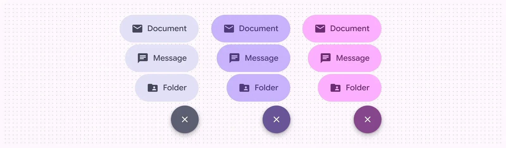{width=100 align=center caption="FAB Menu"}

- **이제 FAB 메뉴를 직접구현하지 않아도 된다**. FAB를 열어서 2~6가지 관련된 항목들을 보여줘야 할 때 사용한다.
- **Extended FABs에는 사용되지 않는다**.
- 기존에 사용 중인 primary, secondary, tertiary color sets을 사용 가능하다.
- 기존의 Speed Dial과 작은 FAB들을 쌓아서 사용하는 방식을 대체할 수 있다.
- 모든 종류의 FAB과 함께 사용할 수 있는 통일된 메뉴 크기를 제공한다.
- 닫기 버튼과 대비되는 항목 색상을 사용한다.

#### 예시 코드

```kotlin
@OptIn(ExperimentalMaterial3ExpressiveApi::class)
@Composable
private fun FABMenu() {
    val listState = rememberLazyListState()
    // FAB 표시 여부를 스크롤 위치에 따라 결정
    val fabVisible by remember { derivedStateOf { listState.firstVisibleItemIndex == 0 } }

    Box {
        // 일반적인 리스트 표시 부분 (생략)...

        // FAB 메뉴에 표시될 아이템 정의
        val items = listOf(
            Icons.AutoMirrored.Filled.ExitToApp to "Exit",
            Icons.Filled.Add to "Add",
            Icons.Filled.Call to "Call",
        )

        // FAB 메뉴 확장 상태 관리
        var fabMenuExpanded by rememberSaveable { mutableStateOf(false) }

        // 백 버튼 처리 - 메뉴가 확장된 상태에서는 닫히도록 함
        BackHandler(fabMenuExpanded) { fabMenuExpanded = false }

        // ★ 새로운 FAB Menu 컴포넌트
        FloatingActionButtonMenu(
            modifier = Modifier.align(Alignment.BottomEnd),
            expanded = fabMenuExpanded,
            button = {
                // ★ 토글 가능한 FAB
                ToggleFloatingActionButton(
                    modifier = Modifier
                        .semantics { traversalIndex = -1f }
                        // ★ 스크롤에 따른 FAB 애니메이션 적용
                        .animateFloatingActionButton(
                            visible = fabVisible || fabMenuExpanded,
                            alignment = Alignment.BottomEnd,
                        ),
                    checked = fabMenuExpanded,
                    onCheckedChange = { fabMenuExpanded = !fabMenuExpanded },
                ) {
                    // ★ 상태에 따라 아이콘 변경 (+ → X) 및 애니메이션
                    val imageVector by remember {
                        derivedStateOf {
                            if (checkedProgress > 0.5f) Icons.Filled.Close else Icons.Filled.Add
                        }
                    }
                    Icon(
                        painter = rememberVectorPainter(imageVector),
                        contentDescription = null,
                        // ★ 아이콘 애니메이션 적용
                        modifier = Modifier.animateIcon({ checkedProgress }),
                    )
                }
            },
        ) {
            // 메뉴 아이템 구성
            items.forEachIndexed { i, item ->
                // ★ 각 메뉴 항목 컴포넌트
                FloatingActionButtonMenuItem(
                    // 접근성 설정
                    modifier = Modifier.semantics { /*...*/ },
                    onClick = { fabMenuExpanded = false },
                    icon = { Icon(item.first, contentDescription = null) },
                    text = { Text(text = item.second) },
                )
            }
        }
    }
}
```

주요 특징으로는

- FAB Menu에 메인 버튼과 여러 하위 메뉴 항목을 포함한다.
- 기존 FAB와 달리 토글 상태를 가질 수 있는 새 컴포넌트인 `ToggleFloatingActionButton`이 존재한다. `checked` 상태에 따라 모양이나 내용을 변경할 수 있다.
- `animateFloatingActionButton()` 으로 FAB이 사라지고 나타나는 애니메이션을 적용한다.
- `BackHandler`를 통해 메뉴가 확장된 상태에서 백 버튼을 누르면 메뉴가 닫히도록 한다.

### 3️⃣ Loading Indicator

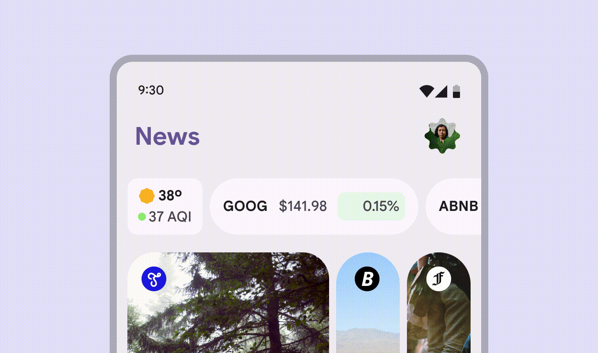{width=100 align=center}

- **기존의 Circular Progress Indicator를 대체하는 것을 추천한다고 한다**.
- 5초 미만의 로딩 과정을 보여주는 데 최적화되어 있다.
- 단순히 장식이 아닌 실제 진행 상황을 반영한다.
- pull-to-refresh(당겨서 새로고침) 기능에 사용한다.
- **Loading Indicator**와 **Contained Loading Indicator** 두 가지 유형이 있다. 배경 컨테이너의 포함 여부가 다르다.
- 로딩 진행에 따라 형태가 변하는 효과를 줄 수 있고, 다양한 크기로 확장이 가능하다.
- 진행률이 불확정에서 확정으로 전환되는 경우에는 사용하지 말아야 한다.

#### 예시 코드

```kotlin
// 진행률 상태 관리var progress by remember { mutableFloatStateOf(0f) }

// 애니메이션이 적용된 진행률
val animatedProgress by
    animateFloatAsState(
        targetValue = progress,
        animationSpec =
            spring(
                dampingRatio = Spring.DampingRatioNoBouncy,
                stiffness = Spring.StiffnessVeryLow,
                visibilityThreshold = 1 / 1000f
            )
    )

Column(horizontalAlignment = Alignment.CenterHorizontally) {
    // ★ 로딩 인디케이터 사용
    LoadingIndicator(progress = { animatedProgress })
    
    Spacer(Modifier.requiredHeight(30.dp))
    
    // 데모용 진행률 조절 슬라이더
    Text("Set loading progress:")
    Slider(
        modifier = Modifier.width(300.dp),
        value = progress,
        valueRange = 0f..1f,
        onValueChange = { progress = it },
    )
}
```

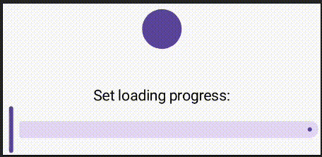{width=70 align=center caption="에뮬레이터에서 실행한 Loading Indicator"}

약간의 딜레이가 있지만 진행 상황에 따라 로딩 인디케이터의 모양이 변하는 모습을 확인할 수 있다.

### 4️⃣ Split Button

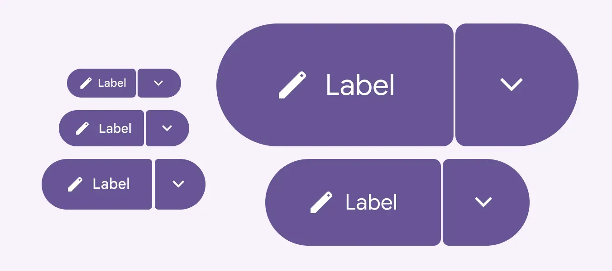{width=100 align=center}

- 주요 액션과 관련 액션의 메뉴를 함께 제공하는 복합 버튼 컴포넌트이다.
- **왼쪽의 주요 액션 버튼(Leading Button)과 메뉴 아이콘 버튼(Trailing Button)의 조합으로 이루어진다**.
- Elevated, Filled, Tonal, Outlined 4가지 스타일 옵션이 존재한다.

#### 예시 코드

```kotlin
    // 메뉴 표시 상태 관리
    var checked by remember { mutableStateOf(false) }

    SplitButtonLayout(
        // 왼쪽 주요 액션 버튼
        leadingButton = {
            SplitButtonDefaults.LeadingButton(
                onClick = { /* 주요 액션 처리 */ },
            ) {
                // 아이콘 + 텍스트 구성
                Icon(
                    Icons.Filled.Edit,
                    modifier = Modifier.size(SplitButtonDefaults.LeadingIconSize),
                    contentDescription = "Localized description",
                )
                Spacer(Modifier.size(ButtonDefaults.IconSpacing))
                Text("My Button")
            }
        },
        // 오른쪽 메뉴 표시 버튼
        trailingButton = {
            SplitButtonDefaults.TrailingButton(
                checked = checked,  // 메뉴 표시 상태
                onCheckedChange = { checked = it },  // 상태 변경 처리
                modifier = Modifier.semantics {
                    stateDescription = if (checked) "Expanded" else "Collapsed"
                },
            ) {
                // ★ 회전 애니메이션 적용
                val rotation: Float by animateFloatAsState(
                    targetValue = if (checked) 180f else 0f,
                    label = "Trailing Icon Rotation"
                )
                // 메뉴 아이콘 (회전 효과 적용)
                Icon(
                    Icons.Filled.KeyboardArrowDown,
                    modifier = Modifier
                        .size(SplitButtonDefaults.TrailingIconSize)
                        .graphicsLayer { this.rotationZ = rotation },
                    contentDescription = "Localized description"
                )
            }
        }
    )
```

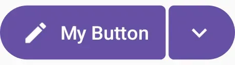{width=70 align=center caption="Split Button 프리뷰"}

- `SplitButtonDefaults.LeadingButton`과 `SplitButtonDefaults.TrailingButton`을 사용해서 두 버튼을 생성한다.
- `SplitButtonDefaults`의 Filled/Tonal/Elevated/Outlined 관련 속성을 부여하여 적절한 스타일을 표시할 수 있다.

### 5️⃣ Toolbars

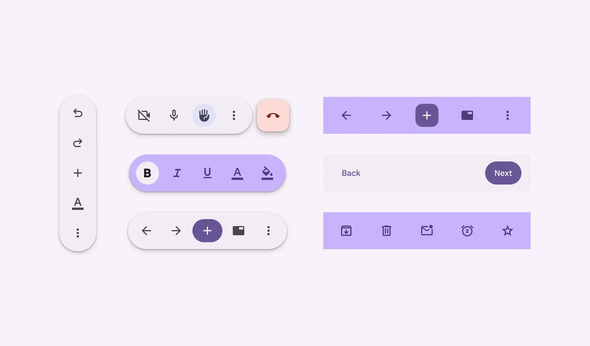{width=100 align=center}

- **기존 Bottom App Bar를 대체한 컴포넌트이다. Bottom App Bar는 Deprecated 될 예정이다**.
- 두 가지 주요 유형으로 **Docked Toolbar**와 **Floating Toolbar**가 존재한다.
- **Docked Toolbar**는 더 짧고 유연성이 뛰어나며, **Floating Toolbar**는 더 많은 기능, 더 많은 작업, 더 다양한 위치 배치를 위해 만들어졌다고 한다.
- 화면 하단에 배치하여 기존의 Bottom App Bar를 대체해 공간 효율성을 높이려면 `Docked Toolbar`를, 더 많은 액션을 표시하고 화면 내 특정 위치에 배치하거나 스크롤에 반응하는 유동적인 UI가 필요할 경우 `Floating Toolbar`를 사용한다.
- FAB와 페어링하여 특정 액션을 강조할 수 있다.
- Navigation bar와 동시에 사용하지 않아야 한다.

#### 수평 플로팅 툴바 예시 코드

```kotlin
    // 툴바 확장 상태 관리
    var expanded by rememberSaveable { mutableStateOf(true) }

    Scaffold(
        content = { innerPadding ->
            Box(Modifier.padding(innerPadding)) {
                // 메인 콘텐츠 (LazyColumn)
                LazyColumn(
                    // ★ 플로팅 툴바와 연동하는 스크롤 Modifier
                    modifier = Modifier.floatingToolbarVerticalNestedScroll(
                        expanded = expanded,
                        onExpand = { expanded = true },
                        onCollapse = { expanded = false },
                    ),
                    state = rememberLazyListState(),
                    contentPadding = innerPadding,
                    verticalArrangement = Arrangement.spacedBy(8.dp),
                ) {
                    // 리스트 아이템 생성 - 생략
                }

                // ★ 수평 플로팅 툴바 구현
                HorizontalFloatingToolbar(
                    modifier = Modifier
                        .align(Alignment.BottomCenter)
                        .offset(y = -ScreenOffset),  // 화면 아래에서 약간 띄움
                    expanded = expanded,             // 확장 상태 연결
                    leadingContent = {
		                    // 왼쪽 콘텐츠
                        FilledIconButton(
                            modifier = Modifier.width(64.dp),
                            onClick = { /* doSomething() */ },
                        ) {
                            Icon(
                                Icons.Filled.Call,
                                contentDescription = "Localized description",
                            )
                        }
                    },   
                    trailingContent = {
                       // 오른쪽 콘텐츠 - 생략
                    }, 
                    content = {
                        // 중앙 콘텐츠 - 생략
                    }, 
                )
            }
        },
    )
```

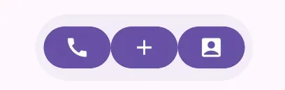{width=60 align=center}

- `Alignment`를 활용하여 자유롭게 배치가 가능하다.
- 왼쪽, 오른쪽, 중앙 콘텐츠를 자유롭게 생성할 수 있다.
- 스크롤에 따라 상태를 변경할 수 있다. 위 예시 코드로 생성한 리스트에서 스크롤을 조금 내리면 아래와 같이 상태가 변한다. 이때 `expanded` 파라미터를 활용한다.

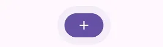{width=40 align=center caption="스크롤을 내리면 변하는 형태"}

지금까지 신규로 추가된 컴포넌트들을 알아보았다. 전체적으로 애니메이션 기능이 강화되었고, 모션과 형태 변형을 강조하여 감성적 상호작용을 얼마나 중요시하는지 알 수 있었다. 또한, 기존에 직접 구현해야만 했던 컴포넌트들을 제공한다는 점이 인상적이었다.

## Expressive Styles

Material3 Expressive에서는 4가지 주요 스타일 요소를 통해 더 감성적이고 생동감 있는 사용자 경험을 구현한다. 각 요소의 특징을 간략하게 정리해보았다.

#### Motion-Physics system

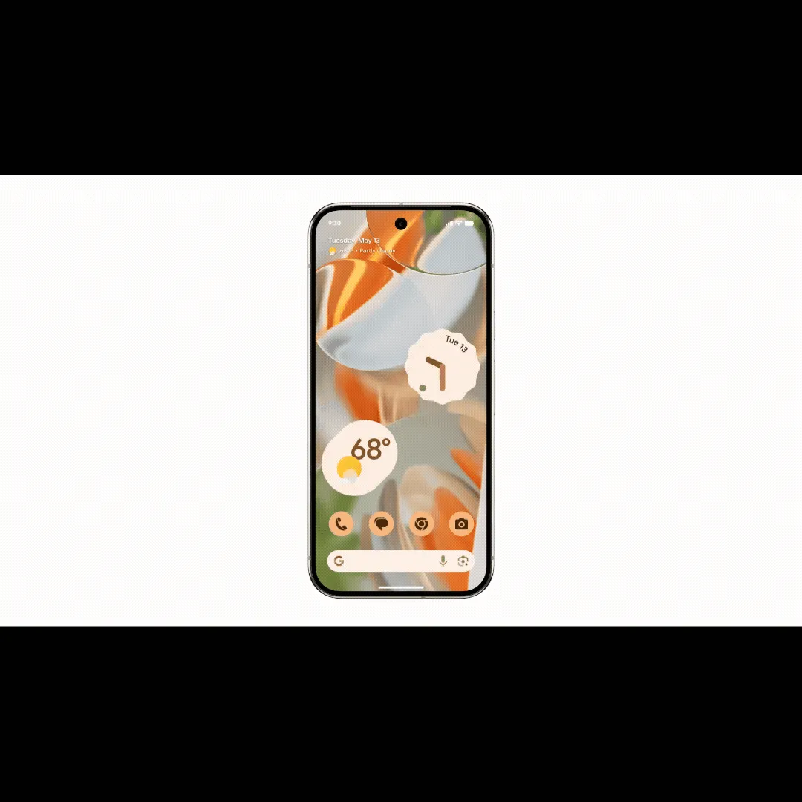{width=100 align=center}

- **모션 스프링 기반**: 상호작용과 전환이 더 생동감 있고, 유동적이며 자연스럽게 느껴지도록 모션 스프링 시스템 도입
- **두 가지 스프링 유형**
  - **Spatial Springs**: 실제 물체가 움직이는 물리법칙을 반영하여 명확하고 예측 가능한 애니메이션 제공
  - **Effects Springs**: 색상과 투명도 변화에 대한 매끄러운 전환 효과 제공

#### 시각적으로 강조된 타이포그래피 (Visually Emphasized Typography)

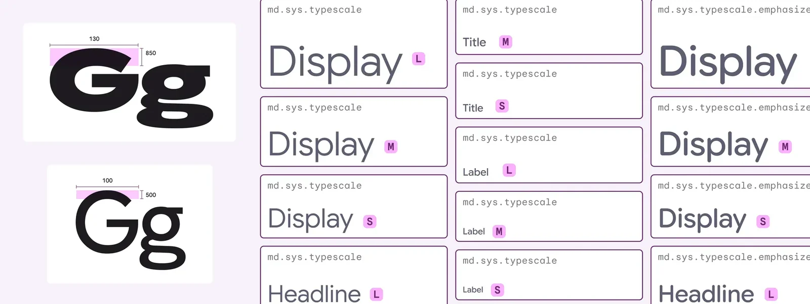{width=100 align=center}

- **새로운 타입 스타일**: 가변 및 고정 글꼴을 위한 새로운 스타일 제공
- **감성 표현**: 다양한 감정 상태를 표현할 수 있는 타이포그래피 설계
- **자동 조정**: 가독성을 위해 변수를 자동으로 조정
- Bold 편집 레이아웃을 지원
- "녹화 시작"이나 읽지 않은 메시지와 같은 중요 정보를 효과적으로 강조
- 브랜드 개성을 더 강하게 표현할 수 있는 타이포그래피 옵션 제공

#### 확장된 모양 라이브러리 (Expanded Shape Library)

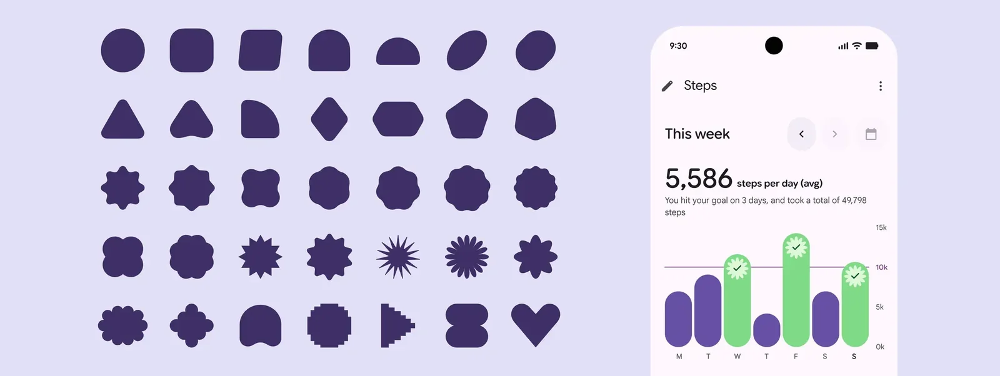{width=100 align=center}

- **35가지 새로운 모양**: 이미지 크롭, 아바타 등의 요소에 장식적 디테일을 추가할 수 있는 다양한 모양 제공
- **모양 변형 애니메이션(Shape-Morph**): 한 모양에서 다른 모양으로 부드럽게 전환되는 내장 애니메이션
- **동적 변화**: 단순한 사각형에서 원형으로의 변화부터 복잡한 동적 변형까지 가능

#### 선명한 색상 스키마 (Vibrant Color Schemes)

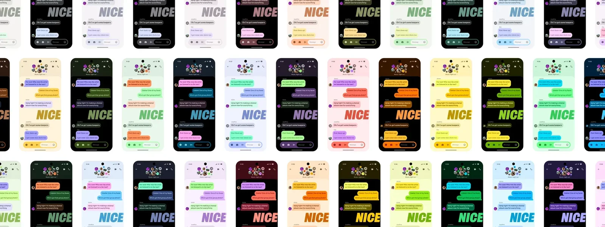{width=100 align=center}

- **확장된 색상 범위**: 계층 구조를 선명하게 하고 핵심 액션을 명확히 하는 다양한 색상 팔레트
- **풍부한 시각적 스타일**: 개인화와 동적 색상을 지원하는 다채로운 비주얼 스타일
- **동적 색상 시스템**: 사용자 환경이나 선호도에 따라 적응하는 색상 시스템

## Expressive Tactics

사용자의 주의를 화면의 가장 중요한 요소로 안내하기 위한 지침을 제공한다. 구글이 제시한 이 7가지 전략들로 컴포넌트와 레이아웃, 그리고 제품을 더욱 Expressive하게 만들 수 있을 것 같다.

#### 1. 다양한 모양을 활용해라 (Use a variety of shapes)

- 인터페이스에서 모양은 강력한 커뮤니케이션 도구로 활용
- 다양한 모양과 모서리 반경을 조합하여 시각적 긴장감이나 응집력 생성
- 클래식 모양과 추상적 모양을 조합하여 독특한 실루엣이나 그룹화 구현

#### 2. 풍부하고 미묘한 색상을 적용해라 (Apply rich and nuanced colors)

- Material의 동적 색상 시스템을 활용하여 다양한 색상 범위 제공
- 주요 구성 요소나 시각적 요소에 색상 혼합을 통해 화면의 핵심 메시지 강조
- 표면 톤으로 시각적 계층 구조 생성

#### 3. 타이포그래피로 주의를 유도하라 (Guide attention with typography)

- 강조된 텍스트 스타일을 사용하여 헤드라인이나 액션과 같은 중요한 UI 요소에 주목시킴
- 타이포그래피를 강조하여 앱에서 editorial-like moments 연출
- 더 무거운 가중치, 더 큰 크기, 색상, 간격을 활용하여 주의를 유도하고 주요 정보를 더 매력적으로 표현

#### 4. 강조를 위해 콘텐츠를 그룹화하라 (Contain content for emphasis)

- 콘텐츠를 논리적 그룹이나 컨테이너로 구성
- 충분한 공간과 밝은 표면 매핑을 통해 가장 중요한 콘텐츠, 작업 또는 액션에 시각적 중요성 부여
- 크기, 간격, 리듬, 유사성 등의 그룹화 원칙을 활용하여 중요 요소를 더 뚜렷하게 구분

#### 5. 유동적이고 자연스러운 모션 추가 (Add fluid and natural motion)

- 모양 변형(Shape Morph)이나 표면 효과를 통해 상호작용을 생동감 있고 활기차게 만듦
- Expressive 모션 스프링이나 사용자 정의 마이크로 애니메이션 적용

#### 6. 컴포넌트 유연성 활용 (Leverage component flexibility)

- UI는 사용자 컨텍스트에 맞게 적응해야 함
- 작업 완료를 쉽게 하기 위해 환경에 따라 컴포넌트나 컨트롤 변경
- 사용자 정의 조정이나 표준 레이아웃 적용을 통해 접이식 및 대형 화면에 콘텐츠 적응

#### 7. 전략을 조합하여 히어로 모먼트 생성 (Combine tactics to create hero moments)

- 여러 Expressive 전술을 조합하여 예측 가능하거나 균일하게 적용된 디자인 아이디어에서 벗어남
- 독자적인 선언을 하거나 필수 정보를 신선하고 에디토리얼한 방식으로 프레임화
- 히어로 모먼트는 집중 메커니즘으로 작용
- 가장 중요한 상호작용을 돋보이게 하는 데 시간 투자

**히어로 모먼트의 특징**:

- 간결하고, 즐겁고, 놀랍고, 예상치 못한 경험 제공
- 제품당 한두 개의 히어로 모먼트로 제한 (너무 많으면 압도적이거나 주의 산만할 수 있음)

**히어로 모먼트 식별 질문**:

1. 이 상호작용이 감정적으로 영향력이 있는가? (디자인 선택이 감정적 반응을 강조하거나 친숙함을 강조할 수 있는지 고려)
2. 이것이 제품의 핵심 상호작용인가? (세부 사항이나 흐름을 명확성을 위해 강조할 수 있는지 생각)

## 소감

구글 디자인 팀이 굉장히 힘을 많이 준 것 같고, Android 16을 기점으로 많은 것이 변화할 것 같아 기대가 되지만 걱정이 들기도 한다. Edge-to-Edge 대응도 해야하는데, 여러 컴포넌트들이 Deprecate되고(물론 계속 사용할 수는 있다.) 새로운 컴포넌트들을 숙지해야한다는 것이기 때문이다. 선택지가 넓어져서 새로운 앱을 만들 때 좀 더 감성적인 디자인을 시도해볼 수 있을 것 같지만, 현실적으로 기존에 배포한 앱에 이 Material 3 Expressive를 반영할 경우가 많지 않을 것 같다는 생각이 든다. Android 16에 대한 정보와 다음주에 있을 Google I/O 2025에서의 발표 내용을 보고 제대로 판단해야 할 것 같다.

그럼에도 앱 차별화와 브랜드 개성 표현 측면에 있어서 Material 3 Expressive에 의의가 있는 것 같다. 기존 Material 3에는 감성적 요소가 부족하고 정적인 컴포넌트 위주로 배치되었다면, Material 3 Expressive에는 다양성과 유연성을 통한 차별화된 경험을 제공하게끔 진화되었다. 점점 더 성숙해가는 디지털 환경에서 사용자들은 단순히 기능적 효율성을 넘어 감성적 만족감과 브랜드 연결성을 원하게 되었기에, M3 Expressive는 이러한 변화로 사용자 기대에 대응하였다.

워치 개인 프로젝트 앱을 만드는 입장에서 워치 디자인 시스템도 같이 변경되는 점이 많아서 신기했다. Wear OS 6 기기가 있어야 체험할 수 있겠지만, 그래도 좀 더 감각적인 디자인을 내 앱에 넣어서 배포하는 경험이 기대된다. 이 디자인 변경 사항에 배터리 최적화까지 탑재했다고 하니 구글이 Wear OS에 신경을 많이 쓰는 것 같아 기분은 좋다.

구글의 41 shades of blue 사건에 대해 알게되고 직접 새로운 컴포넌트들을 구현해볼 수 있어서 개인적으로 재밌었던 포스팅이었다. 블로그에 기재한 코드들은 `androidx.compose.material3:material3:1.4.0-alpha14` 라이브러리를 추가하면 정상적으로 사용 가능하다. (더 낮은 버전을 사용해도 몇 가지는 사용할 수 있지만 자세한 내용은 Material3 [공식문서](https://developer.android.com/reference/kotlin/androidx/compose/material3/package-summary?_gl=1*gu0bdd*_up*MQ..*_ga*MjMyMDA5NTU1LjE3NDczMTM1NTI.*_ga_6HH9YJMN9M*czE3NDczMTM1NTIkbzEkZzAkdDE3NDczMTM1NTIkajAkbDAkaDIwOTUyNzI1MDQ.#top-level-functions)를 확인하길 바란다. 공식문서에는 Deprecated 될 컴포넌트들도 나와있다.)

### 참고자료

[https://android-developers.googleblog.com/2025/05/the-android-show-io-edition.html](https://android-developers.googleblog.com/2025/05/the-android-show-io-edition.html)

[https://design.google/library/expressive-material-design-google-research](https://design.google/library/expressive-material-design-google-research)

[https://m3.material.io/blog/building-with-m3-expressive](https://m3.material.io/blog/building-with-m3-expressive)

[https://blog.google/products/android/material-3-expressive-android-wearos-launch/](https://blog.google/products/android/material-3-expressive-android-wearos-launch/)

[https://www.figma.com/community/file/1035203688168086460](https://www.figma.com/community/file/1035203688168086460)

::youtube[l3yDd3CmA_Y]
