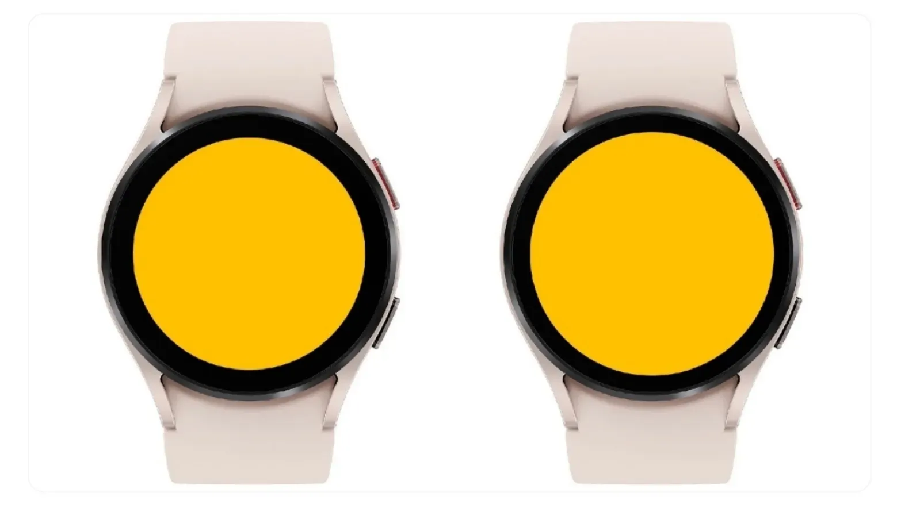
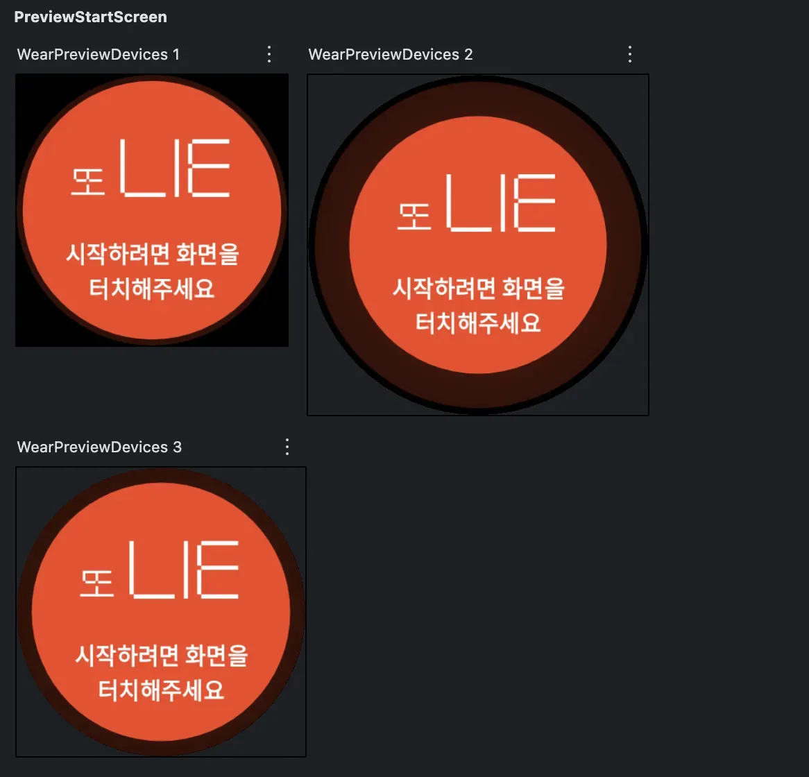
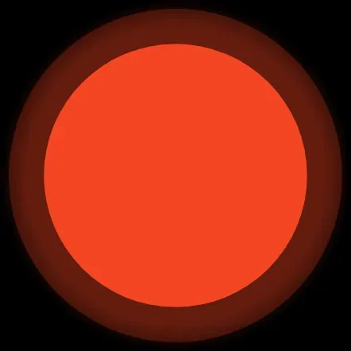
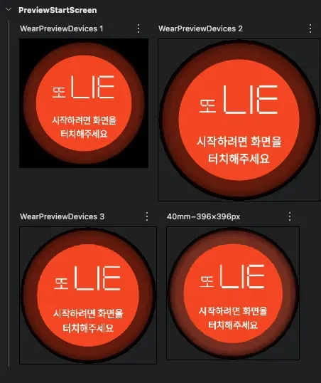

## 배경

필자는 올해 [GDG Super.init(version=6)](https://event-us.kr/gdgandroid/event/99825) 행사에서 워치와 관련한 주제로 발표를 진행하였다. 이때, 청중의 흥미를 좀 더 불러일으키기 위해 직접 기획하고 개발한 개인 프로젝트 워치 앱에 대한 시연을 선보였다. 몇 가지 작은 문제들만 해결하면 곧 배포 예정이고, iOS도 하반기 안에 배포예정이다.

발표 준비에 대한 시간이 충분하지 않아서, 필자가 가지고 있는 **갤럭시 워치4 모델에서만 잘 보이도록 임시로 만들어** 시연을 준비했다. 따라서 배포 전 기기대응을 할 필요가 있었고, 가장 영향을 많이 받는 시작 화면에 대해서 기기대응을 진행한 과정을 설명해보려고 한다.

## ⚠️ 겪었던 문제

필자는 **Wear OS를 사용하는 워치 기기들을 타겟하여 디자인**하였다. 대부분의 Wear OS를 지원하는 기기들(구글 픽셀 워치, 갤럭시 워치)은 **원형**이기에 이를 고려하였다.

{width=50 align=center}

앱의 컨셉과 어울리게 심박수가 퍼지는 느낌을 주도록 파형 느낌으로 디자인 해보았고, 가운데에는 앱 텍스트 로고와 시작 안내 텍스트를 배치하였다. 나중에 애플 워치에 대응을 하게되면 변경될 여지가 있는 화면이다.

일단 위 화면을 빠르게 구현하기 위해, 색이 다른 3개의 원형 Box를 고정된 크기로 배치하였다. 하지만 여기서 간과한 점이 있었다. **워치의 베젤 크기**가 생각보다 커서 **검정색 영역이 거의 2배로 보인다는 점**이었다. **베젤이란**❓ **디스플레이 기기의 테두리**를 말하며, **디스플레이 패널을 고정하고 보호하기 위해 존재**한다. 디스플레이의 구조적인 설계를 위해서 반드시 필요한 부분이다.

{width=100 align=center caption="검정색 영역 = 베젤"}

정말 시간이 없었기에 일단 갤럭시 워치4 기기의 베젤 크기를 고려해서 코드를 수정하였고, 프리뷰 화면에서는 아래와 같이 보였다.

{width=100 align=center}

필자의 워치는 위 이미지에서 **WearPreviewDevices 2**에 해당되어서, **베젤의 크기를 반영하면 원래 의도했던 디자인이 보이게 되었다**. 필자의 기기로 발표 중 시연을 진행했기에 문제 없이 진행하였고, 필자가 판단하기엔 꽤 반응이 좋았다.

## 🔎 기기대응 전 워치의 특징 파악해보기

본격적인 기기대응을 시도하기 전에, 먼저 사용자 층을 파악해 보았다. Wear OS를 사용하는 워치는 **40~47mm 케이스, 1.2~1.5인치 화면이 주류이며, 베젤은 2~4mm 수준이 일반적이**라고 한다. 국내에서는 삼성의 갤럭시 워치의 사용률의 압도적으로 높은데, 44mm 모델이 가장 평균적인 것 같다. 베젤 영역은 평균적으로 **8**% 정도 영역을 차지한다.

이 정보를 반영해서 **기기의 베젤 영역을 디자인에 포함시키는 전략**을 사용했다. 이 방법을 사용하면 **기존의 디자인도 유지하며 화면을 좀 더 크게 사용할 수 있다**.

## 🖌️ 비율을 반영해 원 그려보기

```kotlin
BoxWithConstraints(
    modifier = Modifier
        .fillMaxSize()
        .clickable { /* …네비게이션… */ },
    contentAlignment = Alignment.Center
) {
    val screenWidthDp = maxWidth
    
}
```

먼저 런타임에 최대 허용 너비와 높이(`maxWidth`, `maxHeight`)를 읽어오기 위해 `BoxWithConstraints`를 사용한다. BoxWithConstraints를 사용하면 “**지금 이 기기의 화면 크기**” 또는 “**지금 이 Composable에 할당된 크기**”를 알 수 있다.

워치에서는 가로와 세로의 길이가 같은 **원형 화면**을 사용하기에 `maxWidth` == `maxHeight`가 된다.

```kotlin
Canvas(modifier = Modifier.matchParentSize()) {
    val radiusPx = size.width / 2f
    val center = Offset(rPx, rPx)
    
    // 1) 그라디언트 원 (빨강→검정 페이드)
    val gradientBrush = Brush.radialGradient(
        colorStops = arrayOf(
            0.00f to RedTertiary,  // 반지름 0% 지점: 순수 RedTertiary
            0.85f to RedTertiary,  // 반지름 85% 지점까지: 여전히 RedTertiary
            1.00f to Color.Black   // 반지름 100% 지점: Black
        ),
        center = center,
        radius = radiusPx
    )
    drawCircle(brush = gradientBrush, radius = radiusPx)

    // 2) 중간 원: 반지름 95% (RedSecondary)
    drawCircle(color = RedSecondary, radius = radiusPx * 0.95f)

    // 3) 안쪽 원: 반지름 75% (RedPrimary)
    drawCircle(color = RedPrimary, radius = radiusPx * 0.75f)
}
```

그다음 Canvas를 사용해서 원을 그린다. 기본적으로 제공하는 `drawCircle` 함수를 사용하여 지정한 반지름 크기의 원을 그릴 수 있다. 반지름 크기는 Canvas에서 제공하는 size에서 절반을 사용하면 된다. **반지름에 원하는 비율을 곱하면, 어떤 워치 모델에서도 일관된 UI 비율을 보장할 수 있다**. (가장 바깥쪽 원에는 그라디언트 효과를 부여해야만 했기에 `Brush`를 사용하여 색을 표시하였다.)

{width=60 align=center}

이제 원은 원하는 비율로 잘 그렸으나, 가장 안쪽 원 안에는 로고와 텍스트가 존재했는데, 이 콘텐츠들이 가장 안쪽 원을 벗어나면 시각적으로 좋지 않게 보이기 때문에 추가적인 대응이 필요했다.

## 스케일링 적용해보기

필자의 워치를 기준으로 안쪽 콘텐츠(이미지와 텍스트)를 적절한 크기로 배치한다음, **유저의 워치 크기에 맞춰서 스케일링을 적용**하면 간단하게 문제를 해결할 수 있다. 안쪽 콘텐츠 중 텍스트는 **항상 일정한 크기로 보여주고자 했기에** `sp`**가 아닌** `dp`**를 사용하였다**. `sp`는 사용자 시스템 설정에서 글꼴 크기를 변경하면 같이 커지거나 작아지기에 필자가 의도했던 안쪽 원 안에 배치하는 것에 문제가 있을 수 있기 때문이다.

먼저 기준 모델을 정의하였다. 필자 기기의 화면 너비를 기준으로 잡고 비율을 계산하는 식으로 진행하였다.

```kotlin
	val screenWidthDp = maxWidth

        // 44mm 화면 기준
        val baseWidthDp = 218.dp

        val scale = screenWidthDp / baseWidthDp

        val baseImageWidth  = 108.dp
        val baseImageHeight = 70.dp
        val imageWidth  = baseImageWidth  * scale
        val imageHeight = baseImageHeight * scale

        val baseFontSize  = 15.toTextDp
        val baseLineHeight = 23.toTextDp
        val fontSize   = baseFontSize * scale
        val lineHeight = baseLineHeight * scale

        val baseSpacer = 10.dp
        val spacerHeight = baseSpacer * scale
```

`BoxWithConstraint`를 사용했기에 `maxWidth`로 쉽게 사용자 기기의 크기를 알 수 있었고, 기준으로 잡은 크기와의 비율을 구하면 스케일링을 적용할 수 있다.

```kotlin
    Column(
                modifier = Modifier.fillMaxSize(),
                horizontalAlignment = Alignment.CenterHorizontally,
                verticalArrangement = Arrangement.Center
            ) {
                Image(
                    painter = painterResource(R.drawable.img_logo),
                    contentDescription = "logo",
                    modifier = Modifier.size(width = imageWidth, height = imageHeight)
                )

                Spacer(Modifier.height(spacerHeight))

                Text(
                    text = "시작하려면 화면을\\n터치해주세요",
                    fontSize = fontSize,
                    fontWeight = FontWeight.Bold,
                    lineHeight = lineHeight,
                    textAlign = TextAlign.Center
                )
            }
```

위와 같이 스케일링한 크기들을 알맞게 넣어주면 아래와 같이 어떤 크기의 기기에서도 원하는 비율의 디자인을 보여줄 수 있다.

{width=70 align=center}

## 느낀 점

이번 포스팅 경험으로 워치 기기들의 크기가 4mm 차이나도 10% 정도 차이가 나는 것이기에 기기대응이 반드시 필수적이라는 것을 느꼈다. 그리고 **기기의 물리적인 특징인 베젤을 오히려 디자인적인 요소로 활용**하면 유용할 것 같다. 물론, 가까운 미래에 베젤 영역이 굉장히 얇아진 새로운 워치 기기가 나오면 베젤을 활용한 디자인은 실패할 것 같지만, 사용자의 기기를 파악해 다른 디자인을 적용하도록 분기처리를 할 수 있기에 어느정도 보완할 수는 있을 것 같다.(물론 새로운 기기가 나올 때마다 업데이트가 필요하다..)

추가로 [Wear OS의 접근성 공식문서](https://developer.android.com/training/wearables/accessibility?hl=ko)를 읽어보니 모바일과 비슷하게 TalkBack 지원, 콘텐츠 Description, 최소 터치 영역 등등이 존재했다. 필자가 만든 앱에서는 글꼴 크기에 대한 변경만 고려하면 되는데, 이 부분은 디자인적인 안정성을 챙기기 위해 고정 크기를 반영할 예정이다. 오버플로우를 통해 생략하거나 줄 수를 늘려 표시할 수 있지만, 워치에 한정해서는 디자인적인 요소가 접근성 보다 훨씬 중요하다고 생각하기 때문이다. 물론 필자의 개인적인 생각이며, 배포 전에는 `autoSizeMaxTextSize` 등으로 글꼴 크기 테스트를 진행해서 최대한 접근성을 높이려고 한다.
