지난 [Material 3 Expressive 톺아보기](post/material-3-expressive) 글에서는 모바일 환경에서 무엇이 변경될 예정인지에 대해서 다뤄보았다. 구글 디자인 팀이 Wear OS에서도 Material 3 Expressive에서의 변화에 대해서 생각보다 많이 언급하고 중요하게 여겨는 모습이 보였기에 이번에는 Wear OS에서의 Material 3 Expressive에서 다뤄보도록 하겠다.

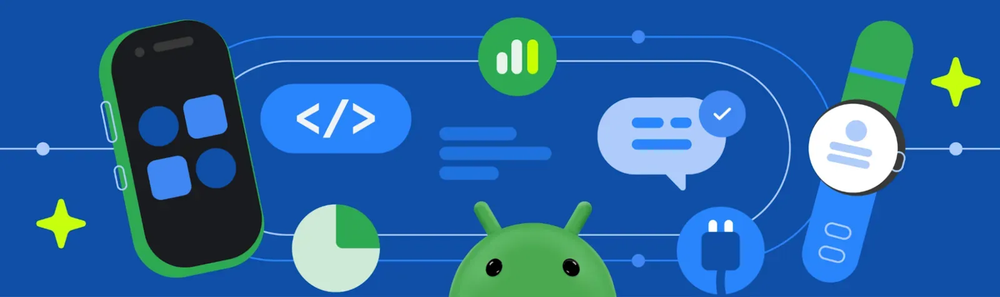{width=100 align=center}

## 원형 디스플레이에서의 유동적인 디자인

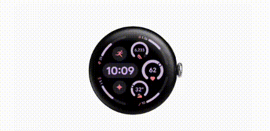{width=70 align=center}

워치에서 Material 3 Expressive의 디자인은 **원형 디스플레이**를 중심으로 디자인되었다. 이 디자인은 **디스플레이의 곡률을 따라 움직이는 스크롤 애니메이션**을 통해 본질적으로 유동적이라고 볼 수 있다. **스크롤할 때 목록이 애니메이션으로 표시되어** 깊이감을 더하고 정보에 대한 접근성을 높인다. 또한 핀 패드 사용, 모션 및 반응형 피드백을 통한 미디어 제어와 같은 일상적인 경험을 새롭게 개선했다고 한다. 그리고 워치의 작은 화면 크기에 맞춰 모양을 변형하는 요소로 시계가 부드럽게 전환되는 것이 특징이다.

## 테마를 사용하여 더 풍부한 색 스키마로 개성 있게 꾸미기

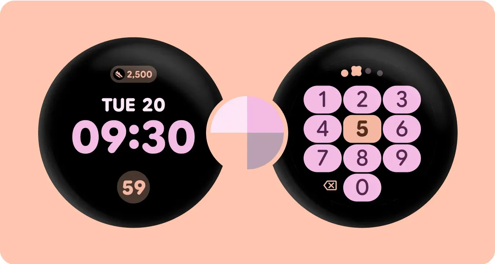{width=100 align=center}

이 주제는 Material에서 항상 강조하는 것 같다. 역시나 **Wear OS에서도 일관된 경험**을 제공하기 위해 업데이트를 진행한 것 같다. Wear Compose Material3와 Wear Protolayout Material 3 라이브러리를 업데이트하여 **확장된 색 스키마, 타이포그래피 및 모양들을 제공**하여 **디자인에 깊이와 다양성**을 모두 부여하는 것이 목적인 것 같다. 타일이 기본적으로 시스템 글꼴에 맞춰 정렬된다는 점은 굉장히 좋은 것 같다.

결국에는 **다이나믹 컬러 테마**를 워치에도 완벽하게 호환되도록 하고 테마를 자동으로 생성하는 업데이트가 진행되었다.

## 새로운 타일 컴포넌트로 한눈에 보기 좋게 만들기

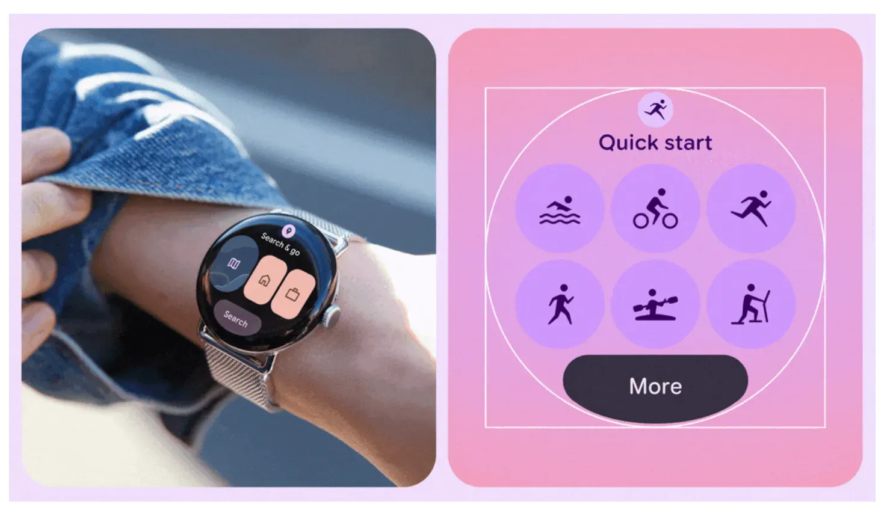{width=100 align=center}

워치에서 **타일**이란, 앱에 직접 접속하지 않고도 홈 화면에서 스와이프를 통해 바로바로 접근할 수 있는 기능을 말한다. **앱에 핵심 기능을 빠르게 사용하기 위해 존재**하며, 필자는 운동할 때나 버스 도착 시간을 볼 때 등등 굉장히 자주 사용하는 화면이다.

이제 타일은 워치의 원형 폼 팩터를 수용하는 새로운 프레임워크와 일련의 컴포넌트를 지원한다. 이러한 컴포넌트는 타일을 **더욱 일관성 있고 한눈에 보기 좋게 만들어** 사용자가 타일에 포함된 정보에 대해 **더 쉽게 신속하게** 조치를 취할 수 있도록 한다.

타일 캐러셀의 시각적 일관성을 개선하기 위해 **3-slot 타일 레이아웃**을 도입했다. 이 레이아웃에는 **제목 슬롯, 메인 콘텐츠 슬롯, 하단 슬롯**이 포함되어 있으며 다양한 화면 크기에서 작동하도록 설계되었다. 개인적으로 3-slot 타일 레이아웃이 단**순히 '화면을 3등분'하는 것이 아니라**, [**게**](https://brunch.co.kr/@jiyuhan/87)[**스탈트 심리학의 근접성 원리**](https://brunch.co.kr/@jiyuhan/87)**를 활용한 똑똑한 디자인**이라고 생각한다. 우리 뇌가 자연스럽게 정보를 그룹핑하는 방식을 웨어러블의 제약된 공간에서 최대한 활용한 것 같다. 특히 빠른 글랜스가 중요한 스마트워치에서는 이런 심리학적 접근이 사용성에 직접적인 영향을 미칠 것 같다.

## 원형 화면에 최적화된 컴포넌트

새로운 Wear OS Material 3 컴포넌트는 Wear OS 5의 일부로 추가된 대형 디스플레이 지원을 기반으로 **더 큰 화면 크기에 맞게 자동으로 조정**된다. 또한 버튼 및 목록과 같은 컴포넌트는 앱에서 모양 변형을 지원한다. 그 중 한 가지 예시를 가져와보았다.

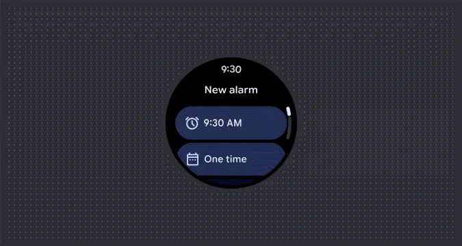{width=100 align=center}

원형 폼 팩터 내에서 공간을 최대화하고 화면 가장자리를 감싸며 4가지 표준 크기로 제공되는 상징적인 디자인 패턴의 새로운 앱 및 타일용 `EdgeButton`이 생겼다. “One time” 이라는 텍스트가 있는 컨테이너를 보면 워치의 원형에 맞게 깎인 모양을 가진 것을 볼 수 있다.

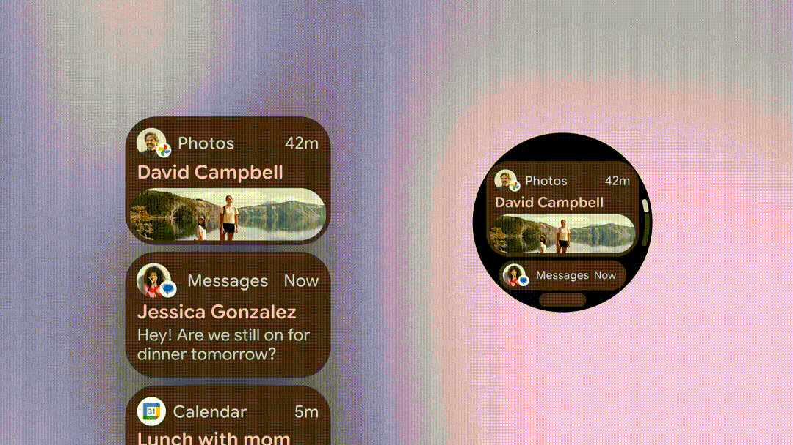{width=100 align=center}

이 외에도 화면 가장자리, 즉 위 아래에서 나오고 들어올 때 모양이 변형되면서 굉장히 자연스러운 애니메이션이 생기도록 한다. Wear OS 기기가 원형 화면을 사용하므로 화면의 상단과 하단 근처에 표시되는 목록 항목을 보기 어렵기 때문에 이러한 레이아웃을 제공하는 것이다.

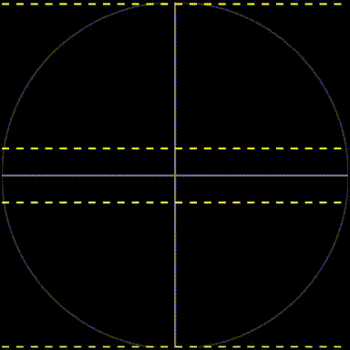{width=60 align=center}

정확히는 스크롤 시 위와 같이 동작한다. FadeIn/Out 시 굉장히 자연스럽게 변형되며, `TransformingLazyColumn`을 사용하면 구현이 가능하다고 한다. [공식 문서](https://developer.android.com/training/wearables/compose/lists?hl=ko&version=3)의 코드 스니펫을 가져와보았다.

```kotlin
val columnState = rememberTransformingLazyColumnState()
val contentPadding = rememberResponsiveColumnPadding(
    first = ColumnItemType.ListHeader,
    last = ColumnItemType.Button,
)
val transformationSpec = rememberTransformationSpec()
ScreenScaffold(
    scrollState = columnState,
    contentPadding = contentPadding
) { contentPadding ->
    TransformingLazyColumn(
        state = columnState,
        contentPadding = contentPadding
    ) {
        item {
            ListHeader(
                modifier = Modifier.fillMaxWidth().transformedHeight(this, transformationSpec),
                transformation = SurfaceTransformation(transformationSpec)
            ) {
                Text(text = "Header")
            }
        }
        // ... other items
        item {
            Button(
                modifier = Modifier.fillMaxWidth().transformedHeight(this, transformationSpec),
                transformation = SurfaceTransformation(transformationSpec),
                onClick = { /* ... */ },
                icon = {
                    Icon(
                        imageVector = Icons.Default.Build,
                        contentDescription = "build",
                    )
                },
            ) {
                Text(
                    text = "Build",
                    maxLines = 1,
                    overflow = TextOverflow.Ellipsis,
                )
            }
        }
    }
}
```

스크롤이 표시되도록 하려면 `ScreenScaffold`와 `TransformingLazyColumn` 간에 `columnState`를 공유하면 된다. 나머지 코드는 익숙한 `LazyColumn`의 구현과 크게 다르지 않은 것 같다.

## 가변 타이포그래피

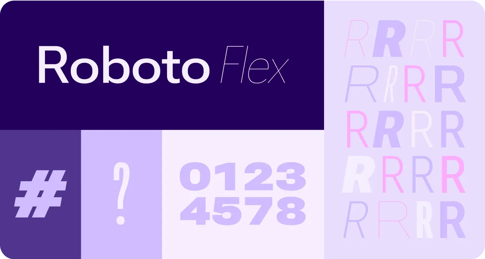{width=100 align=center}

워치에서는 Roboto 글꼴이 기본 값이다. 이번 업데이트에서는 Roboto Flex를 추가하여 가변적인 글꼴을 추가로 지원하게 된다. 추가로 가변 폰트 축을 사용하면 아래와 같은 사례들을 통해 Expressive한 모션 피드백과 상호작용을 더 Expressive하게 만들 수 있다고 한다.

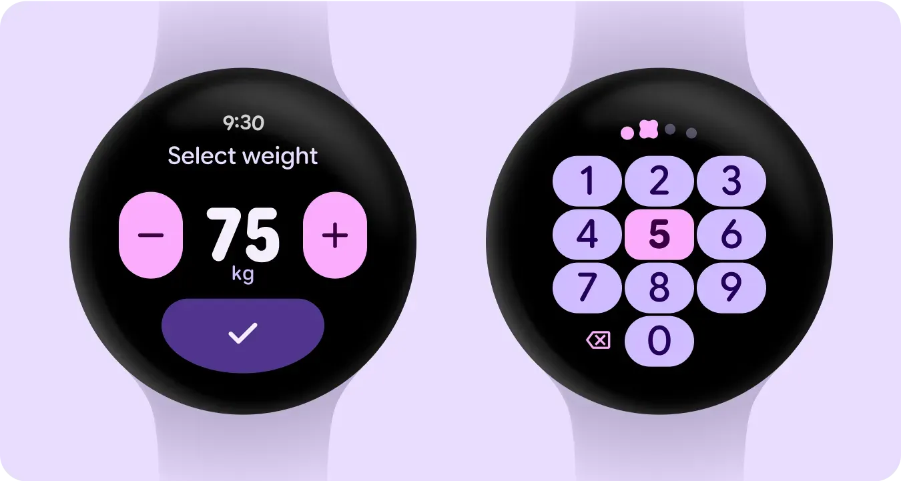{width=100 align=center}

- 동적 글꼴 두께
- 동적 글꼴 너비
- 동적 글꼴 두께 및 너비

## 가장자리에 맞는 컨테이너

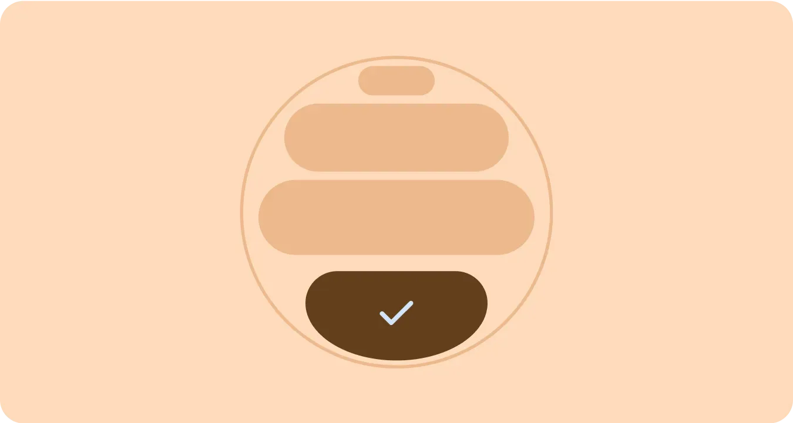{width=100 align=center}

처음 보았을 때는 조금 당황스러운 디자인이었다. 이런 디자인을 접해본 적이 없어 어색했지만, 작은 공간을 극대화할 수 있는 도형 컨테이너 개념이 나왔기에 요긴하게 사용될 것 같다. [**피츠의 법칙**](https://brunch.co.kr/@doyeong/14)을 떠올려보면, 워치라는 작은 화면에서 **터치 시점에 유저들에게 스트레스를 최대한 줄이기 위해서**는 이러한 디자인이 긍정적으로 영향을 줄 것 같다.

> **피츠의 법칙** : 목표물에 도달하는 데 걸리는 시간은 목표물의 크기와 목표물까지의 거리에 영향을 받는다.

## Adaptive한 도형

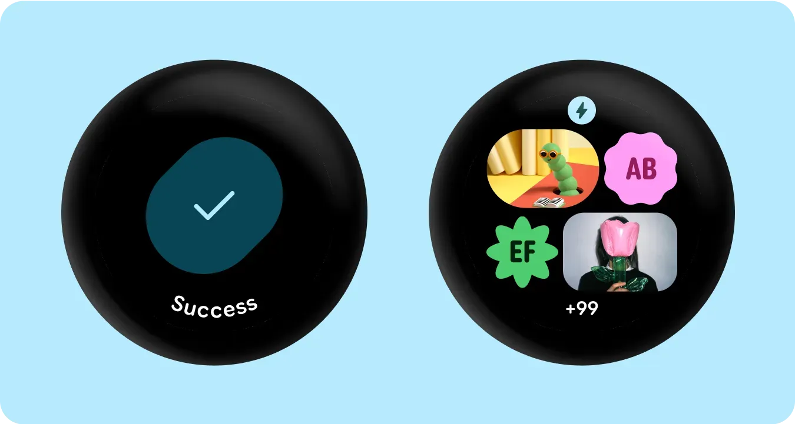{width=100 align=center}

모서리 반경과 고유한 도형을 컨테이너로 사용하여 Expressive한 디자인을 선보였다. 작은 화면에서 특색있는 모양을 사용하여 가성비있는 UI를 만들어보는 것도 재밌을 것 같다.

## 소감

Android 16 및 Wear OS 6 기기에서 동시에 적용되는 Material 3 Expressive에 대해 다뤄보았다. 이번 년도 말부터 적용된 사례들이 나올 것 같아서 기대중이다. 개인적으로는 굉장히 이쁘고 과감한 변화라고 생각이 들며, Wear OS를 사랑하는 유저로서 구글에서 워치에 관심을 많이 가지는 것 같아 안심했다. 실제로 Wear OS 6 업데이트에서는 배터리 수명을 10% 이상 최적화했다고 하니 기대가 된다.

워치에서 Material 3 Expressive가 도입되면서 생긴 가장 큰 변화는 \<화면 크기의 제약을 디자인 언어로 승화시킨 것\>이라고 생각한다. 기존 Material Design은 모바일 중심이었다면, 이번에는 웨어러블의 특성(원형, 작은 화면)을 '**제약'이 아닌 '특색'으로 바꾼 점**이 인상적이다. 특히 `EdgeButton`은 단순히 공간을 절약하는 것이 아니라 '원형 디스플레이만이 가질 수 있는 독특함'을 만들어낸 것 같다.

이외에도 구글팀은 **Watch Face Format4** 출시에 대한 강조를 하였다. **워치 페이스**는 모바일로 따지면 **잠금 화면에 배치하는 컴포넌트**라고 볼 수 있다. 아래 블로그 링크에 해당 업데이트에 대한 내용이 나와있으며, 필자도 워치 페이스 개발을 하게되면 추가적으로 글을 작성해보겠다.

Watch Face 4 : [https://android-developers.googleblog.com/2025/05/whats-new-in-watch-faces.html](https://android-developers.googleblog.com/2025/05/whats-new-in-watch-faces.html)

### 참고자료

[https://developer.android.com/design/ui/wear/guides/get-started/apply?hl=ko](https://developer.android.com/design/ui/wear/guides/get-started/apply?hl=ko)
