Jetpack Navigation의 새로운 버전이 출시되었다. 이번 글에서는 공식문서를 참고하여 새로운 기술인 Navigation3에 추가된 내용들을 살펴보며, 기존 Navigation2 방식과의 차이점을 통해 업데이트에 대한 의의를 다뤄보려고 한다.

## ⚠️ 기존 Navigation 방식의 문제점

최초의 Jetpack Navigation 라이브러리(주 버전 2이므로 Nav2라고도 함)는 AndroidX와 Compose 이전인 2018년에 처음 발표되었다. 원래 목표는 잘 달성했지만, 최신 Compose 패턴을 사용하는 데 몇 가지 제약이 있다는 의견을 들었다고 한다.

한 가지 주요 한계는 **백 스택 상태를 간접적으로만 관찰**할 수 있다는 것이었다. 이는 두 가지 진실의 원천이 존재하여 애플리케이션 상태의 일관성이 떨어질 수 있음을 의미했다. 또한 Nav2의 NavHost는 사용 가능한 공간을 채우는 **단일 대상(백 스택의 최상위 대상)만 표시**하도록 설계되었다. 이로 인해 대형 화면에서 목록-세부 정보 레이아웃과 같이 여러 콘텐츠 창을 동시에 표시하는 적응형 레이아웃을 구현하기가 어려웠다.

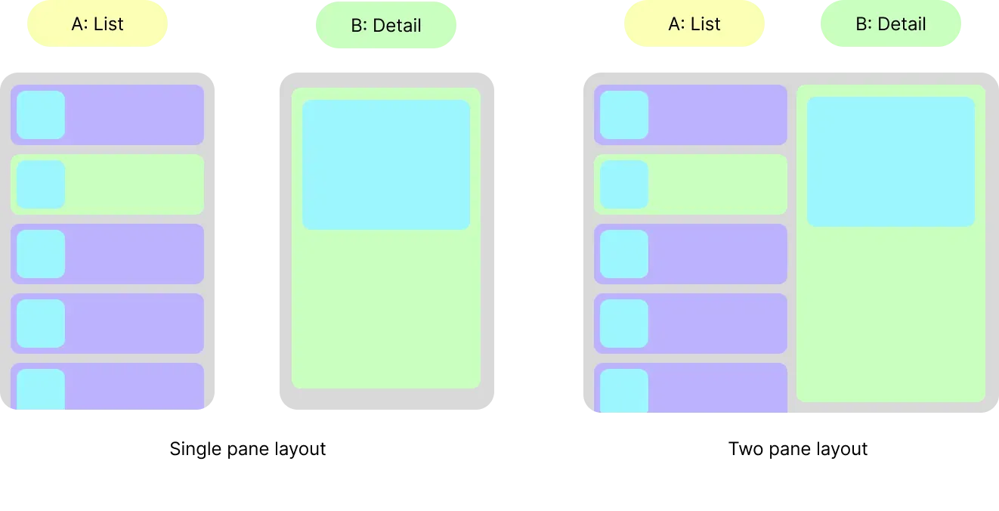{width=100 align=center caption="출처 : 공식문서"}

요약하자면, 기존 Jetpack Compose Navigation 라이브러리는 **사용자가 백스택을 직접 제어하지 못해** 실질적인 제어권이 부족했고, 이는 다중 화면 구성을 구현하는 데 제약이 있었다. 새로운 Navigation 3는 이를 극복하기 위해 설계되었으며, Compose 친화적인 API 제공, **백스택의 명시적 제어**, 다중 패널 구성이 가능한 구조를 도입했다. Voyager와 같은 라이브러리에서 아이디어를 얻었다고 하며, 현대적인 UI 요구에 맞추어 진화했다고 볼 수 있다.

이제 Nav3에서 새로 추가된 내용들에 대해 살펴보겠다.

## 🎯 백 스택의 새로운 패터다임 : 키 기반 구조

백스택에 대한 개념을 한 번 정리하고, 어떤 내용들이 Nav3에 추가되었는지 알아보겠다.

네비게이션은 사용자가 앱을 이동하는 방식을 나타낸다. 사용자는 일반적으로 UI 요소를 탭하거나 클릭하여 상호작용하며 앱은 새 콘텐츠를 표시하여 응답힌다. 사용자가 이전 콘텐츠로 돌아가려면 뒤로가기 제스처를 사용하거나 뒤로가기 버튼을 탭하는 구조이다.

이 동작을 모델링하는 편리한 방법은 콘텐츠 스택을 사용하는 것이다. 사용자가 새 콘텐츠로 Navigate하면 스택의 맨 위에 푸시된다. 사용자가 해당 콘텐츠에서 뒤로 이동하면 스택에서 콘텐츠가 **pop**되고 이전 콘텐츠가 표시된다. 네비게이션 용어로 이 스택은 사용자가 can go back인 콘텐츠를 나타내므로 일반적으로 **back stack**이라고 한다.

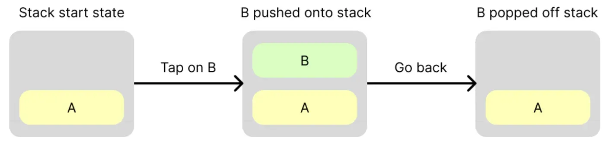{width=100 align=center caption="출처 : 공식문서"}

Nav3에서는 back stack에 실제로 콘텐츠가 포함되지 않는다. 대신 **Keys**라고 하는 content reference가 포함된다. Key는 어떤 유형이든 될 수 있지만 일반적으로 직렬화 가능한 간단한 데이터 클래스이다. 콘텐츠 대신 참조를 사용하면 다음과 같은 이점이 있다.

- key를 back stack에 push하여 간단하게 navigate 할 수 있다.
- **key가 직렬화 가능한 한 back stack을 영구 저장소에 저장할 수 있으므로 Configuration Change / Process Kill에도 유지할 수 있다**. 이는 사용자가 앱을 나갔다가 나중에 다시 돌아와서 중단한 지점부터 동일한 콘텐츠가 표시되기를 기대하기 때문에 중요하다.

Navigation 3 API의 핵심 개념은 back을 소유한다는 것이다.

- back stack이 SnapshotStateList\<T\>이어야 한다. 여기서 `T`은 백 스택 `keys`의 타입이다. `Any`를 사용하거나 더 강력한 유형의 자체 키를 제공할 수 있다. push 또는 pop이라는 용어가 표시되면 기본 구현은 목록 끝에 항목을 추가하거나 삭제하는 것이다.
- back stack을 관찰하고 `NavDisplay`를 사용하여 UI에 상태를 반영한다.

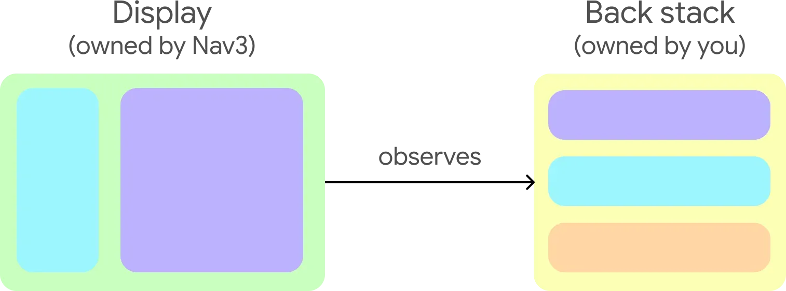{width=100 align=center caption="출처 : 공식문서"}

이제 개념에 대해서 살펴보았으니 키와 백 스택을 만들고 사용자의 네비게이션 이벤트에 응답하여 백 스택을 수정하는 예시를 작성해보겠다.

### 1. content가 아닌 key로 구성

- Navigation 3에서는 **콘텐츠 자체를 저장하지 않고** 대신 **키(Key**) 라는 참조만 저장한다.
- 키는 주로 **직렬화 가능한 data class**로 정의되며, 이를 통해 화면 회전 등 구성 변경 시 상태를 복원할 수 있다.

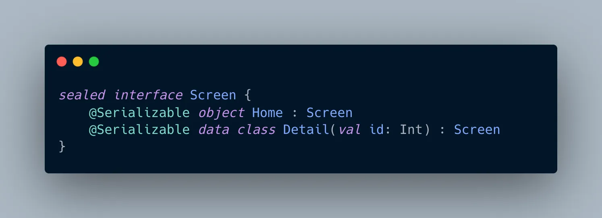{width=100 align=center}

### 2. 리스트 기반 백스택을 직접 생성

- Navigation 3에서는 **개발자가 직접 리스트를 만들어** 백스택을 구성한다.
- 사용자가 네비게이션을 수행할 때마다 새로운 키를 이 리스트에 추가하는 방식이다.

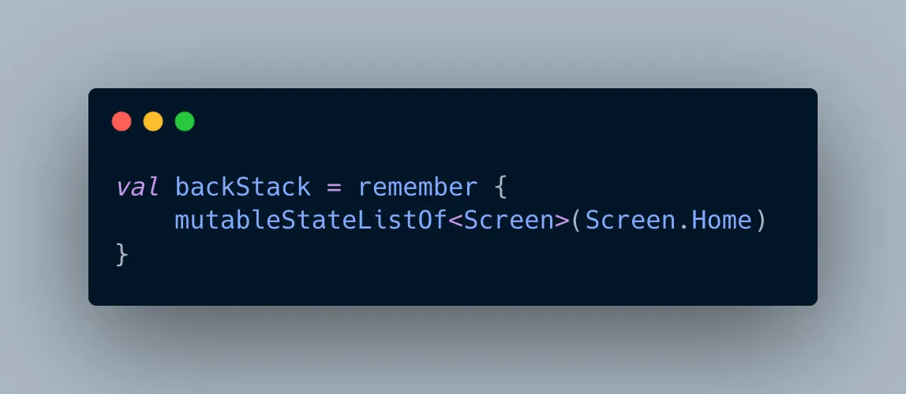{width=100 align=center}

### 3. 백스택을 명시적으로 다뤄보기

- 개발자가 이제 직접 리스트로 생성한 백 스택에 push/pop을 수행하여 네비게이션을 진행할 수 있다.

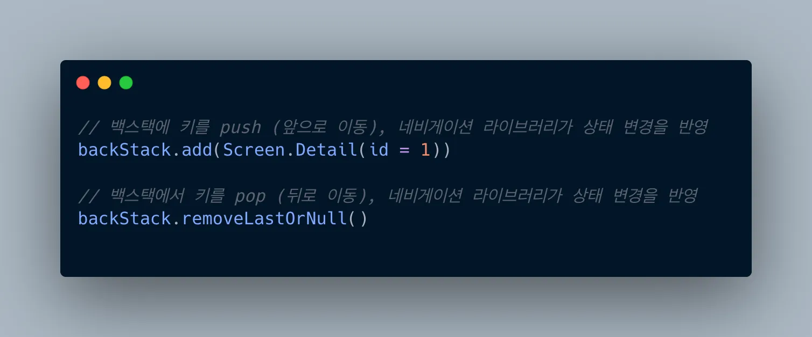{width=100 align=center}

## 🎯 새로운 컨테이너 : NavEntry (구 NavHost)

`NavEntry` 객체는 각 화면의 키와 내용을 매핑해주며, 이를 통해 동적으로 화면을 전환하고 렌더링할 수 있다. 모든 구성 요소가 선언형 방식으로 구현된다.

콘텐츠는 컴포저블 함수가 포함된 클래스인 `NavEntry`를 사용하여 Navigation 3에서 모델링된다. Destination을 나타낸다고 볼 수 있다. 즉, 사용자가 앞으로 이동하고 뒤로 이동할 수 있는 단일 콘텐츠이다.

`NavEntry`에는 콘텐츠에 관한 정보인 메타데이터도 포함될 수 있다. 이 메타데이터는 `NavDisplay`와 같은 컨테이너 객체에서 읽을 수 있으므로 `NavEntry`의 콘텐츠를 표시하는 방법을 결정하는 데 도움이 된다. 예를 들어 메타데이터를 사용하여 특정 `NavEntry`의 기본 애니메이션을 재정의할 수 있다. NavEntry `metadata`는 `String` 키를 `Any` 값에 매핑하여 다양한 데이터 저장소를 제공한다.

`key`를 `NavEntry`로 변환하려면 `entryProvider`를 만든다. `key`를 수신하고 해당 `key`의 `NavEntry`를 반환하는 함수이다. 일반적으로 `NavDisplay`를 만들 때 람다 매개변수로 정의된다.

`entryProvider`를 만드는 방법에는 두 가지가 있다. 람다 함수를 직접 만들거나 `entryProvider` DSL을 사용하는 것이다.

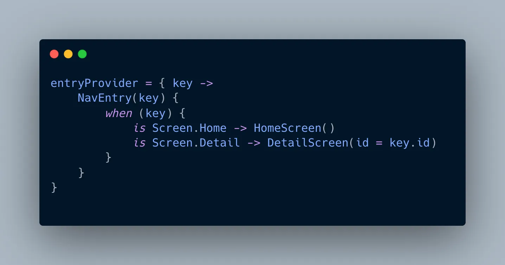{width=100 align=center}

위와 같이 **람다**에서 key를 받아 NavEntry를 반환할 수 있고,

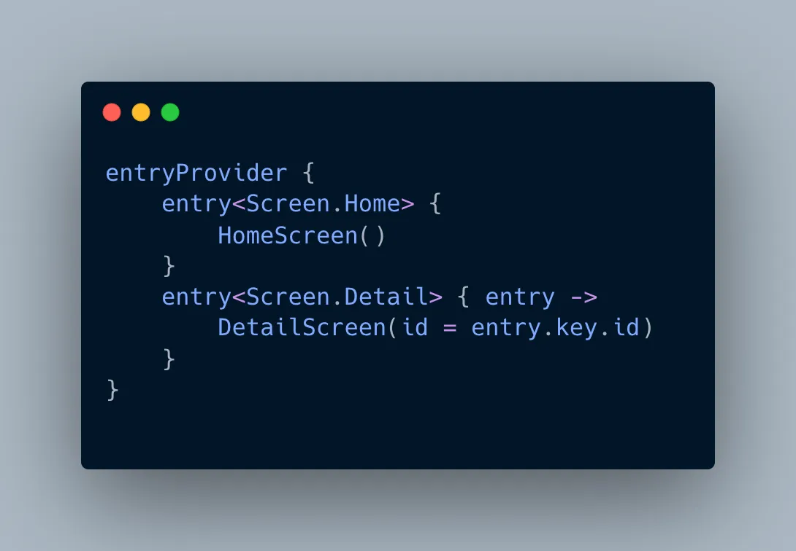{width=100 align=center}

이렇게 **DSL 문법**으로 더 깔끔하게 작성할 수 있다.

만약 메타 데이터를 담고 싶으면 아래와 같이 확장할 수 있다.

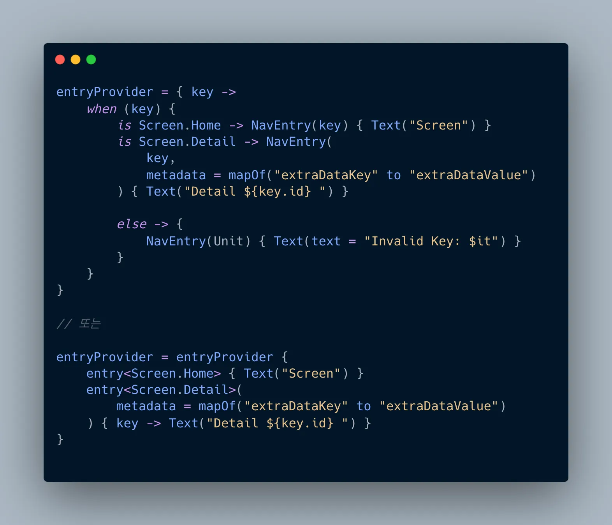{width=100 align=center}

위에서 선언한 `entryProvider`를 `NavDisplay`와 같이 사용하면 아래와 같은 형태가 될 것이다.

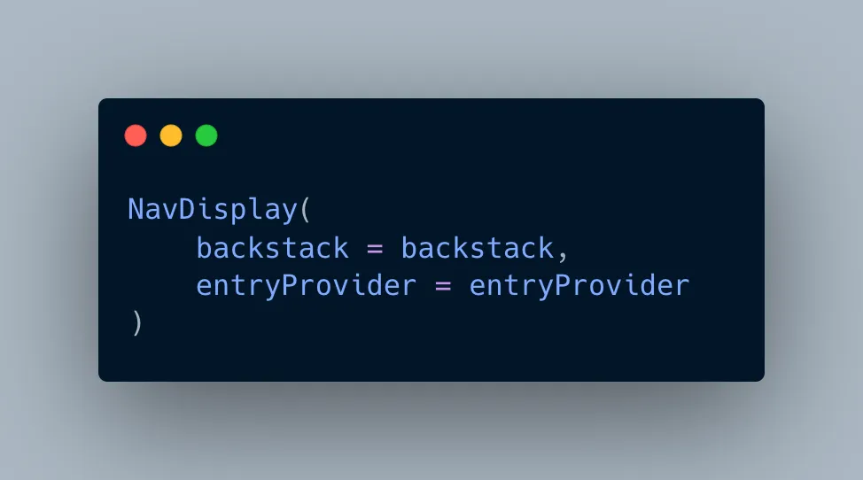{width=100 align=center}

`NavDisplay`는 backstack의 마지막 `key`를 `entryProvider`에 넘기고, 거기서 얻은 `NavEntry`를 통해 화면을 보여준다.

NavEntry는 단순한 화면 렌더링뿐 아니라, **해당 화면에만 유효한 ViewModel 범위**를 지정하는 데도 사용됩니다. 예를 들어, DetailScreen이 백스택에서 제거되면, 그에 연결된 ViewModel도 자동으로 제거되게 만들 수 있습니다.

## 🎯 백 스택을 안전하게 저장하기

구성 변경에 대해서는 이미 remember로 안전하게 처리했다. 프로세스 킬 상황에서도 네비게이션 정보들을 안전하게 저장하기 위해 Navigation3에서 제공하는 방식을 사용할 수 있다.

### NavKey 인터페이스 구현

**백 스택의 모든 키는 NavKey 인터페이스를 구현해야 한다**. 이는 해당 키가 저장될 수 있음을 라이브러리에 알려주는 마커 인터페이스 역할을 한다.

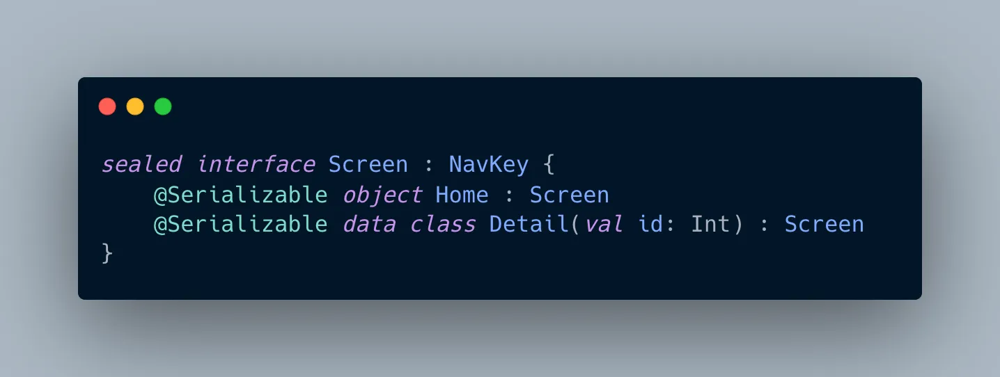{width=100 align=center}

위와 같이 기존의 키들이 **NavKey**를 구현하도록 하면 끝이다. 이외에도 직렬화 처리는 반드시 필요하다. 이제 백 스택을 안전하게 저장하는 두 가지 방법에 대해서 설명해보겠다.

### 1️⃣ `rememberNavBackStack` **사용하기**

`rememberNavBackStack` 컴포저블 함수는 구성 변경 및 프로세스 종료 전후에 유지되는 백 스택을 만들도록 설계되었다. `rememberNavBackStack`가 올바르게 작동하려면 백 스택의 각 키가 다음과 같은 특정 요구사항을 준수해야 한다.

- `NavKey` **인터페이스 구현**: 백 스택의 모든 키는 `NavKey` 인터페이스를 구현해야 한다.
- `@Serializable` **어노테이션**: `NavKey`를 구현하는 것 외에도 키 클래스와 객체는 `@Serializable` 주석으로 표시해야 한다.

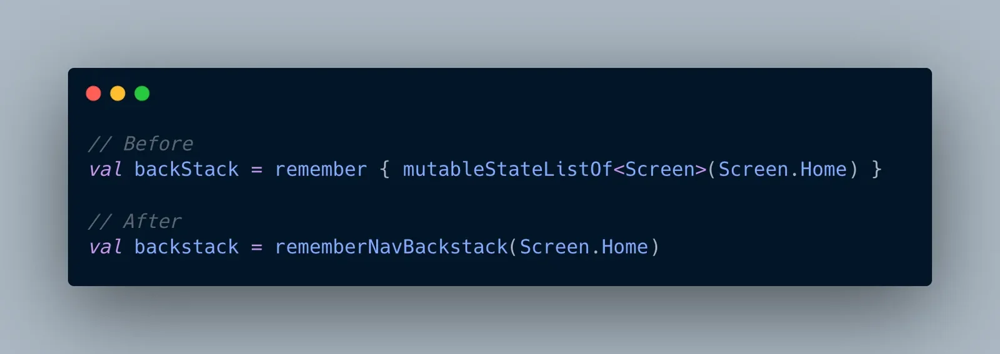{width=100 align=center}

### 2️⃣ ViewModel에 백 스택 저장하기 (+ 스코프 지정)

백 스택을 관리하는 또 다른 방법은 `ViewModel`에 저장하는 것이다. `ViewModel` 또는 기타 커스텀 저장소를 사용할 때 프로세스 종료에서도 지속성을 보장하려면 다음을 실행해야 한다.

- **키가 직렬화 가능해야 함**: `rememberNavBackStack`와 마찬가지로 네비게이션 키는 직렬화 가능해야 한다.
- **직렬화 및 역직렬화를 수동으로 처리**: 앱이 백그라운드로 이동하거나 복원될 때 각 키의 직렬화된 표현을 영구 저장소(예: SharedPreferences, 데이터베이스 또는 파일)에 수동으로 저장하고 역직렬화해야 할 책임이 있다.

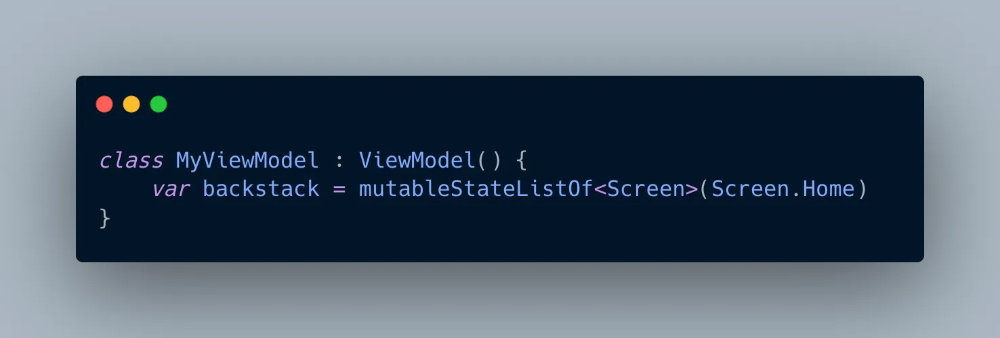{width=100 align=center}

- `mutableStateListOf`를 사용하면 Compose UI가 자동으로 이 리스트를 구독해 UI를 갱신한다.

위와 같이 뷰모델에 저장하고 끝낼 수도 있지만, 생명주기 관점에서 생각해볼 것이 있다.

기본적으로 ViewModel은 Activity나 Fragment 단위로 생명주기를 공유한다.

하지만 Navigation 3에서는 각 화면에 따라 상태를 별도로 관리하고 싶을 수 있다.

> 예: DetailScreen에서만 쓰는 상태를 **뒤로가기 시 자동으로 제거**되게 하고 싶다면

> → **ViewModel을 NavEntry에 범위를 지정** 해야 한다.

`androidx.lifecycle:lifecycle-viewmodel-navigation3` 부가기능 라이브러리는 이를 용이하게 하는 `NavEntryDecorator`를 제공한다. 이 데코레이터는 각 `NavEntry`에 `ViewModelStoreOwner`를 제공한다. `NavEntry`의 콘텐츠 내에 `ViewModel`를 만들면 (예: Compose에서 `viewModel()` 사용) 백 스택의 해당 `NavEntry` 키로 자동으로 범위가 지정된다. **즉**, `NavEntry`**가 백 스택에 추가될 때** `ViewModel`**이 생성되고 삭제될 때 삭제된다**.

Navigation 3에서 ViewModel을 NavEntry에 범위 지정하는 방법은 아래와 같이 간단하다.

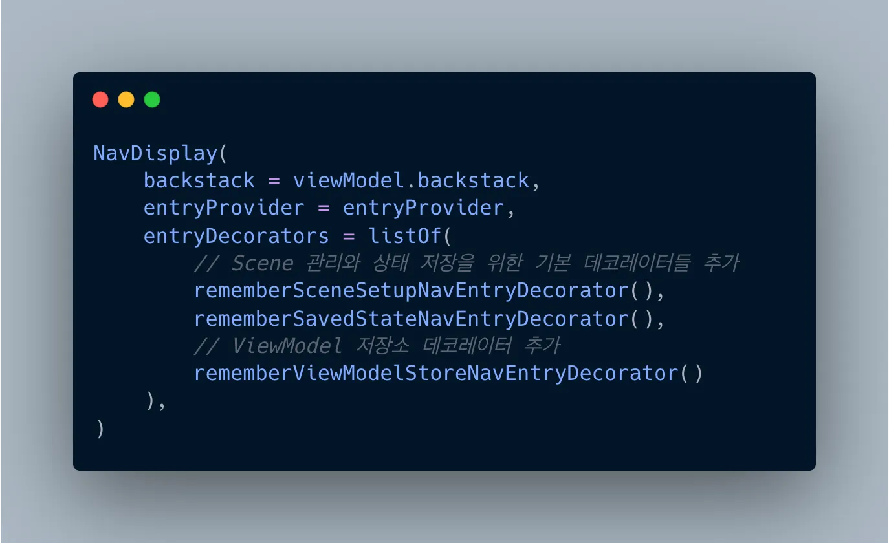{width=100 align=center}

- `NavDisplay`에 `entryDecorators` 파라미터를 추가
- 여기에 `NavEntryViewModelDecorator()` 같은 **라이브러리 제공 데코레이터**를 전달

⇒ 이제 ViewModel은 각 화면에 종속되며 해당 화면이 백스택에서 제거되면 ViewModel도 함께 삭제된다.

## 📝 4줄 요약

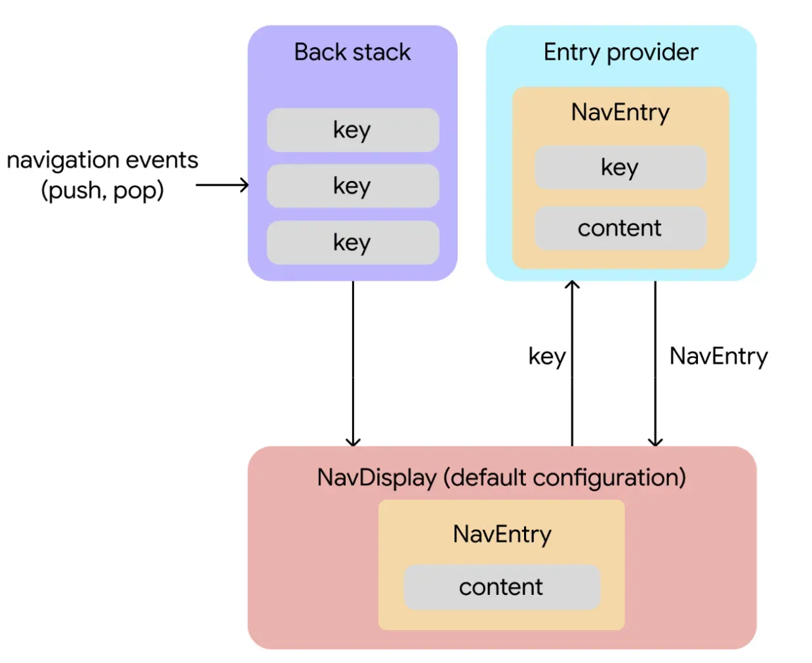{width=100 align=center caption="출처 : 공식문서"}

1. **네비게이션 이벤트가 변경을 시작한다**. 키는 사용자 상호작용에 응답하여 백 스택에 추가되거나 삭제된다.
2. **백 스택 상태 변경이 콘텐츠 검색을 트리거한다**. `NavDisplay`(백 스택을 렌더링하는 컴포저블)는 백 스택을 관찰한다. 기본 구성에서는 단일 창 레이아웃에 최상위 백 스택 항목을 표시한다. 백 스택의 최상위 키가 변경되면 `NavDisplay`는 이 키를 사용하여 `entryProvider`에 해당 콘텐츠를 요청한다.
3. **Entry Provider가 콘텐츠를 제공한다**. `entryProvider`는 키를 `NavEntry`로 확인하는 함수이다. `entryProvider`는 `NavDisplay`에서 키를 수신하면 키와 콘텐츠가 모두 포함된 연결된 `NavEntry`를 제공한다.
4. **콘텐츠가 표시된다**. `NavDisplay`는 `NavEntry`를 수신하고 콘텐츠를 표시한다.

## 소감

이번에는 신기술인 Nav3에 대해서 알아보았다. 신기술에 대한 공부는 항상 즐거우면서도 신기하면서도 공부할 게 많아져서 한숨이 나오면서 좀 복잡한 감정이 든다. 하지만 이번 Nav3는 적당한 볼륨에, 배울 점도 많아서 좋은 경험이었던 것 같다. CMP 네비게이션 오픈소스인 [보이저](https://github.com/adrielcafe/voyager)를 알게 되었고, 멀티플랫폼을 향한 Jetpack의 움직임이 적극적인 뉘앙스라는 것도 느낄 수 있었다. 다중 화면 구성을 지원하는 의도 자체가, 웹에서 여러 화면을 띄우기 위한 빌드업이지 않을까 싶다.

그래도 **백스택을 이제 명시적으로 조작**할 수 있어 유연성이 비약적으로 향상된 것 같다. 또한, 각 화면에 대응하게 **ViewModel의 스코프를 지정**하여 대응하는 것이 굉장히 인상깊었다. `hiltViewModel()`과 `viewModel()`의 차이라던지, 공용 뷰모델의 범위나 인스턴스 불일치 문제 등등 복잡한 상황에서 좋은 해결책이 될 수 있을 것 같다.

하지만 여전히 그 중요한 백 스택과 화면에 필요한 정보들에 대한 키를, 단순히 변경 가능한 리스트로 저장하는 것이 완벽한가? 라는 의구심은 든다. 다음 프로젝트에서는 Nav3를 본격적으로 사용해보며 이에 관련한 시행착오들을 직접 겪어보고 싶다.

(이 글에서 Nav3에 업데이트 내용 중에 포함된 `Scene`이나 애니메이션에 관한 내용은 다루지 않았다. 추후에 적용해볼 상황이 있으면 공부해보고 이 글을 업데이트할 예정이다. 특히 `Scene`은 되게 복잡한 내용 같아 조금 거부감이 있지만, 웹과 태블릿에서만 사용될 것 같기에 당장은 사용하지 않을 것 같다.)

## 참고 자료

[https://github.com/android/nav3-recipes](https://github.com/android/nav3-recipes)

[https://android-developers.googleblog.com/2025/05/announcing-jetpack-navigation-3-for-compose.html](https://android-developers.googleblog.com/2025/05/announcing-jetpack-navigation-3-for-compose.html)

[https://developer.android.com/guide/navigation/navigation-3?hl=ko&_gl=1\*fklray\*_up\*MQ.._*ga*MTk5MDIyNTE5MC4xNzQ5MzA1ODky\*_ga_6HH9YJMN9M\*czE3NDkzMDg4MTckbzIkZzAkdDE3NDkzMDg4MTckajYwJGwwJGg2MDU5MjI2NDA](https://developer.android.com/guide/navigation/navigation-3?hl=ko&_gl=1*fklray*_up*MQ.._gaMTk5MDIyNTE5MC4xNzQ5MzA1ODky*_ga_6HH9YJMN9M*czE3NDkzMDg4MTckbzIkZzAkdDE3NDkzMDg4MTckajYwJGwwJGg2MDU5MjI2NDA).
