## 들어가며

지난 8월 KotlinConf Extended South Korea 2026에서 "이 함수, 실패하면 어떻게 되나요?"라는 제목으로 발표했다. Kotlin이 15년 동안 실패를 어떻게 표현해 왔는지, 그리고 지금 설계 중인 Rich Errors가 어떤 문제를 풀려는 것인지를 다룬 40분짜리 발표였다.

발표를 준비하면서 가장 오래 붙잡고 있었던 건 문법이 아니었다. Kotlin으로 몇 년 개발하다 보면 에러 처리 방식이 한 프로젝트 안에서도 여러 갈래로 나뉜다는 걸 느끼게 된다. 어떤 함수는 `null`을 돌려주고, 어떤 함수는 예외를 던진다. 다른 모듈에서는 `Result`를 쓰고, 화면에서는 다시 sealed class로 감싼다. 각각 이유가 있는 선택이지만, 호출하는 입장에서는 함수를 부를 때마다 "이 함수는 실패를 어떻게 알려주지?"부터 확인해야 한다. 나도 그렇게 해왔다. 그래서 Rich Errors를 처음 봤을 때 궁금했던 건 새 기호의 생김새보다 "이번에는 우리가 매번 손으로 만들던 것 중 어디까지가 언어로 들어오는가"였다.

이 글은 발표의 흐름을 따라가되, 무대에서는 시간 때문에 빠르게 지나간 배경과 코드의 의미를 훨씬 자세히 풀어 쓴 글이다. 발표를 보지 않았거나 KEEP, checked exception, Arrow 같은 단어가 낯선 분도 따라올 수 있도록 맥락을 채웠다. 마지막에는 발표 며칠 뒤 JetBrains Kotlin 블로그에 올라온 에러 처리 글도 함께 읽는다. 발표와 다른 도구를 쓰면서도 같은 방향을 가리키고 있어서, 발표에서 하고 싶었던 이야기를 다른 각도에서 확인해 주는 글이었다.

> 이 글은 2026년 9월 6일 기준의 KEEP 문서를 바탕으로 썼다. Rich Errors의 설계 명세인 KEEP-0462는 아직 `Public discussion` 상태이고, 이 글에 나오는 `error`, `|`, `|.`, `ifError`는 전부 제안된 문법이다. 현재 안정 버전의 Kotlin에서 그대로 컴파일되는 튜토리얼이 아니다. 발표 당시의 캡처와 지금 확인한 내용이 다른 곳은 본문에서 따로 짚었다.

### KEEP이 뭔가

본론에 들어가기 전에 이 글에 계속 나올 단어 하나를 짚고 가자. KEEP은 Kotlin Evolution and Enhancement Process의 약자다. Java의 JEP, Python의 PEP와 같은 자리에 있는 제도로, Kotlin에 새 문법이 들어오려면 공개 설계 문서를 쓰고 GitHub Discussion에서 커뮤니티 리뷰를 거쳐야 한다. 문서와 토론이 전부 공개돼 있어서 누구나 읽고 의견을 달 수 있다. 이 글에 나오는 인용의 대부분이 거기서 나왔다.

Rich Errors와 관련된 문서는 세 편이다.

- [KEEP-0441](https://github.com/Kotlin/KEEP/blob/main/proposals/KEEP-0441-rich-errors-motivation.md) (2025년 8월): 왜 필요한가를 설명하는 동기 문서
- [KEEP-0462](https://github.com/Kotlin/KEEP/blob/main/proposals/KEEP-0462-rich-errors.md) (2026년 5월 최초 공개, 7월 31일 최종 수정): 문법과 타입 규칙을 정한 설계 명세
- [notes/0009](https://github.com/Kotlin/KEEP/blob/main/notes/0009-rich-errors-use-cases.md) (2026년 8월): 실제 Android 앱 세 개의 코드에 적용해 본 검증 문서

동기 문서와 설계 명세를 구분해서 읽는 게 중요하다. 2025년 발표와 동기 문서, 그리고 2026년 설계 명세 사이에 타입 계층과 연산자가 바뀌었기 때문이다. 이 글은 최신 명세인 KEEP-0462를 기준으로 한다.

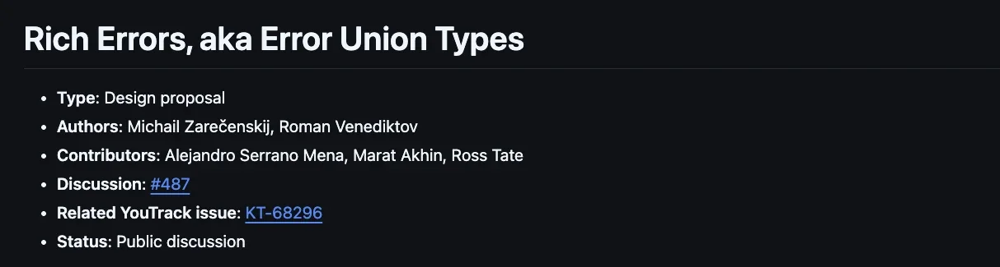{width=100 align=center caption="발표 당시 캡처한 KEEP-0462의 메타데이터. 맨 아랫줄의 Status가 Public discussion이다. KEEP 저장소가 정해둔 상태 순서에서 이건 첫 칸이다. In progress도, Experimental도 아니다."}

## 하나의 null, 두 개의 실패

발표는 이 코드로 시작했다. 코루틴을 쓰는 분이라면 익숙할 것이다.

{width=100 align=center}

사용자를 가져오되, 1초가 지나면 기다리지 않고 `null`을 돌려주는 코드다. 실행했더니 `null`이 나왔다. 무슨 일이 있었을까?

발표에서는 여기서 3초쯤 침묵했다. 답은 두 가지다.

1. `findUser`가 사용자를 찾지 못해서 `null`을 돌려줬다.
2. 1초 안에 끝나지 않아서 `withTimeoutOrNull`이 `null`을 돌려줬다.

조회 함수 자체는 이렇게 생겼다고 하자. 사용자가 없으면 `null`을 돌려준다. 이 정도 계약이라면 `User?`로 충분해 보인다.

{width=100 align=center}

그런데 호출부에서 시간 제한을 붙이는 순간 이야기가 달라진다.

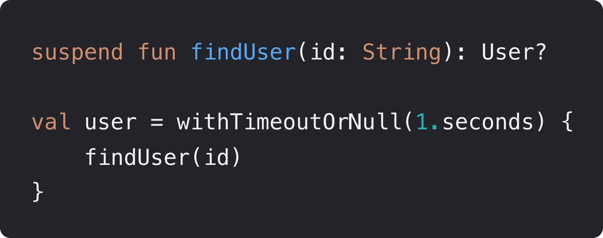{width=100 align=center}

[withTimeoutOrNull](https://kotlinlang.org/api/kotlinx.coroutines/kotlinx-coroutines-core/kotlinx.coroutines/with-timeout-or-null.html)은 제한 시간 안에 블록이 끝나면 그 결과를 돌려주고, 시간 제한으로 취소되면 `null`을 돌려준다. 타입으로 보면 더 분명하다. 이 함수의 반환 타입은 `T?`인데, 여기서 `T`가 이미 `User?`다. 겉보기에는 `User??`가 돼야 할 것 같지만 Kotlin의 nullable 타입은 중첩되지 않는다. `User?`에 `?`를 한 번 더 붙여도 `User?`다. 두 종류의 "없음"이 한 타입으로 접히는 것이다.

첫 번째는 확인된 부재고, 두 번째는 확인 자체에 실패한 것이다. Android 앱이라면 하나는 "사용자를 찾을 수 없습니다"라는 빈 화면이고, 다른 하나는 재시도 안내다. 서버라면 404와 504다. 값은 같은 `null`인데 다음 행동은 완전히 다르다. 그리고 그 차이는 결과가 `null` 하나로 합쳐진 순간 이미 사라졌다. `if (user == null)`을 아무리 꼼꼼하게 써도 없어진 정보를 복원할 수는 없다.

한 가지 짚어둘 것이 있다. `withTimeoutOrNull`이 모든 실패를 `null`로 바꾸는 건 아니다. 블록 안에서 던진 다른 예외는 그대로 전파되고, 바깥 코루틴의 취소도 별개다. 여기서 보려는 건 두 개의 정상적인 반환 경로가 같은 값으로 표현될 때 생기는 모호함이다.

여기까지 읽으면 "sealed class로 만들면 되잖아"라는 생각이 들 것이다. 맞다. 된다. 나도 그렇게 해왔다. 그런데 질문을 하나 바꿔보자. 여러분 코드베이스에 그런 계층이 몇 개나 있나? 화면마다, API마다 하나씩 만들지 않았나? 이 글의 앞 절반은 왜 15년 동안 우리가 그걸 각자 직접 만들어야 했는가에 대한 이야기다.

그리고 요즘은 이런 코드가 조금 다른 경로로 들어온다. AI에게 요청해서 받은 `suspend fun loadUser(id: String): User?`는 동작하고 테스트도 통과한다. 그런데 이 `null`이 무슨 뜻인지는 아무 데도 적혀 있지 않다. 예전에는 리뷰에서 누군가 물어봤다. "이 null 뭐예요?" 지금 우리는 AI가 쓴 코드를 그렇게 한 줄씩 읽지 않는다. 이 이야기는 글 후반에 다시 돌아온다.

## Kotlin은 왜 15년 동안 실패를 각자 만들었을까

Kotlin은 2011년에 공개됐고 2016년에 1.0이 나왔다. 올해로 15년이다. 그 15년 동안 에러 처리와 관련해서 무슨 일이 있었는지 한 줄로 보면 이렇다.

{width=100 align=center caption="2017년 커뮤니티가 Arrow를 만들었고, 2018년 표준 라이브러리에 Result가 들어왔고, 2021년에야 sealed interface가 생겼다. 맨 오른쪽 둘이 이 글의 주제다."}

이 그림을 "옛 도구가 사라지고 새 도구로 대체됐다"는 역사로 읽으면 곤란하다. 다섯 방식 전부 지금도 한 프로젝트 안에서 같이 쓰인다. 그리고 아래 설명은 출시 순서가 아니라 앞선 방식에서 부족했던 것을 다음 방식이 어떻게 메우려 했는가의 순서로 간다. 예외, null, sealed, Result, Arrow 순서인 이유다. KEEP-0441이 문제를 설명하는 순서이기도 하다.

### 첫 번째 결정: checked exception을 버리다

Kotlin의 첫 번째 결정은 무언가를 만든 게 아니라 버린 것이었다. Java의 checked exception이다.

Kotlin부터 시작한 분에게는 낯선 개념일 수 있어서 짧게 설명하면, Java에서는 일부 예외를 던지는 메서드를 호출할 때 그 예외를 `catch`로 처리하거나 자신의 `throws` 절에 다시 선언해야 한다. 안 하면 컴파일이 안 된다. 컴파일러가 이 의무를 검사하는 예외가 checked exception이다.

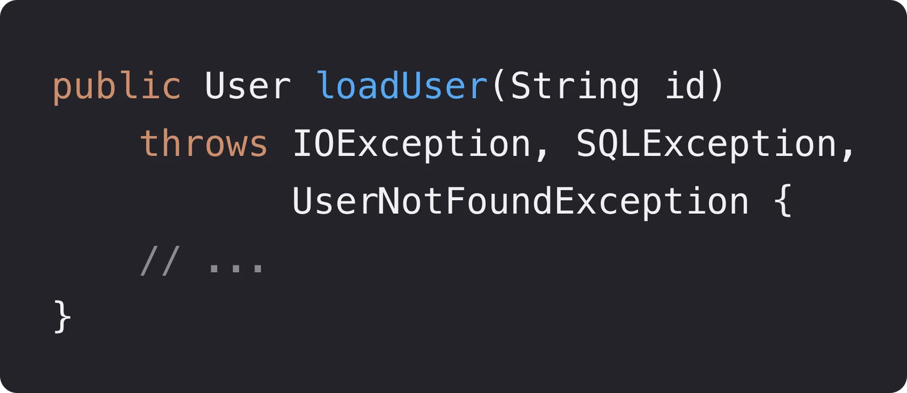{width=100 align=center}

이 방식은 두 가지를 해준다. 실패 가능성이 시그니처에 적혀 있고, 처리가 강제된다. 저장소 메서드가 `IOException`과 `SQLException`을 선언했다면, 호출자는 구현을 열어보지 않아도 그 두 실패를 알 수 있다.

문제는 두 번째였다. 지금 이 계층에서는 복구할 수 없는 예외까지 잡으라고 하니, `catch`를 열어놓고 로그만 찍는 코드가 쌓였다. 저장소는 파일을 읽고, 서비스는 저장소를 부르고, 화면은 서비스를 부른다. 중간의 서비스가 I/O 실패를 복구할 수 없다면 예외를 위로 넘기거나 자기 계층의 예외로 다시 감싸야 한다. 처리 정책은 하나도 안 바뀌었는데 선언과 변환 코드만 늘어난다. 람다와도 안 맞았다. Java의 `Function.apply`에는 checked 예외 선언이 없어서, checked 예외를 던지는 메서드를 `Stream.map`에 그대로 넘길 수 없다. "함수 하나를 연결한다"는 의도에 예외 전달 코드가 끼어드는 것이다.

그래서 Kotlin은 없앴다. 예외와 `try-catch`는 그대로 두되 [모든 예외를 unchecked로 취급한다](https://kotlinlang.org/docs/exceptions.html). Java 호출자에게 알려야 할 때 `@Throws`를 붙일 수는 있지만, 그게 Kotlin 호출부에 검사를 도입하는 건 아니다. 나는 이 결정이 옳았다고 생각한다. 다만 대가가 있었다. 강제성이 싫어서 없앴는데, 시그니처에 적는 것까지 같이 사라졌다. 지금 Kotlin 함수는 `fun loadUser(): User`라고 적혀 있어도 던지는지 아닌지 알 방법이 없다. **실패할 수 있다는 사실을 적을 곳이 없어진 것이다**. 이 문장이 이 챕터 전체의 출발점이다. 뒤에 나올 네 가지 방식은 전부 그 "적을 곳"을 각자 만들어낸 시도로 읽을 수 있다.

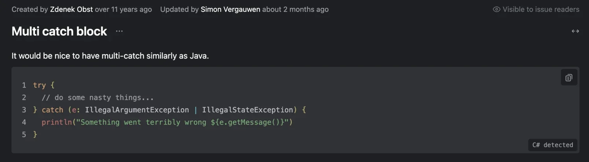{width=100 align=center caption="11년째 열려 있는 KT-7128. 예외 여러 개를 한 번에 잡는 multi-catch 요청이다. 2015년에 만들어졌고 미해결 이슈 중 표가 두 번째로 많은데 담당자가 배정된 적이 없다. 언어팀이 예외를 에러 모델로 쓰는 것 자체를 권하지 않기 때문인데, 거절당한 요청이 11년째 사라지지 않는다는 건 진짜 필요가 있다는 뜻이기도 하다."}

### null: 가장 먼저 손에 잡힌 재료

사람들이 가장 먼저 집어 든 재료는 `null`이었다. Kotlin이 nullable을 타입 시스템에 넣어뒀으니 자연스러운 선택이다. `toIntOrNull()`은 파싱에 실패하면 예외 대신 `null`을 돌려주고, 호출자는 `?:`로 기본값을 고르거나 `?.`로 다음 작업을 잇는다. 체인이 편하고 스마트 캐스트와 잘 맞물린다.

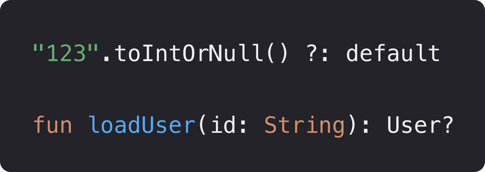{width=100 align=center}

이유가 중요하지 않을 때 `null`은 지금도 좋은 표현이다. 설정값을 읽다가 숫자가 아니면 기본값을 쓰기로 했다면, 어떤 글자 때문에 실패했는지까지 타입으로 구분하는 건 과하다.

그런데 금이 두 군데 간다.

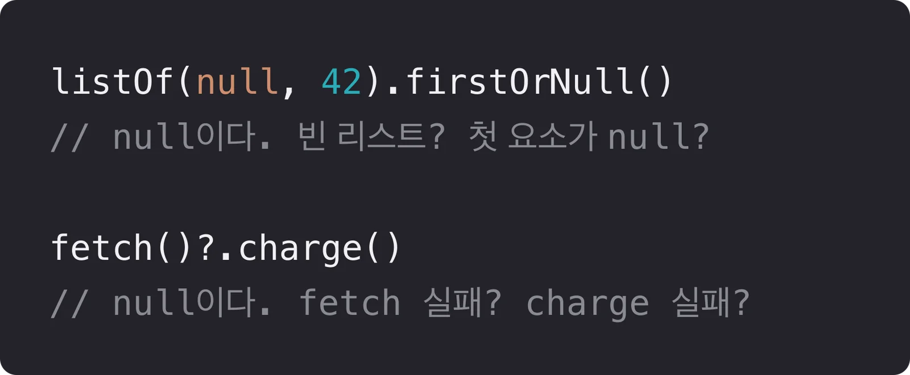{width=100 align=center}

첫째, 컬렉션과 만나면 무너진다. `listOf(null, 42).firstOrNull()`은 `null`을 돌려준다. 그런데 그게 첫 원소가 `null`이라서인지, 리스트가 비어 있어서인지 구분이 안 된다. 하나는 첫 원소를 얻은 것이고 다른 하나는 얻지 못한 것이다. 둘째, 체인에서 위치가 사라진다. `fetch()?.charge()`의 결과가 `null`이면 사용자를 못 찾은 건지 결제가 실패한 건지 알 수 없다. 오프닝에서 본 그 문제다.

"`firstOrNull`은 에러 처리 API가 아니라 조회 API 아닌가"라는 반론이 있을 수 있다. 맞다. 그런데 실무에서는 그 구분 없이 실패 신호로 쓰이고, KEEP-0441도 이 예시를 직접 든다. `null`이 나쁜 게 아니다. **한 종류의 부재로 여러 종류의 판단을 대신하려 할 때 정보가 부족해지는 것이다**.

### sealed class: 타입을 더 만들자

`null`로 부족하니 사람들이 다음으로 한 일은 타입을 더 만드는 것이었다.

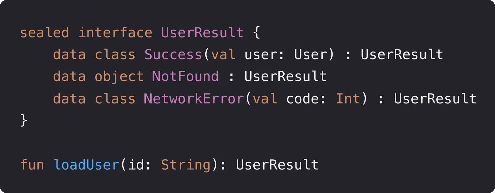{width=100 align=center}

sealed 타입은 가능한 하위 타입의 목록을 컴파일러가 안다. 그래서 `when`을 쓰면 모든 경우를 다뤘는지 검사받을 수 있다. 이게 exhaustive 검사다. `PermissionDenied`를 새로 추가했을 때, 하위 타입을 전부 나열하고 `else`를 두지 않은 `when`은 컴파일이 깨진다. 빠뜨린 처리가 드러나는 것이다. "사용자가 없을 수 있다"가 주석에만 있을 때는 리뷰어가 기억해야 하지만, 타입에 있으면 컴파일러가 확인한다. 이건 `null`이 못 하던 일이다.

대신 두 가지 비용이 생긴다.

첫째, 성공까지 감싸야 한다. `User`는 보통 도메인 모델이지 `UserResult`를 상속하는 클래스가 아니다. sealed는 자기 자식만 받으니, 이미 있는 타입을 넣으려면 `Success(val user: User)`라는 상자를 만들고 호출부에서 다시 꺼내야 한다.

둘째, 이 계층은 이 API 전용이다. 옆 화면에서는 다시 만들어야 한다. 그래서 코드베이스에 `UserResult`, `LoginResult`, `PaymentResult`, `ProfileResult`가 늘어난다. 여러분 코드에도 있을 것이다. KEEP은 이걸 "강력하지만 장황하고 반복적"이라고 표현한다.

물론 함수마다 새로 만들어야 한다는 언어 규칙은 없다. 제네릭 래퍼로 재사용할 수도 있다. 다만 어떤 결과를 묶을지, 어떤 실패를 공유할지, 성공을 어떻게 꺼낼지를 전부 프로젝트가 직접 설계해야 한다. 범용 도구인 만큼 에러 처리 관용구도 팀이 만들어야 하는 것이다. 참고로 sealed interface는 2021년 Kotlin 1.5에 와서야 추가됐다. 그전에는 하위 클래스가 같은 파일 안에 있어야 했고, 계층 하나를 만드는 비용이 지금보다 더 비쌌다.

### kotlin.Result: 표준이 준 반쪽짜리 답

계층을 반복하다 보면 제네릭 버전을 원하게 된다. 그런데 Kotlin이 실제로 준 `Result`는 그 목적으로 태어난 물건이 아니었다.

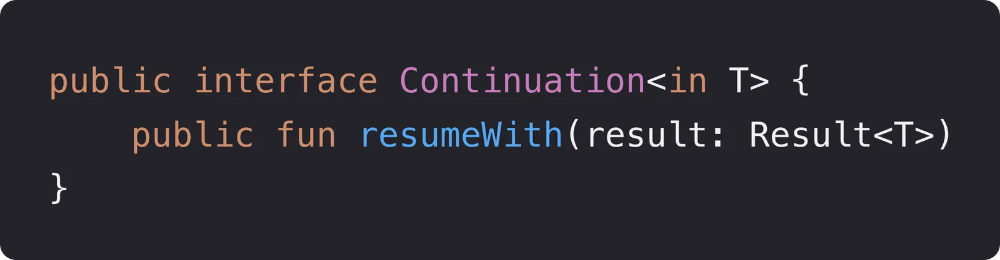{width=100 align=center}

[kotlin.Result](https://kotlinlang.org/api/core/kotlin-stdlib/kotlin/-result/)는 Kotlin 1.3에서 코루틴과 함께 들어왔다. 중단된 계산이 값으로 끝났는지 예외로 끝났는지를 `Continuation.resumeWith`에 전달하기 위한 내부 부품이었다. 그래서 성공 값 `T` 또는 실패를 나타내는 `Throwable` 하나를 담는 구조다. 타입 파라미터가 하나뿐이라 어떤 에러인지 적을 수가 없다. `Result<User>`를 보면 성공하면 `User`를 얻는다는 건 알지만, 실패했을 때 "사용자 없음, 권한 없음, 요청 제한" 중 무엇을 처리해야 하는지는 모른다. `exceptionOrNull()`의 타입이 `Throwable?`이기 때문이다.

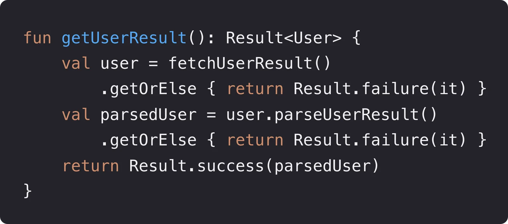{width=100 align=center}

여러 `Result` 함수를 이으면 이런 코드가 된다. 실제로 일하는 건 함수 두 개 호출뿐이고, 나머지는 값을 꺼내고 다시 감싸는 배관 코드다. 표준 `map`은 성공 값을 바꾸는 데는 좋지만 변환 함수가 다시 `Result`를 돌려주면 중첩을 신경 써야 한다. 직접 확장 함수를 만들거나 조기 반환으로 평탄하게 만들 수 있지만, 그것도 팀의 규칙이 된다. JetBrains가 공식 문서에서 스스로 문제 사례로 인용하는 코드다.

성능 이야기는 구분할 필요가 있다. `Result`는 `@JvmInline value class`라 성공 경로에서는 래퍼 객체를 만들지 않는다. "Result는 언제나 객체를 하나 더 만든다"는 설명은 정확하지 않다. 더 직접적인 차이는 할당보다 API 표면이다. `Result<User>`는 자동완성을 열면 `getOrNull`, `map`, `fold`가 뜨고 `User`의 메서드는 하나도 없다. 꺼내야 보인다.

### Arrow: 커뮤니티가 먼저 낸 답

표준 라이브러리 `Result`가 반쪽이니 커뮤니티가 직접 만들었다. Arrow는 Kotlin 함수형 프로그래밍 라이브러리로, 2013년의 funKTionale과 2017년의 Kategory가 커뮤니티가 갈라질 것을 걱정해 합치면서 지금의 이름이 됐다.

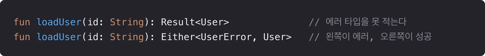{width=100 align=center}

Arrow의 `Either<E, A>`는 실패 타입 `E`와 성공 타입 `A`를 함께 적는다. 관례적으로 `Left`가 실패, `Right`가 성공이다. `Result`와 결정적으로 다른 점이 이것이다. 에러 타입을 제네릭으로 지정할 수 있다. `Either<UserError, User>`라면 호출자는 `UserError`를 열어 예상된 실패를 확인할 수 있고, `UserError`가 sealed라면 exhaustive 검사도 된다. 즉 실패를 타입에 적는 일 자체는 Rich Errors를 기다려야만 가능한 게 아니다.

함수를 잇는 문제도 Arrow는 다룬다. `either { }` 블록 안에서 `bind()`를 쓰면 성공 값을 꺼내 다음 줄에서 쓰고, 실패면 거기서 계산을 멈춘다. 최근에는 [Raise](https://arrow-kt.io/learn/typed-errors/from-either-to-raise/)라는 문맥 기반 방식도 있다. "함수형"이라는 이름 때문에 이론부터 배워야 할 것 같지만, 출발점은 "성공이면 계속하고 실패면 정해둔 방식으로 돌려준다"는 흐름 하나다.

기술적으로는 `Result`의 한계를 정확히 푼 답이었다. 그런데 왜 모두가 쓰지 않았을까. 커뮤니티에서 실제로 나오는 목소리가 있다.

> Either가 좋은 건 알겠어요. 그런데 제네릭도 낯설어하는 팀원들에게 함수형을 6개월 가르칠 수는 없어요. 이건 Arrow 잘못이 아니에요.

기술이 옳아도 팀의 학습 비용 앞에서 도입은 멈춘다. 그리고 하나 더 있다. Arrow를 쓰는 팀과 안 쓰는 팀의 코드가 서로 다른 언어처럼 보이게 된다. **라이브러리는 방언을 만들 뿐 공통어가 되지 못했다**. 이건 Arrow를 실패로 보자는 말이 아니다. 이미 잘 쓰고 있는 팀에는 지금도 충분히 실용적인 답이다. 오히려 커뮤니티가 먼저 답을 만들었고 언어가 그 답에서 배우고 있다고 보는 게 정확하다.

### 그래서 실무는 어디에 도달했나

KEEP 토론에 올라온 실제 코드 이야기를 하나 하고 싶다. 잔액을 차감하는 함수인데 반환 타입이 `Boolean?` 하나였다. `true`면 성공, `false`면 잔액 부족, `null`이면 상태가 예상과 다름. 세 가지 의미가 한 타입에 들어 있고, 어느 게 어느 건지는 오직 주석에만 적혀 있었다. 작성자가 이유도 같이 적어뒀다. 표현할 방법이 없었고, 한 곳에서만 쓰는 함수에 sealed는 보일러플레이트가 너무 많았다고. 타입이 못 하는 말을 주석이 대신하고 있는 것이다. 솔직히 남 이야기 같지 않았다.

### 정리: 전용 문법은 한 번도 없었다

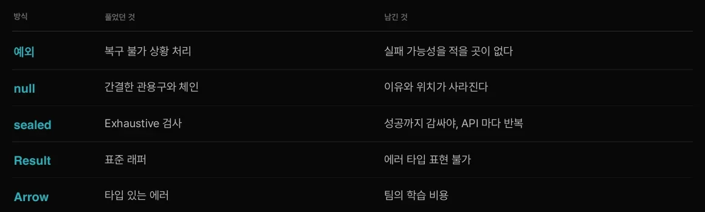{width=100 align=center}

다섯 가지가 각자 뭔가를 풀고 각자 뭔가를 남겼다. 예외는 복구 불가 상황을 처리했지만 실패 가능성을 적을 곳이 사라졌다. `null`은 가장 간결했지만 이유와 위치가 사라진다. sealed는 exhaustive 검사를 얻었지만 성공까지 감싸야 하고 API마다 반복된다. `Result`는 표준 래퍼를 줬지만 에러 타입을 적을 수 없다. Arrow는 에러에 타입을 줬지만 팀이 배워야 했다.

다섯 개가 서로 다르지만 공통점이 하나 있다. **전부 언어가 준 범용 재료로 우리가 각자 조합한 방식이지, 복구 가능한 실패를 위한 전용 문법은 한 번도 없었다는 것**. 오프닝의 "sealed로 만들면 되잖아"에 대한 답이 이것이다. 만들 수 있다. 그런데 15년 동안 각자 만들어 왔다.

## Rich Errors: 실패를 반환 타입에 적는다

그래서 Kotlin이 준비 중인 답이 무엇인가. 2025년 5월 KotlinConf에서 Kotlin 수석 언어 디자이너 Michail Zarečenskij가 45분 단독 세션으로 공개했다. 키노트에서 잠깐 언급하고 지나간 게 아니라 세션 하나를 통째로 썼다. 그만큼 크게 보고 있다는 뜻이다. 이 사람이 KEEP-0441과 0462의 저자이기도 하다.

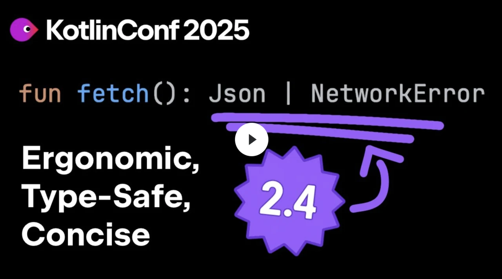{width=100 align=center caption="KotlinConf 2025 세션 화면. 당시에는 2.4라는 숫자가 크게 박혀 있었지만, 실제로는 2.4.0에도 2.4.20에도 들어가지 않았다. 지금 이슈 트래커에 적힌 목표는 2.5.0이다."}

### 문법은 둘뿐이다

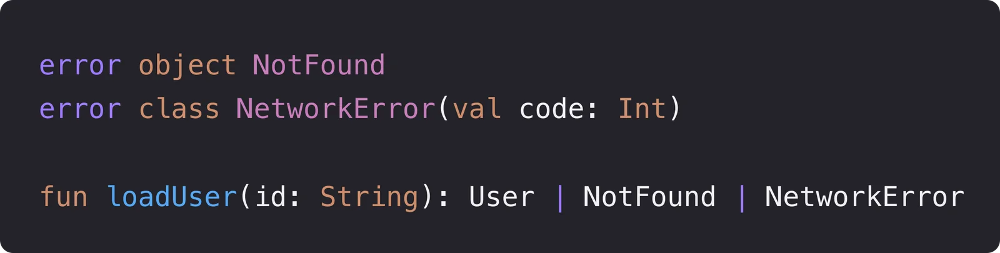{width=100 align=center}

새로 배울 문법은 사실상 둘이다.

첫째, `error`라는 새 키워드. 데이터가 없으면 `error object`, 데이터를 담아야 하면 `error class`로 선언한다. `NetworkError`는 상태 코드를 갖고 있다.

둘째, 반환 타입의 파이프. 성공과 실패를 나란히 적는다. `User | NotFound | NetworkError`는 "User이거나 NotFound이거나 NetworkError"라고 그대로 읽으면 된다. 하나의 호출은 그중 하나를 돌려준다.

중요한 건 error가 예외처럼 스택을 타고 올라가는 게 아니라 **반환되는 값**이라는 점이다. 변수에 담고, 분기하고, 다른 함수에 넘길 수 있다. `return NotFound`와 `throw SomeException()`은 완전히 다른 제어 흐름이다.

### 오프닝의 함수로 돌아가면

{width=100 align=center}

오프닝의 그 함수다. 사용자가 없는 건지 타임아웃인지, 이제 시그니처가 스스로 답한다. 주석도 필요 없고 리뷰에서 물어볼 필요도 없다.

쓰는 쪽은 이렇게 된다.

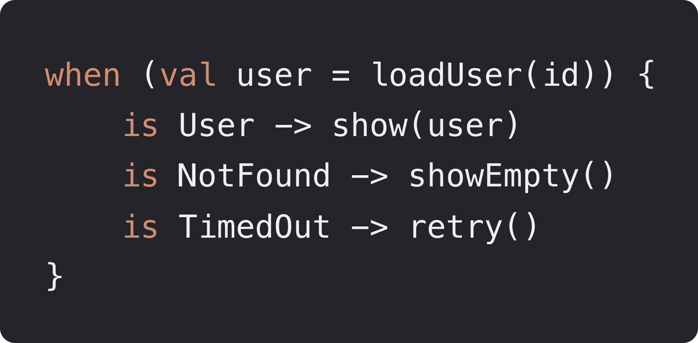{width=100 align=center}

이게 전부다. `when`과 스마트 캐스트다. `is User` 분기 안에서는 `user`가 이미 `User`라서 꺼낼 것도 캐스팅할 것도 없다. 세 갈래를 다 다루지 않으면 컴파일러가 잡는다. 새로 배울 건 `error` 키워드와 파이프뿐이고 나머지는 이미 아는 Kotlin이다. 앞에서 본 Arrow의 학습 비용을 기억하면, 이 설계가 라이브러리가 아니라 언어 차원이어야 했던 이유가 여기 있다.

다만 반환 타입을 바꾼다고 기존 `withTimeoutOrNull`이 두 실패를 알아서 구분해 주지는 않는다. 이미 `null`로 합쳐진 결과에 이름을 붙여봐야 어느 경우였는지 알 수 없다. 조회에서 "없음"을 만드는 지점과 시간 제한이 끝나는 지점에서 각각 다른 error 값을 돌려주도록 구현을 고쳐야 한다. **타입은 보존할 정보의 형태를 정해주고, 그 정보를 올바르게 만드는 책임은 구현에 남는다**.

### 아무 타입이나 묶이는 건 아니다

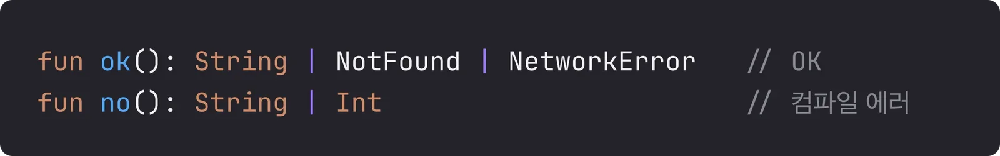{width=100 align=center}

오해를 하나 막고 가자. 파이프로 아무 타입이나 묶을 수 있는 건 아니다. `String | NotFound`는 되지만 `String | Int`는 컴파일 에러다. 파이프에 참여할 수 있는 건 `error`로 선언한 타입뿐이고, 에러가 아닌 타입은 최대 하나이며 가장 왼쪽에 쓴다.

성공 타입이 꼭 있어야 하는 것도 아니다. 공통 에러 처리 함수의 인자처럼 `TimeoutError | ServerError`만 묶을 수도 있다. 반대로 `User? | NetworkError`처럼 성공 쪽에 nullable을 둘 수도 있다. 이 경우 `null`은 계약상 허용한 결과이고 네트워크 실패는 별개의 값이라 둘이 섞이지 않는다. 명세의 Goals에 "null이 에러와 값 양쪽으로 쓰일 때의 모호함을 해소한다"가 적혀 있는데, 오프닝의 문제가 바로 이것이다.

### 왜 이렇게까지 제한했을까

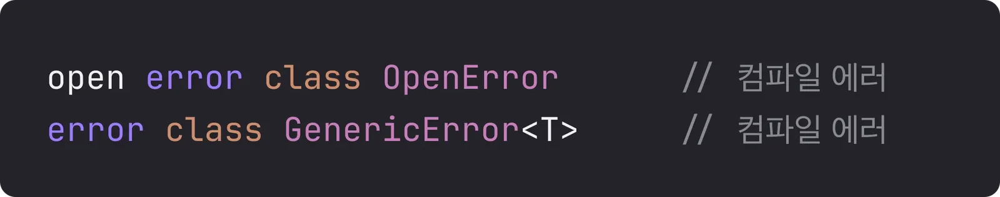{width=100 align=center}

제한은 더 있다. error 타입은 상속이 안 되고 제네릭이 안 된다. 모든 error는 final이고 타입 파라미터를 가질 수 없다. 사용자 정의 상위 클래스나 인터페이스도 못 갖는다. 그래서 `HttpError` 같은 공통 부모로 묶는 게 불가능하다. 대신 typealias로 묶으라고 한다.

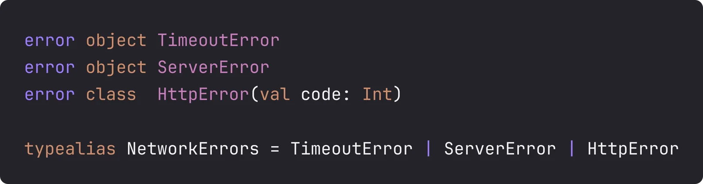{width=100 align=center}

typealias는 새 부모 타입을 만드는 게 아니라 기존 타입 집합에 이름을 붙이는 것이다. 같은 `TimeoutError`를 사용자 조회의 에러 집합과 파일 다운로드의 에러 집합에 각각 넣을 수 있다는 점이 중요하다. 상속으로는 안 되는 일이다.

공통 부모에 익숙한 입장에서는 꽤 답답한 제한이다. 왜 이렇게까지 막았을까. 이유는 둘이다.

첫째, 아무 타입이나 묶으면 그 값으로 할 수 있는 게 없어진다.

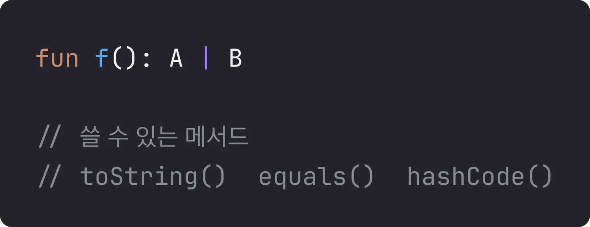{width=100 align=center}

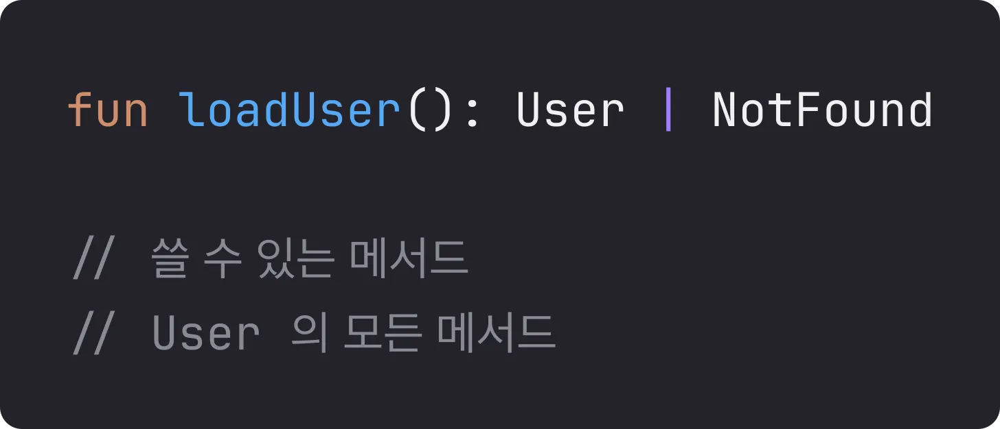{width=100 align=center}

`String | Int`를 받았다고 해보자. `String`도 아니고 `Int`도 아니니 쓸 수 있는 건 `Any`의 메서드뿐이다. `toString`, `equals`, `hashCode`. 반면 Rich Errors는 값이 하나로 정해져 있고 나머지는 전부 에러다. 에러만 걸러내면 남는 게 값 그 자체다. `Result<User>`는 그렇지 않았다. 꺼내는 단계가 있느냐 없느냐, 이게 차이다.

둘째, 컴파일러가 못 버틴다. 유니언을 자유롭게 열어두면 타입 추론 비용이 감당이 안 된다. 명세의 Goals에 "타입 추론 알고리즘이 다항 시간이고 모호하지 않게 유지되도록 한다"가 적혀 있다.

명세는 이 제약의 이유를 한 문단으로 직접 적어놨다. 발표에서 형광펜으로 세 군데만 칠했던 대목이다.

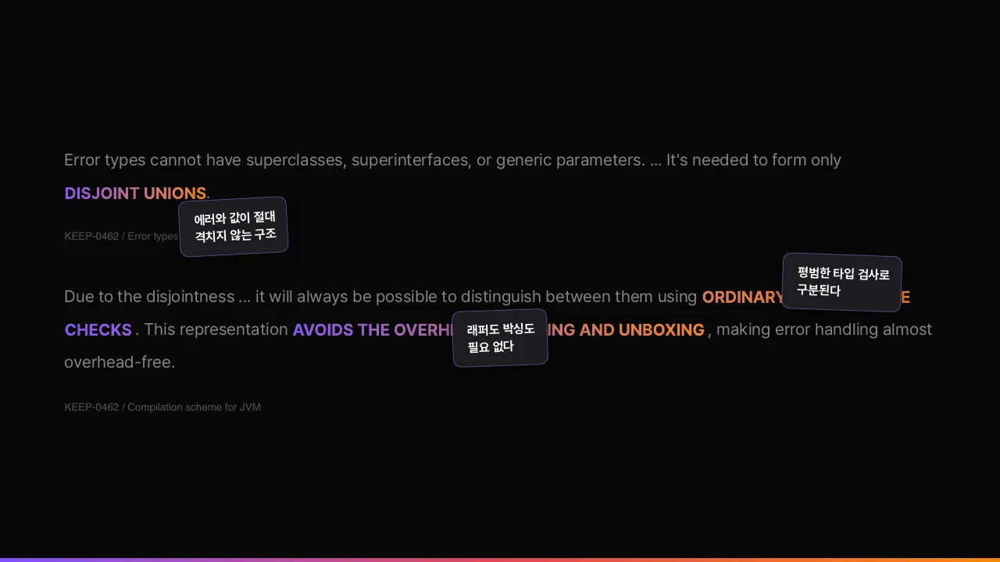{width=100 align=center}

세 비트가 하나의 인과로 이어진다. 에러와 값이 절대 겹치지 않는 구조를 만든다. 명세의 표현으로는 disjoint union이다. 어떤 값도 값이면서 동시에 에러일 수 없다. `User`이면서 `NotFound`인 값은 존재하지 않는다. 겹치지 않으니 평범한 타입 검사만으로 둘을 구분할 수 있다. `is` 한 번이면 성공인지 실패인지 갈린다. 그러면 감쌀 필요가 없다. `Either`는 성공이든 실패든 `Left`나 `Right` 상자를 만들어 넣지만, `User | NotFound`는 성공이면 `User` 그 자체, 실패면 `NotFound` 그 자체다.

[JVM에서는](https://github.com/Kotlin/KEEP/blob/main/proposals/KEEP-0462-rich-errors.md#compilation-scheme-for-jvm) 유니언을 `Object`로 표현하되 실제 객체를 그대로 전달한다. 다만 `Int` 같은 원시 값은 박싱이 필요하다는 단서가 있다. 그러니 "에러 처리가 공짜"가 아니라 "유니언을 위한 추가 래퍼를 없앤다"가 정확하다. 명세도 "거의" overhead-free라고 쓴다.

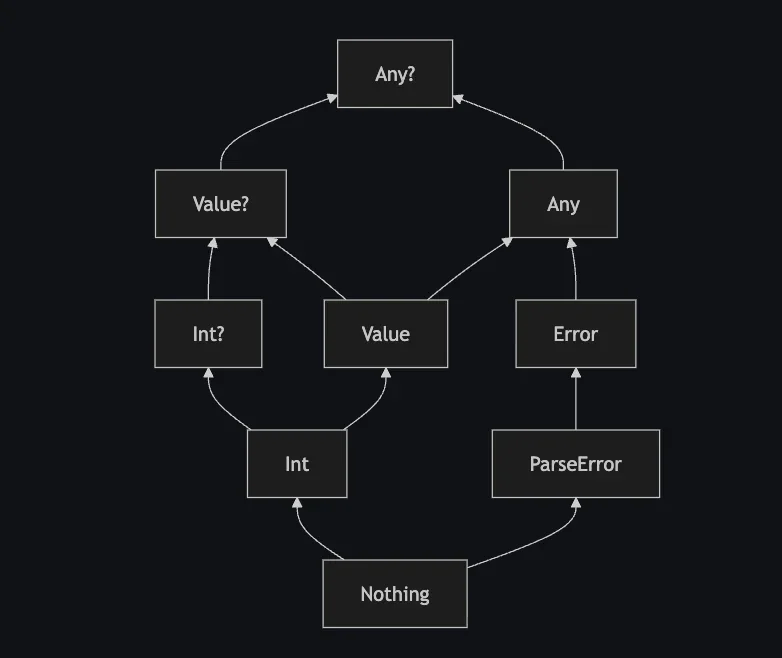{width=100 align=center caption="KEEP의 타입 관계도. 에러가 아닌 모든 타입의 공통 상위 타입으로 Value라는 이름이 새로 생긴다. Value와 Error는 둘 다 Any 아래에 있으니 위로는 만나지만, 하나의 객체가 두 범주에 동시에 속할 수는 없다. Value는 실제 클래스가 아니라 컴파일러가 특별 취급하는 인터페이스이고, value class와는 아무 관계가 없다. 명세도 이 혼동을 인정하면서 더 나은 이름은 미해결 문제라고 적었다."}

**표현력을 깎아서 이 둘을 산 것이다**. 이 거래를 이해하면 앞의 제약이 전부 납득된다.

### 예외는 없어지지 않는다, 경계가 나뉜다

그럼 예외는 없어지는가. 아니다. 경계가 나뉜다.

`require(name.isNotBlank())`가 실패하는 건 예외다. 호출자가 할 수 있는 게 없다. 코드를 고쳐야 하는 상황이다. 반면 사용자가 없거나 네트워크가 끊긴 건 에러다. 호출자가 다르게 행동해야 한다. 빈 화면을 그리든 재시도를 하든. 기준은 하나다. **호출자가 이걸 알고 다르게 행동할 수 있는가**. 있으면 에러, 없으면 예외다. 명세의 Goals 마지막 항목이 이것이다. 예외와 풍부하고 예측 가능한 에러를 명확히 구분한다.

설계 원칙을 네 줄로 정리하면 이렇다. 값처럼 다룬다. 복구 가능한 실패에만 쓴다. `when`이 exhaustive해야 한다. 컴파일이 느려지지 않게 한다. 방금 본 제약이 전부 네 번째 줄에서 나온다.

## `|.`로 연결하면 에러가 쌓인다

### 여러분의 `?.`는 그대로다

먼저 안심할 것이 있다. 기존 `?.`는 한 글자도 안 바뀐다. 대신 error-safe call이라는 새 연산자 `|.`이 생긴다. 원리는 `?.`와 같다. 앞이 에러면 멈추고 그대로 흘려보낸다.

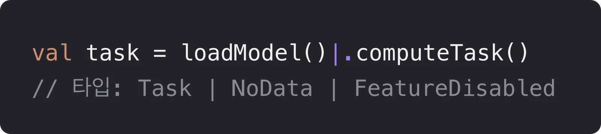{width=100 align=center}

`loadModel()`의 반환 타입이 `Model | NoData`이고, `Model.computeTask()`가 `Task | FeatureDisabled`라고 하자. 둘을 이으면 이렇게 읽힌다.

- `loadModel()`이 `NoData`를 돌려주면 `computeTask()`는 실행되지 않고 그 실패가 결과로 남는다.
- `Model`을 얻었으면 다음 함수를 부르고 `Task` 또는 `FeatureDisabled`를 돌려준다.

최종 타입은 `Task | NoData | FeatureDisabled`다. 그리고 여기가 재미있는 부분이다. 챕터 1에서 `?.` 체인의 문제를 봤다. `fetch()?.charge()`에서 어느 쪽이 실패했는지 `null` 하나로 뭉개진다고. 파이프 점은 반대로 간다. **에러가 뭉개지는 게 아니라 쌓인다**. 그리고 이 목록을 내가 적은 게 아니다. 컴파일러가 두 함수를 보고 조합한 것이다.

"에러가 쌓인다"의 뜻을 정확히 해두자. 발생 가능한 에러 타입의 목록이 합쳐진다는 뜻이지, 실행 중 생긴 에러 여러 개를 리스트에 모은다는 뜻이 아니다. 앞 단계가 실패하면 뒷단계는 실행되지 않으니 이 계산의 결과는 하나다.

그래서 뭐가 좋은가. 중간에 함수를 하나 더 끼우면 타입이 알아서 늘어난다. 새로 생긴 실패를 안 다룬 곳은 컴파일 에러가 된다. 파이프라인이 길어져도 실패 목록이 저절로 최신 상태로 유지된다. sealed class로는 이게 안 된다. 단계를 추가할 때마다 계층을 손으로 고쳐야 한다. 물론 `else`로 다 묶거나 `Any`로 넓혀버리면 이 피드백을 포기하게 된다.

### 체인 안의 전파와 함수의 조기 반환은 다르다

하나 구분할 게 있다. `|.`은 체인의 다음 호출을 건너뛰는 연산자지 현재 함수를 끝내는 연산자가 아니다. 체인의 결과가 error여도 그다음 줄은 계속 실행된다. Rust의 `?`처럼 함수 밖으로 던져 올리는 문법은 없다. 대신 명세는 `ifError { return it }` 같은 표준 함수를 제안한다. 실패면 error를 호출자에게 넘기고 함수가 끝난다. 성공이면 그 뒤에는 성공 값이 남는다. 뒤의 실제 호출부에서 이 차이를 다시 본다.

### 왜 `?.`를 재사용하지 않았나

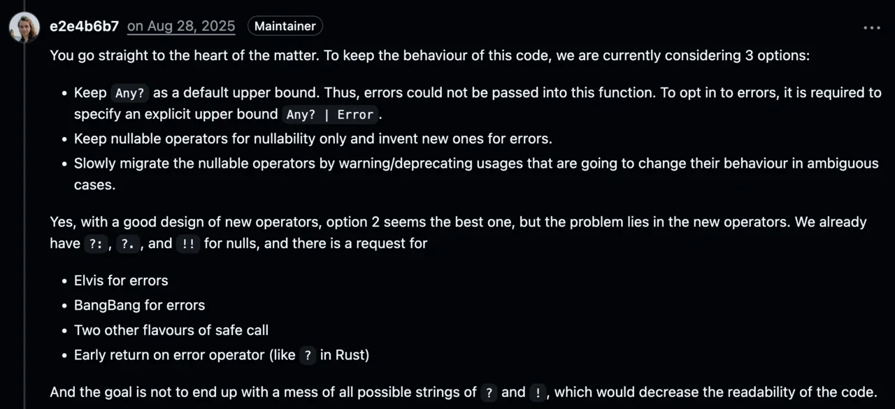{width=100 align=center caption="에러 전파 문법의 대안을 논의한 기록. 처음에는 ?.를 재사용하려 했고 그다음엔 !.이 후보였다. 마지막 문장이 핵심인데, 물음표와 느낌표 조합이 뒤죽박죽되는 것을 피하는 게 목표라고 적혀 있다."}

`?.`를 못 쓰게 된 이유는 타입 계층 때문이다. 현재 설계에서 Error는 `Any`의 하위 타입이라 `Any?`로 다루는 값 안에도 error가 들어갈 수 있다. 그 상태에서 `?.`의 의미를 error까지 건너뛰도록 바꾸면, 소스 코드는 한 글자도 안 고쳤는데 실행되는 함수가 달라진다. 그래서 [명세는](https://github.com/Kotlin/KEEP/blob/main/proposals/KEEP-0462-rich-errors.md#why-existing-nullability-operators-cannot-be-reused) 모호함과 호환성 문제를 피하려고 기존 nullability 연산자를 에러 처리로 확장하지 않는다고 못 박는다.

`!.`을 안 고른 이유는 명세의 다른 절에 있다. 느낌표는 Kotlin에서 이미 `!!`처럼 위험한 연산의 신호로 쓰이고 있어서, 안전하게 실패를 전달하는 연산에 같은 기호를 쓰지 않았다. 유니언을 나타내는 `|`와 연결한 것이다. 기호 하나 고르는 데도 호환성과 일관성이 걸려 있다.

### 같은 에러가 두 곳에서 온다면

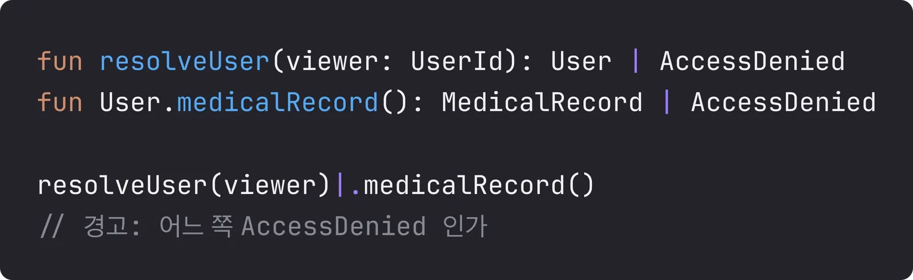{width=100 align=center}

실패에 타입을 붙였다고 출처까지 보존되는 건 아니다. `resolveUser()`와 `medicalRecord()`가 모두 `AccessDenied`를 돌려주면, 둘을 이은 결과의 `AccessDenied`만으로는 사용자를 못 찾아서 거부된 건지 의무기록 접근이 거부된 건지 알 수 없다. 오프닝의 `null` 모호함이 같은 에러 타입에서 다시 나타나는 것이다. 명세는 이 예시를 직접 들면서, 서로 다른 출처의 같은 에러가 `|.` 체인에서 합쳐지면 [traceability 경고](https://github.com/Kotlin/KEEP/blob/main/proposals/KEEP-0462-rich-errors.md#error-traceability)를 낸다고 정한다. 출처에 따라 처리가 달라야 한다면 호출을 나눠 각각 다루거나, 경계에서 더 구체적인 에러로 바꾸면 된다.

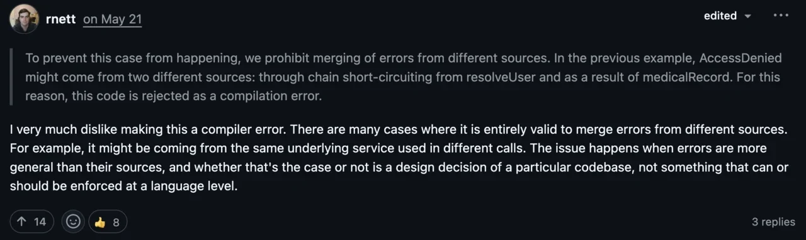{width=100 align=center}

그런데 이게 설계 토론 #487에서 표를 가장 많이 받은 반론이다. 요지는 이렇다. 서로 다른 출처의 에러를 합치는 게 타당한 경우가 많다. 두 호출이 같은 하부 서비스를 쓰고 있으면 거기서 나온 같은 에러를 굳이 구분할 이유가 없다. 그리고 에러를 구분해야 하는지 아닌지는 그 코드베이스의 설계 결정이지, 언어가 강제할 수 있거나 강제해야 할 일이 아니라는 것이다.

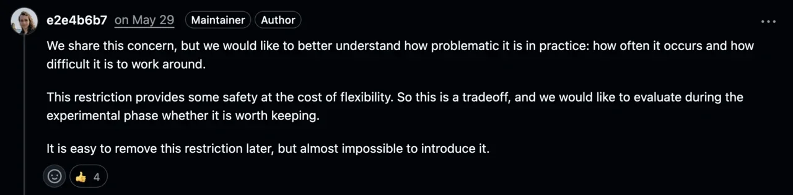{width=100 align=center}

언어팀은 우려에 공감하지만 실무에서 얼마나 자주 일어나고 우회가 얼마나 어려운지 알고 싶다고 답했다. 안전성과 유연성의 트레이드오프이고, 실험 단계에서 유지할 가치가 있는지 평가하겠다고. 그리고 마지막 문장이 언어 설계의 원칙을 보여준다. 제약은 나중에 푸는 건 쉽지만, 나중에 넣는 건 거의 불가능하다. 그래서 일단 조이고 시작한다는 것이다.

그리고 두 달 뒤인 7월 31일, 이 제약이 실제로 컴파일 에러에서 경고로 내려갔다. 반론 때문인지는 모른다. 커밋 메시지에 그런 언급은 없다. 다만 본인이 말한 "풀긴 쉽다"를 직접 실행한 셈이다. 위 반론 캡처의 회색 인용 블록에는 컴파일 에러라고 적혀 있는데, 이건 캡처 당시 명세의 문장이고 지금은 사실이 아니다. 경고는 무시할 수 있고 CI에서 `-Werror`를 켜면 다시 에러가 되니, 판단 책임이 언어에서 개발자에게 넘어갔다고 보는 게 정확하다.

개인적으로는 이 논의가 Rich Errors의 핵심을 잘 보여준다고 생각한다. 타입이 우리 대신 결정할 수 있는 것과 도메인을 아는 사람이 결정해야 하는 것은 다르다. 컴파일러는 "같은 타입이라 구분할 수 없다"까지는 알려줄 수 있지만, "이 두 실패를 반드시 다르게 처리해야 한다"는 답까지는 모른다.

### 여기까지를 한 장으로

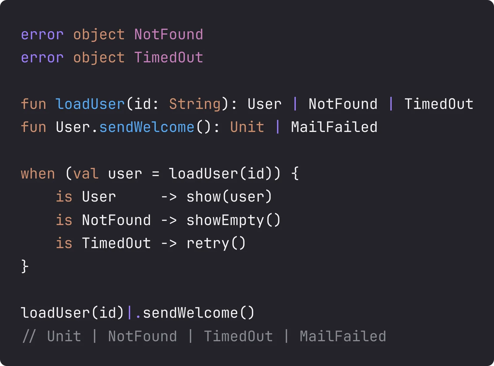{width=100 align=center}

새 문법은 `error`, `|`, `|.` 셋뿐이다. 나머지는 이미 아는 Kotlin이다. 대신 상속도 제네릭도 못 쓴다. 그게 방금 본 거래다.

## 실제 Android 앱 세 개에 적용하면

먼저 분명히 해둘 것이 있다. 이 문법은 오늘 못 쓴다. Kotlin 2.4.0에도 2.4.20에도 없다. 그런데 발표 나흘 전인 8월 12일, 언어팀이 실제 Android 오픈소스 앱 세 개를 직접 뜯어서 Rich Errors가 실제 코드에서 어떻게 쓰일지 검증한 문서를 올렸다. [Design Notes 0009](https://github.com/Kotlin/KEEP/blob/main/notes/0009-rich-errors-use-cases.md)다.

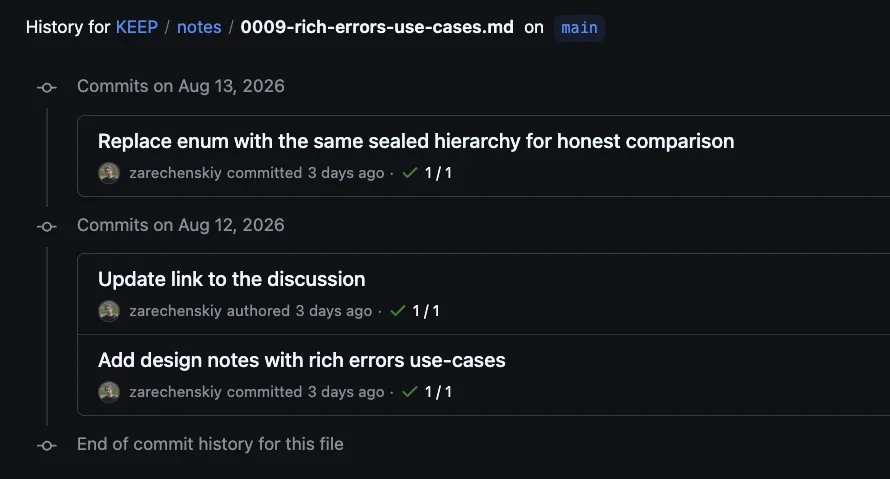{width=100 align=center caption="notes/0009의 커밋 기록. 모든 예제에 원본 코드의 고정 커밋 링크가 달려 있어서 분석 시점을 확인할 수 있다."}

대상은 프라이버시 브라우저 DuckDuckGo(Gradle 모듈 약 100개), 플래시카드 암기 앱 AnkiDroid, 종단간 암호화 메신저 Signal이다. 유명해서 고른 게 아니라 코드가 공개돼 있어서 실제로 세어볼 수 있었기 때문이다.

이 자료를 읽을 때는 전제를 먼저 봐야 한다. 세 앱이 Rich Errors로 전환했다는 보고서가 아니다. **이미 null, sealed 타입, 콜백으로 실패를 값처럼 다루던 코드를 같은 의도로 다시 표현하면 어떻게 달라지는지** 비교한 설계 검토다. 기존 아키텍처가 잘못됐다고 판정하는 자료도, 성능을 실측한 자료도 아니다. 그중 발표에서는 세 가지 패턴과 호출부 하나를 골랐다. 특정 앱을 알아야 이해할 수 있는 문제가 아니라, 우리가 매일 쓰는 저장소와 ViewModel에서 만나는 모양이기 때문이다.

### 1. 실패 하나를 적으려고 성공까지 감쌌다

첫 사례는 DuckDuckGo에서 브라우저 요청에 커스텀 헤더를 붙여도 되는지 판단하는 함수다. 허용된다면 "된다"는 답과 함께 어떤 설정을 쓸지도 돌려줘야 한다. 그래서 `Boolean`으로는 안 끝난다.

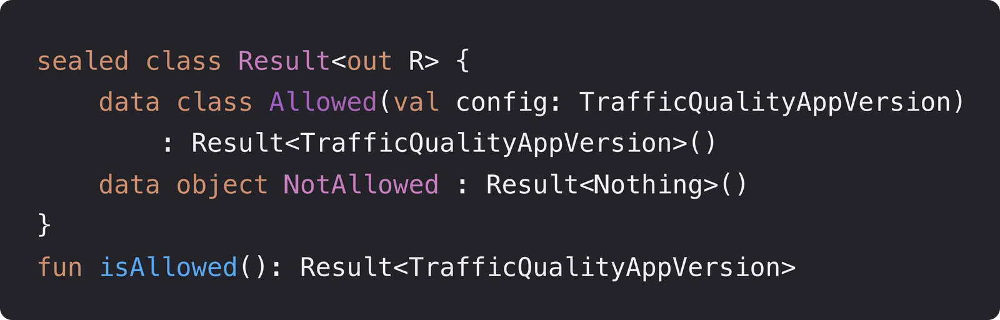{width=100 align=center}

기존 코드는 `Allowed`와 `NotAllowed`를 sealed class에 넣었다. 실제로 필요한 성공 데이터는 `TrafficQualityAppVersion`인데, 돌려주는 건 그걸 담은 `Allowed`다. sealed는 자기 자식만 받으니, 이미 다른 데서 쓰는 설정 클래스를 이 계층의 자식으로 만들 수 없어서 상자를 만들어 넣은 것이다. 상자를 만들었으니 호출부에서는 매번 `result.config`로 열어야 한다.

인과를 정리하면 이렇다. 성공에 데이터가 딸려 있다, 그래서 `Boolean`으로는 부족하다. 둘을 한 타입에 담아야 한다, 그래서 sealed class다. sealed는 자식만 받는다, 그래서 `Allowed` 상자가 필요하다.

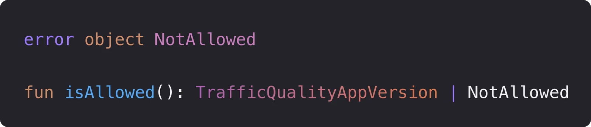{width=100 align=center}

제안된 형태에서는 선언이 한 줄로 끝난다. `error object NotAllowed`. 그리고 `TrafficQualityAppVersion`은 감싸지 않고 그대로 있다. **sealed는 내 자식만 들어오라고 하고, 유니언은 그냥 옆에 놓는다**. 그래서 세 가지가 한꺼번에 사라진다. 상자가 사라지고, 호출부에서 꺼내는 코드가 사라지고, 표준 라이브러리와 겹치던 `Result`라는 이름도 사라진다. 재사용을 기대하고 붙였다가 한 타입에만 쓰이던 제네릭 파라미터도 같이 없어진다. 시그니처를 그대로 읽으면 계약이 나온다. 설정값을 주거나, 허용 안 됨이거나.

이게 모든 래퍼가 불필요하다는 뜻은 아니다. 성공에 생성 시각이나 출처 같은 추가 의미를 붙여야 한다면 별도 타입이 여전히 유용하다. 여기서 줄어드는 건 결과 계층에 맞추기 위해서만 존재하던 래퍼다.

### 2. 값은 반환하고 에러는 콜백으로 나간다

두 번째는 AnkiDroid에서 클립보드의 미디어를 노트에 등록하는 함수다. 성공하면 등록된 미디어를 가리키는 문자열을 돌려주고, 실패하면 사용자에게 안내해야 한다.

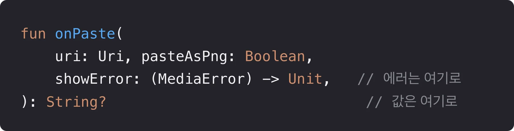{width=100 align=center}

Android에서 정말 흔한 모양이다. 값은 반환 타입으로 나가고, 에러는 `showError` 콜백으로 따로 나간다. 화면에 스낵바를 띄워야 하니 콜백을 받는 것이다. 호출부는 콜백 안에 스낵바 코드를 넣고, 호출 뒤에 `?: return` 같은 제어 흐름을 쓴다.

문서의 지적이 날카롭다. 타입 시스템이 이 두 통로의 일관성을 검증할 수 없다. 콜백을 안 부르고 `null`만 돌려줘도 컴파일되고, 콜백을 부르고 나서 값을 돌려줘도 컴파일된다. 실패하는 모든 헬퍼가 매번 두 가지를 다 해야 하는데 하나만 빠뜨려도 아무도 잡아주지 않는다. 허용하면 안 되는 상태가 시그니처에 그대로 열려 있는 것이다.

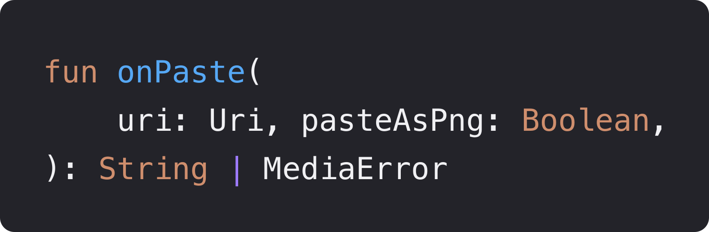{width=100 align=center}

콜백 파라미터가 사라졌다. 값도 에러도 반환 타입 하나로 나온다. 이제 값을 주거나 에러를 주거나 둘 중 하나만 가능하다. 콜백만 부르고 값을 돌려주는 상태는 애초에 표현이 안 된다. **개발자가 지켜야 했던 걸 이제 타입이 강제한다**.

하나 더 있다. 원래는 에러를 어떻게 보여줄지가 이 함수 안에 박혀 있었다. 스낵바를 띄우라고 콜백을 넘겼으니까. 이제 그건 호출자가 정한다. 같은 등록 로직을 화면에서도 백그라운드 작업에서도 재사용한다고 생각해 보면, 화면은 메시지를 띄우고 백그라운드는 로그를 남기거나 작업 상태를 갱신하면 된다. 등록 함수가 알 필요가 없는 표시 정책이 호출자에게 돌아간다. 읽는 순서도 제자리를 찾는다. 아까는 에러 처리가 인자 목록 안에 있고 제어 흐름은 호출 뒤에 있어서 뒤집혀 있었는데, 이제는 부르고, 실패를 처리하고, 다음으로 간다.

오프닝의 `loadUser(id): User?`와 같은 문제다. 반환 타입이 실패를 못 담으니 다른 통로를 뚫은 것이다.

### 3. 이름만 같고 다른 타입

세 번째는 Signal의 등록 API 파일 하나다. 엔드포인트 스무 개쯤에 sealed error 계층이 열일곱 개 있다. 엔드포인트마다 하나씩이다.

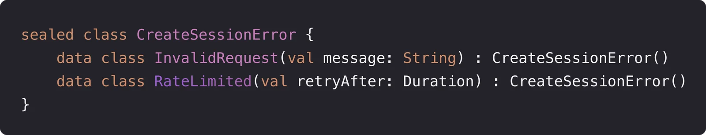{width=100 align=center}

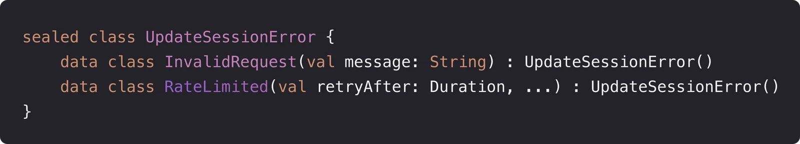{width=100 align=center}

`RateLimited`가 두 번 보인다. 이름만 같고 다른 타입이다. sealed 하위 클래스는 자기 부모에만 속하니까. 이 파일에서 `RateLimited`는 아홉 번, `InvalidRequest`는 열한 번 따로 선언돼 있다.

{width=100 align=center}

그래서 "어떤 `RateLimited`든 처리하는 함수"를 못 만든다. 파라미터에 적을 타입이 없다. "부모 타입으로 받으면 되지 않나"라는 반론이 나올 수 있다. 실제 코드에서 두 sealed class는 `BadRequestError`를 공통으로 구현한다. 하지만 그걸로 받으면 `RateLimited`인지 `InvalidRequest`인지 구분이 안 되고 `retryAfter`도 못 읽는다. 미리 만들어둔 부모가 있어도 지금 필요한 묶음과 일치하지 않으면 쓸모가 없다. 별도 인터페이스나 매핑 계층을 설계하면 풀 수는 있지만 또 하나의 조합 장치가 필요해진다.

Rich Errors에서는 에러를 한 번만 선언하고 typealias로 조합한다. 그러면 `handleRateLimited(e: RateLimited)`가 만들어진다. 물음표 자리가 채워지는 것이다. 재시도 로직을 한 번만 짜면 스무 개 엔드포인트가 같이 쓴다. 에러를 추가하거나 빼는 것도 typealias에서 토큰 하나 바꾸는 일이 된다.

다만 "이름이 같으니 합친다"로 끝내서는 안 된다. 실제 코드의 `RateLimited`에는 엔드포인트에 따라 추가 데이터가 있고, 재시도해도 되는지는 작업의 성격을 봐야 한다. Rich Errors는 공유를 쉽게 표현하게 해줄 뿐, 서로 다른 의미를 자동으로 같게 만들어주지는 않는다. 이 이야기는 뒤에서 다시 나온다.

### 4. 그래서 호출부가 어떻게 되나

선언부만 보면 "그래서 내 코드가 뭐가 좋아지는데"가 안 풀린다. 호출부를 보자. 마스터 키를 복구한 뒤 등록을 진행하는 ViewModel 코드를 줄인 것이다.

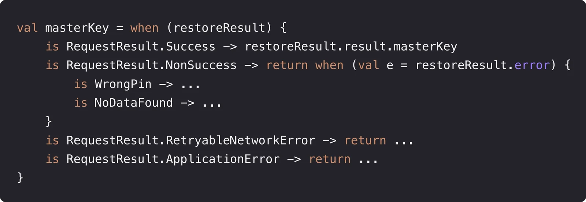{width=100 align=center}

`when` 안에 `when`이 들어 있다. 바깥은 `RequestResult` 래퍼를 벗기는 `when`, 안쪽은 진짜 도메인 에러를 고르는 `when`. 분기가 두 층이다. 성공 경로를 따라가려면 `Success`, 그 안의 `result`, 그 안의 `masterKey` 순서로 읽어야 한다. 실패도 도메인 실패와 전송 실패가 서로 다른 층에 있다.

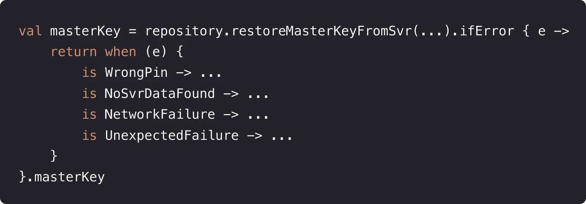{width=100 align=center}

아래는 한 층이다. `ifError` 하나로 에러를 걸러내고, 그 뒤에서 값이 스마트 캐스트되니 꺼내는 코드가 사라진다. 핵심은 `ifError` 블록이 정상적으로 값을 돌려주며 끝나지 않는다는 점이다. 안에서 `return` 하니 이 경로의 타입이 `Nothing`이고, 그 뒤에는 성공 값이 남는다는 정보를 컴파일러가 쓸 수 있다. 단순히 `ifError { log(it) }`처럼 로그만 남기고 계속하는 것과는 다르다. 로그를 썼다고 실패가 성공 데이터로 바뀌지는 않는다.

그리고 `NetworkFailure` 같은 전송 에러를 두 단계가 같이 쓴다. 방금 본 이야기다. 공통 어휘로 선언해뒀으니 어느 단계에서 오든 같은 분기로 받는다. 진짜 차이는 여기서 난다. 중간에 호출을 하나 더 끼워보자. 위쪽 방식은 네 갈래짜리 `when` 피라미드가 하나 더 생긴다. 아래쪽은 타입에 에러가 하나 더 쌓이고 끝이다. 참고로 원래 함수는 120줄쯤 된다.

한 가지 주의할 것. 이 예시에 `NetworkFailure`와 `UnexpectedFailure`가 값으로 남아 있는 건 언어팀이 기존 아키텍처의 의도를 보존한 채 비교했기 때문이다. "모든 예외를 error 값으로 바꾸라"는 공식 지침으로 읽으면 안 된다. 반환 방식의 개선과 실패의 분류는 별개의 판단이다.

### 만든 사람이 적어놓은 한계

마지막으로 하나. Signal도 이 중복 문제를 알고 있었다. 그래서 자체 범용 래퍼를 만들었다. `NetworkResult.kt`, 469줄에 함수 스물아홉 개다. 그런데 그 파일의 KDoc에는 이런 취지의 문장이 적혀 있다. 에러에 따라 응답 종류가 아주 많은 복잡한 요청이라면 이건 당신을 위한 게 아니고, 직접 sealed class를 만드는 편이 낫다고.

자기가 만든 도구의 한계를 자기가 적어놓은 것이다. 그래서 같은 코드베이스 안에 범용 래퍼 하나와 직접 만든 sealed result/error/failure 타입 125개가 나란히 돌아간다. 한 회사 안에서 챕터 1이 다시 일어난 셈이다. 나는 이 숫자를 "고쳐야 할 나쁜 코드의 개수"가 아니라 **실패를 정확히 표현하려고 사람들이 이미 지불하고 있던 비용**으로 읽는다. Rich Errors가 줄이려는 것도 그 정확성을 포기하게 만드는 표현 비용이다.

## 좋은 점만큼 알아둬야 할 것

### 아직 못 쓴다, 그리고 바뀔 수 있다

[KT-68296](https://youtrack.jetbrains.com/issue/KT-68296)에는 Experimental 2.5.0 목표가 적혀 있다. 하지만 언어팀이 날짜를 약속한 적은 없다. 설계 토론에서 나온 말은 "서두르지 않는다"와 "갈 길이 멀다"뿐이다. 설계 명세의 상태도 여전히 Public discussion이다. "2.5.0에 들어간다"가 아니라 "2.5.0을 목표로 검증 중이다"가 정확하다. 발표에서도 말했지만 이 글의 절반은 몇 달 뒤면 낡을 수 있다. 살아 있는 설계다. 명세 안에서도 negative smart cast 같은 일부 기능은 구현 복잡도 때문에 error union보다 늦게 나올 수 있다고 적혀 있다.

### 실패를 적었다고 예외가 없어지지는 않는다

`User | NotFound`라는 반환 타입이 있어도 구현 버그나 다른 예외는 여전히 생긴다. error union은 명시적으로 돌려줄 실패의 집합을 표현하지, 함수에서 일어날 수 있는 모든 런타임 사건을 증명하는 장치가 아니다. 예외 전파와 프레임워크의 예외 처리 경계는 계속 필요하다.

"결국 checked exception 아니냐"는 질문도 나온다. 실패를 계약에 적고 호출자가 고려하게 만든다는 목적은 닮았다. 차이는 셋이다. 전파가 가볍다. 예외처럼 스택을 타고 올라가지 않고 값으로 흐른다. 값이라 람다와 합성된다. checked exception이 람다와 최악이었던 게 Kotlin이 버린 이유였다. 복구 가능한 실패에만 쓴다. 예외는 그대로 남는다. 다만 이 반론은 토론에서도 반복해서 나왔고 아직 완전히 해소되지 않았다.

### 에러 집합의 합성과 검증 결과의 누적은 다르다

회원가입 폼에서 이름, 이메일, 비밀번호 오류를 한 번에 보여주고 싶다고 하자. `|.`로 이으면 첫 실패 뒤의 검사는 건너뛴다. "발생 가능한 실패가 세 가지다"와 "실제로 발생한 실패 세 개를 모은다"는 다른 요구다. 유니언은 여러 에러 중 하나가 오는 구조라 누적이 안 된다. error class에 오류 목록을 담는 모델링은 가능하지만 유니언이나 `|.` 자체가 그 일을 해주지는 않는다. Arrow의 `zipOrAccumulate`, `mapOrAccumulate` 같은 [도구](https://arrow-kt.io/learn/typed-errors/working-with-typed-errors/)가 여전히 의미 있는 영역이다. Rich Errors는 실패 하나를 시그니처에 드러내는 문제를 푸는 도구지 에러 처리 전반을 대체하지 않는다.

### 스택 트레이스와 타입은 다른 정보다

error 값에는 예외처럼 생성 지점의 스택 트레이스가 자동으로 붙지 않는다. 이건 Rich Errors만의 문제가 아니라 errors-as-values 방식 전체의 특성이다. `Result`도 `Either`도 마찬가지다. 애초에 예상한 실패에 쓰는 도구라, 스택 트레이스가 필요한 상황이면 그건 예외로 던져야 할 일에 가깝다. 추적이 필요하면 `error class NetworkError(val code: Int)`처럼 필요한 정보를 직접 담으면 된다. 기존 예외를 변환한 경우라면 원래 `Throwable`을 필드로 보관해서 스택 정보를 보존할 수도 있다. "값으로 다루면 스택 트레이스가 전부 없어진다"는 설명은 피하는 게 좋다.

### 공개 API에 에러를 추가하는 것도 변경이다

앱 내부에서는 에러 하나를 추가했을 때 호출부가 컴파일되지 않는 게 유용한 피드백이다. 외부에 배포한 라이브러리에서는 같은 일이 호환성 문제가 된다. 기존 사용자는 이전의 실패 목록을 기준으로 코드를 썼기 때문이다.

Java 쪽도 마찬가지다. Java 입장에서는 유니언 반환 타입이 그냥 `Object`라 뭘 처리해야 하는지 알 수 없고, 아무 객체나 넘길 수 있어 위험하다. 그래서 현재 [JVM 설계](https://github.com/Kotlin/KEEP/blob/main/proposals/KEEP-0462-rich-errors.md#interoperability-with-java)는 error union이 있는 함수의 이름을 mangling해서 Java에서 직접 부르지 못하게 감추고, error union을 예외로 매핑해 주는 어댑터 플러그인으로 노출하는 방향이다. 레거시 Java 코드가 남은 팀과 라이브러리 작성자에게는 큰 이야기다. 에러 집합의 변경은 현재 mangling 방식에서 바이너리 호환성에도 영향을 주니, typealias 뒤에 숨겼다고 이 문제가 없어지지 않는다.

## AI가 sealed class를 다 만들어주는데, 그래도 필요할까

여기까지 읽으면서 이 생각을 한 분이 있을 것이다. 나도 했다. 챕터 1에서 sealed의 문제가 장황하고 반복적이라는 것이었는데, AI가 몇 초 만에 만들어주면 그 비용은 사라진 게 아닌가?

정직하게 답해보면, 사라진 건 만드는 비용뿐이다. 읽는 비용과 이해하는 비용은 그대로다. 그리고 하나가 더 나빠졌다. 아까 Signal을 떠올려 보자. 사람이 손으로 짰는데도 `RateLimited`가 아홉 번 생겼다. AI는 프로젝트 전체를 보고 짜지 않는다. 이 함수에 필요한 에러 타입을 그때그때 만든다. 기존 에러 어휘와 경계를 전달하지 않은 채 함수 하나씩 구현을 맡기면, 각 함수만 보면 그럴듯한 결과 타입이 여러 개 생긴다. AI가 항상 중복을 만든다는 뜻이 아니다. 우리가 준 맥락이 좁으면 결과도 그 범위 안에서 최적화된다는 뜻이다. 생성 속도가 빨라질수록 이 차이를 뒤늦게 정리하는 일도 커진다. **만드는 비용은 사라졌지만 의미의 비용은 사라지지 않았다**.

### 명세를 먼저, 실행은 맡긴다

Anthropic의 [Opus 5 프롬프팅 가이드](https://platform.claude.com/docs/en/build-with-claude/prompt-engineering/prompting-claude-opus-5)에 이런 문장이 있다.

> \[Opus 5\] performs best when given the complete task specification up front and left to run.

완전한 작업 명세를 먼저 주고 그다음은 맡겨둘 때 가장 잘한다는 뜻이다. 실제로 예전 모델을 위해 넣었던 재검증 지시는 이제 빼라고 한다. 시키지 않아도 알아서 검증하는데 또 시키면 과잉 검증과 비용만 늘어난다고.

그런데 이 문장에서 중요한 건 뒤가 아니라 앞이다. left to run 앞에 조건이 붙어 있다. complete task specification. 작업을 어떻게 쪼갤지, 어떤 순서로 구현할지는 덜 알려줘도 된다. 하지만 무엇이 성공이고 무엇이 실패인지는 먼저 정의해야 한다. **우리가 걷어내고 있는 건 절차이지 계약이 아니다**. 이건 가이드가 Rich Errors의 효과를 입증한다는 말이 아니라, 발표에서 연결해보고 싶었던 내 해석이다. 그렇다면 완전한 명세에는 뭐가 들어가야 할까. 성공 조건만 적으면 절반이다. 실패했을 때 무엇을 해야 하는지도 들어 있어야 한다.

### 실패는 원인이 아니라 다음 행동으로 나뉜다

질문을 바꿔야 한다. "이건 무슨 에러지"가 아니라 "이게 일어나면 호출자는 뭘 해야 하지"로.

같은 404도 다르다. 사용자가 검색해서 못 찾은 404는 화면에 "결과 없음"을 그리면 되는 정상적인 도메인 분기다. 그런데 필수 설정 파일이 404면 그건 배포가 깨진 것이다. 같은 타임아웃도 조회에서는 재시도하면 되지만 결제에서는 이전 요청이 처리됐는지부터 확인해야 한다. 타임아웃이라는 이름만으로 재시도를 결정할 수는 없다. **실패는 기술적 사건이 아니라 도메인 판단이다**.

- **예상된 실패**: 호출자가 복구, 안내, 재시도 중 의미 있는 선택을 해야 한다. 값으로 돌려준다.
- **깨진 전제**: 이 계층에서 복구 정책을 정할 수 없다. 예외로 던져서 중단하고, 적절한 경계에서 기록하고 알린다.
- **취소**: 작업을 더 진행하지 말라는 제어 신호다. 즉시 위로 전달하고 절대 실패 값으로 바꿔 삼키지 않는다.

세 번째가 실무에서 제일 많이 틀린다. `runCatching { api.getUser(id) }`. 이걸 코루틴 안에서 무심코 쓰면 안 된다. [runCatching](https://kotlinlang.org/api/core/kotlin-stdlib/kotlin/run-catching.html)은 `Throwable`을 전부 잡는다. `CancellationException`까지. 취소가 실패로 둔갑해서 `Result.failure`가 되고, 그걸 기본값으로 바꾸거나 일반 오류로 처리하면 취소된 뒤에도 현재 코드가 다음 작업을 이어간다. 부모 Job의 취소 상태 자체가 없어지는 건 아니지만, [취소 예외의 전파](https://kotlinlang.org/docs/cancellation-and-timeouts.html)를 막고 정상 경로처럼 계속 실행할 수 있다는 게 문제다. `runCatching`을 코루틴에서 무조건 금지하자는 게 아니라, 취소와 일반 실패를 구분하지 않는 사용을 피하자는 것이다. 예외를 포괄적으로 잡아 변환한다면 `CancellationException`은 다시 던지는 정책이 있는지 확인해야 한다. 오프닝의 문제와 뿌리가 같다. 실패를 뭉뚱그리면 다음 행동을 정할 수 없다.

### 잡기 전에 정의한다

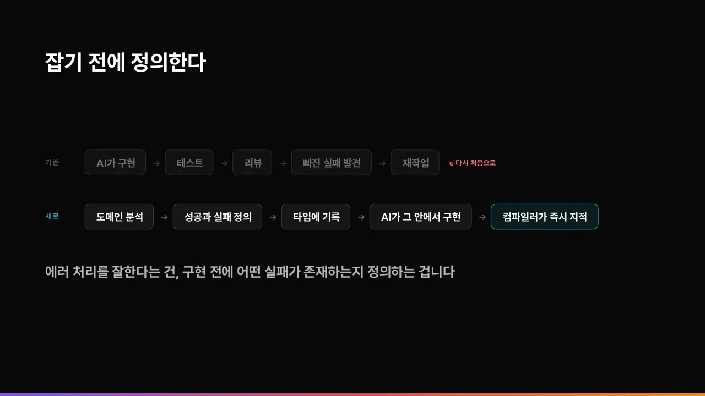{width=100 align=center}

보통 우리는 위쪽 순서를 밟는다. AI에게 시키고, 돌려보고, 테스트하고, 리뷰에서 빠진 실패를 찾는다. 그런데 리뷰는 생성 속도를 못 따라간다. 순서를 바꿔야 한다. 어떤 실패가 존재하는지 먼저 정하고, 그걸 타입에 적어두면, AI는 그 안에서 구현한다. 컴파일러가 마지막 감사자가 아니라 생성 과정에 참여하는 피드백 장치가 된다. **에러 처리를 잘한다는 건 에러를 잘 잡는 게 아니라, 구현 전에 어떤 실패가 존재하는지 정의하는 것이다**.

### 내 규칙 파일에는 뭐가 빠져 있었나

발표를 준비하며 내가 쓰는 AI 규칙 파일들을 다시 열어봤다. MVI 아키텍처 규칙이 있고, Compose 규칙이 있고, 디자인 시스템 규칙이 있고, 코드 스타일 규칙이 있었다. 그런데 에러 처리 규칙만 없었다.

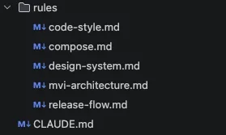{width=40 align=center}

아키텍처는 규약을 만들어놓고 에러 처리는 안 만든 것이다. 챕터 1에서 본 이야기가 내 저장소에도 그대로 있었다. 이 지점이 개인적으로 가장 오래 남았다. 새 문법이 없어서만 생긴 문제가 아니었다. `NotFound`의 의미, 예외를 값으로 바꾸는 경계, 취소를 다루는 기준 정도는 지금도 문서와 타입에 남길 수 있었다.

그래서 규칙을 적으면 된다. 오늘 당장 할 수 있고 효과도 바로 난다. 다만 문서로 끝나면 약하다. 문서는 안 읽힐 수도 있고, 읽고도 다르게 구현될 수 있다. 시그니처는 AI가 구현하는 과정에서 반드시 마주치는 계약이다. 문서가 지도라면 타입은 길 자체고, 컴파일러가 그 자리에서 알려준다.

- **규칙 문서** (AGENTS.md, CLAUDE.md): 찾을 수 있게 한다.
- **타입 시그니처** (`User | NotFound`): 방향을 제한한다.
- **컴파일러** (exhaustive `when`, must-use): 즉시 알려준다.

역할이 다르므로 하나가 다른 하나를 대체하지 않는다. AGENTS.md가 필요 없다는 말이 아니다.

### 좋은 타입은 압축된 도메인 지식이다

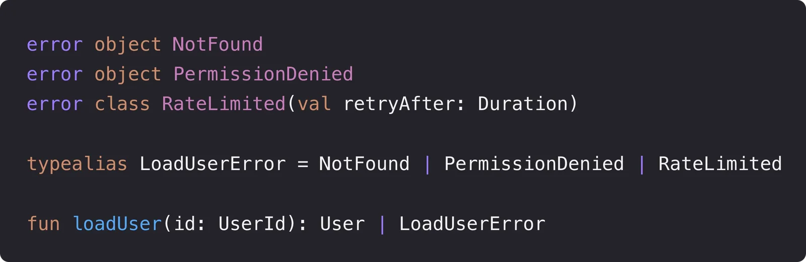{width=100 align=center}

마지막 줄 하나가 AI에게 이 전부를 준다. 무엇이 성공인지, 실패가 몇 가지인지, `RateLimited`면 `retryAfter`만큼 기다리면 된다는 것까지. 추측할 게 없다. Signal의 문제, `RateLimited`를 아홉 번 만들던 문제도 여기서는 안 생긴다. 공통 어휘로 한 번 선언해두면 AI도 그걸 쓴다.

물론 이 시그니처가 모든 걸 증명하지는 않는다. `retryAfter`가 있다는 사실만으로 자동 재시도가 안전하다는 것까지 보장하지 않고, 같은 이름의 에러를 어디까지 공유할지도 사람이 정해야 한다. `NotFound`를 돌려줘야 할 때 `PermissionDenied`를 돌려주는 구현도 둘 다 계약에 있으면 컴파일된다. 그래서 규칙 문서와 타입, 테스트를 함께 둔다. 문서에는 실패를 나눈 이유를, 타입에는 호출자가 알아야 할 결과를, 테스트에는 실제 상황이 올바른 결과로 이어지는지를. 컴파일러는 우리가 정의한 세계 안의 누락을 찾아준다. 그 세계에서 빠뜨린 요구사항까지 대신 찾아주지는 않는다.

순서를 바꾸면 구현 요청도 구체적이 된다. "사용자 조회를 만들어줘"보다 "사용자가 없는 경우와 접근할 수 없는 경우를 구분하고, 요청 제한이면 대기 시간을 전달하며, 취소는 전파하라"가 훨씬 많은 판단을 담고 있다. 이 원칙은 제안 문법으로 적었지만 sealed 타입이나 `Either`로도 오늘 적용할 수 있다.

## 발표 이후 읽은 글: JetBrains가 말하는 "정직한 시그니처"

발표 나흘 뒤인 8월 20일, JetBrains Kotlin 블로그에 [Signatures, be true: domain errors and functional handling in Kotlin](https://blog.jetbrains.com/kotlin/2026/08/signatures-be-true-domain-errors-and-functional-handling-in-kotlin/)이라는 글이 올라왔다. 제목을 보자마자 읽었다. 필자는 Sergey Chernov로, 동남아시아에서 은행과 대출 상품을 만드는 핀테크 회사 Salmon의 Lead Software Engineer다. 인증과 검증 시스템을 맡고 있는데, 그 자리에서는 실패 두 개를 잘못 구분하는 것이 맞는 사람을 들여보내느냐 틀린 사람을 들여보내느냐의 차이가 된다고 적었다.

JetBrains 공식 블로그에 실렸지만 언어팀의 지침이나 Rich Errors 명세가 아니라 실무자의 기고문이라는 점은 구분해서 읽어야 한다. 그런데 그래서 더 흥미로웠다. Rich Errors라는 단어가 한 번도 안 나오는데, 발표에서 한 이야기와 거의 같은 방향을 지금 쓸 수 있는 도구로 걷고 있었기 때문이다.

### 출발점이 같다: Unit을 돌려주며 몰래 던지는 함수

글은 문서에 서명하는 함수 하나로 시작한다.

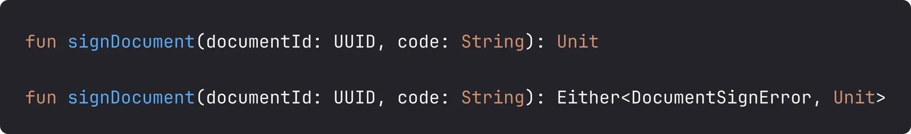{width=100 align=center}

위 시그니처를 보고 뭐가 잘못될 수 있는지 말해보라고 한다. 말할 수 없다. 그런데 서명 코드가 틀릴 수 있고, 서명 가능 기간이 지났을 수 있고, 이미 서명된 문서일 수 있고, DB가 죽어 있을 수도 있다. 이걸 알아내려면 구현을 열고, 그 구현이 부르는 서비스를 열고, 예외 핸들러와 라우트 매핑과 테스트와 OpenAPI 스펙까지 다 읽어야 한다. 정작 알려줬어야 할 시그니처만 빼고 전부. 오프닝의 `loadUser(id): User?`와 정확히 같은 문제다. 그가 원하는 시그니처는 아래쪽이다. 입력은 왼쪽에, 예상된 실패 타입과 성공 타입은 오른쪽에.

"functional error handling"이라는 말이 사람들을 겁먹게 한다는 점도 짚는다. 모나드와 카테고리 이론 강의를 기대하지만 그런 게 아니라고. 목표는 하나다. 시그니처만 봐도 어떻게 부르고 어떤 결과를 처리해야 하는지 알 수 있어야 하고, 본문에 아무것도 숨기지 않는다. 챕터 1에서 Arrow를 두고 "함수형이라는 이름 때문에 이론부터 배워야 할 것 같지만"이라고 쓴 것과 같은 말이다.

### 실패는 세 종류이고, 시그니처에 들어가는 건 하나뿐이다

이 글에서 가장 유용했던 부분이다. 그는 실패를 세 그룹으로 나눈다.

1. **API 클라이언트 오류**. 호출자가 API를 잘못 썼다. 깨진 JSON, 빠진 헤더, 순서가 뒤바뀐 요청. 정상적인 클라이언트라면 거의 만나지 않으니 도메인 모델에 하나씩 나열하지 않고 400, 403, 404 같은 거친 HTTP 응답으로 뭉뚱그린다.
2. **예상 밖의 예외**. DB가 죽었다, 의존성이 타임아웃됐다, NPE가 났다. 비즈니스 결과가 아니다. 아무도 "Postgres가 넘어졌을 때"의 사용자 흐름을 설계하지 않는다. 500과 로그와 메트릭과 온콜 호출이라는 운영 신호가 된다.
3. **도메인 오류**. 클라이언트가 전부 올바르게 했는데도 연산이 성공할 수 없다. 서명 코드가 틀렸다, 기간이 닫혔다, 이미 서명됐다. 실제 사용자가 아무 잘못 없이 만나는 실패이고, 디자이너가 각각의 화면을 갖고 있는 실패다.

시그니처에 들어가야 하는 건 세 번째뿐이다. 그리고 그는 두 번째를 첫 번째나 세 번째로 끌어들이는 실수를 자주 본다고 한다. `DatabaseUnavailable`을 에러 유니언에 넣는 식이다. 그건 던지게 두고 전역 핸들러가 잡게 하라고. HTTP 400은 도메인 개념이 아니지만 "서명 기간 종료"는 도메인 개념이라는 것이다.

발표의 세 갈래 표와 나란히 놓으면 대응이 거의 정확하다. 그의 도메인 오류가 내 "예상된 실패"이고, 예상 밖의 예외가 "깨진 전제"다. 그가 세 그룹을 제대로 나누면 설계의 대부분이 끝난 거라고 쓴 것도, 발표에서 "실패는 기술적 사건이 아니라 도메인 판단"이라고 한 것과 같은 결론이다. 다만 서버 글이라 코루틴 취소는 다루지 않는다. 모바일에서는 그 세 번째 줄이 가장 자주 틀리는 자리다.

한 가지는 그대로 옮기면 안 된다고 생각한다. 그는 네트워크가 끊긴 것을 두 번째 그룹에 넣는다. 서버 운영자에게 DB 장애는 알림과 조사가 필요한 사건이 맞다. 하지만 모바일 앱에서 오프라인은 사용 흐름의 일부다. 캐시를 보여주거나 사용자의 재시도를 기다려야 하는 화면이 있다. "기술적 원인이니 무조건 예외"로 분류하면 그 화면의 요구가 사라진다. 앞의 Signal 예시에서 언어팀이 `NetworkFailure`를 값으로 남긴 것과 이 글이 인프라 장애를 예외로 두는 것은 모순이 아니다. 어떤 계층의 어떤 소비자를 위한 계약인가가 다를 뿐이다. 기준은 원인의 이름이 아니라 **지금 이 계약을 소비하는 쪽이 어떤 구분을 필요로 하는가**다.

### sealed interface로 시작해서 Either에 도착한다

해결책은 익숙하다. 도메인 오류를 sealed interface로 만들고 `when`으로 받는다.

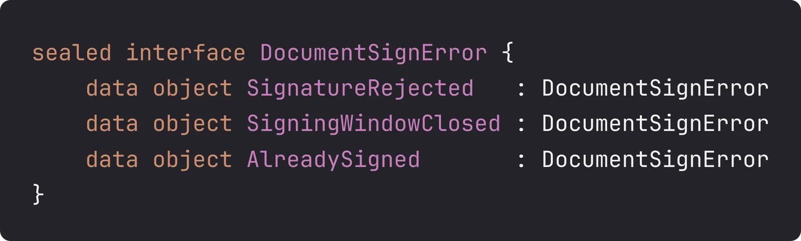{width=100 align=center}

네 번째 실패를 추가하면 이 `when`이 컴파일되지 않는다. 그가 "이게 게임의 전부"라고 부르는 지점이다. 컴파일러가 뭐가 실패할 수 있는지 알고, 잊어버리게 두지 않는다.

그다음은 "이 함수는 그 에러 아니면 성공을 돌려준다"를 표현할 방법이 필요하다. 손으로 래퍼를 만들 수도 있고 사람들이 실제로 결과 타입마다 그렇게 하는데, 금방 장황해진다. 그래서 제네릭 버전인 `Either`에 도달한다. 왼쪽이 실패, 오른쪽이 성공. 라이브러리 없이도 이해할 수 있는 두 갈래 sealed 타입에 `map`, `flatMap`, `fold`, `getOrElse` 정도의 헬퍼가 붙은 것이다. Java의 `Optional`은 왼쪽에 아무 정보도 없는 `Either`라는 비유도 좋았다.

읽으면서 챕터 1을 다시 쓰는 기분이었다. `null`로 부족해서 sealed로, sealed를 반복하다 제네릭 래퍼로. 그가 "You just reinvented Either"라고 소제목을 붙인 그 경로가 Kotlin 커뮤니티가 15년 동안 걸은 길이다. 그리고 그는 `Result`에 대해서도 발표와 같은 판단을 내린다. 왼쪽이 열려 있으면 얻는 게 없다는 것이다.

### 사람들이 잘못 만드는 두 가지 유니언

이 글의 실무적 핵심이다. 팀이 이 방식을 채택하면 거의 항상 두 가지 안티패턴이 나타나고, 둘 다 이점의 대부분을 없앤다고 한다.

첫째, `Either<Throwable, Unit>`. 타입이 붙은 것처럼 보이지만 "뭔가 실패할 수 있다"만 말한다. `Throwable`은 열린 타입이라 `when`에 항상 `else`가 필요하고, 결국 모르는 상태로 돌아간다. 그는 이것이 예외를 던지는 것과 본질적으로 같고, Kotlin의 `Result<T>`가 도메인 모델링에 권장되지 않는 이유라고 쓴다. 챕터 1의 "Result는 에러 타입을 적을 수 없다"와 같은 진단이다.

둘째, 반복을 줄이겠다고 클래스 전체가 공유하는 하나의 넓은 유니언.

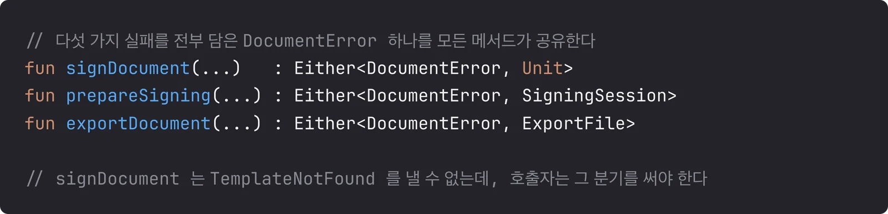{width=100 align=center}

컴파일러는 만족하지만 이제 모든 메서드가 모든 에러를 돌려주는 것처럼 보인다. `signDocument`는 절대 `TemplateNotFound`를 낼 수 없는데 모든 호출자가 그 분기를 써야 한다. 불가능한 가지로 가득한 exhaustive 처리다. 그의 표현으로는 타입을 뒤집어쓴 catch-all 프로그래밍이다. 해법은 공개 메서드마다 좁은 유니언을 하나씩 정의하는 것이다. `DocumentSignError`, `PrepareSigningError`, `ExportError`. 타이핑은 조금 늘지만 시그니처를 읽을 때마다 그 값을 한다고.

여기서 Rich Errors가 왜 typealias 조합을 택했는지가 다시 보인다. 챕터 3의 Signal 사례를 떠올려보자. 문제는 반복이었고, 반복을 없애는 가장 쉬운 방법은 이 글이 경고하는 두 번째 안티패턴, 즉 전역 `AppError` 하나로 통일하는 것이다. 그러면 선언은 간단해지지만 사용자를 읽는 함수의 결과에 결제 승인 실패까지 들어 있게 되고, 호출자는 시그니처를 믿는 대신 구현을 다시 확인한다. 타입은 있는데 계약은 여전히 모호하다.

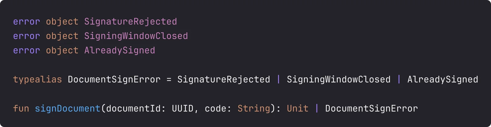{width=100 align=center}

Rich Errors의 답은 둘 다 잡는 것이다. 에러는 한 번 선언해서 공유하되, 함수마다 실패 목록은 따로 조합한다. 프로필 조회는 `NotFound | PermissionDenied`, 프로필 변경은 `PermissionDenied | InvalidNickname`. 공유하는 건 같은 의미로 쓰이는 `PermissionDenied`고, 각 작업의 실패 목록은 서로 다르다. sealed interface로 이걸 하려면 계층마다 새 클래스를 파야 하고, 그래서 Signal에서 `RateLimited`가 아홉 번 생겼다. 이 글이 "좁은 유니언을 메서드마다 하나씩"이라고 요구하는 규율을, Rich Errors는 typealias 한 줄의 비용으로 만들어주는 셈이다.

반대로 "프로젝트 전역에서 에러를 전부 공유한다"는 규칙도 과하다. 계정이 없는 것과 임시 파일이 없는 것은 둘 다 `NotFound`라고 이름 지을 수 있지만 변경 이유와 처리 정책이 다를 수 있다. 같은 의미로 함께 변할 지식인지 확인한 범위 안에서만 공유해야 한다. 타입의 중복을 줄이는 것보다 계약의 의미를 보존하는 것이 먼저다.

### 배관 없이 조합하기, 그리고 경계에서 한 번만 변환하기

실제 흐름은 여러 단계를 잇고 각 단계가 실패할 수 있다. `flatMap`으로 순진하게 짜면 람다가 단계마다 깊어진다. 그가 보여주는 탈출구는 둘이다. 순수 Kotlin의 조기 반환, 그리고 Arrow의 `either { }` 블록.

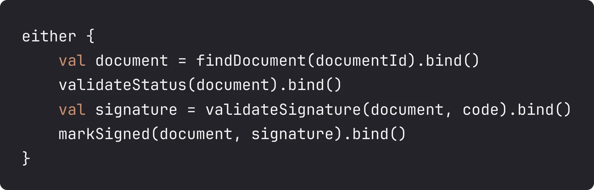{width=100 align=center}

`bind()`가 `Right` 값을 꺼내고 첫 `Left`에서 짧게 끝난다. Scala의 for-comprehension이 오래전부터 언어 안에 갖고 있던 아이디어다. 그리고 그는 이렇게 덧붙인다. 팀에 도움이 되면 Arrow를 쓰되, "I'd rather you adopt the discipline than the dependency." 의존성보다 규율을 채택하라는 것이다. 챕터 1에서 본 Arrow 도입 비용에 대한 실무자의 답이다. 그리고 챕터 2의 `|.`과 `ifError`가 하는 일이 정확히 이 `bind()`의 역할이라는 것도 눈에 들어온다. 라이브러리의 DSL 블록 안에서만 되던 일이 연산자 하나로 언어에 들어오는 것이다.

경계 이야기도 명확하다. 서비스와 저장소는 도메인 에러를 돌려주고, HTTP로 바꾸는 건 딱 한 곳, 라우트 경계에서만 한다. `mapLeft { it.toHttpResponse() }` 한 줄이다. 컨트롤러만 HTTP를 알고, 그 아래 계층은 비즈니스 결과로 말한다. 그리고 API 클라이언트를 서비스와 함께 배포한다면 에러 타입도 같이 배포하라고 한다. 그러면 클라이언트가 서버와 같은 sealed 유니언으로 실패를 처리하고 둘이 공짜로 일관성을 유지한다. 모바일 팀 입장에서는 상당히 매력적인 제안이다. 서버의 404를 앱에서 다시 "사용자 없음인지 엔드포인트 없음인지" 추측하는 일이 없어지기 때문이다.

### 리뷰의 단위는 구현이 아니라 계약이다

마지막 절이 발표의 챕터 4와 겹친다. 실패가 시그니처에 있으면 리뷰어는 구현을 파헤치는 고고학 대신 계약에서 시작할 수 있다. 에러 유니언이 바뀌었나? API 오용을 도메인 에러로 포장하지는 않았나? 새 실패는 HTTP에 매핑되나? 본문을 열기 전에 인터페이스만 읽고 답할 수 있는 질문들이다.

그리고 그는 코드의 상당 부분을 에이전트가 초안하는 지금 이 민첩함이 더 중요해졌다고 쓴다. 모델이 구현을 쓸 때 명시적 계약은 그 구현이 옳은지 확인하는 가장 싼 방법이다. 밑에 깔린 200줄이 아니라 타입을 읽는다. 에이전트 지시 파일에 "예상된 실패는 던지지 말고 타입 있는 에러 유니언을 돌려줘라"라고 적으면 모델은 대체로 따르지만, 검증하는 방법은 산문을 믿는 게 아니라 계약을 읽는 것이라고. 그의 팀에서는 이게 개인 취향이 아니라 공유된 기본값이라고 한다. 계약이 리뷰의 단위이고, 생성된 구현이라고 그 기준이 낮아지지 않는다. 어떤 실패를 낼 수 있는지 결정하는 건 판단의 문제이고, 시그니처는 그 판단이 적히는 자리다. 다음 사람 혹은 다음 에이전트가 존중해야 하도록. 그의 말로는 시그니처가 소유권이 사는 곳이다.

발표에서 "문서는 지도, 타입은 계약"이라고 했던 말을 서버 쪽 실무자가 거의 같은 문장으로 쓰고 있었다. 규칙 파일에 적는 것은 발견 가능성을 높이고, 시그니처는 강제한다. 그리고 그도 정직한 트레이드오프를 숨기지 않는다. 타입이 늘고 매핑 코드가 늘고 시그니처가 길어진다. 하지만 그 복잡성은 원래 거기 있었다. 서명 기간은 언제나 닫힐 수 있었고 코드는 언제나 틀릴 수 있었다. 이 접근은 그 복잡성을 숨어 있던 구현에서 꺼내, 이름이 붙고 테스트되고 보이는 타입으로 옮길 뿐이다. 발표 준비 중 Signal의 125개 sealed 타입을 보며 "이미 지불하고 있던 비용"이라고 생각했던 것과 같은 결론이다.

이 글에서 얻은 건 Rich Errors를 반드시 도입해야 한다는 확신이 아니었다. **새 문법이 오기 전에도 계약을 더 정확하게 만들 수 있다는 기준**, 그리고 그 기준을 지키는 데 지금 드는 비용이 정확히 어디에서 발생하는지였다. 발표는 그 비용을 언어가 얼마나 줄여줄 수 있는가에 대한 이야기였고, 이 글은 현재의 도구로도 그 판단을 미루지 말자는 실무적 연결점이 돼 주었다. 글의 마지막 문장을 요약하면 이렇다. `Unit`을 돌려주면서 몰래 던지는 시그니처는 자기가 뭘 하는지 거짓말을 하고 있으니, 시그니처가 진실을 말하게 하라.

## 마치며

발표를 준비하기 전에는 Rich Errors를 성공 래퍼와 반복 선언을 줄여주는 편의 기능 정도로 봤다. 명세와 토론과 실제 앱의 코드를 같이 읽고 나니 더 중요한 건 줄어드는 줄 수가 아니라 **정확한 실패 계약을 유지하기가 얼마나 쉬워지는가**였다.

`null`은 이유가 중요하지 않은 부재를 간결하게 표현한다. sealed 타입과 Arrow는 지금도 실패를 명확하게 모델링할 수 있다. `Result`는 성공이나 예외를 나르는 데 유용하다. Rich Errors는 이 도구들이 이미 풀어온 문제 위에서, 실패의 표현과 조합을 Kotlin의 문법과 타입 시스템으로 가져오려 한다. 대가로 상속, 타입 추론, 호환성 같은 제약이 따라온다. traceability처럼 안전성을 어디까지 강제할지 의견이 갈리는 부분도 있다. 그래서 지금은 찬성이나 반대를 서둘러 정하기보다 기대되는 효과와 남은 문제를 같이 보는 편이 좋다고 생각한다. 실제 코드의 구체적인 사례가 이런 논의에 도움이 되는 이유다. 그리고 완성된 뒤에는 튜토리얼이 백 개 생기겠지만, 설계에 참여할 수 있는 건 지금뿐이다.

개인적으로는 내 규칙 파일에 에러 처리 기준이 빠져 있었다는 발견이 가장 실용적인 숙제로 남았다. Rich Errors를 당장 쓸 수 없어도 다음에 만드는 함수부터 "실패하면 호출자가 무엇을 해야 하는가?"를 먼저 적어볼 수 있다. 그 질문에 답하는 데는 새 키워드가 필요 없다.

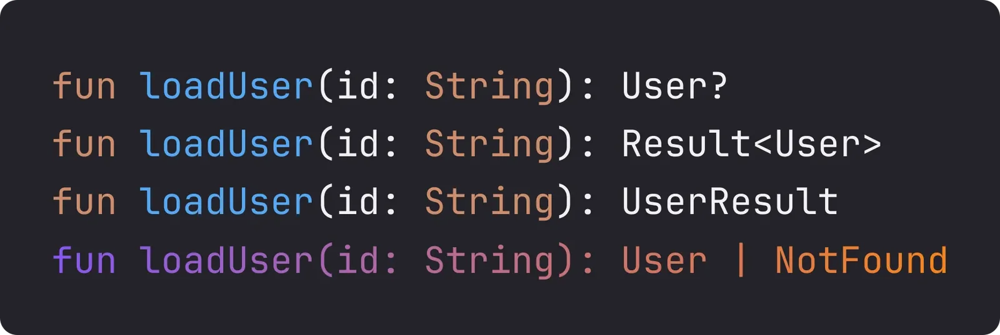{width=100 align=center}

처음 질문으로 돌아가자. 이 함수, 실패하면 어떻게 되나요. 15년 동안 우리는 `null`로, `Result`로, 화면마다 만든 sealed class로 대답해 왔다. 마지막 줄에서는 아무도 대답할 필요가 없다. 시그니처가 이미 대답하고 있으니까. 그리고 이 줄을 읽는 게 이제 사람만이 아니다.

AI가 구현을 더 많이 맡을수록 개발자가 정의해야 할 것이 선명해진다. 무엇을 성공으로 볼지, 어떤 실패를 구분할지, 어디서 멈추고 어디서 다시 시도할지. 좋은 타입은 컴파일러를 위한 제약이기 전에, 사람과 AI가 함께 읽는 압축된 도메인 지식이다.

> 실패를 정의할 수 있어야, AI가 성공을 구현할 수 있다.

### 4줄 요약

- Kotlin은 checked exception을 버린 뒤 15년 동안 실패를 반환 타입에 적는 전용 문법이 없었다. `null`, sealed, `Result`, Arrow는 전부 각자 조합한 우회였다.
- Rich Errors는 `error`, `|`, `|.` 세 문법으로 실패를 반환 타입에 적는다. 상속과 제네릭을 막은 대가로 래퍼 없는 표현과 다항 시간 타입 추론을 산다.
- 아직 못 쓴다. 이슈 트래커에 2.5.0 목표가 있지만 명세는 Public discussion이고 두 달 전에도 크게 바뀌었다.
- 문법보다 먼저 할 일은 실패를 "호출자의 다음 행동" 기준으로 나누고 계약에 적는 것이다. JetBrains 블로그의 실무자 글도 같은 결론을 sealed와 `Either`로 보여준다.

## 참고 자료

- [KEEP-0441 · Rich Errors Motivation and Rationale](https://github.com/Kotlin/KEEP/blob/main/proposals/KEEP-0441-rich-errors-motivation.md)
- [KEEP-0462 · Rich Errors Design Proposal](https://github.com/Kotlin/KEEP/blob/main/proposals/KEEP-0462-rich-errors.md)
- [KEEP Discussion #487](https://github.com/Kotlin/KEEP/discussions/487)
- [Design Notes 0009 · Evaluating Rich Errors in the Wild](https://github.com/Kotlin/KEEP/blob/main/notes/0009-rich-errors-use-cases.md)
- [KT-68296 · Union Types for Errors](https://youtrack.jetbrains.com/issue/KT-68296)
- [KT-7128 · Multi-catch](https://youtrack.jetbrains.com/issue/KT-7128)
- [JetBrains Kotlin Blog · Signatures, be true: domain errors and functional handling in Kotlin (Sergey Chernov)](https://blog.jetbrains.com/kotlin/2026/08/signatures-be-true-domain-errors-and-functional-handling-in-kotlin/)
- [Kotlin · Exception and error handling](https://kotlinlang.org/docs/exceptions.html)
- [Kotlin · Result API](https://kotlinlang.org/api/core/kotlin-stdlib/kotlin/-result/)
- [Kotlin · runCatching API](https://kotlinlang.org/api/core/kotlin-stdlib/kotlin/run-catching.html)
- [kotlinx.coroutines · withTimeoutOrNull](https://kotlinlang.org/api/kotlinx.coroutines/kotlinx-coroutines-core/kotlinx.coroutines/with-timeout-or-null.html)
- [Kotlin · Cancellation and timeouts](https://kotlinlang.org/docs/cancellation-and-timeouts.html)
- [Arrow · From Either to Raise](https://arrow-kt.io/learn/typed-errors/from-either-to-raise/)
- [Arrow · Working with typed errors](https://arrow-kt.io/learn/typed-errors/working-with-typed-errors/)
- [Anthropic · Prompting Claude Opus 5](https://platform.claude.com/docs/en/build-with-claude/prompt-engineering/prompting-claude-opus-5)
